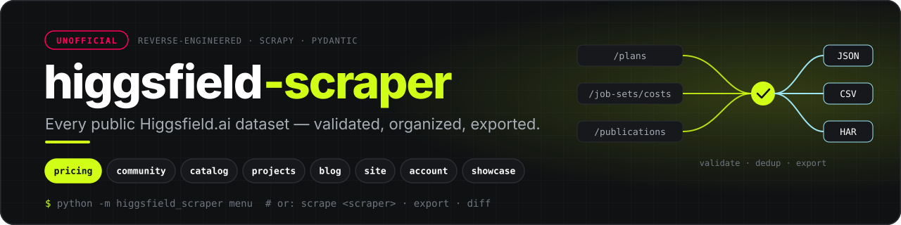
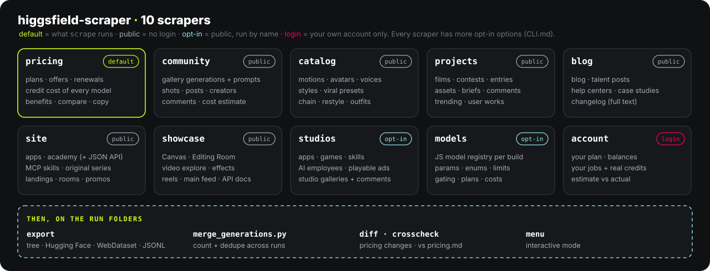
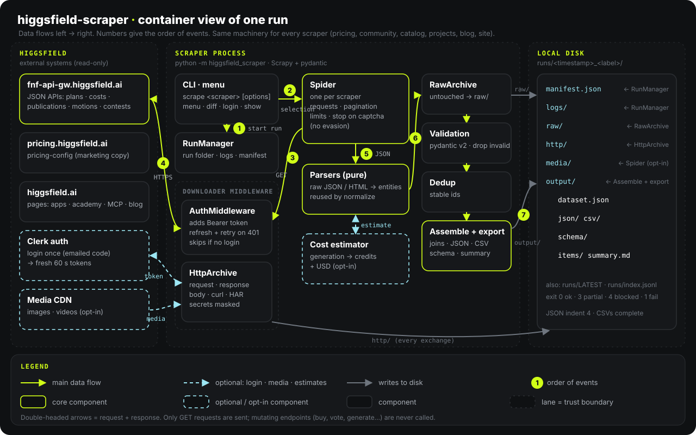

<p align="center">
  <picture>
    <source media="(prefers-color-scheme: dark)" srcset="docs/assets/banner-dark.svg">
    <source media="(prefers-color-scheme: light)" srcset="docs/assets/banner-light.svg">
    
  </picture>
</p>

<p align="center">
  
  
  
  
  
</p>

# higgsfield-scraper

Scrapy scrapers for **public [Higgsfield.ai](https://higgsfield.ai) data**: prices, model credit costs, community
generations (prompt + model + settings + estimated cost) and community pages (shots, posts, Feed, creators and their
works, comments, rooms), preset/asset catalogs, projects & contests down to every asset, brief and comment, the blog /
help center, site pages (apps, academy, MCP skills, original series, landings), showcase/example content (Canvas
templates, Editing Room, Property Studio, video explore, effect samples, reels, the home feed, API models), the
**studios & marketplaces** (community apps, games, skills, AI employees, Playable Ads, AI Influencer, every studio's
published outputs) and the **model registry** read from the site's JS bundle; plus an opt-in `account` scraper for
*your own* balances and jobs (login required). **10 scrapers.** Data comes from the site's JSON
APIs wherever they exist (embedded page data or HTML only for page-only content), is validated with pydantic, and lands in
a timestamped run folder as indented JSON, complete CSVs, JSONL feeds and a full HTTP archive. The `export` command
turns run folders into browsable folders or ready-to-load datasets (Hugging Face, WebDataset, JSONL).

Two ways to drive it: a **flag CLI** for scripts/CI, and an **interactive menu** (Rich + questionary) with multi-select,
option editing, login with emailed code, a test request and a live progress panel.

> **Unofficial.** Not affiliated with Higgsfield. The APIs are undocumented and may change at any time. Only public
> data is collected by default; login-only data uses *your own* account. No captcha/bot-protection bypass, no purchase
> or write endpoints — every request is a `GET` (login uses the normal Clerk sign-in).

**All documentation, organized by topic: [`docs/README.md`](docs/README.md)** (index with what each doc contains and when to read it).

| Doc | Contents |
|---|---|
| [`CLI.md`](CLI.md) | **Every command and option**, interactive mode, recipes, exit codes |
| [`docs/scrapers/`](docs/scrapers/) | One page per scraper: [community](docs/scrapers/community.md) · [catalog](docs/scrapers/catalog.md) · [projects](docs/scrapers/projects.md) (incl. the nested data model) · [blog](docs/scrapers/blog.md) · [site](docs/scrapers/site.md) · [account](docs/scrapers/account.md) · [showcase](docs/scrapers/showcase.md) · [studios](docs/scrapers/studios.md) · [models](docs/scrapers/models.md) · [cost estimate](docs/scrapers/cost-estimate.md) |
| [`docs/CONTENT_MAP.md`](docs/CONTENT_MAP.md) | **Every content source on the site** (videos, images, audio, templates, prompts, models, users, comments), visibility, live totals, and which option covers it; "scrape everything" sizes |
| [`docs/COMPLETENESS.md`](docs/COMPLETENESS.md) | Completeness audit: is anything dropped between `raw/` and `output/`, per product and model; fix list (#1–#17 done) |
| [`docs/EXPORT.md`](docs/EXPORT.md) | The `export` command: layouts (tree, Hugging Face, WebDataset, JSONL), dedup, idempotent writes, loading examples, privacy and licensing |
| [`docs/COMMUNITY_COVERAGE.md`](docs/COMMUNITY_COVERAGE.md) | Every Community page (Feed, Shots, Creators, Rooms, …): endpoints, JS evidence, totals, data model, logged-in check, how to scrape it all |
| [`docs/ENGAGEMENT.md`](docs/ENGAGEMENT.md) | Likes, views, comments, votes: where each count lives, public or not, old vs new items, how to track them over time |
| [`docs/ENDPOINTS.md`](docs/ENDPOINTS.md) · [`docs/ENDPOINT_FIELDS.md`](docs/ENDPOINT_FIELDS.md) | Pricing endpoints, params, field meanings (generated field list) |
| [`docs/REVERSE_ENGINEERING.md`](docs/REVERSE_ENGINEERING.md) | How every endpoint was found, the Clerk login flow, evidence |
| [`docs/MODEL_LOADING.md`](docs/MODEL_LOADING.md) | How each tool loads its models: JS model registry, feature flags, per-model param schemas, cost formulas, job create/poll flow (Seedance 2.5 deep dive) |
| [`docs/PRICING.md`](docs/PRICING.md) | **Pricing & plans, standalone**: lookup table vs formula, every endpoint with raw JSON and every key, plan math (offers, discounts, renewal, $/credit), all 25 plan sets, benefits, generated current price snapshot (`scripts/gen_pricing_snapshot.py`) |
| [`docs/COST_FORMULAS.md`](docs/COST_FORMULAS.md) | **How credits and cost are calculated**: every model's formula, variables, rounding, discounts, unlimited/free gens, credits→USD, worked scenarios, Seedance / GPT Image variation tables (generated by `scripts/gen_cost_tables.py`) |
| [`docs/PRODUCTS.md`](docs/PRODUCTS.md) | Every product → raw model ids (`job_set_type`) → provider (ByteDance, Google, OpenAI, …) → endpoint, params, examples; catalog of 175 job types (`scripts/gen_model_catalog.py`) |
| [`docs/PROVIDERS.md`](docs/PROVIDERS.md) | **Where models come from**: maker of each model, where it runs (vendor API, cloud, in-house), evidence (upstream billing records, JS, official text), is it fal/Replicate? (no evidence found) |
| [`docs/JOBS_AND_STORAGE.md`](docs/JOBS_AND_STORAGE.md) | Job / job set / publication ids, lifecycle (upload → create → SSE status → result), CDN storage, library, chains, workflows, Canvas |
| [`docs/products/EDITING_ROOM.md`](docs/products/EDITING_ROOM.md) · [`PROPERTY_STUDIO.md`](docs/products/PROPERTY_STUDIO.md) | Editing Room (AI re-shoot editor: tools, timeline model, server rendering, autosave, credits) · Property Studio (floor plan → narrated 3D walkthrough chain, review gates, endpoints) |
| [`docs/HIGGSFIELD_DATA_INVENTORY.md`](docs/HIGGSFIELD_DATA_INVENTORY.md) | Everything on Higgsfield: features, routes, APIs, public vs login |
| [`docs/LOGIN_COVERAGE.md`](docs/LOGIN_COVERAGE.md) | Login audit: what a session really unlocks (extra `lite` plan and `magi_2` cost row, the account's own money state and jobs), every probed login endpoint, service prefixes, implementation status |
| [`docs/ADDING_A_SCRAPER.md`](docs/ADDING_A_SCRAPER.md) | The scraper contract — how to add a new one |
| [`docs/higgsfield.postman_collection.json`](docs/higgsfield.postman_collection.json) | 164 requests in 10 folders (pricing, community, catalog, projects, blog, site, showcase, studios, models + login), generated by `scripts/make_postman.py` |

---

## Contents

1. [What it scrapes](#1-what-it-scrapes) · 2. [Setup](#2-setup) · 3. [Quick start](#3-quick-start) ·
4. [Interactive mode](#4-interactive-mode) · 5. [Login](#5-login-optional) · 6. [Options](#6-options) ·
7. [Run folders & output](#7-run-folders--output) · 8. [Export](#8-export-datasets-from-run-folders) ·
9. [Logging](#9-logging--observability) · 10. [Cost estimates](#10-cost-estimate-per-generation) ·
11. [Privacy & safety](#11-privacy--safety) · 12. [Architecture](#12-architecture) · 13. [Testing](#13-testing) ·
14. [Contributing](#14-contributing)

## 1. What it scrapes

<p align="center"></p>

By category (what you get, which scraper, the command). Everything is public unless marked; every opt-in is off by
default, so default runs never change. Where every piece of content on the site lives and which option covers it:
[`docs/CONTENT_MAP.md`](docs/CONTENT_MAP.md).

| Category | Data | Scraper · command |
|---|---|---|
| **Pricing, plans & credits** | Plans (USD before/after offer, renewal, discounts, $/credit), the credit cost of every model, benefits, comparison matrix, marketing copy, 25 regional plan sets; opt-in logged-in rows (`lite`, `magi_2`); `diff` and `crosscheck` against the official `pricing.md` | `pricing` · `scrape pricing --sections all` |
| **Community & creators** | Gallery generations (model, prompt, settings, inputs, results, likes/views, estimated cost); opt-in Community pages: shots (+ model facets), posts, the Feed, creator/talent stats **and every showcased work in full**, comment threads of shots/projects/blogs/posts, Feed hashtag categories; one pseudonymous `creator_uid_key` per user across all scrapers | `community` · `scrape community --max-items 300` · `scrape community --feeds shots,posts,feed,creators,talents --with-comments` |
| **Templates, presets & catalog** | Motions, avatars, voices, sounds, styles, viral-hub presets (price matrices), soul/marketing/katana/mixed-media presets, chain presets (credit prices), notices, restyle presets, outfit characters; music cards, collections and explore cards (`community --feeds`) | `catalog` · `scrape catalog --kinds all` · `--kinds outfit_character` |
| **Projects & contests** | Project publications, recommended and **trending** feeds (ranking + total), contests (rules, prizes, judges, winners), submissions and entries, contest participation counters, original series; opt-in per project: folders, **every asset with prompt and model**, the brief as Markdown, stats + model stack, comments, related projects; contests by slug, a user's projects, **the published works and stats of users found in the run** | `projects` · `scrape projects --what all,trending,contest-participation` · `--with-project-assets --with-project-brief --with-user-works` |
| **Studios & marketplaces** | Community apps marketplace (~59.6k apps: views, likes, dislikes, remixes, credits used), games (plays), skills and AI employees (installs, usage), Playable Ads presets, AI Influencer builder options, the published outputs of every studio (Marketing Studio, Cinema Studio, Canvas, AI Influencer, …) with likes/views and comments | `studios` · `scrape studios` · `scrape studios --what galleries --with-comments` |
| **Showcase, reels & main feed** | Canvas templates, Editing Room examples (edits + renders), Property Studio presets, video explore (~49k community items with likes), effect sample generations + effect presets (price matrices), public API models (83 endpoints, parameters, prices), Cinema Studio controls, faceless / Intone / Seedance / motion-control showcases; opt-in Shorts Studio reels presets + comments and the home **main feed** | `showcase` · `scrape showcase` · `scrape showcase --what reels_presets,reels_comments,main_feed` |
| **Models** | The model registry from the site's public JS bundle (~130 job types: parameter schema with enums / ranges / defaults, media roles and limits, routes, plan tiers, feature-flag gating, featured order, picker menus), joined with the credit costs and the published-shots facet; one record per frontend build | `models` · `scrape models` |
| **Blog, site & academy** | Blog posts, talent and community posts, Creator Hub and Enterprise help centers, case studies, changelog (full text, Markdown); apps (+ credit cost per template), academy courses and lessons (+ the academy JSON API: free generations, tests, MDX lessons), MCP skills + bundles, original-series episodes, mixed-media presets, ~165 landing/plugin pages, promo APIs; opt-in community rooms (88 rooms, their works and discussions) | `blog` · `scrape blog` · `site` · `scrape site --what all,room-content,academy-api` |
| **Your account** (login) | Your plan, balances, wallet, subscription, auto top-up; your jobs with the credits actually charged; estimate-vs-actual check | `account` · `scrape account --with-jobs` |
| **Export, dedupe, diff & menu** | `export` turns runs into browsable folders or datasets (tree, Hugging Face, WebDataset, JSONL); `scripts/merge_generations.py` counts and dedupes every video/image across runs (likes/views deltas with `--compare`); `diff` / `crosscheck` for pricing; an interactive `menu` | [§8](#8-export-datasets-from-run-folders) · `export --run runs/<id> --layout hf` · `menu` |

Per scraper:

| Scraper | Data | Login needed? |
|---|---|---|
| **`pricing`** (default) | Every plan with USD prices before/after offer and on renewal, discounts, $/credit; the **credit cost of every model** (≈95 models × every resolution/quality/mode/audio option); plan benefits, comparison matrix, marketing copy; 25 regional plan sets. Opt-in: `--logged-in-prices` (the rows only logged-in users see: `lite` annual plan, `magi_2`), `--sections account` (your wallet, subscription, top-up settings) | No (top-ups / bundles / credit price, `--logged-in-prices`, `--sections account`: yes) |
| **`community`** | Community generations: model (`job_set_type`), **prompt**, settings, inputs, result media, engagement; feeds `trending`, `approved`, `top`, `model-x`; optional detail, creator profiles (opt-in), comments, and an **estimated credit + USD cost per generation**; opt-in Community pages `--feeds shots,posts,feed,creators,talents` (creators/talents with every work in full) and their comment threads (`--with-comments`); opt-in `--feeds music-cards,job-showcase,collections,explore-cards,feed-categories` | No |
| **`catalog`** | Presets & assets: motions (+ samples, details), avatars, voices, reference voices, sounds, styles, soul samples, viral-hub types & presets (with price matrices); opt-in group (`--kinds login`): soul styles, per-model motions, mixed media, katana, faceless, marketing presets (public CMS lists), color presets and camera settings (login); opt-in public kinds: **chain presets with credit prices**, per-model **notices**, **restyle presets**; name-only `outfit_character` | Only color presets / camera settings |
| **`projects`** | Community projects (films / series / carousels), recommended feeds, contests (rules, rewards, judges, winners) and contest submissions; original series from the public `fnf-series` service with `--public-series`; opt-in nested project data (`--with-project-assets/-brief/-stats/-comments/-related`), `--contest <slug>`, `--contest-tabs`, `--users <handle>`; opt-in `--what trending,contest-participation` and `--with-user-works` | No |
| **`blog`** | Blog posts + authors, talent/community posts, Creator Hub help center, case studies, changelog, Enterprise help — metadata **and full article text** (Markdown + plain text) | No |
| **`site`** | Site pages nothing else covers: **apps** (templates + **credit cost per generation**), **academy** courses + lessons (Markdown), **MCP** skills + bundles (agent prompts, example conversations), **original-series** films/episodes (views, likes), mixed-media presets, ~165 model/feature/plugin **landing pages** (Markdown, FAQ, HowTo), optional community rooms (`--what rooms` page titles, `room-list` all rooms with counts, `room-content` + their works and discussions) and the academy JSON API (`--what academy-api`); plus the public promo APIs (sale schedule, business unlimited offers, game-gift networks) | No |
| **`showcase`** | Example / showcase content: Canvas templates, Editing Room examples (edits, renders), Property Studio presets, video explore (categories, curated and ~49k community items with likes, variants with prompts), effect sample generations + effect presets, public API models (parameters, prices), Cinema Studio controls, faceless / Intone / Seedance / motion-control showcases; opt-in Shorts Studio reels presets + comments (`--what reels_presets,reels_comments`) and the home main feed (`--what main_feed`, by name only) | No (opt-in `season`: yes) |
| **`studios`** (opt-in) | Studio & marketplace content: community apps (+ views / likes / dislikes / remixes / credits), games (+ plays), skills & AI employees (+ installs / usage), Playable Ads presets, AI Influencer options, published outputs of every studio (+ likes / views, optional comments). Options `--what`, `--apps-sort`, `--studios`, `--gallery-feeds`, `--gallery-pages`, `--with-comments`, `--lang` | No |
| **`models`** (opt-in) | Model registry from the public JS bundle (~130 job types with params schema, enums, ranges, defaults, media roles / limits, routes, plan tiers, flag gating, featured order, picker menus) + `/job-sets/costs` + the Shots `available_models` facet; build id recorded. Options `--pages`, `--max-chunks`, `--no-costs`, `--no-shots` | No |
| **`account`** (opt-in) | **Your own** account: plan, balances (credits), wallet, subscription, auto top-up, free gens, generation seconds; `--with-jobs` your jobs with the **credits actually charged**; `--compare-estimate` checks the cost estimator against those charges. Never part of a default run; field whitelists, hashed job ids, prompts redacted unless `--with-prompts` | **Yes** |

Run `python -m higgsfield_scraper scrapers` to list them with examples.

## 2. Setup

```bash
# Python 3.10+
git clone https://github.com/workingshady/higgsfield-scraper.git
cd higgsfield-scraper
python -m venv .venv
.venv\Scripts\activate                 # Windows    (Linux/macOS: source .venv/bin/activate)
pip install -r requirements-dev.txt    # runtime + tests + interactive menu (rich, questionary)
# or: pip install -e ".[interactive]"  -> also adds a `higgsfield-scraper` command
cp .env.example .env                   # optional: login + defaults (see §5)
```

Check it works (offline, no network):

```bash
python -m pytest -q
python -m higgsfield_scraper scrape --dry-run          # requests a pricing run would make
python -m higgsfield_scraper show-config               # resolved settings, secrets redacted
```

## 3. Quick start

```bash
# Pricing (default scraper — `scrape` alone == `scrape pricing`)
python -m higgsfield_scraper scrape --sections all --label full
python -m higgsfield_scraper show plans
python -m higgsfield_scraper show model seedance_2_5   # every option combination + credits + ≈USD
python -m higgsfield_scraper diff                      # what changed vs the previous pricing run
python -m higgsfield_scraper crosscheck                # compare with the official pricing.md

# ALL prices and plans: 25 price lists, all marketing versions, hidden plans
# (+ login-only top-ups/bundles when logged in, see §5; add --auth required to insist on login)
python -m higgsfield_scraper scrape pricing --sections all --plan-sets all --marketing-versions all --include-hidden-plans --include-raw-cost --label all-prices

# Community generations with prompts and estimated cost
python -m higgsfield_scraper scrape community --max-items 300 --estimate-cost all

# Catalogs, projects/contests, blog
python -m higgsfield_scraper scrape catalog --kinds motion,voice,sound
python -m higgsfield_scraper scrape projects --what contests --with-details --with-submissions
python -m higgsfield_scraper scrape blog --what help,changelog
python -m higgsfield_scraper scrape site --what apps,academy      # apps (+ credit cost), courses + lessons
python -m higgsfield_scraper scrape site --what mcp                # all MCP skills + bundles + prompts

# Opt-in public extras: chain-preset credit prices, notices, restyle presets; original series
python -m higgsfield_scraper scrape catalog --kinds chain_preset,notice,restyle_preset --include-hidden
python -m higgsfield_scraper scrape projects --what series --public-series

# With a login (see §5): logged-in-only price rows, your own account
python -m higgsfield_scraper scrape pricing --sections all --logged-in-prices
python -m higgsfield_scraper scrape account --with-jobs --max-items 50

# Community pages, nested projects, rooms, showcase (all opt-in, public)
python -m higgsfield_scraper scrape community --feeds shots,posts,feed --max-items 50 --with-comments
python -m higgsfield_scraper scrape projects --what contests --contest talent-contest --with-submissions --max-submissions 5 --with-project-assets --with-project-brief --with-project-stats
python -m higgsfield_scraper scrape site --what room-content
python -m higgsfield_scraper scrape showcase

# Studios & marketplaces, the model registry (opt-in scrapers, public)
python -m higgsfield_scraper scrape studios --what apps,games,skills,employees --max-items 200
python -m higgsfield_scraper scrape studios --what galleries --studios marketing_studio --with-comments
python -m higgsfield_scraper scrape models                          # ~800 requests, ~16 min

# More opt-in extras (selected by name only)
python -m higgsfield_scraper scrape community --feeds music-cards,collections,explore-cards,feed-categories
python -m higgsfield_scraper scrape showcase --what main_feed,reels_presets
python -m higgsfield_scraper scrape projects --what trending,contest-participation --max-pages 2
python -m higgsfield_scraper scrape site --what academy-api
python -m higgsfield_scraper scrape catalog --kinds outfit_character

# Scrape everything: every public scraper, one run folder each (account is login-only, run it separately)
for s in pricing community catalog projects blog site showcase studios models; do python -m higgsfield_scraper scrape $s --label all-$s; done
# + the opt-in extras: see CLI.md "Scrape everything (all 10 scrapers)"

# Export a run as a browsable folder / dataset, and count + dedupe all videos and images across runs
python -m higgsfield_scraper export --run runs/<run-id>                 # website-like tree under exports/
python -m higgsfield_scraper export --run runs/<run-id> --layout hf     # Hugging Face ImageFolder / VideoFolder
python scripts/merge_generations.py --latest community,catalog,projects,site,showcase,studios

# Past runs
python -m higgsfield_scraper runs
python -m higgsfield_scraper normalize --run runs/<run-id>    # re-parse raw/ offline (after a parser change)
```

## 4. Interactive mode

```bash
python -m higgsfield_scraper          # no arguments in a terminal -> menu
python -m higgsfield_scraper menu     # explicit (alias: -i / --interactive)
```

```
┌───────────────────────────────── higgsfield-scraper 0.1.0 · interactive ─────────────────────────────────┐
│ scrapers: pricing · community · catalog · projects · blog · site · account · showcase · studios · models │
│ session:  not logged in                                                                                  │
│ Ctrl-C = back · flags: python -m higgsfield_scraper --help                                               │
└──────────────────────────────────────────────────────────────────────────────────────────────────────────┘
? What do you want to do?
 » Scrape                     pick scrapers, options, run
   Normalize a past run       re-parse raw/ offline
   Browse runs                table, summaries, errors
   Login / session            status, log in, log out
   Pricing tools              diff two runs, cross-check pricing.md
   Test request               one GET of a public endpoint
   Show config                resolved settings (secrets hidden)
   Clean old runs             dry run first, then confirm
   Settings / prefs           remembered choices
   Quit
```

Before running, a review screen shows every chosen scraper, its label, the changed options and the **equivalent flag
commands** (copy them into scripts):

```
┌─────────────────────────── equivalent commands ───────────────────────────┐
│ python -m higgsfield_scraper scrape pricing                               │
│ python -m higgsfield_scraper scrape community --type video --max-items 10 │
└───────────────────────────────────────────────────────────────────────────┘
? Proceed?  » Run / Dry run (print the first requests) / Edit options / Cancel
```

- **Fully dynamic:** scrapers and their options are read from the registry and each scraper's argparse options
  (choices → select, flags → yes/no, numbers → validated input), so a newly added scraper shows up with no menu changes.
- Multi-select scrapers → *quick (defaults)* or *customize* → run label → review → run. Each scrape runs in its own
  child process (Scrapy's reactor starts once per process) with a live Rich panel: requests, HTTP codes, items per
  kind, retries, errors, elapsed. Ctrl-C cancels the crawl (status `cancelled`, exit 130) and returns to the menu.
- Login with masked password (or `HF_PASSWORD` without showing it) and 6-digit code validation; logout asks first.
- Remembers your last scrapers, options and label (`%APPDATA%\higgsfield_scraper\prefs.json`, override with `HF_PREFS`;
  never stores secrets).
- Without a terminal (pipes, cron, `CI`, `HF_NO_MENU=1`) no-args still runs the pricing scrape exactly as before;
  `menu` without a terminal (or without questionary, e.g. plain Git Bash/mintty) prints a hint and exits 2 —
  use Windows Terminal / PowerShell / cmd for the menu.

## 5. Login (optional)

Public data needs nothing. Login unlocks (audit: [`docs/LOGIN_COVERAGE.md`](docs/LOGIN_COVERAGE.md)):

- pricing top-ups / bundles / adjustable credits (`auth` section);
- the price rows only logged-in users see: a `lite` annual plan ($12/year) and a `magi_2` cost row
  (`--logged-in-prices`, opt-in);
- your own account: wallet, subscription, auto top-up (`--sections account`, opt-in) and the `account` scraper
  (snapshot, your jobs with the credits actually charged, estimate-vs-actual check);
- the color-preset / camera-setting catalogs.

(Community comments, the other opt-in catalogs (soul styles, per-model motions, mixed media, katana, faceless,
marketing presets), chain presets, notices, restyle presets and the original series turned out to be **public**; see
[`docs/scrapers/catalog.md`](docs/scrapers/catalog.md) and [`docs/scrapers/projects.md`](docs/scrapers/projects.md).) Higgsfield uses **Clerk**; the scraper keeps a long-lived Clerk client cookie and mints fresh ~60-second
session tokens automatically, refreshing and retrying once on `401`.

| Option | Put in `.env` | Notes |
|---|---|---|
| **A — email + password** (recommended) | `HF_EMAIL`, `HF_PASSWORD` | One-time emailed code on a new device, then automatic for up to ~400 days |
| **B — browser cookie** | `HF_CLERK_CLIENT` | Value of the `__client` cookie (DevTools → Application → Cookies → higgsfield.ai). Use for Google/Apple accounts |
| **C — one-off JWT** | `HF_TOKEN` | The `__session` cookie; expires in ~60 s, no refresh |

```bash
python -m higgsfield_scraper login                 # step 1: Clerk emails a 6-digit code
python -m higgsfield_scraper login --code 123456   # step 2: session cached in runs/.auth/clerk_client.json
python -m higgsfield_scraper auth-check            # "ok": true   (--json for scripts)
```

Every scrape has `--auth auto|off|required` (default `auto`: use a session if one is configured, skip login-only
endpoints cleanly otherwise). Secrets are never printed or logged; `.env` and `runs/.auth/` are gitignored.

Once logged in, just run the normal commands: the login is used automatically. For example, all prices **plus** the
login-only pricing data:

```bash
python -m higgsfield_scraper scrape pricing --sections all --plan-sets all --marketing-versions all --include-hidden-plans --include-raw-cost --label all-prices
```

What logging in adds for pricing (verified 2026-11-26, personal account): **credit top-up packs** (6 packs, 100–4,000
credits, e.g. 100 credits = $6.25), **adjustable credit tiers** (12 slider tiers) and the **unlimited bundle catalog**.
`/workspaces/credit-price` only works for team workspaces (500 otherwise; logged as a warning, the run still succeeds).
Details: [`docs/PRICING.md`](docs/PRICING.md) §10.

Two more **opt-in** extras (never on by default, the default output is unchanged without them):

```bash
# + the rows only logged-in users see (Lite annual plan, magi_2 cost), tagged visibility="logged_in"
python -m higgsfield_scraper scrape pricing --sections all --logged-in-prices
# + the account's own wallet (credits), subscription, auto top-up (credits_per_dollar), free gens, generation seconds
python -m higgsfield_scraper scrape pricing --sections all,account --logged-in-prices
```

`account` is never implied by `all`; its bodies are reduced to a privacy whitelist before anything is saved (no emails,
names, avatars, user/workspace/subscription or Stripe ids). See [`CLI.md`](CLI.md) "Logged-in pricing".

The `account` scraper reads more of your own data (opt-in, never in a default run):

```bash
python -m higgsfield_scraper scrape account                                            # snapshot
python -m higgsfield_scraper scrape account --with-jobs --compare-estimate --max-items 20   # jobs + estimator check
```

Details, privacy rules and the current Cloudflare limitation on `/jobs/accessible`:
[`docs/scrapers/account.md`](docs/scrapers/account.md).

## 6. Options

Full reference with every choice and default: **[`CLI.md`](CLI.md)**. Summary:

**Commands**

| Command | Purpose |
|---|---|
| `scrape [<scraper>] …` | Live run into a new run folder (`scrape <scraper> -h` for its options) |
| `menu` / `-i` | Interactive mode |
| `normalize --run DIR [--scraper NAME]` | Re-parse a run's `raw/` offline into a new run |
| `show plans\|models\|model <id>\|plan-sets\|benefits\|compare` | Tables from the latest pricing run |
| `scrapers` · `sections` · `plan-sets` | What can be scraped |
| `login` / `login --code N` · `auth-check [--json]` | Session management |
| `runs [--json]` · `runs clean --keep-last N --keep-days D [--yes]` | List / prune run folders (clean is a dry run unless `--yes`) |
| `show-config [--json]` · `schema --out DIR` | Resolved configuration · JSON Schemas of every scraper |
| `diff [--old RUN] [--new RUN] [--json] [--out F.md\|.json] [--only …] [--min-change PCT]` | Compare two pricing runs: plan prices/credits, offers, model credits, benefits (exit 0 either way; `changed` in JSON) |
| `crosscheck [--run RUN] [--json] [--save]` | Compare a run's `ps_a3` prices and plan benefits with the official `higgsfield.ai/pricing.md` |
| `export --run RUN [--layout tree\|hf\|webdataset\|jsonl] …` | Read-only export of run folders into a browsable / dataset folder (§8, [`docs/EXPORT.md`](docs/EXPORT.md)) |
| `python scripts/merge_generations.py [runs…] [--latest …] [--compare OLD]` | Count and dedupe generations across runs; likes/views deltas between snapshots |

**Shared by every scraper**

| Group | Options |
|---|---|
| Limits | `--max-items`, `--max-pages`, `--page-size`, `--max-requests` (5000), `--max-minutes` |
| Politeness | `--delay` (1.0 s), `--concurrency` (2), AutoThrottle, retry on 429, `--obey-robots` (off by default), `--no-stop-on-block` |
| Media | `--download-media none\|thumbs\|full\|all`, `--max-media-files` (500), `--max-media-mb` (1024) |
| Auth | `--auth auto\|off\|required` |
| Run | `--label`, `--runs-dir`, `--dry-run`, `--cache`, `--no-http-archive` |
| Logging | `-v/-vv`, `-q`, `--log-level`, `--log-format console\|json`, `--no-color`, `--heartbeat S`, `--split-logs` |

**Per scraper** (highlights)

| Scraper | Options |
|---|---|
| pricing | `--sections` (incl. opt-in `account`), `--plan-sets us\|tiers\|all\|ps_…`, `--billing`, `--plan-types`, `--models`, `--categories`, `--marketing-versions`, `--locale`, `--usd-reference`, `--include-hidden-plans`, `--include-raw-cost`, `--logged-in-prices` |
| community | `--feeds` (incl. opt-in `shots`, `posts`, `feed`, `creators`, `talents`, `music-cards`, `job-showcase`, `collections`, `explore-cards`, `feed-categories`), `--type`, `--models`, `--preset-ids`, `--resolution`, `--publication-ids`, `--detail`, `--with-comments`, `--with-profiles`, `--with-raw-params`, `--estimate-cost off\|images\|videos\|all`, `--estimate-version 1\|2` (2 = exact site formulas, opt-in), `--usd-reference`, `--usd-plan-set` |
| catalog | `--kinds public\|login\|all\|<list>` (opt-in kinds `chain_preset`, `notice`, `restyle_preset`; name-only `outfit_character`), `--with-samples`, `--with-details`, `--lang`, `--include-login-only auto\|yes\|no`, `--keep-placeholders`, `--include-hidden`, `--with-profiles` |
| projects | `--what`, `--categories`, `--featured`, `--scope`, `--with-details`, `--with-submissions`, `--contest-status`, `--contest-types`, `--entry-keys`, `--entry-tab`, `--submission-ordering`, `--max-submissions`, `--public-series`, `--with-project-assets`, `--with-project-brief`, `--with-project-stats`, `--with-project-comments`, `--with-project-related`, `--users`, `--contest`, `--contest-tabs`, `--what trending,contest-participation` (opt-in), `--trending-sort`, `--trending-filter`, `--trending-with-contest`, `--with-user-works`, `--with-profiles` |
| blog | `--what`, `--with-content`/`--no-content`, `--locale`, `--tags`, `--since`, `--include-author-avatars`, `--no-markdown` |
| site | `--what` (incl. opt-in `rooms`, `room-list`, `room-content`, `academy-api`), `--with-content`/`--no-content`, `--only`, `--with-profiles`, `--no-markdown` |
| account | `--with-jobs`, `--compare-estimate`, `--job-types`, `--estimate-version`, `--with-prompts` (login required; limits `--max-items` / `--max-pages` / `--page-size` apply to jobs) |
| showcase | `--what` (`public`, `all`, or `canvas_templates`, `editing_room_examples`, `property_studio_examples`, `explore_categories`/`explore`, `effect_examples`, `api_models`, `cinema_controls`, `faceless_showcases`, `intone_examples`, `seedance_presets`, `motion_control_presets`, `season`, opt-in `reels_presets`, `reels_comments`, `main_feed`), `--lang`, `--explore-sources`, `--explore-sort new\|trending\|both`, `--explore-pages`, `--explore-categories`, `--effects`, `--reels-sources`, `--main-feed-pages`, `--with-profiles` |
| studios | `--what apps,games,skills,employees,playable_presets,influencer_options,galleries\|all`, `--lang`, `--apps-sort trending\|most_viewed\|popular\|newest`, `--studios`, `--gallery-feeds`, `--gallery-pages`, `--with-comments`, `--with-profiles` |
| models | `--pages`, `--max-chunks` (800; 0 = no cap), `--no-costs`, `--no-shots` |
| export | `--run` (repeatable, globs), `--out`, `--layout tree\|hf\|webdataset\|jsonl`, `--group-by`, `--per-asset`, `--media auto\|link\|copy\|hardlink\|none`, `--download-missing-media thumbs\|full`, `--max-media-files`, `--max-media-mb`, `--only`, `--filter`, `--shard-mb`, `--dry-run`, `--force`, `--runs-dir` |

**Exit codes:** `0` success · `1` failure · `2` usage error · `3` partial (some non-200s / invalid items / limit hit
with errors) · `4` blocked (bot protection) · `130` cancelled (Ctrl-C).

## 7. Run folders & output

Every run gets its own folder `runs/YYYYmmdd-HHMMSS_<label>/`; nothing is overwritten.

```
runs/20261125-141237_full/
  manifest.json        status, scraper, args, selection, limits hit, auth status, counts, timings, versions,
                       sha256 of every output file, live progress (updated on every heartbeat)
  _SUCCESS             only on success
  logs/                events.jsonl · run.log · errors.log · access.jsonl   (see §9)
  raw/                 every API response as a JSON envelope {meta, body} — input for `normalize`
  http/                wire archive of every exchange: request.json, response.json, body.raw, curl.sh,
                       index.jsonl, session.har (import into Chrome DevTools)
  media/               downloaded thumbnails / files + index.jsonl   (only with --download-media)
  output/
    dataset.json       ★ everything, nested and validated (indent 4)
    summary.md         readable tables
    json/              one file per entity (indent 4)
    csv/               COMPLETE flat copy: every JSON field is a column (UTF-8 BOM for Excel)
    items/             Scrapy JSONL feeds (one object per line)
    schema/            JSON Schema of the dataset
    articles/          blog and site only: <collection>/<slug>.md
    briefs/            projects with --with-project-brief only: <slug>.md
runs/LATEST · runs/latest.json · runs/index.jsonl     newest successful run, one line per run
exports/<run>-<layout>/                                `export` output (gitignored), see §8
```

Conventions: money is a `Decimal` string + ISO currency (USD); IDs are stable hashes of natural keys; `null` = missing,
`[]` = empty; every entity has `source_url`, `scraped_at` (UTC) and `schema_version`. Pydantic models are the source
of truth — `python -m higgsfield_scraper schema` exports them. Pricing details: prices depend on the IP's country and
can't be overridden; `ps_a3` matches the official US list and is the default (`--plan-sets tiers|all` for the rest).

## 8. Export: datasets from run folders

`export` turns one or more finished run folders (any scraper) into a new folder under `exports/` (gitignored). It is
read-only (never writes into `runs/`, never re-scrapes) and sends no request unless `--download-missing-media`.

| `--layout` | Result |
|---|---|
| `tree` (default) | Website-like folders (e.g. `<contest>/<project>/<Folder>/` with `project.json`, `brief.md`, `comments.md`), `metadata.jsonl` + `prompts.csv` per folder, media with a same-stem `.txt` caption |
| `hf` | Hugging Face ImageFolder / VideoFolder (`images/train/metadata.jsonl` …) + `urls.jsonl` |
| `webdataset` | Tar shards (`shards/shard-000000.tar`, `--shard-mb`) |
| `jsonl` | One deduplicated `manifest.jsonl` |

```bash
python -m higgsfield_scraper export --run runs/<run-id>                                    # tree
python -m higgsfield_scraper export --run "runs/*nested*" --layout jsonl                    # several runs, deduped
python -m higgsfield_scraper export --run runs/<run-id> --filter "has_prompt=true,media_type=video" --dry-run
```

Records are deduped across runs (`job:`, `media:`, `pub:` keys, shared with `scripts/merge_generations.py`); re-running
changes nothing. Every export carries a README (data card) with the licensing caveat. All options:
[`CLI.md` §6b](CLI.md#6b-export-run-folders--browsable--dataset-folders) · guide: [`docs/EXPORT.md`](docs/EXPORT.md).

## 9. Logging & observability

- **Console:** Rich, colored, one line per event; Scrapy banners/stat dumps hidden unless `-v`. `--log-format json`
  for machines, `--no-color` / `NO_COLOR` for plain text.
- **`logs/events.jsonl`:** structured JSON (OpenTelemetry-style keys: `event`, `run.id`, `scraper.name`, …) —
  `run.started`, `page.fetched`, `raw.saved`, `worker.heartbeat` (items, rate, ETA, memory, queue), `output.written`,
  `run.finished` (outcome, exit code, counts, limits hit).
- **`logs/access.jsonl`:** one line per HTTP request: method, URL, status, duration, size, retry attempt, outcome.
- **`logs/errors.log`:** warnings and errors with full tracebacks. **`logs/run.log`:** everything, human-readable.
- All logs, the manifest and the HTTP archive pass through one redaction layer (JWTs, cookies, Bearer tokens,
  passwords, secret query params).

## 10. Cost estimate per generation

`scrape community --estimate-cost images|videos|all` adds an `estimated_cost` to each generation:
credits, ≈USD (at the `--usd-reference` plan's $/credit), the matched price point, status
`exact | approximate | unpriced`, and notes on any assumption (e.g. a missing duration). Sources, in order:
`/job-sets/costs` price points → viral-hub preset price matrices → plan comparison table. About 80 % of sampled
generations get a price. Details: [`docs/scrapers/cost-estimate.md`](docs/scrapers/cost-estimate.md).

## 11. Privacy & safety

- **Personal data is opt-in:** creator usernames, handles and avatars are redacted (`[redacted]`) in output, `raw/` and
  `http/` unless you pass `--with-profiles`. People are joined across scrapers by one pseudonymous key,
  `creator_uid_key` (a hash of the user id).
- **CDN media URLs are kept as they are** (owner decision, 2026-11-26): Higgsfield's media addresses contain the
  uploader's Clerk user id (`user_…`) in the path, and downloads need them. All other personal fields stay redacted
  unless `--with-profiles`.
- **Your own account data** (`--sections account`, `scrape account`) is reduced to a field whitelist before anything
  is written (`raw/`, `http/`, logs, output): no emails, names, ids, invoices or media URLs; job ids are hashed and
  prompts kept only with `--with-prompts`.
- **Safeguards:** request/page/item/time/media budgets, a hard `--max-requests` cap, delay + AutoThrottle, retry on
  429, stop on bot protection (DataDome) with exit code 4.
- robots.txt is not obeyed by default (owner decision); `--obey-robots` turns it on.
- Never commit `.env` or `runs/.auth/`. Never call purchase, checkout or other write endpoints.

## 12. Architecture

<p align="center"></p>

```
higgsfield_scraper/
  cli.py                     flag CLI (scrape <scraper>, normalize, show, login, runs, …)
  interactive/               menu mode (Rich + questionary), built dynamically from the registry
  core/                      ScraperDef + registry, BaseApiSpider, CommonOptions, auth (Clerk), privacy,
                             redaction, exporting (JSON/CSV), dataset meta
  scrapers/<name>/           community · catalog · projects · blog · site · account · showcase · studios · models — endpoints, options,
                             parsers, schemas, dataset, spider (pricing: scrapers/pricing.py adapts the original modules below)
  scrapers/projects/         + nested.py (folders/assets traversal), yjs.py + brief.py (Yjs brief → Markdown)
  scrapers/showcase/         Canvas, Editing Room, Property Studio, explore, effects, reels, main feed, API models, CMS showcases
  scrapers/studios/          marketplaces (apps, games, skills, employees), Playable Ads, AI Influencer, studio galleries
  scrapers/models/           JS bundle → model registry (jsparse.py, extract.py; no JS execution) + costs + shots facet
  export/                    `export` command: run folders → tree / hf / webdataset / jsonl (read-only)
  spiders/ parsers/ schemas/ assemble.py exporters.py   the pricing scraper
  pricing_diff.py            `diff`: compare two pricing runs
  pricing_crosscheck.py      `crosscheck`: compare a run with the official pricing.md
  estimate/                  cost estimator (+ comparison-table and viral-preset fallbacks)
  pipelines.py               raw archive → validation → dedup → collect & export
  middlewares.py             auth, HTTP archive, access log, retry events
  extensions.py              heartbeat
  run/                       run folders, manifest, logging setup, RunManager, retention
scripts/merge_generations.py  count + dedupe generations across runs (likes/views deltas with --compare)
docs/  scripts/  tests/  samples/
runs/  exports/              output (gitignored)
```

## 13. Testing

```bash
python -m pytest -q                       # offline, on captured fixtures (~15 s)
HF_LIVE=1 python -m pytest -q -m live     # real end-to-end scrape into a temp folder
```

## 14. Contributing

1. Map the area first (DevTools → Network, or the `reverse-engineer-site` Claude skill) and document endpoints in
   `docs/` with raw samples.
2. Follow [`docs/ADDING_A_SCRAPER.md`](docs/ADDING_A_SCRAPER.md): create `higgsfield_scraper/scrapers/<name>/` with a
   `ScraperDef`, pydantic schemas, pure parsers with fixture tests, and a `BaseApiSpider`; add it to
   `core/registry.py`. It then appears in `scrape <name>`, `normalize`, `schema` **and the interactive menu**
   automatically.
3. Keep the rules: `GET` only, public data (or the user's own login), personal data opt-in, JSON `indent=4`,
   complete CSVs, no anti-bot bypass.
4. Run `python -m pytest -q`; if you touched pricing, confirm `normalize` of an old run gives identical output.
5. Update `CLI.md` for new flags and regenerate the Postman collection (`python scripts/make_postman.py`).

Issues and PRs welcome at [workingshady/higgsfield-scraper](https://github.com/workingshady/higgsfield-scraper).
