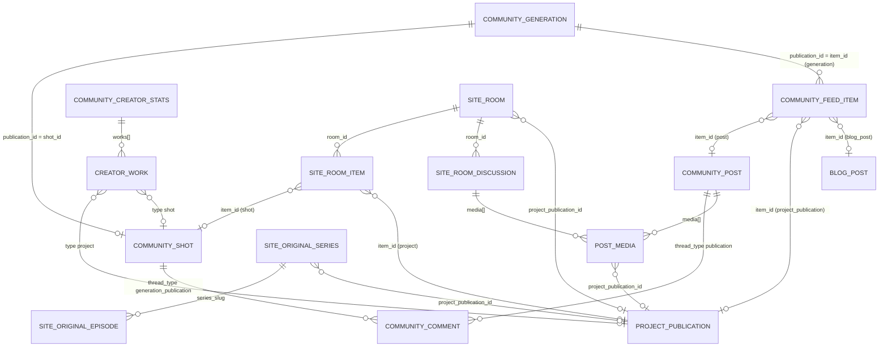

# Community pages — coverage, endpoints, data model

Audit of every page under the **Community** nav (Discovery, Feed, Projects, Shots, Creators, Contests, Rooms, Blogs,
Originals) on 2026-11-26: which GET requests each page makes (from the JS route chunks), what they return (live
checks), whether they need a login, what the scrapers already collect, and what was added as **opt-in** options.
Projects, contests and `/@user/projects/...` pages are covered by the `projects` scraper (docs/scrapers/projects.md)
and are only listed here for completeness.

Rules kept: GET only (~1 request/s), no login, no bot-protection bypass, nothing liked/voted/commented/followed.
Default `scrape community` and `scrape site` runs are unchanged (same requests, same outputs — see "Proof").

## 1. Coverage table

Bases: `fnf` = `https://fnf-api-gw.higgsfield.ai/fnf`, `fnf-community` = `https://fnf-api-gw.higgsfield.ai/fnf-community`,
`fnf-series` = `https://fnf-api-gw.higgsfield.ai/fnf-series`. All endpoints below answer **200 without a session**.

| Page | Endpoints (GET) | Data | Login? | Covered before | Added now / not added (why) |
|---|---|---|---|---|---|
| **Discovery** `/community` | SSR loader `snapshot{discoveryHeader, discoveryCreators, originals, exploreProjects, festival}`; client: `fnf /community/discovery/header`, `fnf /community/discovery/v2/creators` (12 cards), `fnf-series /series?order=curated`, `/hero`, `fnf /project-publications/trending`, `fnf-community /generations/feed` | 3 featured projects, 12 creators, 32/35 originals, trending projects (15,160), contest projects (4,518), shots | public | projects (`projects`), originals (`site --what originals`, `projects --public-series`) | Sections are the same objects as the pages below → covered by `--feeds creators`, `--feeds shots`, `site --what originals`, `projects`. No separate "discovery" kind (would duplicate) |
| **Feed** `/community/feed` | `fnf-community /feed?limit≤50&cursor` (+ `/feed/categories`, `/feed/ongoing`, `/feed/items/{type}/{id}`, `/feed/items/{type}/{id}/related`) | mixed cards: shots (`generation`), projects, blog posts, Community posts, with like/comment/share counts, `made_with`, top comment | public | no (only the posts' comments via `--with-comments`) | **`community --feeds feed`** → `community_feed_item`; `--with-comments` adds every card's thread |
| Community posts (`/community/feed/$postId`, `/community/posts`) | `fnf-community /publications/feed?limit&offset` | post text, attached works (project cards with credits stats), likes, dislikes, comments, views, shares | public | comments only | **`community --feeds posts`** → `community_post` (+ `post_media` CSV) |
| **Shots** `/community/generations` | `fnf-community /generations/feed?limit≤50&cursor&type&models` (+ `/generations/search?q&offset&size`) | published generations: model, media URL, size, likes, views, comments, aesthetic score | public | the same publications via the gallery feeds (`community`, `/fnf/publications/community/*`) but not this ranking or its comment counts | **`community --feeds shots`** → `community_shot` (joins `community_generation` by `publication_id` / `generation_id`) |
| Comments on shots / projects / blogs | `fnf-community /entities/{generation_publication\|project_publication\|blog_post}/{id}/comments?limit=20&cursor&parent_id` | comments + one level of replies | public | **no** (doc said gallery generations have no comments — they do, on this endpoint) | `--with-comments` together with `--feeds shots/feed/posts` → `community_comment` (`thread_type` = entity type) |
| **Creators** `/community/creators` (+ `/community/creators-2`) | `fnf /community/discovery/v2/creators?all=true&sort&limit&cursor` | creator cards: rating, followers, following, likes, views, verified projects, badges, works | public | no | **`community --feeds creators`** → `community_creator_stats` (aggregate stats; names/bio/avatar only with `--with-profiles`) |
| Talents hub `/community/talents-hub` | `fnf /community/discovery/talents?sort=recent\|trending\|rating&limit&offset` | same card shape, 80 talents | public | no | **`community --feeds talents`** (listing `talents`) |
| **Rooms** `/community/rooms` | `fnf-community /rooms?limit≤50&cursor` (+ `query`, `kind`, `sort=popular`, `similar_to`) | rooms: name, description, avatar/cover, works counts per type, followers, owner id, call status, flags | public | `site --what rooms`: title/description from each room page's `<head>` (73 sitemap pages) | **`site --what room-list`** → `site_room` (88 rooms, + room-stats) |
| **Room page** `/community/rooms/{slug}` | `fnf-community /rooms/{id}`, `/rooms/{id}/items?limit&cursor`, `/publications/feed?room_id&kind=discussion&offset&limit[&sort=new]`, `/publications/room-stats?room_id` | room works (shots with prompts, projects, blog posts), discussion posts, counts | public | head tags only | **`site --what room-content`** → `site_room_item`, `site_room_discussion` |
| Room members | `fnf-community /rooms/{id}/followers?limit&cursor` | list of people (username, avatar) | public | no | **Not added**: personal data only, no value beyond `followers_count` |
| Room chat / live calls | no chat or WebSocket/SSE code in the room chunks; `call_status{status, participant_count}` comes with the room JSON; joining/talking needs a login (mutations, `authMode: required`) | — | login | — | **Not added**: there is no public message stream; "discussions" (above) are the room's text posts and are covered |
| **Blogs** `/community/blogs` | `fnf /blog/posts/recommended?cursor&size&sort&query`, `fnf /community/discovery/talents/blog-posts?cursor&size`, `fnf /blog/{folder}/posts/{slug}` | community blog posts + talent blog posts with Markdown bodies | public (`following=true` needs login) | **yes**: `blog --what community` (recommended) and `blog` (talents) | Nothing to add |
| **Originals** `/community/originals` | SSR loader `snapshot{hero.data[5], originals.data{items[35], total}}`; client `fnf-series /series?order=curated&limit&offset`, `/hero`, `/series/{slug}` | series with views, likes, comments, votes, subscribers, trailer, episodes | public | **yes**: `site --what originals` (35 series, 40 episodes with views/likes) and `projects --public-series` | Nothing to add |
| Projects `/community/projects`, Contests `/community/contests`, `/@user/projects/...`, `/contests/...` | `fnf /project-publications/trending`, contests APIs | — | public | `projects` scraper (other agent) | Out of scope here |
| Magazine `/community/magazine/$issue` | route only (3.8 KB chunk, no API strings) | static issue page | public | no | Not added (no data API) |
| Favourites (`/publications/community/favourites`, `/project-publications/favourites`, `/community/discovery/v2/creators/favourites`), `/users/feed`, follows | — | the viewer's own lists | **login** | — | Not added (login + personal) |

## 2. Totals (live, 2026-11-26)

| Page / list | Total | How measured |
|---|---:|---|
| Gallery generations (trending / approved) | 75,528 on 2026-11-26 (78,595 on 11-25) / 6,701 | API `total` (existing `community` scraper) |
| Shots (`/generations/feed`) | not reported (cursor feed over a snapshot; `available_models`: 168 models) | — |
| Feed (`/feed`) | not reported (ranked snapshot, `feed_session_id`) | first 50: 19 shots, 16 projects, 8 blog posts, 7 posts |
| Community posts | ≈ 24,294 | binary search on `offset` (limit=1), 16 requests |
| Creators | 646 (`all=true`); 658 on the 12-card discovery call | API `total` |
| Talents | 80 | API `total` |
| Rooms | 88 (API `total`); 73 room pages in `sitemap-marketing.xml` | API `total` |
| Room works (sum of `works_count`) | 1,202 (839 shots, 307 projects, 56 blog posts); room-stats posts 1,207; followers 3,120 | full `site --what room-list` run |
| Room discussions (sum of room-stats `discussions`) | 1 (rooms are almost only works so far) | idem |
| Discovery header / creators / originals / trending projects / contest projects | 3 / 12 (of 658) / 32 (of 35) / 15,160 / 4,518 | SSR snapshot of `/community` |
| Talent blog posts / recommended blog posts | ~57 / ≈50 per day | docs/scrapers/blog.md |
| Original series / episodes | 35 (+5 hero) / 40 | docs/scrapers/site.md |

## 3. Evidence per page (JS + live)

Route chunks (all fetched into `samples/higgsfield/js2/`; the route table is in `548e0f3a-aXyXjC_KHBp09DNW.js`):

| Route | Chunk |
|---|---|
| `/(public)/community/_tabs` (layout) | `548e0f3a-DdSr5EQ7JLKlceTP.js` |
| `/(public)/community/_tabs/` (Discovery) | `548e0f3a-Wte7Wx5kDv0Ao93A.js` |
| `…/_tabs/feed`, `feed_/$postId`, `feed_/$kind/$itemId` | `548e0f3a-9XJgyMD-_upYcXnp.js`, `548e0f3a-HRq_J5OOznbe9FLw.js`, `548e0f3a-1dv1a0FU_eee8sFH.js` |
| `…/_tabs/generations` (Shots) | `548e0f3a-MPUTFNVU3ZLbcp0N.js` |
| `…/_tabs/creators`, `creators-2` | `548e0f3a-GBOY-0UOmZG7ph0E.js`, `548e0f3a-fcLtq3JpbH4AqpAB.js` |
| `…/_tabs/rooms`, `/(public)/community/rooms/$roomSlug` | `548e0f3a-CvAxhYq4-n-skvR4.js`, `548e0f3a-J380-oy_aThK_vXz.js` |
| `…/_tabs/blogs`, `…/_tabs/originals`, `magazine/$issue` | `548e0f3a-ZFWMqY14kp98o7Gj.js`, `548e0f3a-ywl3cziYOdpMtR6C.js`, `548e0f3a-cyS1CrTvFQ_6QkgK.js` |

Shared modules: `548e0f3a-Pl2H2mKz4X6BJdOa.js` (named modules `community-rooms-api`, `discovery-creators`,
`community-shot-model`, `community-publication-adapter`, feed + entity-comment functions) and
`548e0f3a-H2odSMT_fOKI1GMn.js` (posts feed, blog APIs). Base helpers in `aXyXjC`: `function Axe(e=``){return
xO(`https://fnf-api-gw.higgsfield.ai/fnf-community`,e)}` exported as `Gj` (imported as `N`, `Et`, `Li`, `$e`, `Se`).

### Feed `/community/feed`
- JS (`Pl2H2`): `async function Kr(e,t){let n=N(`/feed`);e.category&&…set(`category`…),e.tab&&…(`tab`),e.username&&…,
  e.roomId&&…(`room_id`…),e.filter&&…,e.cursor&&…(`cursor`…),e.limit&&…(`limit`…)` ; `qr()` → `/feed/categories`,
  `Jr()` → `/feed/ongoing`; item detail `ni=(e,t,n=``)=>N(`/feed/items/${e}/${encodeURIComponent(t)}${n}`)`
  (+ `/related`; `/share`, `/dislike`, `/report` are mutations, never called).
- Pagination: opaque `next_cursor` over a `snapshot_id`; `limit` 50 accepted. Live: `limit=50` → 50 items.
- Field map (card → API): likes `like_count`, comments `comment_count`, shares `share_count`, author `author{id,
  username, avatar_url, headline, badge, rating_points}`, "made with" `made_with{tool, model_name}`, shot media
  `generation{media_url, thumbnail_url, width, height, model, view_count, job_id}`, project/blog `card{title, slug,
  cover_url, video, stats, views_count, like_count, reading_time_minutes}`, post `post{content{text, medias}}`,
  top comment `top_comment{text, like_count}`. All raw integers; display formatting is client-side.
- `/feed/categories` lists hashtag contests (`slug, title, hashtag, post_count, previews`); `/feed/ongoing` was `[]`.

### Community posts
- JS (`H2od`): `async function lE(e,t){let n=Li(`/publications/feed`);e.type&&…(`type`…),e.search&&…(`search`…),
  e.offset!=null&&…(`offset`…),e.limit&&…(`limit`…)` ; detail `Li(`/publications/${e}`)`, related
  `Li(`/publications/${id}/related`)`.
- Pagination: `offset` + `has_more` (no total). `limit=100` accepted; scraper uses 50.
- Fields: `id, user_id, title, content{title, text, medias[{type, job_result{url}, project_publication_id, card{…,
  video{url, hls_url, preview_url, thumbnail_url, width, height, duration}, stats{generations_count, credits_spent,
  free_generations, size_bytes, stack[{job_set_type, display_name, count, credits_spent}]}}}]}, like_count,
  dislike_count, comment_count, views_count, share_count, author{…}, created_at, updated_at`.
  `job_result.url` is `""` for project cards → stored as null.

### Shots `/community/generations`
- JS (`MPUTFN`, same code in `Wte7` for Discovery): `function y(e,t){let n=$e(`/generations/feed`);return
  n.searchParams.set(`limit`,String(Math.min(e.limit,50))),e.filters.type&&…(`type`…),e.filters.models.length>0&&
  …(`models`,e.filters.models.join(`,`)),e.cursor&&…(`cursor`…)` ; search `$e(`/generations/search`)` with `q`,
  `offset`, `size≤50`. Filters: `type ∈ {image, video}`, models matching `/^[\w-]{1,100}$/`, at most 50.
- Mapper `community-shot-model` `d(e)`: `{id:e.id, authorId:e.author_id, media:{type:e.media_type===`video`?`video`:
  `static`, width:l(e.width), height:l(e.height), source:e.media_url, thumbnail:e.thumbnail_url}, likes:e.like_count,
  comments:e.comment_count, jobId:e.job_id, job:{jobSetType:e.model}}` with `l(e)= e>0 ? e : 0`.
  → The card shows likes and comments; `view_count`, `aesthetic_score`, `aesthetic_label` are not displayed.
- Join verified live: shot `89f5f485…` (`job_id d47bf92c…`) = `GET fnf/publications/89f5f485…` → item `id d47bf92c…`,
  `publication.id 89f5f485…`, `views_count` 27,866 vs shot `view_count` 27,860 (same counter, minutes apart).
  So `shot_id` = `community_generation.publication_id`, `generation_id` = `community_generation.generation_id`.
- `limit=100` → HTTP 400 `invalid generation feed parameters or cursor`.
- Shot page URL: `/community/generations?shot=<id>` (route search key `communityShot:`shot``).

### Comments of shots, projects and blog posts (new finding)
- JS (`Pl2H2`): `ea=20, ta={generation:`generation_publication`, project:`project_publication`, blog:`blog_post`},
  na=({kind:e,id:t})=>N(`/entities/${ta[e]}/${encodeURIComponent(t)}/comments`)`; list `Xi()` sets `limit`,
  `cursor`, `parent_id` and reads `{items, next_cursor}`; Community posts still use `/publications/{id}/comments`
  (offset).
- Live: `/entities/generation_publication/89f5f485…/comments?limit=2` → `{items[2], next_cursor, total: 16}` (the
  card says 16). `/entities/generation_publication/{id}/stats` → 400 (only project/blog have stats).
- The old note "gallery generations have no comments" was about `fnf-community /publications/{gallery id}/comments`
  (always empty). Their comments are on the entities endpoint, keyed by the **publication id**.

### Creators `/community/creators`, Talents hub
- JS (`Pl2H2`, module `discovery-creators`): `u(e={},t){let n=Ue(`/community/discovery/v2/creators`);if(e.all){
  n.searchParams.set(`all`,`true`),n.searchParams.set(`sort`,(r=e.sort)==null?`default`:r); …query}
  e.limit!=null&&…(`limit`…),e.cursor!=null&&…(`cursor`…),e.size!=null&&…(`size`…)`; sorts `[`default`,
  `most_followers`,`top_rated`,`most_viewed`,`newest`]`. Talents `pa({sort,limit,offset,size})` →
  `/community/discovery/talents` with zod `va=k({users:O(_a),total,limit,next_offset})`; live sort enum
  `recent|trending|rating` (422 on `default`).
- Mapper `b(e)`: `displayName: full_name||username, location, followers:T(e.followers_count), following:
  T(e.following_count), likes:T(e.likes_count), views:T(e.views_count), rating: finite(rating_points)?…:null,
  badges: badges.filter(icon_url).map(name, iconUrl), works: items.map(project|shot)`; `ne()` shows at most 12
  works plus "view all". Stored as raw integers.
- Pagination: `next_cursor` (`creators-all-v2:…`) + `next_offset`; talents `next_offset`.

### Rooms `/community/rooms` and `/community/rooms/{slug}`
- JS (`Pl2H2`, module `community-rooms-api`): `function S(...e){return N([`/rooms`,...e.map(Ke)].join(`/`))}`;
  list `ce()` sets `query`, `kind`, `following`, `mine`, `sort` (≠ newest), `cursor`, `similar_to`, `limit` (default
  20); `_e(id)` → `/rooms/{id}`; `ve(id,{type,sort,limit=20,cursor,mine})` → `/rooms/{id}/items`; `he(id)` →
  `/rooms/{id}/followers`; POST/PATCH/PUT/DELETE (create, edit, pin, follow, add works) use `authMode:`required`` and
  are never called. Zod room schema `d=k({id, slug, name, description, avatar_url, cover_url, works_count,
  works_counts{project_publication, shot, blog_post}, followers_count, is_followed, author{user_id, username,
  avatar_url}, created_at, permissions, call_status{status: active|inactive, participant_count}, followers_preview,
  works_preview, pinned, project_publication_id, contest_id, original_space_id, members_can_post, join_approval,
  join_requested, notification_level})`; items `re=k({items:O(discriminatedUnion(`item_type`,[project_publication,
  shot, blog_post])), next_cursor})`.
- Room page (`J380`): discussions `td(e,{sort,cursor,limit=cd})` with `cd=20`: `Et(`/publications/feed`)` +
  `room_id`, `kind=dc` (`dc=`discussion``), `sort=new` when "latest", `offset`, `limit`; `nextCursor:
  c.has_more ? a+r : null`; stats `mu()` → `Et(`/publications/room-stats`)` + `room_id` → `{posts, discussions}`.
- Realtime: no `WebSocket`, `EventSource`, LiveKit or socket.io code in the rooms chunks; the only realtime-looking
  field is `call_status` (a snapshot in the room JSON). Room chat as a message stream does not exist in the public
  bundle; discussions are ordinary posts.
- Live: `/rooms?limit=2` → `{items, next_cursor, total: 87}` (88 later); `limit=100` → 400 (`Invalid query, sort,
  kind or limit`), 50 OK. `/rooms/{id}/items?limit=50` → 53 items (pinned items come on top of `limit`).
  `codeoneshot` room-stats `{posts: 84, discussions: 0}`.
- The room HTML loader carries only head tags (title, description, og:image, JSON-LD CollectionPage) — the old
  `site --what rooms` output.

### Discovery `/community`
- Loader snapshot keys (decoded from `$_TSR`): `discoveryHeader.data{items[3], limit}`, `discoveryCreators.data{
  creators[12], total: 658}`, `originals.data{items[32], total: 35}`, `exploreProjects.data{items[32], total: 15160,
  next_cursor}`, `festival.data{items[40], total: 4518}`.
- JS (`Wte7`): shots `Se(`/generations/feed`)` (fnf-community), originals `Ve(`/series`)` with `order=curated`,
  `limit`, `offset` and `Ve(`/hero`)` (fnf-series), projects `De(`/project-publications/trending`)` (`limit`,
  `query`, `filter`, `with_contest`, `contest_key`, `sort`, `cursor`).

### Blogs `/community/blogs`, Originals `/community/originals`
- Blogs loader `{ready}`; data from `H2od`: `bpe()` → `P(`/blog/posts/recommended`)` (`cursor`, `size`, `sort`,
  `query`, `following` — the latter with a session), `xpe()` → `P(`/community/discovery/talents/blog-posts`)`,
  `Spe()` → `/blog/{folder}/posts`. Same endpoints as the `blog` scraper.
- Originals loader = the `/original-series` snapshot (hero + 35 series); chunk `ywl3` imports the fnf-series base
  (`/series`, `/hero`). Covered by `site --what originals` and `projects --public-series`.

## 4. Reels, videos, assets and templates — where they live

| What | Source (GET) | Prompt / assets | Command |
|---|---|---|---|
| Community videos and images (incl. viral "reels" outputs of effects, `viral_transform_*`, `viral_hub_*`) | `fnf /publications/community/{trending,approved,top,model-x}` | `prompt`, `settings` (preset_id, motion_id, chain_preset_id…), `inputs[]` (input images/videos = the assets), `results[]` (raw, min, h264 mp4, hls) | `community` (`--type video`, `--models viral_transform_video`, `--with-raw-params`, `--download-media full`) |
| Shots ranking (same publications) | `fnf-community /generations/feed` | media URL, model; prompt via the gallery item (`generation_id`) or `--publication-ids` | `community --feeds shots` |
| Feed cards (shots, projects, blog posts, posts) | `fnf-community /feed` | media/cover/video URLs, project credit stats | `community --feeds feed` |
| Room works (shots with prompts, projects, blog posts) | `fnf-community /rooms/{id}/items` | shot `prompt`, raw media URL | `site --what room-content` |
| Project films / series (episodes, assets, canvas) | `fnf /project-publications…` | project assets and prompts (if `show_prompts`) | `projects` |
| Original series episodes (HLS video) | `/original-series` SSR, `fnf-series` | trailer/episode video URLs | `site --what originals`, `projects --public-series` |
| App templates (apps) and their credit cost | `/apps` SSR | template inputs, cost per template | `site --what apps`; catalog apps in `catalog` |
| Viral presets ("effects", reels templates) | `fnf /viral-hub/presets/all`, `/viral-hub/types` | preset media, price matrix | `catalog --kinds viral_preset,viral_type` |
| Chain presets | fnf-cms-api `/job-set-chain-presets` | chain steps/params | `catalog --kinds chain_preset` |
| Marketing presets | CMS `/marketing-studio-v2/...` | preset prompts/media | `catalog --kinds marketing_category,marketing_preset` |
| Mixed-media presets (+ sample generations) | CMS `/mixed-media-presets`, `/mixed-media-presets/preset/<id>` SSR | sample media | `catalog --kinds mixed_media_preset`, `site --what mixed-media` |
| Motions / model motions / styles / soul styles / katana / restyle / youtube-faceless presets | `fnf /motions`, CMS lists | preset params and preview media | `catalog` |

## 5. Data model

Natural keys are the API UUIDs (hashed `make_id(...)` only where a record has no single id). Every record has
`source` (endpoint, URL, params, `fetched_at`); `scraped_at` and `schema_version` are on the dataset `meta`
(project convention). Identity fields are personal data: **null unless `--with-profiles`**; `user_id` (Clerk id)
is kept as the pseudonymous join key, as in `community_generation.creator.user_id`.



Nesting vs tables: lists that belong to one record and have no id of their own are nested in JSON and get a
child CSV (`post_media`, `creator_works`, `room_discussion_media`); records with their own id are separate
collections. People are never their own table by default (only `PersonRef` with `user_id`).

CSV layout: one row per record, every JSON leaf a column (nested objects → dotted columns, lists → JSON text or
`|`-joined for the site's join lists); child tables carry the parent key + `index`/`position`.

### `community_shot` (`csv/shots.csv`) — key `shot_id`
| Field | Type | Unit | Source | Null | Example |
|---|---|---|---|---|---|
| shot_id | str | — | `id` (publication id) | no | `af29d29e-…` |
| generation_id | str | — | `job_id` | yes | `6301c461-…` |
| url | str | — | built `/community/generations?shot=` | no | |
| job_set_type | str | — | `model` | yes | `nano_banana_2_1` |
| media_type | enum | — | `media_type` | no | `image` |
| media_url / thumbnail_url | str | — | `media_url` / `thumbnail_url` | yes | `…_min.webp` |
| width / height | int | px | `width` / `height` | yes | 768 / 1376 |
| likes / views / comments | int | count | `like_count` / `view_count` / `comment_count` | yes | 4 / 56 / 0 |
| aesthetic_score | float | 0..1 | `aesthetic_score` | yes | 0.844 |
| aesthetic_label | bool | — | `aesthetic_label` | yes | true |
| published_at | datetime | UTC | `published_at` | yes | |
| author.user_id | str | — | `author_id` | yes | `user_…` |
| author.username, full_name, avatar_url, headline | str | — | `author.*` | **personal** (null by default) | |
| author.badge / rating_points | str / int | — | `author.badge` / `rating_points` | yes | |
| snapshot_id | str | — | page `snapshot_id` | yes | |

### `community_post` (`csv/posts.csv` + `csv/post_media.csv`) — key `post_id`
| Field | Type | Unit | Source | Null | Example |
|---|---|---|---|---|---|
| post_id, url | str | — | `id`; `/community/feed/<id>` | no | |
| title | str | — | `title` or `content.title` (`""` → null) | yes | |
| text | str | — | `content.text` | yes | `THE PATCHED BALL …` |
| room_id, post_kind | str | — | `content.room_id`, `content.kind` | yes | `discussion` |
| media[] | PostMedia | — | `content.medias[]` | [] | |
| likes, dislikes, comments, views, shares | int | count | `like_count`, `dislike_count`, `comment_count`, `views_count`, `share_count` | yes | 3, 0, 4, 2052, 1 |
| created_at, updated_at | datetime | UTC | same | yes | |
| author | PersonRef | — | `user_id`, `author{…}` | names **personal** | |
| extra | dict | — | other non-null fields | {} | |

PostMedia: `index, type, url (job_result.url), project_publication_id, job_id, blog_post_id, card_id, card_title,
card_slug, card_description, card_cover_url, video_url, video_hls_url, video_preview_url, video_thumbnail_url, width
(px), height (px), duration_seconds (s), card_stats{generations_count, credits_spent (credits), free_generations,
size_bytes (bytes), stack[]}, extra`.

### `community_feed_item` (`csv/feed_items.csv`) — key `feed_item_id = make_id("feed_item", item_type, item_id)`
| Field | Type | Unit | Source | Null |
|---|---|---|---|---|
| item_type | enum generation/project_publication/blog_post/post | — | `type` | no |
| item_id | str | — | `id` | no |
| url | str | — | shot/post page; null for projects and blogs (need the username) | yes |
| position | int | rank | label `offset` + index | yes |
| title, description, slug | str | — | `card.title/description/slug`, `post.title`, first line of `post.content.text` | yes |
| media_type, job_set_type, generation_id | str | — | `generation.media_type/model/job_id` | yes |
| made_with_tool, made_with_model | str | — | `made_with.tool/model_name` | yes |
| media_url, thumbnail_url, cover_url, video_url | str | — | `generation.*`, `card.cover_url`, `card.video.*` | yes |
| likes, comments, shares | int | count | `like_count`, `comment_count`, `share_count` | yes |
| views | int | count | `generation.view_count` / `card.views_count` / `post.views_count` | yes |
| reading_time_minutes | int | min | `card.reading_time_minutes` | yes |
| project_stats | dict | credits, bytes | `card.stats` | yes |
| created_at | datetime | UTC | `created_at` | yes |
| top_comment_id, top_comment_likes | str, int | — | `top_comment.id/like_count` (text not stored) | yes |
| author | PersonRef | — | `author{…}` | names **personal** |

### `community_creator_stats` (`csv/creator_stats.csv` + `csv/creator_works.csv`) — key `record_id = make_id("creator_stats", listing, user_id)`
| Field | Type | Unit | Source | Null |
|---|---|---|---|---|
| listing | enum creators/talents | — | endpoint | no |
| position | int | rank | offset + index | yes |
| user_id | str | — | `id` | no |
| rating_points, followers_count, following_count, likes_count, views_count, verified_projects_count | int | count | same names | yes |
| latest_verified_at | datetime | UTC | same | yes |
| is_pinned | bool | — | same | yes |
| badge, badge_names[] | str, list | — | `badge`, `badges[].name` | yes / [] |
| works_count, works[] (`type, item_id, title, is_pinned`) | int, list | — | `items[]` | 0 / [] |
| username, full_name, headline, bio, location, avatar_url | str | — | same | **personal**: null unless `--with-profiles` (also blanked in raw/http archives by `CreatorsPrivacyMiddleware`) |

### `community_comment` (existing kind, new thread types)
Unchanged schema. New rows come from `/entities/{type}/{id}/comments`: `thread_type` ∈ `generation_publication`,
`project_publication`, `blog_post`; `publication_id` = the shot / project / blog id. Commenter names only with
`--with-profiles`.

### `site_room` (`csv/rooms.csv`) — key `room_id`
| Field | Type | Unit | Source | Null |
|---|---|---|---|---|
| room_id, slug, url | str | — | `id`, `slug`, `/community/rooms/<slug>` | no |
| name, description, avatar_url, cover_url | str | — | same | yes |
| works_count, works_shots, works_projects, works_blog_posts | int | count | `works_count`, `works_counts.*` | yes |
| followers_count | int | count | `followers_count` (joined members; "follow" = join) | yes |
| posts_count, discussions_count | int | count | room-stats `posts`, `discussions` | yes |
| call_status, call_participants | str, int | — | `call_status.status/participant_count` (snapshot) | yes |
| owner_user_id | str | — | `author.user_id` | yes |
| owner_username | str | — | `author.username` | **personal** |
| pinned, members_can_post, join_approval | bool | — | same | yes |
| project_publication_id, contest_id, original_space_id | str | — | same | yes |
| works_preview_ids | list | — | `works_preview[].item_id` | [] |
| created_at | datetime | UTC | same | yes |
| position | int | rank | list order | yes |

`followers_preview` (people) is not stored.

### `site_room_item` (`csv/room_items.csv`) — key `room_item_id` (= `space_item_id`)
`room_id, room_slug, item_type (shot | project_publication | blog_post), item_id (shot: publication id; project:
publication_id; blog: id), generation_id (shot job id), pinned, position, url (shots only), title (project name /
blog title / first 200 chars of the shot prompt), slug, description (project description / blog subtitle), prompt
(shot `params.prompt`), job_set_type, media_type, media_url (shot raw result / cover), thumbnail_url, project_type
(film/series/carousel), duration_seconds (s), reading_time_minutes, likes, views, comments (counts),
tags[], author_user_ids[] (pseudonymous), created_at (UTC)`.

### `site_room_discussion` (`csv/room_discussions.csv` + `csv/room_discussion_media.csv`) — key `post_id`
Same fields as `community_post` + `room_slug`.

## 6. Options added

| Scraper | Option | Kinds | Default |
|---|---|---|---|
| community | `--feeds shots` | `community_shot` | off (not part of `--feeds all`) |
| community | `--feeds posts` | `community_post` | off |
| community | `--feeds feed` | `community_feed_item` | off |
| community | `--feeds creators`, `--feeds talents` | `community_creator_stats` | off |
| community | `--with-comments` + one of the feeds above | `community_comment` from `/entities/…/comments` and `/publications/{post}/comments` | off; without opt-in feeds `--with-comments` behaves exactly as before |
| site | `--what room-list` | `site_room` (+ room-stats) | off (not part of `--what all`) |
| site | `--what room-content` | + `site_room_item`, `site_room_discussion` | off |

`--max-items` caps each opt-in feed (and rooms / room items / room discussions) separately; the page size never
exceeds what is left. `--max-pages` caps pages per feed, per room list and per comment thread. `--type image|video`
and `--models` are passed to the shots feed.

Live checks (`--max-items 20`, 2026-11-26):
- `community --feeds shots,posts,feed,creators,talents`: 20 shots, 20 posts, 20 feed items, 40 creator rows
  (20 creators + 20 talents); 5 requests; archives contain no username/bio/headline/location/avatar values.
- `community --feeds shots,posts,feed --with-comments`: 20 + 20 + 20 items, **409 comments** (project 222, blog 109,
  shot 66, post 12) from 68 thread requests.
- `site --what room-content`: 20 rooms, 20 room items (10 projects, 9 blog posts, 1 shot), 1 discussion, 61 requests.
- `site --what room-list` (no cap): 88 rooms in 90 requests (2 list pages + 88 room-stats), 0 active calls.

## 7. Not scraped, and why
- Room chat / voice calls: no public message stream (no WebSocket/SSE in the bundle; calls need a login).
- Room followers (`/rooms/{id}/followers`), `/users/{id}/subscribers|subscriptions`, `/users/suggestions`,
  `/users/search`: lists of people only.
- Favourites, `following=true` lists, `/users/feed`, `/rooms/following/count`, `mine=true`: need a login (viewer's
  own data).
- `/feed/items/{type}/{id}/related`, `/publications/{id}/related`, `/generations/search`: other views of the same
  objects (search needs a query).
- Discovery as a separate kind: every section is an object covered elsewhere (see table).
- Magazine issues: route without a data API.

## 7a. Anonymous vs logged in (checked 2026-11-26)

Each endpoint was requested twice, ~1 s apart: without and with the cached session (`TokenProvider.from_env().get()`,
bearer token never printed or saved). Compared: HTTP status, item counts, `total`, keys present only when logged
in, and keys that are `null` anonymously but filled when logged in.

| Endpoint | Status anon / login | Items, total anon / login | Only with login |
|---|---|---|---|
| fnf-community `/feed?limit=50` | 200 / 200 | 50 / 50; **48 of 50 ids shared, order differs** (personalized ranking; two anonymous calls are identical) | `card.liked_by_me`; `card.is_liked`, `generation.is_liked_by_user` filled |
| `/feed/categories`, `/feed/ongoing`, `/feed/items/generation/{id}` | 200 / 200 | same | `is_liked_by_user` filled (item) |
| `/generations/feed` (Shots) | 200 / 200 | 50 / 50, same ids, same order | `is_liked_by_user` filled |
| `/publications/feed` (posts), `/publications/{id}` | 200 / 200 | 50 / 50, same ids, same order | `medias[].card.is_liked` filled |
| `/publications/{id}/comments`, `/entities/generation_publication/{id}/comments` | 200 / 200 | 2 / 2; 10 / 10, total 16 / 16 | — |
| fnf `/community/discovery/v2/creators` (`all=true` / 12 cards), `/community/discovery/talents` | 200 / 200 | total 646 / 646, 658 / 658, 80 / 80 | works' `is_liked_by_user` filled |
| fnf `/community/discovery/header` | 200 / 200 | 3 / 3 | — |
| fnf-community `/rooms?limit=50` | 200 / 200 | 50 / 50, total 88 / 88 | `is_followed`, `join_requested` |
| `/rooms/{id}`, `/rooms/{slug}` | 200 / 200 | — | `is_followed`, `join_requested` |
| `/rooms/{id}/items` | 200 / 200 | 23 / 23 (`limit=20`), 53 / 53 (`limit=50`) | `is_liked_by_user`, `liked_by_me` filled |
| `/publications/feed?room_id=&kind=discussion`, `/publications/room-stats` | 200 / 200 | 0 / 0; same counts | — |
| `/rooms/{id}/followers` | 200 / 200 | same | — |
| `/rooms?mine=true`, `/rooms?following=true`, `/rooms/following/count` | 401 / 401 | — | the web app sends these with its own session mode; they would only list the viewer's rooms |
| fnf `/blog/posts/recommended`, `/community/discovery/talents/blog-posts` | 200 / 200 | 10 / 10 | `liked_by_me` filled |
| fnf-series `/series?order=curated`, `/hero` | 200 / 200 | total 35 / 35, 5 / 5 | — |
| fnf `/publications/community/trending`, `/publications/{id}` (gallery) | 200 / 200 | total 75,528 / 75,528 | `publication.is_liked_by_user` filled |
| fnf-community `/users/feed`, fnf `/publications/community/favourites`, `/community/discovery/v2/creators/favourites` | **401 / 200** | — / 0 items (the test account follows / favourites nothing) | the viewer's own following feed and favourites |

A single run also showed `/rooms/{id}` 200 → 401 and `/rooms/{id}/items` 500 → 200; repeated a minute later both
were 200 / 200 with identical bodies (transient gateway errors, not auth differences).

**Result:** a login adds no public data — no extra items, no larger totals, no member-only room content, no room
chat or messages (room discussions and works are identical; the account is not a member of any room, so content of
`join_approval` rooms could not be compared beyond their public works list). It only adds the viewer's own state
(my likes, my follows/join requests) and the viewer's own lists (favourites, following feed), plus a slightly
personalized Feed order. **So no logged-in option was added**: every new request is sent without a session
(`meta["auth"] = False`, whatever `--auth` says), and the parsers drop the per-viewer flags (`is_liked_by_user`,
`liked_by_me`, `is_liked`, `is_followed`, `join_requested`, `is_subscribed`, `is_mine`, `my_vote`,
`notification_level`, `permissions`) so a run with a configured session produces the same records. Tests:
`tests/test_community_pages.py::test_opt_in_requests_never_send_a_session_even_with_auth_required`,
`::test_viewer_flags_never_reach_the_outputs`. If the viewer's likes/follows are ever wanted, they belong in the
`account` scraper (personal, login-only), not here.

## 8. How to scrape everything (Community)

```bash
python -m higgsfield_scraper scrape community --feeds all                                   # gallery (~85k generations)
python -m higgsfield_scraper scrape community --feeds shots,posts,feed --with-comments      # Shots, posts, Feed + threads
python -m higgsfield_scraper scrape community --feeds creators,talents                      # creator stats (aggregate)
python -m higgsfield_scraper scrape community --feeds creators,talents --with-profiles      # + names/bios (personal data)
python -m higgsfield_scraper scrape site --what room-content                                # rooms, works, discussions
python -m higgsfield_scraper scrape site --what originals                                   # original series + episodes
python -m higgsfield_scraper scrape blog --what blog,talents,community                      # community + talent blogs
python -m higgsfield_scraper scrape projects                                                # projects / contests (projects scraper)
python -m higgsfield_scraper scrape catalog --kinds public                                   # templates: viral/chain/marketing/mixed-media presets
python -m higgsfield_scraper scrape site --what apps,mixed-media                            # app templates + cost, mixed-media samples
```
Add `--max-items N` for a sample and `--download-media thumbs|full` for media files.
