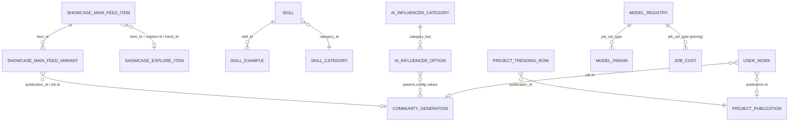

# Higgsfield.ai content map: every source of videos, images, audio, templates, prompts, models, users, comments

Master map of **everything on higgsfield.ai that carries content** (videos, images, audio, assets, templates/presets,
prompts, ads, model info, user profiles, comments, engagement), classified against what this project already scrapes.

- **Checked:** 2026-11-26, frontend build `548e0f3a` (176 + new JS chunks in `samples/higgsfield/js2/`, 841 files).
- **Inputs:** `samples/higgsfield/inventory/` (589 routes, 728 API paths, 361 probe results), the 10 saved sitemaps
  (1,384 URLs), a fresh scan of `js2/` for path literals (1,146 distinct call paths, **737 not in the old inventory**),
  every scraper doc (`docs/scrapers/*.md`), `COMMUNITY_COVERAGE.md`, `LOGIN_COVERAGE.md`, `ENGAGEMENT.md`,
  `HIGGSFIELD_DATA_INVENTORY.md`, `PRODUCTS.md`, `MODEL_LOADING.md`, and `python -m higgsfield_scraper scrapers` /
  `scrape <name> -h`.
- **Live checks:** about 150 GETs at ~1 request/s, count fields only (`size=1` / `limit=1` where possible), no
  POST/like/vote/generate/upload, no bot-protection bypass, no share-code guessing. A few endpoints were requested a
  second time with the cached session (`TokenProvider.from_env().get()`, bearer never printed or stored) to compare.
- **Privacy:** no usernames or real `user_` ids in this doc or in the samples. Samples:
  [`samples/higgsfield/content_map/`](../samples/higgsfield/content_map/) (lists cut to 2 items, people fields
  `<redacted>`, profile endpoints saved as **types only**).
- **Regenerate the tables:** `python scripts/content_map.py --write` (offline) or
  `python scripts/content_map.py --live --write` (refreshes the "Live total" column with ~45 public GETs). The rows
  live in `scripts/content_map.py`; text outside the `content-map` markers is hand-written.

Legend. **Visibility:** `public` · `login (own data)` · `login (any)` (any account, data about others) ·
`share-code only` · `websocket-only` · `blocked` (DataDome). **Published?** `published` = the author made it public;
`private` = own library. **Covered by:** a scraper command, `in progress (agent)` (another agent is building it now),
or **GAP** (public, not covered, not in progress). "Comments (entity type)" is the `{type}` of
`GET fnf-community/entities/{type}/{id}/comments`.

> **Update 2026-11-26 (evening):** every GAP row and every "in progress (agent)" row is now resolved. The GAP rows are
> covered by new opt-in options (`showcase --what main_feed`, `studios`, `projects --what trending,contest-participation`,
> `projects --with-user-works`, `community --feeds feed-categories,music-cards,collections`, `catalog --kinds
> outfit_character`, `site --what academy-api`, the new `models` scraper); the in-progress rows were built (`studios`,
> reels presets, community galleries) or checked and found to have no public data (character pages, studio projects,
> magazine). The "Covered by" column of each table names the option; §16 keeps the original build list with its status.

## Category index

| # | Category | What is there | Status in one line |
|---|---|---|---|
| 1 | [All published videos / images / outputs](#1-all-published-videos--images--outputs) | gallery, shots, explore, projects, contests, samples | covered (main feed: `showcase --what main_feed`; trending projects: `projects --what trending`; per-user works: `projects --with-user-works`) |
| 2 | [Avatars](#2-avatars) | 100 avatars, 21 avatar presets, character pages | covered by `catalog` (+ `--kinds outfit_character`); character pages have no separate data |
| 3 | [AI influencer](#3-ai-influencer) | builder options, 1,017 gallery outputs, own/shared influencers | covered (builder options: `studios --what influencer_options`) |
| 4 | [Trends](#4-trends) | trending gallery, explore trending, viral presets, collections, hashtags | covered (hashtags: `community --feeds feed-categories`; trending projects: `projects --what trending`) |
| 5 | [Reels](#5-reels) | reels showcase, viral-transform outputs, genjutsu presets | covered (`showcase --what reels_presets,reels_comments,main_feed`) |
| 6 | [Shorts and short videos](#6-shorts-and-short-videos) | studios, series, faceless | covered; studio projects are login-only (checked by `studios`) |
| 7 | [Cinematic video](#7-cinematic-video) | Cinema Studio controls + outputs | covered |
| 8 | [Templates and presets](#8-templates-and-presets) | ~3,600 presets/templates in 30 lists | covered (playable ads, AI-influencer options: `studios`; music cards, collections: `community --feeds`) |
| 9 | [Ideas, prompt suggestions, tips](#9-ideas-prompt-suggestions-tips) | no public "ideas" list exists | nothing to build; prompts come from content |
| 10 | [Model information](#10-model-information) | costs, JS registry, flags, API docs, landings, notices | covered (JS registry: `scrape models`) |
| 11 | [Users and profiles](#11-users-and-profiles) | creators, talents, profiles, user works | aggregate stats covered; user works/stats `projects --with-user-works`; identity opt-in only |
| 12 | [Text, learning, apps and marketplaces](#12-text-learning-apps-and-marketplaces) | blog, academy, MCP, skills, apps marketplace, rooms | covered (`studios --what apps,games,skills,employees`; `site --what academy-api`) |
| 13 | [Login-only, share-code, websocket, blocked](#13-login-only-share-code-websocket-blocked) | own library, shared links, SSE/WS | out of scope by rule |
| 14 | [Comments: where they exist](#14-comments-where-they-exist) | 4 thread types | covered |
| 15 | [Anonymous vs logged in](#15-anonymous-vs-logged-in) | per area | a login adds no public content |
| 16 | [The GAP list](#16-the-gap-list-drives-the-next-build-round) | 9 build items | **all 9 built** (2026-11-26) |
| 17 | [Grand totals](#17-grand-totals) | videos / images / audio / templates / prompts / comments | ~83k videos, ~77k images |
| 18 | ["Scrape everything" command list](#18-scrape-everything-command-list) | every command + size/time | |

Summary of the 105 rows (updated 2026-11-26 after the studios / models / completeness round): **82 covered** by a
scraper option, **0 in progress**, **0 GAP**, 23 deliberately not scraped (personal, share-code, websocket, blocked,
empty, a redirect, or checked and found to have no public data). 91 rows are public; 8 are login (own data),
3 share-code only, 1 websocket-only, 1 blocked, 1 login (any). Before this round: 62 covered, 11 in progress,
12 GAP (9 build items, §16), 20 not scraped.

---

## 1. All published videos / images / outputs

Everything a user published, with its assets (inputs), prompt and model. The **gallery** (`/fnf/publications/
community/*`) is the backbone: every published generation has `job_set_type`, `params.prompt`, `params.medias[]`
(input assets), `results.raw/min` (output) and `publication.{views_count, likes_count}`. Shots, Feed cards, room works,
explore variants, effect samples and user works are **other views of the same publications** (dedupe in §17).
Notable live facts: the trending feed is 99.96 % images (75,226 of 75,257), the approved feed is 100 % video
(6,175); videos of newer models (e.g. `cinematic_studio_video_4_0`, `seedance_2_5` beyond 34 items) are not in the
gallery feeds and appear in **Shots** (`/generations/feed?models=`) and **video explore** instead.

<!-- BEGIN content-map:published -->
| Source | Endpoint / route (GET) | Content | Visibility | Published? | Live total | Comments (entity type) | Engagement | Prompt | Model / job_set_type | Covered by | Evidence |
|---|---|---|---|---|---|---|---|---|---|---|---|
| Community gallery, trending | `https://fnf-api-gw.higgsfield.ai/fnf/publications/community/trending?size&cursor&type&model` | image (99.9 %), video, prompt, input assets | public | published | 75,257 (image 75,226 / video 31) | `generation_publication` (key = publication id) | views, likes | yes (`params.prompt`) | yes (`job_set_type`, `params.model`) | `community` (default `--feeds trending`) | ENGAGEMENT.md §1 |
| Community gallery, approved (curated) | `…/publications/community/approved` | video (100 %), prompt, inputs | public | published | 6,175 | `generation_publication` | views, likes | yes | yes | `community --feeds approved` | ENGAGEMENT.md §1 |
| Community gallery, top picks | `…/publications/community/trending/top` | image, video | public | published | ≤ 100 | `generation_publication` | views, likes | yes | yes | `community --feeds top` | HIGGSFIELD_DATA_INVENTORY.md §3.1 |
| Community gallery, featured model (model-x) | `…/publications/community/model-x` | image, video | public | published | 61 | `generation_publication` | views, likes | yes | yes | `community --feeds model-x` | inventory §3.1 |
| Publication detail | `/fnf/publications/{publication_id}` | one generation | public | published | detail | `generation_publication` | views, likes | yes | yes | `community --detail`, `--publication-ids` | COMMUNITY_COVERAGE.md §3 |
| Shots (`/community/generations`) | `https://fnf-api-gw.higgsfield.ai/fnf-community/generations/feed?limit≤50&cursor&type&models` | image, video (same publications as the gallery) | public | published | no total (snapshot cursor); `available_models` = 168 | `generation_publication` (`comment_count` on card) | likes, views, comments, aesthetic score | via the gallery item (`generation_id`) | yes (`model`) | `community --feeds shots [--with-comments]` | chunk `MPUTFNVU3ZLbcp0N`; COMMUNITY_COVERAGE.md |
| Shots search | `/fnf-community/generations/search?q&offset&size` | same objects | public | published | needs a query | — | — | — | — | not scraped (search view of covered objects) | COMMUNITY_COVERAGE.md §7 |
| Community Feed tab (mixed) | `/fnf-community/feed?limit≤50&cursor` | shots, projects, blog posts, posts | public | published | no total (ranked snapshot) | per card type (`generation_publication`, `project_publication`, `blog_post`, post) | likes, comments, shares, views, top comment likes | no (card) | `made_with` | `community --feeds feed [--with-comments]` | COMMUNITY_COVERAGE.md |
| Community posts | `/fnf-community/publications/feed?limit&offset` | text + attached media/project cards | public | published | ≈ 24,294 (binary search) | post thread `/publications/{id}/comments` | likes, dislikes, comments, views, shares | no | card stack | `community --feeds posts [--with-comments]` | ENGAGEMENT.md §4 |
| Per-model community galleries | `/soul-community`, `/soul-cinema-community`, `/seedance-2(-5)-community`, `/seedance-4k-community`, `/kling-30-community`, `/gpt-image-2-community`, `/marketing-studio-community`, `/mixed-media-community/$id`, `/nano-banana-pro-preview/$id`, `/sora-video/$id`, `/wan-video/$id`, `/motion/$id/publication/$id`, `/mixed-media-presets/publication/$id` | image, video | public | published | subsets of the gallery (`model=` filter) | `generation_publication` | views, likes | yes | yes | `community --feeds approved --models <job_set_type>` (COMMUNITY_COVERAGE.md §3b); studio galleries (Marketing / Cinema Studio, Canvas, AI influencer …) also `studios --what galleries` | routes.json; inventory §2.5 |
| Video explore (Higgsfield Multiplier), community | `https://cms.higgsfield.ai/higgsfield-multiplier/video-explore/v2?source=community&sort=new\|trending&size=20&cursor` | video trends + variants (original / edit / generation), prompts | public | published | 49,237 | count only (`comments_count`) | likes (+ views/comments/times_made on top items) | yes (generation variants) | yes (`job_set_type`) | `showcase --what explore_categories --explore-pages 0 --explore-sort both` | ENGAGEMENT.md §12 |
| Video explore, curated (Higgsfield) | `…/video-explore/v2?source=higgsfield` | video trends | public | published | 35 | no | none | yes | yes | `showcase --what explore_categories` | scrapers/showcase.md |
| CMS main feed (home 'Explore' feed of Genjutsu community presets) | `https://cms.higgsfield.ai/main-feed?lang&size=20&cursor` | video presets (original video + edit/generation variants), title, description | public | published | no total (cursor); 13 of 20 ids also in video explore | count only (`comments_count`) | likes, views, comments, times_made | variant params | yes (`job_set_type`, e.g. `hf_mult_replace_object`) | `showcase --what main_feed` (+ `--main-feed-pages`; by name only, not in `all`) | chunk `uBUqSEKZIqX571QB` (`Sn('/main-feed')`); sample `content_map/cms_main_feed.json` |
| Soul samples | `/fnf/soul-samples` | image + prompt | public | published | 1,263 | no | none | yes | yes (soul) | `catalog` (default) | scrapers/catalog.md |
| Motion samples | `/fnf/motion-samples?motion_id&size` | video per motion (~3–5 each) | public | published | ≈ 1,500 (419 motions) | no | none | yes | preset family | `catalog --with-samples` | scrapers/catalog.md |
| Effect example generations | `/effects/examples/{slug}` (SSR, 87 pages) | image, video, prompt, inputs | public | published | 87 pages × first SSR page | no | none | yes | yes | `showcase --what effect_examples` (pages 2+ come from a per-build server fn: not fetched) | scrapers/showcase.md §9 |
| Project publications (films, series, carousels) | `/fnf/project-publications?limit≤50&cursor`, `/{id}` | video (cover/trailer/gallery), project assets | public | published | > 2,000 walked; trending list total 15,276 | `project_publication` | views, likes, comments, votes | assets: yes if `show_prompts` | assets `job_set_type`, stats stack | `projects` (+ `--with-project-assets/-stats/-comments`) | scrapers/projects.md |
| Trending project publications (ranking + total) | `/fnf/project-publications/trending?limit&cursor&sort&filter&with_contest` | same objects as above | public | published | 15,276 | `project_publication` | views, likes, comments | — | — | `projects --what trending` (+ `--trending-sort`, `--trending-filter`, `--trending-with-contest`) | COMMUNITY_COVERAGE.md (Discovery); live total |
| Contest entries (festival, talent contest) | `/fnf/contest-participations/publications?tab&contest_key&size&cursor` | film projects | public | published | 4,516 public (counters: 66,645 total, 62,129 private) | `project_publication` | views, likes, comments, votes | via project assets | via project stats | `projects --what entries` | probe `contest_participation_counters.json` |
| Contest participation counters + config | `/fnf/contest-participations/publications/counters`, `/config` | counts, rules | public | published | 66,645 / 4,516 public | no | — | no | no | `projects --what contest-participation` | sample `content_map/contest_participation_counters.json` |
| Contest submissions | `/fnf/contests/{id}/submissions?limit≤100&offset&ordering` | video | public | published | 9,158 over 10 contests | no public thread (entity `contest_submission` → 400) | likes, dislikes, views, social views | no | no | `projects --what contests --with-submissions` | ENGAGEMENT.md §7 |
| Room works | `/fnf-community/rooms/{id}/items` | shots (with prompt), projects, blog posts | public | published | 1,202 works in 89 rooms | by item type | likes, views | shots: yes | yes | `site --what room-content` | COMMUNITY_COVERAGE.md |
| Original series + episodes | `https://fnf-api-gw.higgsfield.ai/fnf-series/series`, `/hero`, `/series/{slug}`; `/original-series/*` SSR | HLS video episodes, trailers | public | published | 35 series (+5 hero), 40 episodes | count only (no public thread found) | views, likes, dislikes, votes, subscribers | no | no | `site --what originals`, `projects --what series --public-series` | ENGAGEMENT.md §8 |
| Mixed-media preset samples | `/mixed-media-presets/preset/{id}` SSR | 6 community samples per preset | public | published | 33 presets | no | likes | yes | yes | `site --what mixed-media` | scrapers/site.md |
| Editing Room example projects + renders | `/fnf/videoshop/project-examples`, CMS `/videoshop-examples` | video edits, tool params | public | published | 11 examples, 6 projects, 41 renders | no | none | edit prompts | tool | `showcase --what editing_room_examples` | scrapers/showcase.md |
| A user's published works | `/fnf/user/{user_id}/v2/publications?publication_type&limit=50&cursor` | assets (generations with prompt/params/results), projects, submissions | public | published | per user (`total`) | by type | views, clones | yes | yes | `projects --with-user-works` (opt-in, pseudonymous; only users already found in the run) | chunk `3On2TPGk30aH8MrG`; sample `content_map/fnf_user_v2_publications.json` |
| AI influencer outputs in the gallery | `…/publications/community/trending?model=ai_influencer` | image + trait config | public | published | 1,017 | `generation_publication` | views, likes | `config` (traits; prompt often empty) | yes | `community --models ai_influencer` | live total |
| Viral transform outputs (reels made with effects) | gallery `model=viral_transform_image\|viral_transform_video` | image/video | public | published | 12 / 0 today | `generation_publication` | views, likes | yes | yes | `community --models viral_transform_image,viral_transform_video` | live totals |
| Cinema Studio outputs in the gallery | gallery `model=cinematic_studio_image\|cinematic_studio_3_0\|cinematic_studio_video_4_0` | image, video | public | published | image 489 (trending); 3.0 video 41 (approved); 4.0 video 0 | `generation_publication` | views, likes | yes | yes | `community --models cinematic_studio_image,cinematic_studio_3_0`; 4.0 videos via `community --feeds shots --models cinematic_studio_video_4_0` | live totals |
<!-- END content-map:published -->

## 2. Avatars

Avatars exist in three forms: the public avatar catalog (`/fnf/avatars`, 100, with media and params; `/avatar-presets`,
21), avatar/character gallery pages (`/avatars`, `/avatar/$category`, `/characters`, `/cast`: checked, no separate
data — `/characters` and `/avatars` are Ads Studio pages (login), `/avatars` 301 → `/ai-influencer`;
COMMUNITY_COVERAGE.md §3b), the two outfit-tool model images (`catalog --kinds outfit_character`), and the user's own trained characters (Soul ID / custom references / reference
elements: login, personal, not scraped). Avatars have no comments or engagement fields.

<!-- BEGIN content-map:avatars -->
| Source | Endpoint / route (GET) | Content | Visibility | Published? | Live total | Comments (entity type) | Engagement | Prompt | Model / job_set_type | Covered by | Evidence |
|---|---|---|---|---|---|---|---|---|---|---|---|
| Avatars | `/fnf/avatars?size&cursor&category` | image/video avatar, params | public | published | 100 | no | none | params | avatar job | `catalog` (default) | scrapers/catalog.md |
| Avatar presets | `/fnf/avatar-presets` | preset media | public | published | 21 | no | none | preset prompt | — | `catalog` (default) | scrapers/catalog.md |
| Avatar / character pages and galleries | `/avatars`, `/avatar/$category`, `/characters`, `/character`, `/cast` | avatar galleries | public | published | — | — | — | — | — | nothing separate: `/characters`, `/avatars` = Ads Studio (login, personal); `/avatars` 301 → `/ai-influencer` (`studios`) | routes.json |
| Own characters (Soul ID / custom references / elements) | `/fnf/custom-references`, `/v2/reference-elements/*`, `/kling-elements/{id}` | trained characters, reference media | login (own data) | private | per account | no | — | no | no | not scraped (personal library) | LOGIN_COVERAGE.md §2.4 |
| Outfit characters | `/fnf/outfits/characters` | 2 model images | public | published | 2 | no | none | no | no | `catalog --kinds outfit_character` (by name only) | chunk `sGxtyi5DXhlNSfix`; sample `content_map/fnf_outfits_characters.json` |
<!-- END content-map:avatars -->

## 3. AI influencer

- **Builder options** (`GET cms.higgsfield.ai/ai-influencer-config`, also `fnf-cms-api`): public, 4 categories →
  subcategories → options (`key, label, icon, media, is_advanced`), 32.9 KB. This is the trait catalog behind the
  `ai_influencer` job `config` (age, gender, `ethnicity_origin_base`, hair, eye_color, skin_color, …). Covered by
  `studios --what influencer_options` (143 options, `--lang`; kind `studios_influencer_option`).
- **Outputs:** 1,017 `ai_influencer` images in the trending gallery (`community --models ai_influencer`); the prompt
  is usually empty and the traits are in `params.config`. Video variants (`ai_influencer_motion_control`,
  `ai_influencer_replace_object`) had no gallery items.
- **Own influencers** (`/fnf/ai-influencers`, 200 `{items: []}` even anonymously = per viewer) and **shared**
  influencers (`/ai-influencer/shared/$code`) are personal / share-code only.
- Same anonymous and logged in (spot-check: byte-identical config).

<!-- BEGIN content-map:influencer -->
| Source | Endpoint / route (GET) | Content | Visibility | Published? | Live total | Comments (entity type) | Engagement | Prompt | Model / job_set_type | Covered by | Evidence |
|---|---|---|---|---|---|---|---|---|---|---|---|
| AI influencer builder options | `https://cms.higgsfield.ai/ai-influencer-config` (= `fnf-cms-api`) | 4 categories → subcategories → options with preview media | public | published | 4 categories | no | none | no (trait config) | `ai_influencer` | `studios --what influencer_options` | chunk `YNwTwBIMiHh-jeot`; sample `content_map/cms_ai_influencer_config.json` |
| AI influencer outputs in the gallery | `…/publications/community/trending?model=ai_influencer` | image + trait config | public | published | 1,017 | `generation_publication` | views, likes | `config` (traits; prompt often empty) | yes | `community --models ai_influencer` | live total |
| Own AI influencers | `/fnf/ai-influencers?size=30&direction&cursor` | own characters | login (own data) | private | 0 anonymous / own list | no | — | no | no | not scraped (personal) | chunk `keixfeJScOR0pZEX`; live 200 `{items: []}` |
| Shared AI influencer | `/ai-influencer/shared/$code` | one shared character | share-code only | private (link) | — | no | — | no | no | not scraped (never enumerate codes) | routes.json |
<!-- END content-map:influencer -->

## 4. Trends

"Trending" exists in six places; only two are separate data:

1. **Community gallery trending** (score-ranked, 75,257) and **top** (≤ 100): `community`.
2. **Video explore trending** (`sort=trending`, opaque cursor) and **new** (page numbers, `total` 49,237): `showcase`.
3. **Viral effects / presets** (87) and **collections** (`/collection/catch-the-pulse` → `GET /fnf/collections/
   catch-the-pulse`, 15 presets): `catalog` / `community --feeds collections`.
4. **Trending projects** (`/project-publications/trending`, total **15,276**): `projects --what trending` (ranking
   rows `projects_trending_row` + `total_reported`; `--trending-sort`, `--trending-filter`, `--trending-with-contest`).
5. **Feed hashtag categories** (`/fnf-community/feed/categories`: 2 hashtag contests with `post_count`):
   `community --feeds feed-categories`.
6. `/sora-trends` is only a client redirect to `/ai/video` with a preset prompt (chunk `qQFcAZLo87VHkLMU`);
   `/contests/trending` → 204; `/youtube-faceless/hot-right-now` → empty.

The CMS **main feed** (`cms /main-feed`, the home "explore" feed of Genjutsu community presets with likes, views,
`times_made`) is trend-like too: `showcase --what main_feed` (by name only); 13 of its first 20 ids are also
video-explore items.

<!-- BEGIN content-map:trends -->
| Source | Endpoint / route (GET) | Content | Visibility | Published? | Live total | Comments (entity type) | Engagement | Prompt | Model / job_set_type | Covered by | Evidence |
|---|---|---|---|---|---|---|---|---|---|---|---|
| Community gallery, trending | `https://fnf-api-gw.higgsfield.ai/fnf/publications/community/trending?size&cursor&type&model` | image (99.9 %), video, prompt, input assets | public | published | 75,257 (image 75,226 / video 31) | `generation_publication` (key = publication id) | views, likes | yes (`params.prompt`) | yes (`job_set_type`, `params.model`) | `community` (default `--feeds trending`) | ENGAGEMENT.md §1 |
| Community gallery, top picks | `…/publications/community/trending/top` | image, video | public | published | ≤ 100 | `generation_publication` | views, likes | yes | yes | `community --feeds top` | HIGGSFIELD_DATA_INVENTORY.md §3.1 |
| Community Feed tab (mixed) | `/fnf-community/feed?limit≤50&cursor` | shots, projects, blog posts, posts | public | published | no total (ranked snapshot) | per card type (`generation_publication`, `project_publication`, `blog_post`, post) | likes, comments, shares, views, top comment likes | no (card) | `made_with` | `community --feeds feed [--with-comments]` | COMMUNITY_COVERAGE.md |
| Video explore (Higgsfield Multiplier), community | `https://cms.higgsfield.ai/higgsfield-multiplier/video-explore/v2?source=community&sort=new\|trending&size=20&cursor` | video trends + variants (original / edit / generation), prompts | public | published | 49,237 | count only (`comments_count`) | likes (+ views/comments/times_made on top items) | yes (generation variants) | yes (`job_set_type`) | `showcase --what explore_categories --explore-pages 0 --explore-sort both` | ENGAGEMENT.md §12 |
| Video explore, curated (Higgsfield) | `…/video-explore/v2?source=higgsfield` | video trends | public | published | 35 | no | none | yes | yes | `showcase --what explore_categories` | scrapers/showcase.md |
| CMS main feed (home 'Explore' feed of Genjutsu community presets) | `https://cms.higgsfield.ai/main-feed?lang&size=20&cursor` | video presets (original video + edit/generation variants), title, description | public | published | no total (cursor); 13 of 20 ids also in video explore | count only (`comments_count`) | likes, views, comments, times_made | variant params | yes (`job_set_type`, e.g. `hf_mult_replace_object`) | `showcase --what main_feed` (+ `--main-feed-pages`; by name only, not in `all`) | chunk `uBUqSEKZIqX571QB` (`Sn('/main-feed')`); sample `content_map/cms_main_feed.json` |
| Effect example generations | `/effects/examples/{slug}` (SSR, 87 pages) | image, video, prompt, inputs | public | published | 87 pages × first SSR page | no | none | yes | yes | `showcase --what effect_examples` (pages 2+ come from a per-build server fn: not fetched) | scrapers/showcase.md §9 |
| Trending project publications (ranking + total) | `/fnf/project-publications/trending?limit&cursor&sort&filter&with_contest` | same objects as above | public | published | 15,276 | `project_publication` | views, likes, comments | — | — | `projects --what trending` (+ `--trending-sort`, `--trending-filter`, `--trending-with-contest`) | COMMUNITY_COVERAGE.md (Discovery); live total |
| Viral effects / viral-hub presets | `/fnf/viral-hub/presets/all`, `/viral-hub/types` | effect presets, preview media, price matrix | public | published | 87 presets, 6 types | no | none | preset | `viral_transform_*` | `catalog --kinds viral_preset,viral_type` | scrapers/catalog.md |
| Collections (`/collection/catch-the-pulse`, `/collection/effects`) | `/fnf/collections/{slug}` | curated preset lists (name, media, params, tags) | public | published | catch-the-pulse: 15 | no | none | params | preset | `community --feeds collections` | chunk `tCLaulKUdGQfxqgZ` (`HW`); sample `content_map/fnf_collection_catch_the_pulse.json` |
| Sora trends (`/sora-trends`, `/sora-trends/$category`) | route only | redirect to `/ai/video` with a preset prompt | public | published | — | no | — | no | no | nothing to scrape (client redirect, chunk `qQFcAZLo87VHkLMU`) | chunk `qQFcAZLo87VHkLMU` |
| Feed hashtag categories | `/fnf-community/feed/categories`, `/feed/ongoing` | hashtag contests with post counts, previews | public | published | 2 categories; ongoing `[]` | no | `post_count` | no | no | `community --feeds feed-categories` | COMMUNITY_COVERAGE.md §3 |
| Contests trending / weekly latest | `/fnf/contests/trending`, `/contests/weekly-challenge/latest` | — | public | published | 204 / 404 | no | — | no | no | nothing to scrape | scrapers/projects.md |
| Faceless 'hot right now' | `/fnf/youtube-faceless/hot-right-now` | trending topics | public | published | empty | no | — | no | no | not built (empty) | inventory §3.6 |
<!-- END content-map:trends -->

## 5. Reels

Reels are in `showcase --what reels_presets,reels_comments` (Shorts Studio presets, 40 curated + 75 community).
Related public data: viral-transform outputs in the gallery (`viral_transform_image` 12, `viral_transform_video` 0
today), Genjutsu presets "for reels" (served by the CMS main feed: `showcase --what main_feed`), and shared reels (`/ai-reels/shared/$code`, share-code only, never enumerated). The enum
`reels_studio` exists in the JS but has no public list.

<!-- BEGIN content-map:reels -->
| Source | Endpoint / route (GET) | Content | Visibility | Published? | Live total | Comments (entity type) | Engagement | Prompt | Model / job_set_type | Covered by | Evidence |
|---|---|---|---|---|---|---|---|---|---|---|---|
| CMS main feed (home 'Explore' feed of Genjutsu community presets) | `https://cms.higgsfield.ai/main-feed?lang&size=20&cursor` | video presets (original video + edit/generation variants), title, description | public | published | no total (cursor); 13 of 20 ids also in video explore | count only (`comments_count`) | likes, views, comments, times_made | variant params | yes (`job_set_type`, e.g. `hf_mult_replace_object`) | `showcase --what main_feed` (+ `--main-feed-pages`; by name only, not in `all`) | chunk `uBUqSEKZIqX571QB` (`Sn('/main-feed')`); sample `content_map/cms_main_feed.json` |
| Reels (showcase) | `/ai-reels`, reels showcase sources | short vertical videos | public | published | — | no | — | no | no | `showcase --what reels_presets,reels_comments` | task brief |
| Shared reels | `/ai-reels/shared/$code` | one shared reel | share-code only | private (link) | — | no | — | no | no | not scraped (never enumerate codes) | routes.json |
| Viral transform outputs (reels made with effects) | gallery `model=viral_transform_image\|viral_transform_video` | image/video | public | published | 12 / 0 today | `generation_publication` | views, likes | yes | yes | `community --models viral_transform_image,viral_transform_video` | live totals |
| Genjutsu for reels / Genjutsu presets | `/genjutsu-for-reels`, CMS main feed `genjutsu` items | video presets | public | published | see main feed | no | — | no | no | `showcase --what main_feed` (`genjutsu` items) | routes.json |
<!-- END content-map:reels -->

## 6. Shorts and short videos

Shorts / Shorts Studio / Short Drama / Production / Popcorn / AI Host / Faceless Studio were checked by the
`studios` scraper: their projects are per-user (login) and have no public listing; their published outputs are in
`studios --what galleries` (docs/scrapers/studios.md §1, §7). Public short-form content already covered: the 35 original series and 40
episodes (`site --what originals`, `projects --public-series`), faceless presets (12) and showcases (9), contest
submissions (9,158 short films over 10 contests). The studios' own projects (channels, storyboards, timelines) are
login-only personal data.

<!-- BEGIN content-map:shorts -->
| Source | Endpoint / route (GET) | Content | Visibility | Published? | Live total | Comments (entity type) | Engagement | Prompt | Model / job_set_type | Covered by | Evidence |
|---|---|---|---|---|---|---|---|---|---|---|---|
| Contest submissions | `/fnf/contests/{id}/submissions?limit≤100&offset&ordering` | video | public | published | 9,158 over 10 contests | no public thread (entity `contest_submission` → 400) | likes, dislikes, views, social views | no | no | `projects --what contests --with-submissions` | ENGAGEMENT.md §7 |
| Original series + episodes | `https://fnf-api-gw.higgsfield.ai/fnf-series/series`, `/hero`, `/series/{slug}`; `/original-series/*` SSR | HLS video episodes, trailers | public | published | 35 series (+5 hero), 40 episodes | count only (no public thread found) | views, likes, dislikes, votes, subscribers | no | no | `site --what originals`, `projects --what series --public-series` | ENGAGEMENT.md §8 |
| Faceless 'hot right now' | `/fnf/youtube-faceless/hot-right-now` | trending topics | public | published | empty | no | — | no | no | not built (empty) | inventory §3.6 |
| Shorts / Shorts Studio / Short Drama / Production / Popcorn / AI Host / Faceless Studio | `/shorts/$id`, `/shorts-studio/$id`, `/short-drama/$projectId`, `/production/$episodeId`, `/popcorn`, `/ai-host/channel/$id`, `/faceless-studio/channel/$id` | studio projects, episodes, storyboards | public | published | — | no | — | no | no | checked by `studios`: no public listing (per-user projects, scrapers/studios.md §7); published outputs via `studios --what galleries` | routes.json; PRODUCTS.md §3.18–3.19 |
| YouTube faceless presets + showcases | `https://cms.higgsfield.ai/youtube-faceless-presets`, `/youtube-faceless-showcases` | presets; showcase videos | public | published | 12 presets; 9 showcases | no | none | no | no | `catalog --kinds youtube_faceless_preset`; `showcase --what faceless_showcases` | catalog.md, showcase.md |
| Own studio projects (channels, storyboards, timelines) | `/youtube-faceless/channels/*`, `/video-storyboards`, `/timeline-renders`, `/videoshop/projects`, `/realtor-studio/projects/*` | own projects | login (own data) | private | — | no | — | no | no | not scraped (personal) | newpaths in js2 |
<!-- END content-map:shorts -->

## 7. Cinematic video

Cinema Studio 4.0 creative controls (78 with sample media) are covered by `showcase --what cinema_controls`.
Outputs: `cinematic_studio_image` 489 (trending gallery), `cinematic_studio_3_0` 41 (approved), and
`cinematic_studio_video_4_0` 0 in the gallery feeds → use the Shots feed with `--models` (the Shots feed lists 168
`available_models`). Soul cinematic styles (2) are in `catalog`. Camera settings are the account's own (login).

<!-- BEGIN content-map:cinematic -->
| Source | Endpoint / route (GET) | Content | Visibility | Published? | Live total | Comments (entity type) | Engagement | Prompt | Model / job_set_type | Covered by | Evidence |
|---|---|---|---|---|---|---|---|---|---|---|---|
| Community gallery, approved (curated) | `…/publications/community/approved` | video (100 %), prompt, inputs | public | published | 6,175 | `generation_publication` | views, likes | yes | yes | `community --feeds approved` | ENGAGEMENT.md §1 |
| Cinema Studio creative controls | `https://fnf-api-gw.higgsfield.ai/fnf/cinema-studio-4-0/creative-controls?type` | camera model/lens/aperture/movement, color, pacing, light, genre, era + sample media | public | published | 78 | no | none | no | Cinema Studio 4.0 | `showcase --what cinema_controls` | chunk `bKEXuDpgggSxxXuu` |
| Cinema Studio outputs in the gallery | gallery `model=cinematic_studio_image\|cinematic_studio_3_0\|cinematic_studio_video_4_0` | image, video | public | published | image 489 (trending); 3.0 video 41 (approved); 4.0 video 0 | `generation_publication` | views, likes | yes | yes | `community --models cinematic_studio_image,cinematic_studio_3_0`; 4.0 videos via `community --feeds shots --models cinematic_studio_video_4_0` | live totals |
| Soul cinematic styles | `https://cms.higgsfield.ai/soul-cinematic-styles` | style presets | public | published | 2 | no | — | no | no | `catalog --kinds soul_style` | scrapers/catalog.md |
| Own camera settings | `/fnf/camera-settings` | saved settings | login (own data) | private | 0 | no | — | no | no | `catalog --kinds camera_setting` (login) | scrapers/catalog.md |
<!-- END content-map:cinematic -->

## 8. Templates and presets

About **3,600 public templates/presets** in 30 lists (plus ~59,550 community apps, §12, `studios --what apps`). All are flat CMS or fnf lists
with a `total` or a single response; none has comments; only the explore/main-feed presets and the marketplaces carry
engagement. Presets carry prompts or params and usually the target model (`job_set_type`, `preset_family`, `model`).

<!-- BEGIN content-map:templates -->
| Source | Endpoint / route (GET) | Content | Visibility | Published? | Live total | Comments (entity type) | Engagement | Prompt | Model / job_set_type | Covered by | Evidence |
|---|---|---|---|---|---|---|---|---|---|---|---|
| Soul samples | `/fnf/soul-samples` | image + prompt | public | published | 1,263 | no | none | yes | yes (soul) | `catalog` (default) | scrapers/catalog.md |
| Motion samples | `/fnf/motion-samples?motion_id&size` | video per motion (~3–5 each) | public | published | ≈ 1,500 (419 motions) | no | none | yes | preset family | `catalog --with-samples` | scrapers/catalog.md |
| Effect example generations | `/effects/examples/{slug}` (SSR, 87 pages) | image, video, prompt, inputs | public | published | 87 pages × first SSR page | no | none | yes | yes | `showcase --what effect_examples` (pages 2+ come from a per-build server fn: not fetched) | scrapers/showcase.md §9 |
| Mixed-media preset samples | `/mixed-media-presets/preset/{id}` SSR | 6 community samples per preset | public | published | 33 presets | no | likes | yes | yes | `site --what mixed-media` | scrapers/site.md |
| Editing Room example projects + renders | `/fnf/videoshop/project-examples`, CMS `/videoshop-examples` | video edits, tool params | public | published | 11 examples, 6 projects, 41 renders | no | none | edit prompts | tool | `showcase --what editing_room_examples` | scrapers/showcase.md |
| Avatars | `/fnf/avatars?size&cursor&category` | image/video avatar, params | public | published | 100 | no | none | params | avatar job | `catalog` (default) | scrapers/catalog.md |
| Avatar presets | `/fnf/avatar-presets` | preset media | public | published | 21 | no | none | preset prompt | — | `catalog` (default) | scrapers/catalog.md |
| AI influencer builder options | `https://cms.higgsfield.ai/ai-influencer-config` (= `fnf-cms-api`) | 4 categories → subcategories → options with preview media | public | published | 4 categories | no | none | no (trait config) | `ai_influencer` | `studios --what influencer_options` | chunk `YNwTwBIMiHh-jeot`; sample `content_map/cms_ai_influencer_config.json` |
| Viral effects / viral-hub presets | `/fnf/viral-hub/presets/all`, `/viral-hub/types` | effect presets, preview media, price matrix | public | published | 87 presets, 6 types | no | none | preset | `viral_transform_*` | `catalog --kinds viral_preset,viral_type` | scrapers/catalog.md |
| Collections (`/collection/catch-the-pulse`, `/collection/effects`) | `/fnf/collections/{slug}` | curated preset lists (name, media, params, tags) | public | published | catch-the-pulse: 15 | no | none | params | preset | `community --feeds collections` | chunk `tCLaulKUdGQfxqgZ` (`HW`); sample `content_map/fnf_collection_catch_the_pulse.json` |
| Genjutsu for reels / Genjutsu presets | `/genjutsu-for-reels`, CMS main feed `genjutsu` items | video presets | public | published | see main feed | no | — | no | no | `showcase --what main_feed` (`genjutsu` items) | routes.json |
| YouTube faceless presets + showcases | `https://cms.higgsfield.ai/youtube-faceless-presets`, `/youtube-faceless-showcases` | presets; showcase videos | public | published | 12 presets; 9 showcases | no | none | no | no | `catalog --kinds youtube_faceless_preset`; `showcase --what faceless_showcases` | catalog.md, showcase.md |
| Cinema Studio creative controls | `https://fnf-api-gw.higgsfield.ai/fnf/cinema-studio-4-0/creative-controls?type` | camera model/lens/aperture/movement, color, pacing, light, genre, era + sample media | public | published | 78 | no | none | no | Cinema Studio 4.0 | `showcase --what cinema_controls` | chunk `bKEXuDpgggSxxXuu` |
| Soul cinematic styles | `https://cms.higgsfield.ai/soul-cinematic-styles` | style presets | public | published | 2 | no | — | no | no | `catalog --kinds soul_style` | scrapers/catalog.md |
| Motions (camera / VFX presets) | `/fnf/motions?size&cursor`, `/motions/{id}` | preset + preview video | public | published | 419 | no | none | params | `preset_family` | `catalog` (+ `--with-details`) | scrapers/catalog.md |
| Per-model motion / style lists | `https://cms.higgsfield.ai/veo3-styles`, `/kling-motions`, `/kling2-6-motions`, `/seedance-motions`, `/wan2-2-motions`, `/wan2-5-motions`, `/minimax-motions` | presets | public | published | 241 (17+58+22+25+27+15+77) | no | — | no | per family | `catalog --kinds model_motion` (login group, public) | scrapers/catalog.md |
| Soul styles (+ keyframe) | `https://cms.higgsfield.ai/soul-styles`, `/soul-keyframe-styles` | style presets | public | published | 106 + 17 | no | — | no | no | `catalog --kinds soul_style` | scrapers/catalog.md |
| Image styles | `/fnf/styles` | style presets | public | published | 5 | no | — | no | no | `catalog` | catalog.md |
| Chain presets (game character creator) | `/fnf-cms-api/job-set-chain-presets[?show_hidden]` | presets with credit prices | public | published | 48 (58 with hidden) | no | — | no | yes (`model`) | `catalog --kinds chain_preset [--include-hidden]` | LOGIN_COVERAGE.md §2.2 |
| Restyle presets | `/fnf-cms-api/restyle-presets` | presets + preview media | public | published | 21 | no | — | no | no | `catalog --kinds restyle_preset` | catalog.md |
| Mixed-media presets | `https://cms.higgsfield.ai/mixed-media-presets` | presets | public | published | 33 | no | — | no | no | `catalog --kinds mixed_media_preset`, `site --what mixed-media` | catalog.md |
| Katana categories + presets | `/fnf-cms-api/katana-categories`, `/katana-presets` | presets (authors redacted) | public | published | 3 / ~100+ | no | — | no | no | `catalog --kinds katana_category,katana_preset` | catalog.md |
| Marketing Studio v2 catalog + presets | `https://cms.higgsfield.ai/marketing-studio-v2/catalog`, `/categories/{slug}/presets` | ad presets (prompts, media) | public | published | 7 categories; 1,051 presets (`total` is global, not per category) | no | — | yes | no | `catalog --kinds marketing_category,marketing_preset`; community gallery: `studios --what galleries --studios marketing_studio`; brands/products: not public (Ads Studio workspace) | catalog.md; live |
| Playable-ads presets | `https://cms.higgsfield.ai/playable-ads-presets?size&cursor` | game ad presets (video, poster, game, recreate) | public | published | 112 | no | — | no | no | `studios --what playable_presets` | chunk `uBUqSEKZIqX571QB`; sample |
| Music cards presets | `https://cms.higgsfield.ai/music-cards-presets?q&category` | song cards: lyrics, music, video, style | public | published | 111 (26 categories) | no | — | lyrics | no | `community --feeds music-cards` | chunk `Hba1h6PAxZ4rbHsX`; sample |
| Seedance 2.0 presets / Kling motion-control presets / Intone examples | `https://cms.higgsfield.ai/seedance-2-0`, `/kling-motion-control-presets`, `/intone/explore` | preview media | public | published | 14 / 36 / 18 | no | — | no | no | `showcase --what seedance_presets,motion_control_presets,intone_examples` | scrapers/showcase.md |
| Canvas templates | `canvas-worker.higgsfield.ai/api/templates` | workflow templates | public | published | 5 | no | — | no | no | `showcase --what canvas_templates` (graph only over a login websocket) | showcase.md |
| Property Studio presets | JS preset table + `static.higgsfield.ai/realty-studio/…` | before/after/tour media | public | published | 69 | no | — | no | no | `showcase --what property_studio_examples` | showcase.md |
| Apps (`/apps/{slug}`) and app templates | `/apps` SSR, `/apps/{slug}`; `fnf-cms-api /applications/explore` | app templates, inputs, credit cost | public | published | 84 on index, 98 in sitemap | no | — | no | no | `site --what apps` | scrapers/site.md |
| Voices / reference voices / sounds | `/fnf/voices`, `/reference-elements/voices`, `/sounds` | audio | public | published | 82 / 115 / 11 | no | — | no | no | `catalog` | catalog.md |
| Notices (model badges, retirements) | `https://cms.higgsfield.ai/notices` | model lifecycle text | public | published | 10 | no | — | no | yes | `catalog --kinds notice` | catalog.md |
| Own presets (custom restyle, color presets, mixed-media configs, recraft styles) | `/fnf/restyle/presets/custom`, `/color-presets`, `/mixed-media/configs`, `/recraft-styles` | own presets | login (own data) | private | recraft: anon 401, login 200 `[]` | no | — | no | no | `catalog --kinds color_preset` (login); rest not scraped | catalog.md; live |
| Promo cards / banners | `https://cms.higgsfield.ai/cards` | 192 promo banners | public | published | 192 | no | — | no | no | not scraped (marketing banners) | showcase.md §9 |
| Skills marketplace (builtin + community) | `https://fnf-api-gw.higgsfield.ai/fnf-skills-marketplace/api/v1/skills/builtin`, `/skills/community?limit≤100&cursor`, `/skills/community/{id}/content` | agent skills: description, `example_prompt`, examples, preview media | public | published | 80 builtin + 632 community | no | usage_total, usage_count, installs_count, unique_users_count | yes (`example_prompt`) | no | `studios --what skills` (community skills; the `/skills/builtin` list is not fetched) | chunk `73K2QNngizhBbx6B`; samples `content_map/skills_*.json` |
| Apps marketplace (community-built apps, games, websites) | `https://fnf-api-gw.higgsfield.ai/fnf-apps-marketplace/api/v1/apps/community?offset&limit=50` | apps: cover image/video, description, `credits_usage` | public | published | ≈ 59,550 (binary search on offset) | no | views, likes, dislikes, remixes | no | no | `studios --what apps` (+ categories) | ENGAGEMENT.md §11; live |
<!-- END content-map:templates -->

## 9. Ideas, prompt suggestions, tips

Searched the routes and every JS chunk for `idea`, `ideas`, `inspiration`, `prompt-ideas`, `suggestion(s)`,
`random-prompt`, `/tips`, `what-if`, `enhance-prompt`, `presetPrompt`, `trends`, `hashtag`, `popular`,
`hot-right-now`. Result: **there is no public list of ideas or prompt suggestions.**

- `GET cms /tips/random?plan=&job_set_type=` (CMS builder `tt` = `Jj`, chunk `eiD1gGu1p32WESpz`): 422 without
  `plan`, **404 `No matching tips found`** for `free`, `basic`, `starter`, `plus`, `pro` (with and without
  `job_set_type`). Nothing to scrape today; re-check with `scripts/content_map.py --live` later.
- Agent ideas are per chat and login-only: `/claudesfield/chats/{id}/suggestions`, `data-agent-suggestions`, the
  agent tool `tool-higgsfield_inspiration`.
- `/users/suggestions` = people to follow (not ideas; never collected).
- `what-if`, `genjutsu`, `katana` are apps whose results are shared by code only (`/what-if/shared/$code`).
- `enhance-prompt` is a POST (LLM), never called. `/sora-trends` puts a stored `presetPrompt` into the URL (client).
- "idea" strings are UI labels only (short-drama "Write your series (idea)", icon keywords).

**Where prompt ideas really are (public):** community prompts (~81k gallery items), explore generation variants,
effect samples, room shots, project assets with `show_prompts`, marketing presets (1,051), music-card lyrics (111),
MCP skill prompts (75), skills-marketplace `example_prompt` (632 community skills, `studios --what skills`),
blog/academy prompt guides.

<!-- BEGIN content-map:ideas -->
| Source | Endpoint / route (GET) | Content | Visibility | Published? | Live total | Comments (entity type) | Engagement | Prompt | Model / job_set_type | Covered by | Evidence |
|---|---|---|---|---|---|---|---|---|---|---|---|
| Random tip | `https://cms.higgsfield.ai/tips/random?plan&job_set_type` | UI tip | public | published | 404 `No matching tips found` for free/basic/starter/plus/pro | no | — | no | no | nothing to scrape today | chunk `eiD1gGu1p32WESpz` (`tt` = CMS builder); live |
| Agent / chat suggestions, inspiration tool | `/claudesfield/chats/{id}/suggestions`, `agent-suggestions`, `tool-higgsfield_inspiration` | per-chat prompt ideas | login (own data) | private | — | no | — | no | no | not scraped (per chat, login) | chunks `Qh3eKMIijLiIcSip`, `uEHtQK8MdgAsd1Z0` |
| Follow suggestions | `/fnf-community/users/suggestions` | people to follow | public | published | 10 per call | no | — | no | no | not scraped (lists of people) | LOGIN_COVERAGE.md §2.3 |
| Prompt guides and examples (public text) | blog guides, `/nano-banana-pro-prompt-guide`, academy lessons, MCP skill prompts, skills marketplace `example_prompt` | prompt examples | public | published | — | no | — | yes | no | `blog`, `site --what academy,mcp,landings`; skills marketplace: `studios --what skills` | see rows in §text |
<!-- END content-map:ideas -->

## 10. Model information

Where model metadata lives, and its status:

| Source | What it gives | Covered |
|---|---|---|
| `GET fnf/job-sets/costs` | every priced `job_set_type` × resolution (87 anonymous, 88 logged in: `magi_2`), `version` hash | `pricing --sections models` (+ `--logged-in-prices`) |
| `pricing.higgsfield.ai/v2/pricing-config`, `/pricing.md` | plan × model credit tables, US markdown | `pricing` |
| JS registry (`defineJob({type, input, validate, toProvider})`, menus, `video-featured-model-ids`, gating `flag/pricedAs`, plan tiers, adapter routes `/jobs/v2/<type>`) | ~100 job types with enums, ranges, media roles, limits | **`scrape models`** (live, per build: `job_types`, `menu_entries`, `builds`; docs/scrapers/models.md); offline: `scripts/gen_model_catalog.py` → `PRODUCTS.md` §4 |
| `window.__HF_FF` (SSR feature flags) | 23 flags; which models are visible / "coming soon" | `scrape models` (`builds[].flags`, `job_types[].gate.status`); `scripts/re_check_changes.py` (monitor) |
| Shots `available_models` (`/generations/feed`) | 168 model ids that have published shots | `scrape models` (`shot_facets`, `in_shots`); `community --feeds shots` (`community_shot_model_facet`) |
| `docs.higgsfield.ai/llms-full.txt`, `/docs/openapi.json` | public API: 83 endpoints, 580 parameters, listed prices | `showcase --what api_models` |
| `cms /notices` | per-model badges, retirements | `catalog --kinds notice` |
| Model landing pages (`/kling-3.0`, `/seedance/2.5`, …) | marketing text, FAQ, JSON-LD | `site --what landings` |
| Help center "AI models", blog model guides | docs | `blog` |
| Per-item model fields | `job_set_type` / `params.model` (gallery), `made_with` (Feed), `stats.stack[]` (projects), `model` (chain presets), `preset_family` (motions) | the respective scrapers |
| `/claudesfield/models` | agent (LLM) model list | login, not scraped |

Built 2026-11-26: the opt-in **`models`** scraper (registry + flags + `available_models`, joined to `/job-sets/costs`
on `job_set_type`) turns the one-off PRODUCTS.md table into a dated, diffable dataset (§16 item 7;
[`scrapers/models.md`](scrapers/models.md)).

<!-- BEGIN content-map:models -->
| Source | Endpoint / route (GET) | Content | Visibility | Published? | Live total | Comments (entity type) | Engagement | Prompt | Model / job_set_type | Covered by | Evidence |
|---|---|---|---|---|---|---|---|---|---|---|---|
| Community gallery, featured model (model-x) | `…/publications/community/model-x` | image, video | public | published | 61 | `generation_publication` | views, likes | yes | yes | `community --feeds model-x` | inventory §3.1 |
| Shots (`/community/generations`) | `https://fnf-api-gw.higgsfield.ai/fnf-community/generations/feed?limit≤50&cursor&type&models` | image, video (same publications as the gallery) | public | published | no total (snapshot cursor); `available_models` = 168 | `generation_publication` (`comment_count` on card) | likes, views, comments, aesthetic score | via the gallery item (`generation_id`) | yes (`model`) | `community --feeds shots [--with-comments]` | chunk `MPUTFNVU3ZLbcp0N`; COMMUNITY_COVERAGE.md |
| Model prices and availability | `https://fnf-api-gw.higgsfield.ai/fnf/job-sets/costs`, `pricing.higgsfield.ai/v2/pricing-config`, `/pricing.md` | job_set_type × resolution cost rows | public | published | 87 anon / 88 logged in | no | — | no | yes | `pricing` (`--sections models`; `--logged-in-prices`) | ENDPOINTS.md, LOGIN_COVERAGE.md §1 |
| JS model registry (`defineJob`, menus, gating, routes) | `assets.higgsfield.ai/tanstack/assets/*.js` | ~100 job types: params schema, enums, plans, flags | public | published | — | no | — | no | yes | `scrape models` (live, build by build); offline: `scripts/gen_model_catalog.py` → PRODUCTS.md §4 | MODEL_LOADING.md §2–3, §8 |
| Feature flags `__HF_FF` | any SSR page | 23 flags (model gating) | public | published | — | no | — | no | gating | `scrape models` (`builds[].flags`, gating status); `scripts/re_check_changes.py` (monitor) | MODEL_LOADING.md §1 |
| Public API model docs | `docs.higgsfield.ai/llms-full.txt`, `/docs/openapi.json` | 83 endpoints, 580 params, prices | public | published | 83 | no | — | no | yes | `showcase --what api_models` | showcase.md |
| Model landing pages | `/kling-3.0`, `/seedance/2.5`, `/veo3.1`, … (sitemap-marketing) | marketing text, FAQ | public | published | ~165 | no | — | no | yes | `site --what landings` | scrapers/site.md |
| Help center 'AI models' articles | `/creator-hub/help-center/ai-models/*` | model docs | public | published | — | no | — | no | no | `blog --what help` | scrapers/blog.md |
<!-- END content-map:models -->

## 11. Users and profiles

**What is public** (all answered 200 anonymously, identical when logged in):

| Endpoint | Fields | Collected |
|---|---|---|
| `fnf/community/discovery/v2/creators` (646), `…/talents` (80) | rating, followers/following/likes/views counts, badges, works; identity | `community --feeds creators,talents`: **aggregate stats only**; username/name/bio/avatar only with `--with-profiles` (also blanked in archives by `CreatorsPrivacyMiddleware`) |
| `fnf/user/{username}` | full name, bio, headline, location, avatar, background, **6 social handles** (instagram, twitter, youtube, tiktok, discord, linkedin), `total_projects_views/likes`, account dates | **never** (identity) |
| `fnf-community/profiles/{username}/preview` | identity + followers/following/likes/views/rating | no (same counts as the creators feed) |
| `fnf/user/{user_id}/stats` | `posts_count, likes_count, views_count` | `projects --with-user-works` (`user_stats`; opt-in, pseudonymous, only users already found in the run) |
| `fnf/user/{user_id}/v2/publications?publication_type&limit=50` | the user's published assets (full job: prompt, params, results), projects, contest submissions; `views`, `clones` | `projects --with-user-works` (`user_works`; opt-in, pseudonymous); projects also via `projects --users` |
| Embedded authors | `author{id, username, avatar_url, headline, badge, rating_points}` on shots, feed, posts, comments, rooms; `profile.*` on gallery items | `user_id` kept as the pseudonymous join key; names only with `--with-profiles` |
| `fnf/users/{id}/subscribers`, `/subscriptions`, room followers | **follower lists** | **never** (rule) |
| `fnf/users/{id}/achievements`, `/user/{id}/compact` | achievements, presence | 401 anonymously (login any), not scraped |

**Pseudonymous by default:** every scraper keeps only the Clerk `user_id` (or a hashed `creator_key` in `showcase`;
since 2026-11-26 also `creator_uid_key` = `core/privacy.py:creator_uid_key`, one key per user shared by every scraper),
never usernames, names, bios, handles or avatars. **Opt-in `--with-profiles`** exists on `community`, `catalog`
(chain-preset collaborators, katana authors), `projects` (authors, contestants, judges), `site` (app authors, episode
creators) and `showcase` (explore/effect creators); `blog --include-author-avatars` keeps avatars. Privacy notes:
user ids appear inside CDN media paths (`…/user_xxx/<file>`) and are kept because they are the media address (strip
downstream if needed); input uploads use a generic `content_user_id`; personal flags (`is_liked_by_user`,
`liked_by_me`, `is_followed`, `my_vote`, …) are dropped everywhere.

<!-- BEGIN content-map:users -->
| Source | Endpoint / route (GET) | Content | Visibility | Published? | Live total | Comments (entity type) | Engagement | Prompt | Model / job_set_type | Covered by | Evidence |
|---|---|---|---|---|---|---|---|---|---|---|---|
| A user's published works | `/fnf/user/{user_id}/v2/publications?publication_type&limit=50&cursor` | assets (generations with prompt/params/results), projects, submissions | public | published | per user (`total`) | by type | views, clones | yes | yes | `projects --with-user-works` (opt-in, pseudonymous; only users already found in the run) | chunk `3On2TPGk30aH8MrG`; sample `content_map/fnf_user_v2_publications.json` |
| Follow suggestions | `/fnf-community/users/suggestions` | people to follow | public | published | 10 per call | no | — | no | no | not scraped (lists of people) | LOGIN_COVERAGE.md §2.3 |
| Creators directory | `/fnf/community/discovery/v2/creators?all=true&sort&cursor` | creator cards + works | public | published | 646 | no | followers, following, likes, views, rating | no | no | `community --feeds creators` (aggregate stats; names only `--with-profiles`) | COMMUNITY_COVERAGE.md |
| Talents hub | `/fnf/community/discovery/talents?sort` | talent cards | public | published | 80 | no | — | no | no | `community --feeds talents` | COMMUNITY_COVERAGE.md |
| Public profile (full) | `/fnf/user/{username}` | name, bio, headline, location, 6 social handles, totals | public | published | per user | no | total_projects_views/likes | no | no | not scraped by design (identity + social handles) | live 200 anonymous; shape-only sample `content_map/fnf_user_profile.json` |
| Profile preview card | `/fnf-community/profiles/{username}/preview` | counts + identity | public | published | per user | no | followers, following, likes, views, rating | no | no | not scraped (creators feed gives the same counts) | chunk `2LEglrRfQ_sthOCg`; shape-only sample |
| User stats | `/fnf/user/{user_id}/stats` | posts, likes, views | public | published | per user | no | — | no | no | `projects --with-user-works` (`user_stats`; opt-in, pseudonymous) | live 200 anonymous |
| User projects (`/@user/projects`) | `/fnf/project-publications/{username}/{slug}`, user project list | projects | public | published | — | no | — | no | no | `projects --users <handles>` | scrapers/projects.md |
| Followers / following / room members | `/fnf/users/{id}/subscribers\|subscriptions`, `/fnf-community/rooms/{id}/followers` | lists of people | public | published | — | no | — | no | no | never collected (rule) | COMMUNITY_COVERAGE.md §7 |
| Achievements, presence, rating | `/fnf/users/{id}/achievements`, `/user/{id}/compact`, `/users/me/*` | per user | login (any) | published | — | no | — | no | no | not scraped | live 401 anonymous |
<!-- END content-map:users -->

## 12. Text, learning, apps and marketplaces

<!-- BEGIN content-map:text -->
| Source | Endpoint / route (GET) | Content | Visibility | Published? | Live total | Comments (entity type) | Engagement | Prompt | Model / job_set_type | Covered by | Evidence |
|---|---|---|---|---|---|---|---|---|---|---|---|
| Community posts | `/fnf-community/publications/feed?limit&offset` | text + attached media/project cards | public | published | ≈ 24,294 (binary search) | post thread `/publications/{id}/comments` | likes, dislikes, comments, views, shares | no | card stack | `community --feeds posts [--with-comments]` | ENGAGEMENT.md §4 |
| Project publications (films, series, carousels) | `/fnf/project-publications?limit≤50&cursor`, `/{id}` | video (cover/trailer/gallery), project assets | public | published | > 2,000 walked; trending list total 15,276 | `project_publication` | views, likes, comments, votes | assets: yes if `show_prompts` | assets `job_set_type`, stats stack | `projects` (+ `--with-project-assets/-stats/-comments`) | scrapers/projects.md |
| Apps (`/apps/{slug}`) and app templates | `/apps` SSR, `/apps/{slug}`; `fnf-cms-api /applications/explore` | app templates, inputs, credit cost | public | published | 84 on index, 98 in sitemap | no | — | no | no | `site --what apps` | scrapers/site.md |
| Prompt guides and examples (public text) | blog guides, `/nano-banana-pro-prompt-guide`, academy lessons, MCP skill prompts, skills marketplace `example_prompt` | prompt examples | public | published | — | no | — | yes | no | `blog`, `site --what academy,mcp,landings`; skills marketplace: `studios --what skills` | see rows in §text |
| Model landing pages | `/kling-3.0`, `/seedance/2.5`, `/veo3.1`, … (sitemap-marketing) | marketing text, FAQ | public | published | ~165 | no | — | no | yes | `site --what landings` | scrapers/site.md |
| Help center 'AI models' articles | `/creator-hub/help-center/ai-models/*` | model docs | public | published | — | no | — | no | no | `blog --what help` | scrapers/blog.md |
| Blog (CMS) + authors | `/blog/*` SSR | articles | public | published | 342 + 5 authors | no | — | no | no | `blog` | scrapers/blog.md |
| Talent + community blog posts | `/fnf/community/discovery/talents/blog-posts`, `/fnf/blog/posts/recommended` | user articles (Yjs body) | public | published | 57 / ≈ 50 per day | `blog_post` | likes, views | no | no | `blog --what talents,community`; comments via `community --feeds feed --with-comments` | scrapers/blog.md |
| Help centers, case studies, changelog | `/creator-hub/*`, `/enterprise-help-center/*` | articles | public | published | 75 + 30 help, 24 case studies, 189 changelog | no | — | no | no | `blog` (default) | scrapers/blog.md |
| Academy courses + lessons | `/academy/*` SSR; `fnf-academy /api/v1/courses` | lessons (Markdown), videos | public | published | 17 courses, 179 lessons | no | — | no | no | `site --what academy`; JSON API (`free_generations`, `test_count`, MDX): `site --what academy-api` | site.md; LOGIN_COVERAGE.md |
| MCP skills + bundles | `/mcp`, `/mcp/{slug}`, `/mcp/bundles/{id}` | prompt packages | public | published | 75 + 3 | no | — | yes | no | `site --what mcp` | scrapers/site.md |
| Skills marketplace (builtin + community) | `https://fnf-api-gw.higgsfield.ai/fnf-skills-marketplace/api/v1/skills/builtin`, `/skills/community?limit≤100&cursor`, `/skills/community/{id}/content` | agent skills: description, `example_prompt`, examples, preview media | public | published | 80 builtin + 632 community | no | usage_total, usage_count, installs_count, unique_users_count | yes (`example_prompt`) | no | `studios --what skills` (community skills; the `/skills/builtin` list is not fetched) | chunk `73K2QNngizhBbx6B`; samples `content_map/skills_*.json` |
| Apps marketplace (community-built apps, games, websites) | `https://fnf-api-gw.higgsfield.ai/fnf-apps-marketplace/api/v1/apps/community?offset&limit=50` | apps: cover image/video, description, `credits_usage` | public | published | ≈ 59,550 (binary search on offset) | no | views, likes, dislikes, remixes | no | no | `studios --what apps` (+ categories) | ENGAGEMENT.md §11; live |
| Employees / games / connectors marketplace | `/marketplace/{employees,games,connectors}`, `/api/v1/ai-agents/` | AI employees, games | public | published | — | no | — | no | no | `studios --what employees,games` (connectors: not collected) | routes.json |
| Rooms | `/fnf-community/rooms`, `/rooms/{id}`, room-stats, discussions | rooms, works, discussion posts | public | published | 89 rooms | discussion posts | followers, works | no | no | `site --what room-list\|room-content` | COMMUNITY_COVERAGE.md |
| Magazine issues | `/community/magazine/$issue` (+ `static.higgsfield.ai/public/magazine/…`) | static issue | public | published | — | no | — | no | no | not scraped (no data API: issues are bundled JS modules, COMMUNITY_COVERAGE.md §3b) | COMMUNITY_COVERAGE.md §1 |
| Promo APIs | `/fnf/datetime-settings`, `/business-unlim/state`, `/game-gift/networks` | promo windows | public | published | 17 / 8 / 37 | no | — | no | no | `site --what promos` | scrapers/site.md |
<!-- END content-map:text -->

## 13. Login-only, share-code, websocket, blocked

Out of scope by rule: the account's own library (only `account --with-jobs` reads own jobs, opt-in), every
`…/shared/$code` link (never brute-forced), realtime streams (SSE `fnf-notification /notifications/stream`, the
canvas websocket, `fnf-meet`), and the three DataDome-protected paths.

<!-- BEGIN content-map:private -->
| Source | Endpoint / route (GET) | Content | Visibility | Published? | Live total | Comments (entity type) | Engagement | Prompt | Model / job_set_type | Covered by | Evidence |
|---|---|---|---|---|---|---|---|---|---|---|---|
| Own characters (Soul ID / custom references / elements) | `/fnf/custom-references`, `/v2/reference-elements/*`, `/kling-elements/{id}` | trained characters, reference media | login (own data) | private | per account | no | — | no | no | not scraped (personal library) | LOGIN_COVERAGE.md §2.4 |
| Own AI influencers | `/fnf/ai-influencers?size=30&direction&cursor` | own characters | login (own data) | private | 0 anonymous / own list | no | — | no | no | not scraped (personal) | chunk `keixfeJScOR0pZEX`; live 200 `{items: []}` |
| Shared AI influencer | `/ai-influencer/shared/$code` | one shared character | share-code only | private (link) | — | no | — | no | no | not scraped (never enumerate codes) | routes.json |
| Shared reels | `/ai-reels/shared/$code` | one shared reel | share-code only | private (link) | — | no | — | no | no | not scraped (never enumerate codes) | routes.json |
| Own studio projects (channels, storyboards, timelines) | `/youtube-faceless/channels/*`, `/video-storyboards`, `/timeline-renders`, `/videoshop/projects`, `/realtor-studio/projects/*` | own projects | login (own data) | private | — | no | — | no | no | not scraped (personal) | newpaths in js2 |
| Own camera settings | `/fnf/camera-settings` | saved settings | login (own data) | private | 0 | no | — | no | no | `catalog --kinds camera_setting` (login) | scrapers/catalog.md |
| Own presets (custom restyle, color presets, mixed-media configs, recraft styles) | `/fnf/restyle/presets/custom`, `/color-presets`, `/mixed-media/configs`, `/recraft-styles` | own presets | login (own data) | private | recraft: anon 401, login 200 `[]` | no | — | no | no | `catalog --kinds color_preset` (login); rest not scraped | catalog.md; live |
| Agent / chat suggestions, inspiration tool | `/claudesfield/chats/{id}/suggestions`, `agent-suggestions`, `tool-higgsfield_inspiration` | per-chat prompt ideas | login (own data) | private | — | no | — | no | no | not scraped (per chat, login) | chunks `Qh3eKMIijLiIcSip`, `uEHtQK8MdgAsd1Z0` |
| Achievements, presence, rating | `/fnf/users/{id}/achievements`, `/user/{id}/compact`, `/users/me/*` | per user | login (any) | published | — | no | — | no | no | not scraped | live 401 anonymous |
| Own library (jobs, assets, folders, favourites, trash) | `/fnf/jobs/accessible`, `/assets`, `/folders*`, `/trash/*` | own generations with real cost | login (own data) | private | — | no | — | no | no | `account --with-jobs` (jobs only) | LOGIN_COVERAGE.md §2.4 |
| Shared links | `/shared/$code`, `/share/$id`, `/s/{code}`, `/go/$code`, `/genjutsu\|katana\|what-if/shared/$code`, `/v2/reference-elements/shared/{id}`, `/marketplace/employees/shared/$slug`, `/supercomputer/shared/$code` | one shared object per link | share-code only | private (link) | — | no | — | no | no | never (no enumeration of codes) | routes.json, js2 |
| Realtime streams | `fnf-notification /notifications/stream` (SSE), canvas `wss …/api/templates/{id}/connect`, `fnf-meet` | job status, canvas graph sync, calls | websocket-only | private | — | no | — | no | no | not scraped (not GET APIs) | MODEL_LOADING.md §1; showcase.md §9 |
| Bot-protected paths | `/fnf/jobs`, `/media`, `/v2/reference-elements/picker` | — | blocked | published | — | no | — | no | no | never (DataDome 403) | inventory §6 |
| Season / quests | `fnf-score /v1/season` | per-user season | login (own data) | private | `null` | no | — | no | no | `showcase --what season` (login) | showcase.md |
<!-- END content-map:private -->

## 14. Comments: where they exist

| Thread | Endpoint (GET, `fnf-community`) | Keyed by | Paging | Public? | Collected by |
|---|---|---|---|---|---|
| Gallery generations / shots | `/entities/generation_publication/{publication_id}/comments?limit=20&cursor&parent_id` | publication id (= shot id) | cursor, `total` | yes | `community --feeds shots,feed --with-comments` |
| Project publications (incl. contest entries) | `/entities/project_publication/{id}/comments` | publication id | cursor | yes | `projects --with-project-comments`; `community --feeds feed --with-comments` |
| Blog posts (talent + community) | `/entities/blog_post/{id}/comments` | post id | cursor | yes | `community --feeds feed --with-comments` (feed cards only) |
| Community posts (incl. room discussions) | `/publications/{post_id}/comments?limit&offset` (+ replies) | post id | offset | yes | `community --feeds posts --with-comments` |

- Every comment has `like_count`, `dislike_count`, `reply_count`, `reactions[]`; replies are one level deep
  (`parent_id`).
- **No public thread** for: original series / episodes (`comment_count` exists, but `/entities/series|episode/{id}/
  comments` → 400), contest submissions (`contest_submission` → 400), video-explore and main-feed presets
  (`comments_count` only), gallery `/fnf/publications/{id}/comments` (404), apps/skills marketplaces. The generic
  `/comments`, `/comments/{id}/resolve` family is folder/review collaboration (login).
- Gap in coverage: comments of **every** gallery generation are only fetched for items that come through the
  Shots/Feed listings; `community` (gallery feeds) with `--with-comments` reads the Community-post threads. A
  per-generation thread crawl over 81k publications would be ~81k requests (≈ 23 h at 1 req/s): only worth it for
  items with `comment_count > 0` from Shots (see §17).

## 15. Anonymous vs logged in

Reused from `COMMUNITY_COVERAGE.md` §7a, `ENGAGEMENT.md`, `LOGIN_COVERAGE.md`, `scrapers/showcase.md`, plus new
spot-checks on 2026-11-26 (same URL anon vs bearer, ~1 s apart):

| Area | Anonymous | Logged in | Source |
|---|---|---|---|
| Pricing | 14 plans, 87 cost rows | +1 `lite` annual plan, +1 `magi_2` cost row | LOGIN_COVERAGE.md §1 |
| Gallery, shots, posts, comments, creators, talents, rooms, series, blog feeds | all items and counts | same items and totals; only per-viewer flags filled; Feed order personalised | COMMUNITY_COVERAGE.md §7a |
| Projects, contests, entries, submissions | all | same | ENGAGEMENT.md §6–7 |
| Showcase sources (explore, CMS lists, canvas templates) | all | same for the same URL (app adds `user_id` for personalised trending) | showcase.md §4 |
| Catalog CMS lists | all public | same; only `color-presets`, `camera-settings` need a session (own data) | catalog.md |
| **New:** CMS main feed `/main-feed` | 20 `genjutsu` items | 16 `genjutsu` + **4 `game`** items (personalised mix; games are public marketplace items) | spot-check |
| **New:** music cards, AI-influencer config, playable-ads presets, feed categories, collections, contest counters | full | byte-identical | spot-check |
| **New:** skills marketplace builtin/community, apps marketplace community | full | identical bytes / items | spot-check |
| **New:** `/fnf/user/{username}`, `/profiles/{username}/preview`, `/user/{id}/stats`, `/user/{id}/v2/publications` | full | identical (± 3 bytes of viewer flags) | spot-check |
| `/fnf/ai-influencers`, `/recraft-styles`, `/tips/random` | 200 empty / 401 / 404 | 200 empty (own) / 200 empty / 404 | spot-check |
| Own library, wallet, jobs | 401 | own data only | LOGIN_COVERAGE.md §2.4 |

**Conclusion:** a login adds no public content anywhere (no extra items, no larger totals) except the two pricing
rows and personalised ordering. Logged-in data is the viewer's own state, which belongs in `account`.

## 16. The GAP list (drives the next build round)

Public sources that no scraper covers and no agent is building. Effort: **S** < ½ day, **M** 1–2 days, **L** > 2 days
(incl. tests and docs). All GET, public, no session needed. **Status 2026-11-26: the table below is empty — every
build item was done; the "Built as" column of §16.1 names the option.**

<!-- BEGIN content-map:gaps -->
| Source | Endpoint / route (GET) | Content | Visibility | Published? | Live total | Comments (entity type) | Engagement | Prompt | Model / job_set_type | Covered by | Evidence |
|---|---|---|---|---|---|---|---|---|---|---|---|
<!-- END content-map:gaps -->

### 16.1 Build items

| # | Recommended scraper / option | Endpoints (GET) | Size | Value | Effort | Built as (2026-11-26) |
|---:|---|---|---:|---|---|---|
| 1 | `showcase --what main_feed` (kinds `showcase_main_feed_item`, `…_variant`) | `cms /main-feed?lang&size=20&cursor` (opaque cursor + `feed_session_id`; anonymous only) | unknown, cursor (13/20 overlap with explore) | Genjutsu community presets with likes/views/`times_made`, original video + edit variants, `job_set_type` | S | **done**: `showcase --what main_feed` (+ `--main-feed-pages`; by name only, not in `all`) |
| 2 | `skills` in `site` (`site --what skills`) or a `marketplace` scraper (coordinate with the studios agent's marketplace work first) | `fnf-skills-marketplace /api/v1/skills/builtin?limit=100`, `/skills/community?limit≤100&cursor`, `/skills/community/{id}/content` (Markdown body) | 80 + 632 | agent skills with `example_prompt`, examples, usage/installs | S–M | **done**: `studios --what skills` (community skills; `/skills/builtin` and the per-skill `content` body not fetched, `content_url` recorded) |
| 3 | `catalog --kinds ai_influencer_option` (+ `outfit_character`) | `cms /ai-influencer-config?lang`, `fnf /outfits/characters` | 4 categories (~100s of options), 2 | AI-influencer trait catalog with preview media; joins to `ai_influencer` `params.config` | S | **done**: `studios --what influencer_options` + `catalog --kinds outfit_character` (by name only) |
| 4 | `projects --what trending` | `fnf /project-publications/trending?limit≤50&cursor&sort&filter&with_contest&contest_key` | 15,276 (`total`) | the only project listing with a `total`; ranking snapshot | S | **done**: `projects --what trending` (+ `--trending-sort/-filter/-with-contest`) |
| 5 | `projects` meta: contest-participation counters + config | `/contest-participations/publications/counters`, `/contest-participations/config` | 2 requests | public vs private entry counts (4,516 / 62,129), rules, voting windows | S | **done**: `projects --what contest-participation` |
| 6 | `community --feeds feed` add `feed_category` | `fnf-community /feed/categories`, `/feed/ongoing` | 2 + 0 | hashtag contests with `post_count`, previews | S | **done**: `community --feeds feed-categories` |
| 7 | **new `models` scraper** | SSR `/ai/video`, `/ai/image` → chunk graph (as `samples/higgsfield/js2`), `__HF_FF`, `/job-sets/costs`, Shots `available_models` | ~100 job types, 168 published models | dated model registry: params schema, enums, limits, plans, flags, availability; diffable per build | L | **done**: `scrape models` (docs/scrapers/models.md) |
| 8 | opt-in `community --with-user-works` (pseudonymous; input = user ids already in a run, never a username list) | `fnf /user/{user_id}/v2/publications?limit=50&cursor`, `/user/{user_id}/stats` | per user | each creator's full public works incl. assets not in the feeds; `clones` count | M | **done** as `projects --with-user-works` (users already found in a projects run) |
| 9 | `site --what academy` JSON source (open item from LOGIN_COVERAGE.md) | `fnf-academy /api/v1/courses`, `/api/v1/courses/{slug}` | 17 | adds `free_generations` per course | S | **done**: `site --what academy-api` |

Also resolved in the same round (were "in progress (agent)"): apps / games / skills / AI employees marketplaces,
Playable Ads presets and per-studio galleries (`studios`), Shorts Studio reels presets + comments (`showcase --what
reels_presets,reels_comments`), music cards, job showcase, collections and explore cards (`community --feeds
music-cards,job-showcase,collections,explore-cards`).

Not GAPs (checked): `/tips/random` (404 for every plan), `/sora-trends` (redirect), series/episode comments (no
endpoint), effect samples beyond the first SSR page (per-build server function, not a stable GET), `cms /cards` (192
marketing banners: low value, could join `site --what promos`), `/generations/search` (needs a query).

### 16.2 Schema sketches

Pre-build sketches, kept for reference; the implemented schemas are in the scraper guides (`scrapers/showcase.md`
§11, `scrapers/studios.md` §4, `scrapers/projects.md`, `scrapers/community.md`, `scrapers/models.md` §3,
`scrapers/site.md`). Conventions as everywhere: stable hashed natural key, `source_url`, `scraped_at` (UTC), `schema_version`, money as
Decimal strings, people pseudonymous.



```text
showcase_main_feed_item: id = item id, position, feed_session_id (run-level), source, title, description,
  job_set_type, category, trend_id, priority, original_video{url, width, height, duration_s, thumbnail_url},
  likes, views, comments, times_made, variants[] -> showcase_main_feed_variant
showcase_main_feed_variant: id, item_id, type (original|edit|generation), media{url, type, width, height,
  duration_s, thumbnail_url}, params (raw), prompt, publication_id, author_key (hash; names only --with-profiles)
skill (builtin|community): id, kind, name, display_name, sub_title, short_description, description, category_id,
  color, example_prompt, examples[] {prompt, media}, preview_urls[], usage_total, usage_count, installs_count,
  unique_users_count, created_at, updated_at, content_markdown (opt-in, from content_url), author_key
ai_influencer_option: id = hash(category_key, subcategory_key, option key), category_key, category_label,
  subcategory_key, subcategory_label, key, label, is_advanced, icon_url, media[{url, type}], lang
project_trending_row: id = hash(snapshot, publication_id), publication_id, position, sort, filter, total_reported
contest_participation_counters (meta): total, public_total, private_total, config{contest_key, stage, timeline,
  votes_per_user, max_projects, submissions_close_at, voting_opens_at, voting_closes_at}
feed_category: slug, title, hashtag, post_count, preview_media[]
model_registry: job_set_type, model_version_id, title, family, route (/jobs/v2/...), plan_tier, flag, flag_value,
  available, in_costs (bool), in_shots_available_models (bool), build_id, params[] -> model_param
model_param: job_set_type, name, type, enum[], default, min, max, unit, media_role, max_count
user_work (opt-in): id = publication id, user_key, publication_type (asset|project|contest_submission|…),
  job_set_type, prompt, params, results, views, clones, published_at
```

## 17. Grand totals

Live totals from 2026-11-26 unless marked. "Unique" estimates subtract the known overlaps (below).

| Content | Source | Public count | Notes |
|---|---|---:|---|
| **Videos** | gallery approved + trending video | 6,206 | all with prompt + model |
| | video explore community + curated | 49,237 + 35 | trend items; each has 1–3 video variants |
| | contest submissions (10 contests) | 9,158 | |
| | project publications (trending total) | 15,276 | cover/trailer video; nested project assets add more (unknown) |
| | contest entries | 4,516 | **subset** of project publications |
| | motion samples + motion previews | ≈ 1,500 + 419 | |
| | effect example pages | 87 pages (first page each) | overlap with gallery |
| | original series | 35 trailers + 40 episodes | |
| | presets with video (marketing 1,051, playable ads 112, music cards 111, model motions 241, viral 87, cinema 78, motion control 36, intone 18, seedance 14, faceless 9, editing-room renders 41) | ≈ 1,800 | |
| | **Videos, unique (estimate)** | **≈ 83,000** | + project assets; apps-marketplace covers excluded |
| **Images** | gallery trending images | 75,226 | prompt + model |
| | soul samples | 1,263 | |
| | effect/explore image variants, room shots, user works | overlap | same publications |
| | **Images, unique (estimate)** | **≈ 76,500** | preset thumbnails not counted |
| **Audio** | voices 82, reference voices 115, sounds 11, music cards 111 | **319** | + `speak` generations in the gallery (`--type speak`) |
| **Templates / presets** | §8 lists | **≈ 3,600** | + ≈ 59,550 community apps (`studios --what apps`), 632 community skills (`studios --what skills`) |
| **Prompts** | gallery (81k items, some empty), explore generation variants, effect samples, room shots, project assets (`show_prompts`), marketing presets 1,051, skills 632, MCP 75, music-card lyrics 111 | **≈ 85,000–130,000** | dedupe by generation key; preset-driven jobs often have no prompt |
| **Comments** | projects (top 100 trending: 2,265; deep sample 0.9 per project) | ≈ 20,000–35,000 | rough extrapolation |
| | community posts (mean 0.17 per post over 4 offsets) | ≈ 4,000 | |
| | shots / gallery (top 50: 72; most 0) | ≈ 5,000–20,000 | unknown; only `comment_count > 0` threads are worth fetching |
| | blog posts | unknown | list has no comment count |
| | **Comments, total (rough)** | **≈ 30,000–60,000** | no global total exists |
| **Users** | creators 646, talents 80, rooms 89 | | aggregate stats only |

**Overlaps** (dedupe with `python scripts/merge_generations.py <runs…>`, keys `job:<job id>`, `pub:<publication id>`
for single-generation publications, `media:<output file uuid>`, `static:<path>`):

- Shots, Feed generation cards, room shots, main-feed/explore generation variants, effect samples and user works ↔
  gallery generations (same publication/job ids).
- Explore community variants ↔ gallery (`publication_id`); main feed ↔ explore (13/20 ids shared on page 1).
- Contest entries ⊂ project publications; room projects ⊂ projects; feed project/blog cards ⊂ projects/blog.
- Effect presets ↔ catalog viral presets (`catalog_ref`); mixed-media samples ↔ gallery.
- Inputs (`d2ol7oe51mr4n9.cloudfront.net`) are never keys, so different generations from one upload stay separate.

## 18. "Scrape everything" command list

Sizes at the default 1 request/s (`--delay 1`, `--concurrency 2`). **The default `--max-requests 5000` stops large
runs**: raise it (e.g. `--max-requests 200000`) and use `--max-minutes` for a time box. Media: `--download-media
thumbs` is small; `full` downloads every video (≈ 5–30 MB each → **hundreds of GB** for the gallery + explore), so
use `--max-media-mb` / `--max-media-files`.

```bash
# pricing and model info (~30 requests, 1 min)
python -m higgsfield_scraper scrape pricing --sections all --plan-sets all
python -m higgsfield_scraper scrape pricing --logged-in-prices                       # needs a login; adds lite + magi_2
python -m higgsfield_scraper scrape showcase --what api_models                       # public API model docs

# published generations (~1,700 requests ≈ 30–60 min; 81k items)
python -m higgsfield_scraper scrape community --feeds all --max-requests 20000
python -m higgsfield_scraper scrape community --feeds shots,posts,feed --with-comments --max-requests 100000   # hours
python -m higgsfield_scraper scrape community --feeds creators,talents               # aggregate creator stats

# catalogs / templates (~900 requests with samples + details ≈ 15 min)
python -m higgsfield_scraper scrape catalog --kinds all --with-samples --with-details --include-hidden

# showcase incl. the full explore feed (~5,000 requests ≈ 1.5 h for both sorts)
python -m higgsfield_scraper scrape showcase --what public --explore-sort both --explore-pages 0 --explore-categories all --max-requests 20000

# projects, contests, entries, series (publications ~350 pages; nested data adds ~6 requests per project → many hours)
python -m higgsfield_scraper scrape projects --what all --public-series --with-details --with-submissions --max-requests 50000
python -m higgsfield_scraper scrape projects --what publications --with-project-assets --with-project-stats --with-project-comments --max-items 2000 --max-requests 100000

# text, learning, rooms (~1,300 requests ≈ 25 min)
python -m higgsfield_scraper scrape blog --what all,community
python -m higgsfield_scraper scrape site --what all
python -m higgsfield_scraper scrape site --what room-content

# login-only, opt-in, own data
python -m higgsfield_scraper scrape account --with-jobs --max-items 500

# added 2026-11-26 (all opt-in): studios, models, and the by-name extras
python -m higgsfield_scraper scrape studios --gallery-pages 0 --with-comments --max-requests 50000   # apps ≈ 600 pages
python -m higgsfield_scraper scrape models --max-chunks 0                                         # ≈ 800 requests, ~16 min
python -m higgsfield_scraper scrape community --feeds music-cards,job-showcase,collections,explore-cards,feed-categories
python -m higgsfield_scraper scrape showcase --what reels_presets,reels_comments,main_feed --main-feed-pages 0
python -m higgsfield_scraper scrape projects --what trending,contest-participation --max-requests 20000
python -m higgsfield_scraper scrape catalog --kinds outfit_character
python -m higgsfield_scraper scrape site --what academy-api

# dedupe + export
python scripts/merge_generations.py --latest community,catalog,projects,site,showcase,studios --out runs/generations_index
python -m higgsfield_scraper export --run "runs/*" --layout jsonl            # or --layout hf / webdataset --shard-mb 512
python -m higgsfield_scraper export --run "runs/*" --filter "has_prompt=true,media_type=video" --per-asset
```

Add `--with-profiles` only when identity data is really needed (personal data). Never collect follower lists.

## 19. Method and evidence

- Route groups from `samples/higgsfield/inventory/routes.json`; API paths from `js_call_paths.json` plus a new scan
  of `js2/` for ``f(`/path…`)`` literals: 737 paths not in the old inventory (most are mutations, own-library or
  static-asset paths; the content-bearing new ones are rows above: `/main-feed`, `/ai-influencer-config`,
  `/music-cards-presets`, `/playable-ads-presets`, `/collections/{slug}`, `/outfits/characters`, `/user/{id}/v2/
  publications`, `/user/{id}/stats`, `/profiles/{username}/preview`, skills marketplace, `/tips/random`).
- Service bases seen in the bundle: `fnf`, `fnf-community`, `fnf-series`, `fnf-academy`, `fnf-cms-api`,
  `fnf-apps-marketplace`, `fnf-skills-marketplace`, `fnf-score`, `fnf-notification` (SSE), `fnf-meet`,
  `fnf-campaign-api`, `fnf-ai-cmo`, `fnf-aitys`, `fnf-higgsclaw-cron` (all on `fnf-api-gw.higgsfield.ai`), plus
  `cms.higgsfield.ai`, `canvas-worker.higgsfield.ai`, `layer-worker.higgsfield.ai`, `3d-scene-builder.higgsfield.ai`,
  `pricing.higgsfield.ai`, `docs.higgsfield.ai`, `bridge.higgsfield.ai/mcp`, `mcp.higgsfield.ai`,
  `creator-hub-chat.higgsfield.ai`, `l10n.higgsfield.ai`, and media/static hosts `static.higgsfield.ai`,
  `cdn.higgsfield.ai`, `assets.higgsfield.ai`, CloudFront.
- Live totals: one GET with `size=1`/`limit=1` per list; the apps-marketplace size by binary search on `offset`
  (between 59,546 and 59,576); community posts from `ENGAGEMENT.md`; skills community by walking 7 cursor pages of 100.
- Redacted samples written: `samples/higgsfield/content_map/*.json` (14 files).
