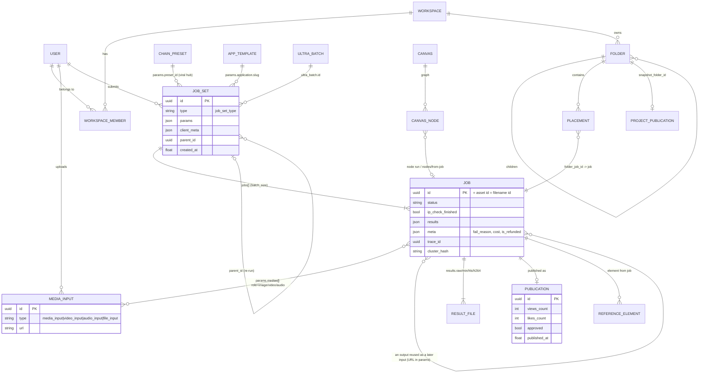
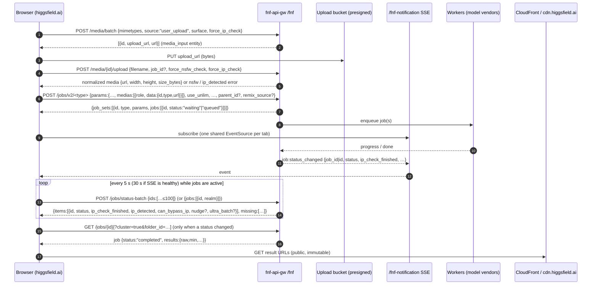
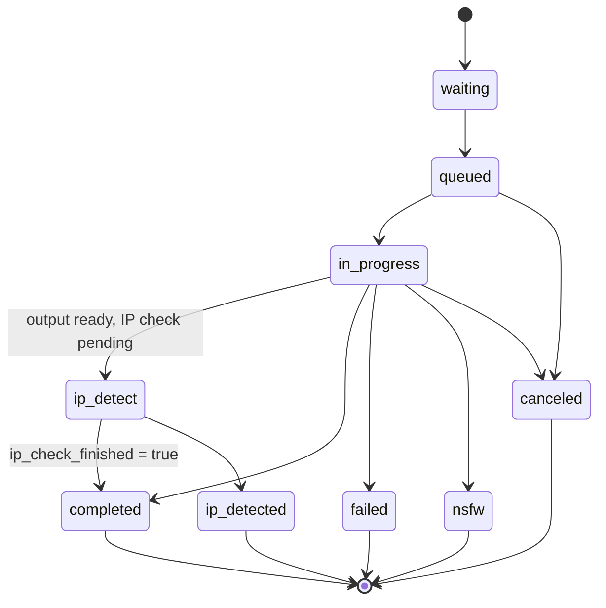

# How Higgsfield creates, identifies, stores and tracks generations

This covers how a generation on higgsfield.ai goes from an upload to a job, a stored file, a library item and a
community publication. It covers the ids, the job lifecycle (statuses, polling, push), CDN storage, where history is
kept on the server and in the browser, chains, workflows (apps), Canvas, projects and publishing.

**Date:** 2026-11-26. **Build studied:** `548e0f3a` (`samples/higgsfield/js2/`, gitignored). Chunk names below are
from that build.

**Method:**
- Static analysis of the public JS.
- 4,225 stored generations from the community scraper. The run for this doc is
  `runs/20261126-090252_re-jobs` (100 trending posts with `--detail --with-raw-params`), plus the earlier
  `re-models*` and `community-*` runs.
- A few GET-only checks: CDN headers, HLS playlists, Canvas templates, and two dummy-id calls.

No POST, PUT, PATCH or DELETE was sent, nothing was uploaded or generated, no login was used and no bot protection
was bypassed. One URL served a Cloudflare challenge; I stopped there (§8).

> Read first: [`MODEL_LOADING.md`](MODEL_LOADING.md) covers model registry, `defineJob` schemas, create bodies per
> model and costs. This doc does not repeat them. Related: [`scrapers/community.md`](scrapers/community.md),
> [`scrapers/projects.md`](scrapers/projects.md), [`HIGGSFIELD_DATA_INVENTORY.md`](HIGGSFIELD_DATA_INVENTORY.md).

**How claims are marked:**

| Label | Meaning |
|---|---|
| **verified (GET)** | I saw it in a live public response |
| **probe** | Status code from `samples/higgsfield/inventory/probe_results.jsonl` (2026-11-25, anonymous GET) |
| **from JS** | Seen only in the bundle; the endpoint was **not called** |
| **inferred** | My reading of the evidence |

---

## 1. TL;DR

```
 upload  POST /media/batch → PUT presigned S3 URL → POST /media/{id}/upload          (media_input id = UUID)
         big files: POST /uploads/multipart/{init,part-urls,complete}
            │   file lands at d2ol7oe51mr4n9.cloudfront.net/user_<clerk id>/<media id>.<ext>
            ▼
 create  POST /jobs/v2/<type> | /jobs/<kebab> | /chains/<name> | /workflows
         → {"job_sets":[{id, type, params, client_meta, parent_id, created_at, ultra_batch?, jobs:[{id,status,…}]}]}
            │   1 job_set = 1 submit; jobs[] = one per output (batch_size)
            ▼
 track   push:  SSE  fnf-api-gw.higgsfield.ai/fnf-notification/notifications/stream   event "job:status_changed"
         pull:  POST /jobs/status-batch {ids:[…≤100]} every 5 s (30 s while SSE is open)
         on change: GET /jobs/{id}  (or /job-sets/{id})
            ▼
 result  results.raw / results.min (+ hls, h264) → d8j0ntlcm91z4.cloudfront.net/user_<id>/hf_<YYYYMMDD_HHMMSS>_<job id>.<ext>
                                                  cdn.higgsfield.ai/…_min.mp4 | _thumbnail.webp | hls/job/<job id>/…/index.m3u8
            ▼
 library GET /jobs, /jobs/accessible, /project (job sets), /assets, /folders/{id}/items/v2, trash, favourites  (login)
            ▼
 publish POST /assets/publish {asset_ids:[job id]} → public GET /publications/{publication id}  (copies params + results)
```

Key facts:

- **Every id is a UUID** except user ids, which are Clerk ids (`user_` + 27 base62 characters).
- A **job id is also the asset id** in the library, the id in result filenames, and `trace_id` in most cases.
  A **publication id** is a different UUID. `/publications/{job id}` returns 404.
- **Result files are public, unsigned and immutable.** Responses carry `Cache-Control: public, max-age=31536000,
  immutable`. You can't list the buckets; you need the exact URL.
- The app has **push plus polling**. In this build an SSE stream delivers `job:status_changed`, and
  `/jobs/status-batch` is the fallback and safety net. This corrects `MODEL_LOADING.md`, which says there is no push
  channel.

---

## 2. Identifiers

### 2.1 Id formats (observed)

| Id | Format (observed) | What it identifies | Where you see it |
|---|---|---|---|
| **user id** | Clerk id `user_` + 27 base62 characters, e.g. `user_3Bu…` | The account. Also the top-level folder in both CDN buckets | `user_id` on jobs and publications; CDN paths |
| guest folder | literal `anon_user_id/` | Guest uploads (`POST /media/anon`) | Input URLs |
| staff folder | literal `content_user_id/` | Staff and contest content | Contest pages |
| **job id** (`id`) | UUID **v4**. 726 of 749 unique jobs. The other **23 are UUID v5**, all `magi_2` (§2.3) | **One output** (one image or one video) | `jobs[].id`; library asset id; result filename; `/jobs/{id}`; status-batch; HLS path |
| **job_set id** | UUID v4 (v5 for the same `magi_2` items) | **One submit** (one request, one prompt and parameter set, 1–N jobs) | `job_set_id`, `/job-sets/{id}`, `parent_id` of a later re-run |
| `job_set_parent_id` | job_set id or `null` | The job set this one was re-run or derived from (`parent_id` in the create body) | Always `null` in the 749 public items |
| `trace_id` | UUID | A pipeline trace. Equals the job id for 75% of items | `trace_id`; `GET /jobs/{id}/trace` (history) |
| `cluster_hash` | 32 hex characters (md5-like) | "Smart clustering" group of similar jobs | `cluster_hash`; `GET /jobs/{id}?cluster=true` |
| **publication id** | UUID v4 | A community post of **one job** | `publication.id`, `/publications/{id}` |
| **project publication id** | UUID v4 | A published project (film, series, carousel) | `/project-publications/{id}` |
| **project id** / folder ids | UUID v4 | A project is a **folder**. Publishing snapshots it (`snapshot_folder_id`, `original_folder_id`, `root_folder_id`) | Project publication detail |
| **folder id** | UUID v4 (validated by regex in JS) | A library folder or project, owned by a workspace | `folder_ids[]`, `params.folder_id`, `hf-access-realm` |
| `folder_job_id` | string | One **placement** of a job inside a folder (a job can sit in several folders) | Library items, `access.placements[]` |
| **media id** | UUID v4 or v5 | One upload. Kinds: `media_input` (image), `video_input`, `audio_input`, `file_input` | `params.medias[].data.id`; input filename |
| **workspace id** | UUID | A personal or team workspace (credits, members) | `hf-workspace-id` header, `workspace_id` |
| ultra-batch id | job id of a placeholder job | A large server-side batch (§3.7) | `job_sets[].ultra_batch.id` |
| `client_meta.group_id` | UUID | Client-side grouping of several submits (seen once) | `job_set_client_meta` |
| chain/viral preset id | UUID (v5 seen) | The preset graph a chain ran | `params.preset_id` |
| app template | slug, not a UUID | App workflow: `application_slug` + `application_template_slug` | `POST /workflows` body; `params.application.slug` |
| Canvas id, template id, node id | UUID (templates) | Canvas graph documents on `canvas-worker.higgsfield.ai` | `/canvas/{id}`, `/api/templates/{id}` |
| reference element id | UUID | A saved character, product or voice element, possibly built from a job | `params.reference_elements[]`, `/reference-elements/job/{id}` |

Timestamps: `created_at` and `published_at` are **unix seconds with a fractional part** (e.g. `1795651837.699106`).
The library mapper multiplies by 1000. Result filenames embed the **UTC** creation time
(`hf_20261126_001037_…`), which matches `created_at` to within a second for 77 of 100 items.

### 2.2 How they relate



Rules of thumb:

- **job set = request, job = output.** `batch_size: 4` gives 1 job set with 4 jobs. All four share `params`,
  `type` and `created_at`, but each has its own `status` and `results`. The web adapter flattens
  `job_sets[].jobs[]` into one row per job and copies `job_set_id`, `job_set_type`, `job_set_parent_id` and `params`
  onto each row.
- **A publication wraps exactly one job.** It repeats the job fields (`id` = job id, `job_set_id`, `params`,
  `results`, …) and adds `publication{…}` and `profile{…}`. Of 748 job sets in the samples, only 1 had more than one
  of its jobs published.
- **A project is a folder.** Generations placed in a project folder are the project's media. Publishing it makes a
  frozen copy (`snapshot_folder_id`).
- **Asset id = job id** for generations. Favourites and publishing send `{type:"job", id:<job id>}` and
  `asset_ids:[<job id>]`. Uploads use their media id and type (`media`→`media_input`, `video`→`video_input`, …).

### 2.3 Oddities in the samples

- **UUID v5 ids:** all 23 are `magi_2`. Each one's `created_at` is **exactly 86,400 s before** its filename
  timestamp, and it was published about 5 min after the file was written. This looks like server-seeded showcase
  content (deterministic UUIDs, backdated by one day) rather than user generations (inferred).
- **`trace_id` ≠ job id** for 320 of 4,225 items. They are mostly `nano_banana_2`, `nano_banana_2_1`,
  `seedream_v5_*` and `image_auto`. In 3 cases several jobs share one trace. `image_auto` routes to another model,
  so the trace is likely the upstream request (inferred). `magi_2` items have `trace_id: null`.
- **`meta.cost`** on some image jobs is a **JSON string** of the provider bill (`request_id`, token counts, …).
  It leaks vendor accounting and is not a credit price.

---

## 3. Lifecycle

### 3.1 Sequence



### 3.2 Upload (from JS, not called)

Chunk `SFmCACe0YcBh5r-G.js`, plus `MODEL_LOADING.md` §6.

| Step | Image (`media_input`) | Video (`video_input`) | Audio (`audio_input`) | File (`file_input`) |
|---|---|---|---|---|
| 1. create entity | `POST /media/batch` `{mimetypes:[…], source, surface, force_ip_check}`, or `POST /media` `{mimetype, is_hidden:true}` for hidden uploads | `POST /video` `{mimetype, force_ip_check?, is_hidden?}` | `POST /audio` `{extension, name}` | `POST /file` `{name, extension}` |
| 2. bytes | `PUT <upload_url>` (presigned S3) | same | same | same |
| 3. confirm | `POST /media/{id}/upload` `{job_id?, filename, force_nsfw_check, force_ip_check}` | `POST /video/{id}/upload?start_seconds&end_seconds` `{filename, force_nsfw_check, surface, folder_id}` | `POST /audio/{id}/upload` `{folder_id}` | `POST /file/{id}/upload` |
| multipart above | 50 MB | 100 MB | 100 MB | 100 MB |
| client max | 100 MB | 1,000 GB (effectively no cap) | 500 MB | 1 GB |

- **Multipart flow.** `POST /uploads/multipart/init {entity_type, entity_id, file_size}` returns
  `{upload_id, part_size, part_count, parts:[{part_number, url}], expires_in}`. The client:
  - checks `part_size` ≥ 5 MB (the S3 minimum) and `part_count == ceil(size/part_size)`;
  - re-requests part URLs with `POST /uploads/multipart/part-urls {entity_type, entity_id, upload_id,
    part_numbers}` 5 min before they expire;
  - finishes with `POST /uploads/multipart/complete {…, parts:[{part_number, etag}]}`;
  - cancels with `/uploads/multipart/abort`.

  The error text *"check the ExposeHeaders CORS config on the upload domain"* shows the browser PUTs straight to S3.
- **Confirm triggers moderation.** A `nsfw` or `ip_detected` result raises an error before any job exists.
- **Guests** use `POST /media/anon`. Their files land under `anon_user_id/`.
- Images may be compressed or resized in the browser first. The `do-not-compress-image` localStorage switch turns
  that off. Server-side `_resize` copies are referenced in the JS (§4), but none existed for 110 sampled public
  reference inputs checked on 2026-11-26, so they may be created only for some upload paths.
- **Where inputs are stored:** `https://d2ol7oe51mr4n9.cloudfront.net/user_<id>/<media id>.<ext>` (verified in
  params of public posts).

### 3.3 Create (from JS, not called)

The adapter `j8lj58UEh2bbmHmn.js` picks the route:

| Route | Used for |
|---|---|
| `POST /jobs/v2/<job_set_type>` | Modern model types (the route table in `MODEL_LOADING.md` §4.3) |
| `POST /jobs/<type with _ → ->` | Everything else, e.g. `/jobs/topaz-video` |
| `POST /chains/motion-control` | `kling2_6_motion_control` / `kling3_0_motion_control` with `isChain:true` |
| `POST /chains/reframe`, `/chains/reframe/batch` | `reframe` (batch when duration > 15.25 s) |
| `POST /chains/viral-hub` | `viral_hub_video` |
| `POST /chains/dubbing`, `/chains/voice-change` | `dubbing_lipsync`, `voice_change_merge` (table `X`) |
| `POST /workflows` | Apps (§6) |

Common body fields:

- `params` (the `defineJob` wire format);
- `use_unlim`, `use_free_gens`, `use_generation_seconds`, `use_free_daily_credits`;
- `confirmation_token` (after a confirm dialog);
- `parent_id` (a job set id, when re-running);
- `client_meta`;
- `remix_source:{publication_id, job_id}`, added only to `/jobs/v2/*` when the user arrived from a community post
  (§5.4).

**Every create route returns the same envelope**, and the client treats them all the same:

```json
{ "job_sets": [ {
    "id": "<job_set uuid>", "type": "<job_set_type>", "params": { "...": "..." },
    "client_meta": null, "parent_id": null, "created_at": 1795651837.69,
    "ultra_batch": null,
    "jobs": [ { "id": "<job uuid>", "status": "queued", "results": null,
                "ip_check_finished": false, "cost": 0, "meta": {} } ] } ] }
```

The UI inserts the new job set into the feed caches optimistically (`withFeedOptimistic`). The polling registry then
takes over.

### 3.4 Statuses

The enum is in `H2odSMT_fOKI1GMn.js` (`W`) and in the status module.

| Status | Class in the client | Meaning |
|---|---|---|
| `waiting` | **wait** (shown as queued) | Accepted, not yet queued (e.g. a concurrency limit) |
| `queued` | active | In the queue |
| `in_progress` (UI alias `processing`) | active | Running. May carry a `nudge` (a "rights" upsell) |
| `ip_detect` | active | Output exists but the IP/likeness check is still running. Equivalent to `completed` with `ip_check_finished:false` |
| `dna`, `script`, `visuals`, `vision`, `flow` | active | Stage values for multi-step products (agents, series, ads) |
| `completed` | done | `results` filled. Final only once `ip_check_finished` is `true` |
| `failed` | terminal | `meta.fail_reason` explains |
| `nsfw` | terminal | Moderation. With `deepfake_consent_required:true` the UI opens a consent flow instead |
| `ip_detected` | terminal | IP/likeness hit. **`results` are hidden** unless `can_bypass_ip:true`. `POST /jobs/{id}/ip-detect` exists (from JS; likely the appeal or bypass path) |
| `canceled` | terminal | `PUT /jobs/{id}/cancel` (from JS) |



The client never moves a job **backwards**. A status update ranked lower than the cached one (e.g. `queued` after
`in_progress`) is ignored. A terminal state is never overwritten by an active one.

### 3.5 Tracking: SSE push plus batch polling

The module `job-status-batch-api` and the registry in `E2NDnybsciNVEoC4.js` work as follows.

- **Push.** `realtime-url` builds `https://fnf-api-gw.higgsfield.ai/fnf-notification/notifications/stream`. One
  pooled SSE connection per URL subscribes to **`job:status_changed`**. The payload carries `job_id` (or `id`),
  `status`, `ip_check_finished` and so on.

  Reconnects use exponential backoff from 1 s up to 30 s with jitter. After 3 auth failures in a row the delay is
  capped at 5 min. `Retry-After` is honoured on 429 and 503. The stream counts as stale after 60 s, and it
  reconnects on `online`, `visibilitychange` and `pageshow`. It also keeps a `Last-Event-ID` style query parameter
  per URL.
- **Poll.**
  - A 5 s `setInterval` tick calls `POST /jobs/status-batch` for every "interested" job that isn't terminal.
  - The minimum gap is **5 s when SSE is down** and **30 s when SSE is open** (`lt=5e3`, `ut=3e4`).
  - Ids go in chunks of **100**, with a **15 s** timeout per request.
  - Body: `{ids:[…]}`, or `{jobs:[{id, realm:{…}}]}` when a job needs an access realm (§5.2).
  - A job named in `missing[]` **3 times** is "dropped" and re-polled only every **60 s**.
  - After **2** failed batches in a row, the poller backs off exponentially from 5 s.
  - A job with no update for **120 s** triggers a Sentry "Job status polling stalled" report.
  - New interest in a job fires an immediate (50 ms debounced) check.
- **Detail fetch.** When a batch item's status or `ip_check_finished` changes, the client fetches
  `GET /jobs/{id}` (`?cluster=true`, `&folder_id=` for folder views, plus `hf-access-realm`). This is cached under
  query key `["job-details-fetch", id, viewer, folderId, status, ip_check_finished]` with `staleTime: 0`.
  A 404 or 410 means the job was deleted.

  A whole job set can be fetched with `GET /job-sets/{id}`. Apps and a few legacy surfaces use
  `GET /jobs/{id}/status`.
- **Per-job cache:** the query key is `["job-status", <job id>]`.

`MODEL_LOADING.md` §4.4 describes a 3 s `setInterval`. I could not match that to the job tracker. It is probably a
different poller. The job tracker described here ticks every 5 s.

### 3.6 Completion: result files

`results` is an object keyed by variant:

| Variant | Image jobs | Video jobs |
|---|---|---|
| `raw` | `d8j0…/user_<id>/hf_<ts>_<job id>.png` (sometimes `.<sha256>.png`) | `d8j0…/user_<id>/hf_<ts>_<job id>.mp4` |
| `min` | `d8j0…/…_min.webp` | `cdn.higgsfield.ai/…_min.mp4`, plus `thumbnail_url` `…_thumbnail_min.webp` |
| `hls` | — | `cdn.higgsfield.ai/hls/job/<job id>/<uuid>/index.m3u8`, plus `thumbnail_url` `…_thumbnail.webp`. Seen on all 1,065 viral-hub items |
| `h264` | — | `cdn.higgsfield.ai/…_h264.mp4`, plus a thumbnail. 74 items: a re-encode for compatibility |

Notes:

- Some types (Soul, `topaz_image*`, `cinematic_studio_soul_location`) also fill a legacy single `result: {type, url}`.
  In those samples it equals `raw`.
- The UI shows `min` (or `thumbnail_url`) in grids and `raw` for download. Downloads are counted with
  `POST /jobs/{id}/track {download_variant}` (from JS).
- Vector outputs (Recraft) expose a `vectorUrl` derived in the client from `raw` and `min`.
- The `hls` master playlist is public (verified): renditions `index_1080p.m3u8`, `index_720p.m3u8`, …, H.264 and
  AAC, `Cache-Control: public, max-age=31536000, immutable`.

### 3.7 Failure, refund, cancel, hide

- **Failure:** `status` becomes `failed`, `nsfw`, `ip_detected` or `canceled`, and `meta.fail_reason` holds a
  string. The UI maps it through `mA()`.
- **Submit-time errors** come back as `detail.error_type` before any job exists. Values seen in JS:
  `not_enough_credits`, `nsfw`, `ip_detected`, `batch_size_not_allowed`, `folder_limit_reached`,
  `folders_not_available`, `storage_quota_exceeded`, `workspace_member_spend_paused`,
  `free_trial_model_requires_plan`, `not_enough_boost_credits`, `auto_top_up_*`, `subscription_renewal_failed`,
  `rate_limit_error`, `ip_check_rate_limit_reached`, `image_recognition_failed`.
- **Refunds** are server-side, and no client refund call exists. Signals:
  - `job.meta.is_refunded` (read for `grok_video_edit`);
  - `ultra_batch.status = "refunding"`;
  - a `wan3_0_unlim_refund` promo object on the user.

  Credits are charged at submit; failed jobs appear to be refunded automatically (inferred from `is_refunded`).
- **Cancel:** `PUT /jobs/{id}/cancel`. **Hide a job set:** `POST /job-sets/{id}/hide`, retried up to 10 times with
  a delay of `(n+1)²` s. **Seen markers:** `POST /jobs/{id}/view` (smart clustering) and `POST /jobs/{id}/viewed`
  (drives the `unviewed` filter). All from JS.
- **Ultra batch:**
  - `GET /jobs/v2/ultra-batch/availability` returns `{available, job_set_types[], max_size, max_parallel_jobs,
    max_parallel_batches, running_batches}`.
  - A job set with `ultra_batch:{id, status:"running"|"refunding"|…, completed}` is a server-side bulk run. Its
    `ultra_batch.id` is a placeholder job id.
  - New jobs appear over time; the client re-reads the job set as `completed` grows.

---

## 4. Storage

### 4.1 Hosts

| Host | Backend (from response headers) | Holds | Path pattern | Caching |
|---|---|---|---|---|
| `d2ol7oe51mr4n9.cloudfront.net` | CloudFront → **S3** (`Server: AmazonS3`, SSE-AES256, `x-amz-version-id` so the bucket is versioned) | **Inputs and uploads**; avatars; project covers | `user_<clerk id>/<media uuid>.<ext>`, `…_resize.<ext>`, `anon_user_id/…`, `content_user_id/…` | `public, max-age=31536000, immutable` |
| `d8j0ntlcm91z4.cloudfront.net` | CloudFront → **S3** (versioned, SSE) | **Generation outputs**: `raw` for all, image `min` | `user_<id>/hf_<YYYYMMDD_HHMMSS>_<job id>[_min][.<sha256>].<ext>`. Before 2026 mostly `user_<id>/<uuid>.<ext>` | same, 1 year immutable |
| `cdn.higgsfield.ai` | **Cloudflare** (likely R2 or an origin pull; `Access-Control-Allow-Origin: *`) | **Video derivatives** (`_min.mp4`, `_thumbnail.webp`, `_thumbnail_min.webp`, `_h264.mp4`), **HLS** (`hls/job/<job id>/<uuid>/…`), upload thumbnails `<media id>_thumb.webp`, card previews `card_preview/video_input/<media id>/compressed.mp4`, static style art (`soul-v2-style/…`, `cinema_studio_40_creative_controls/…`) | as listed | Derivatives `max-age=14400` (4 h); HLS 1 year immutable |
| `static.higgsfield.ai`, `assets.higgsfield.ai`, `static-public-media.higgsfield.ai`, `d1xarpci4ikg0w.cloudfront.net` (Canvas templates), other `d*.cloudfront.net` | CDN | Site and marketing assets, template thumbnails | — | — |
| `higgsfield.ai/cdn-cgi/image/…` | Cloudflare Image Resizing | On-the-fly thumbnails: `fit=cover\|scale-down,format=webp,onerror=redirect,width=…[,height][,quality]` wrapped around any media URL | — | — |

The two S3 buckets are separate from the Cloudflare host:

- `cdn.higgsfield.ai/<raw path>.mp4` returns 404;
- `d8j0…/<…>_min.mp4` and `d8j0…/<…>_thumbnail.webp` return 403;
- a missing key returns **403 AccessDenied** (S3 without ListBucket), not 404.

You can't enumerate the buckets. A URL needs the Clerk user id, the UTC timestamp and the job id.

### 4.2 Signing, expiry, retention

- **No signing.** The URLs have no query string, cookie or token. They are plain public objects, and the stored URL
  is the permanent URL. Only **upload** URLs are presigned and short-lived (`expires_in`, refreshed 5 min early).
- **Retention.** In a spot check over time:
  - files from 2025-10-14 onward, and a staff image from 2026-05-09 hard-coded in JS, still answer 206;
  - the oldest sample (2025-10-04, `wan2_5_video`, old `<uuid>.mp4` naming) returns 403, so it was deleted or
    moved.

  There is no visible expiry policy. Deleting a job (trash → `delete-forever`) likely removes the objects
  (inferred). Storage is metered per workspace (`storage_quota_exceeded`, `stats.size_bytes` on projects).
- **Blur placeholders:** none come from the API. There is no blurhash or thumbhash field. The UI blurs with CSS
  (`blur_radius`) for NSFW or IP-held items, and uses `min` or `thumbnail_url` as the low-res placeholder.
- **Watermarks:** in an older sample (`MODEL_LOADING.md` §4.4) the `raw` URL ended in `_wm3.mp4`, so a watermarked
  copy can be the stored `raw` for some plans or products. Talent contracts have a `watermark_required` flag. The
  current samples have no `_wm` suffix.

### 4.3 Image vs video variants

| | Image | Video |
|---|---|---|
| Original | `raw` PNG/JPG/WebP on `d8j0…` | `raw` MP4 on `d8j0…` (e.g. 17.9 MB) |
| Preview | `min` = `_min.webp` on `d8j0…` | `min` = `_min.mp4` on `cdn.higgsfield.ai` (e.g. 1.1 MB) |
| Thumbnail | — (resized via `cdn-cgi/image`) | `_thumbnail.webp`, `_thumbnail_min.webp` (about 19 KB) |
| Streaming | — | `hls` (viral hub and others), `h264` re-encode |
| Input copy | `<media id>.<ext>` and `<media id>_resize.<ext>` on `d2ol7…` | `<media id>.mp4`, plus `<media id>_thumb.webp` and `card_preview/video_input/<id>/compressed.mp4` on `cdn.higgsfield.ai` |

---

## 5. Where history is kept

### 5.1 Server-side library (login only; from JS, **not called**)

All under `https://fnf-api-gw.higgsfield.ai/fnf`, with a Clerk bearer token.

| Endpoint | What it lists | Query parameters (from JS) |
|---|---|---|
| `GET /jobs` | The user's own generations, one row per job (`{jobs:[…], cursor…}`) | `job_set_type` (repeatable), `status` (repeatable), `cursor`, `size` (50), `ordering`, `only_downloaded`, `start_date`, `end_date`, `gen_type` |
| `GET /jobs/accessible` | Jobs across workspaces and folders the user can see | the above plus `workspace_id[]`, `liked_by[]`, `hide_failed`, `unviewed` |
| `GET /project` | **Job sets** (not projects; the name is legacy) → `{job_sets, has_more}` | `job_set_type[]`, `gen_type[]` (`video`/`image`/`speak`), `created_at` (cursor), `size` (20), `parent_id`, `ordering`, `shared`, `status[]` |
| `GET /job-sets/{id}`, `GET /jobs/{id}` | Detail (+`?cluster=true&folder_id=`) | — |
| `GET /jobs/{id}/trace` | Generation history or versions of a result | `ordering`, `size`, `cursor`, `show_all` |
| `GET /assets` | The **library** ("Assets"): generations plus uploads, as asset rows | `category` (`all`/`image`/`video`/`upscale`/`lipsync`/`voice`/…), `job_set_type` |
| `GET /assets/count` | Counts per tab: `{all, image, video, upscale, lipsync, voice, favourites, videoEditFeed}` | `folder_id` |
| `GET /assets/{id}/detail` | One asset with access info | `folder_id`, `surface` |
| `GET /assets/favourites`, `/assets/favourites/job-sets`, `/assets/favourites/feed` | Favourites ("liked") | `job_set_type`, `folder_id`, `ordering` |
| `POST /favourites/like` / `unlike` | `{items:[{type:"job", id}], folder_id?}` | — |
| `GET /folders`, `/folders/accessible`, `/folders/shared`, `POST /folders/pinned` | Folders and projects | `search`, `sort_by`, `surface`, `workspace_id`, `access_mode`, `recent_jobs_count`, `include_members_preview`, `only_unpinned` |
| `GET /folders/{id}`, `/children`, `/stats`, `/info`, `/compose-view`, `/members/v2`, `/usage/breakdown`, `/credit-limit` | Folder detail, sub-folders, stats, members, spend | — |
| `GET /folders/{id}/items/v2` | **Items in a folder** | `cursor`, `size`, `ordering`, `job_set_type`, `status`, `type`, `user_id`, `review_status`, `start_date`, `end_date`, `include_subfolders`, `hide_failed` |
| `GET /folders/{id}/items/locate` | Find an item's page | `item_id` \| `job_id` \| `job_set_id`, `include_subfolders` |
| `GET /folders/{id}/assets`, `/public-assets`, `/jobs` | Folder content views | `category`, `job_set_type` |
| `POST /folders/{id}/add` `{asset_ids}`, `/items`, `/move`, `/relocate`, `/duplicate`, `/transfer`, `/migrate`; `DELETE /folders/{id}/remove` | Organise | — |
| `DELETE /assets` `{asset_ids, source?}` | Delete, i.e. move to **trash** | — |
| `/trash/entries/{id}`, `/contents`, `/restore`, `/delete-forever`, `/trash/restore`, `/trash/delete-forever`, `/folders/{id}/trash`, `/trash/count`, `/trash/empty`, `/delete-preview` | Trash with restore | — |
| `GET /media/accessible`, `/video/accessible`, `/file/accessible`; `GET /input-images/{id}`, `/input-videos/{id}`; `/media/status`; `DELETE /media/{id}`, `/media/batch`; `POST /audio/{id}/hide` | **Uploads** history | `cursor`, `size`, `order`, `sort_by`, `created_at` |
| `/reference-elements`, `/v2/reference-elements/*` | Saved elements (characters, products, voices). `PATCH /reference-elements/job/{id}` turns a job into an element | `category`, `filter`, `pinned`, `folder_id`, `query`, `ip_detected` |
| `/boards/{id}/jobs` | Legacy boards (`board_ids[]` on jobs, always `[]` in samples) | — |

**A library row (asset)**, from the mapper `OA()`:

```text
id (job id), folder_job_id, workspace_id, user_id, created_at (unix s),
status, results{raw,min,…}, meta.fail_reason, params, job_set_type, job_set_id,
is_favourite, published_at (non-null = published), folder_ids[], comments_count, has_unresolved_comment,
ip_check_finished, ip_detected, can_bypass_ip, user{…},
access{ source: "unfiled"|"folder"|"unresolved",
        placements:[{folder_id, folder_job_id, review_status, capabilities}],
        can_download, can_track_download, can_comment, can_like, can_copy, can_delete, can_publish }
```

**Workspaces and shared access:**

- **`hf-workspace-id: <uuid>`** scopes requests to a team workspace. You switch with `POST /workspaces/context
  {workspace_id}`, and the choice is remembered in localStorage `hf:workspace:stable`.
- **`hf-access-realm`** is a JSON header. A patched `window.fetch` adds it automatically to `/jobs/`, `/job-sets/`,
  `/assets/` and `/favourites/` calls. Realm kinds (from `aXyXjC_KHBp09DNW.js`):

  ```json
  {"kind":"folder","folder_id":"<uuid>"}            // shared folder / project member
  {"kind":"share_link","share_code":"<≤64 [A-Za-z0-9_-]>"}   // share link
  {"kind":"publication"}                             // viewing a job via its community post
  {"kind":"blog_post","post_id":"<uuid>"}
  {"kind":"contest_submission","submission_id":"<uuid>"}
  {"kind":"workspace","workspace_id":"<uuid>"}
  ```

  Status-batch sends the realm per job (`{jobs:[{id, realm}]}`).
- **Shared links:** `/share`, `/publications/{id}/share`, and the `/<tool>_/shared_/$code` routes (`ai-influencer`,
  `ai-reels`, `genjutsu`, `katana`, `what-if`). Public folder views use `GET /folder/{id}/preview` and
  `GET /assets/{id}/public?folder_id=` (§8).

### 5.2 Browser storage

**IndexedDB: `hf-generate-cache-v1`** (`aXyXjC_KHBp09DNW.js`):

- A persisted TanStack Query cache for the generate page. Store `queries`; buster `generate-cache-schema-v1`.
- Max age **3 days** (`2592e5` ms).
- Three families:

  | Family | Limits | Query keys covered |
  |---|---|---|
  | `assets` | 12 MB, 48 entries | `["hf:namespace:asset","assets",…,"hf:scope:generate-cache"]` |
  | `folders` | 8 MB, 256 entries | `asset-folder`, `asset-folder-children` |
  | `projects` | — | `accessible-folders`, `shared-folders`, `pinned-folders` |

- It is scoped to `{ownerId, sessionId, workspaceId}`, remembered in localStorage
  `hf:generate-cache:last-confirmed-scope:v1`, and wiped on logout.
- It is gated by the per-user feature `generate_persisted_cache` (from `/user/features`; overridable with
  `hf:feature-override:generate_persisted_cache`).
- `idb-keyval` (`keyval-store`) is also present.

**TanStack Query keys** that hold history in memory:

- `["job-status", id]`, `["job-details-fetch", …]`, `jobset`;
- `assets`, `asset-details`, `asset-trace`, `asset-categories-count`, `asset-folder(s)`, `asset-folder-children`,
  `asset-folder-stats`, `asset-folder-by-project-slug`;
- `job-folders`, `shared-folders`, `job-set-favourites`, `member-assets`, `medias-list`;
- `library-trash`, `project-trash`, `reference-elements`, `element-folders`, `folder-info`;
- `job-set-chain-presets`, `mixed-media:presets`, `ms2:generation-catalog`;
- `publication-likes`, `["feature-flags", userId]`.

Namespaces: `hf:namespace:user`, `hf:namespace:workspace`, `hf:namespace:asset`.

**localStorage and sessionStorage keys:**

| Purpose | Keys |
|---|---|
| Per-model form state (last settings; "recreate" target) | `hf:video-seedance-2-5-store:v1`, `hf:video-kling-3-store:v2`, `hf:video-kling-4-store:v1`, `hf:video-magi-2-store:v1`, `hf:video-minimax-h3-store:v2`, `hf:video-cinematic-studio-4-0-store:v1`, `hf:video-grok-video-v15-store:v1`, `hf:video-wan-3-0-store:v1`, … (about 35 `hf:video-*-store`), `hf:imagegen-2-0-image-form:v2`, `hf:upscale-video-form-general`, `hf:evolution-form:media:v1`, `hf-ai-influencer-manual-store` |
| Generation panel | `hf:gen-panel-v1:V2026-04-25`, `hf:gen-panel-multishot-v1:V2026-03-09`, `hf:gen-panel-nsfw-v1:V2026-03-13` |
| Prompt and instruction history | `hf:video:instruct-history`, `hf:video:instruct-history-040925`, `hf:video:canvas:instruct-161125`, `hf:instruct:job-040925`, `hf:video-hf-mult-recreated-prompts:v1` |
| Feed and library views | `hf:{video,image,mixed-media,cinematic-studio}-feed-view-controls[:2026-03-28]`, `hf-image-feed-filters`, `new-mobile:feed-settings`, `hf:own-generation-data-source`, `hf:media-player-preferences` |
| Recreate and remix | sessionStorage `hf:genjutsu-recreate-origin:v1` = `{sourceVideoId, presetId, presetMediaIds[], inputAssetCount, publicationId?, feedSessionId?, requestId?}`; `hf:genjutsu-picked-from-video-model-list`, `hf:genjutsu-video-page-mode` |
| Workspace and session | `hf:workspace:stable`, `hf:last-used-sign-in-method`, `hf:auth-telemetry:v1` |
| Misc | `hf:sora-draft-migration`, `hf:guest-media-consent`, `do-not-compress-image`, `hf:credit-top-up:last-threshold`, `hf-job-id` and `hf-media-links` (seen as strings; usage not traced) |

**URL state:**

- `?model=<model version id>` and the tool mode from the path (`MODEL_LOADING.md` §2.2).
- `?remixPublicationId=<pub>&remixJobId=<job>` (§5.4).
- `/canvas/{id}`, `/library/`, `/asset/…`, `/debug/supercomputer/$folderId`, `/generate/{…}/folders/{id}`.

### 5.3 Re-run, retry and recreate from the user's own history (from JS)

Module `video-legacy-resubmit` (`7neBbGmjVy-OZO45.js`):

- **retry** re-submits the same params. **rerun** re-submits with a **new random `seed`** and, for some types,
  `job_set_id` of the source (`image2video`, `wan2_2_*`).
- Both need `user.id == job.user.id` (`job-resubmit-owner-required`). `batch_size` is forced to 1.
- An **app** job is detected by `params.application.slug` and redirected to the app page instead of re-submitted.
- Type migrations happen on the way. For example `seedance_2_5_kling_upscale` → `seedance_2_5`, and
  `kling_elements` → `kling_element_ids`.

### 5.4 Recreate or remix from a community post

- The post detail (`GET /publications/{id}`, public) carries the full `params`. "Recreate" passes them through the
  model's `defineJob(...).fromProvider` to rebuild form state, then writes that into the per-model store. The
  `feed-recreate-command-model` lets the user pick which parts to copy: `All`, `Prompt`, `Model`, `Image`, `Video`,
  `Audio`, `Preset`, `Surface`.
- The page URL gets `remixPublicationId` and `remixJobId` (validated `^[\w-]{1,128}$`). The
  `community:remix-source` request extension then adds `remix_source:{publication_id, job_id}` to the next
  **`POST /jobs/v2/*`** body, but not on resubmits and not on other routes. This lets the server attribute remixes
  (and count `clones` on profile publications).
- Input media are re-used **by URL**. The params keep the original `d2ol7…/user_<author>/<media id>.png` URLs, so a
  remix points at another user's uploaded file. In samples, 12 inputs pointed at earlier **outputs**
  (`d8j0…/hf_…`), meaning a generation was fed into another one.

---

## 6. Chains, workflows and Canvas

### 6.1 Chains (from JS, not called)

Routes: `/chains/{viral-hub, mixed-media, mixed-media-preview, motion-control, reframe, reframe/batch, dubbing,
voice-change, draw-to-video, beat-fit-nano-banana, sticker-matchcut, game-character-creator,
seedance-eye-mask-sam}`.

- **Node graph.** Viral-hub presets (`/viral-hub/presets/all`, public; `catalog` scraper) are graphs:
  - `inputs[]` with `binds_to:[{node, port}]`;
  - per-node `param_choices`;
  - `price_matrix` keyed `"<node>.<param>=<value>,…"`.

  Mixed-media presets use `/mixed-media/configs?preset_id=` (login). Chain presets per product come from
  `/job-set-chain-presets?product_key=` (login) and `/viral-hub/chain-presets/{id}`.
- **Chain run vs jobs.** A chain submit returns the **same `job_sets[].jobs[]` envelope** as a plain job. The client
  flattens and tracks it like any job. The intermediate graph steps don't show as separate jobs in the client (the
  server runs them; inferred).

  The stored job has:
  - `job_set_type` = the product (`viral_hub_video`, `reframe`, `dubbing_lipsync`, …);
  - `params.preset_id` = the graph;
  - `job_set_client_meta.source` = the surface (`viral_hub_web` on all 1,065 viral items).

  Viral outputs come with an `hls` variant.
- **Status.** Same enum. The multi-step stage values (`dna`, `script`, `visuals`, `vision`, `flow`) are how longer
  pipelines report progress.

### 6.2 Workflows: apps and templates (from JS, not called)

```http
POST /fnf/workflows
{ "width": 1024, "height": 1536,
  "params": [ {"id": "<field id>", "value": "<text | number | {url,…} | [{url,…}]>"} ],
  "application_slug": "<app slug>", "application_template_slug": "<template slug>" }
```

- File fields are uploaded first (`forceNsfwCheck:true`; width and height come from the first image).
- The response is the usual `{job_sets:[…]}`. The client inserts `job_sets[0]` into the feed
  (`invalidate:"api"`) and tracks it.
- The server expands the template into a fixed model and params. The stored params then include
  `application.slug`, which is how re-run detects app jobs.
- Templates and their static credit cost are in the SSR page loader (`site` scraper, `MODEL_LOADING.md` §5).
- A few apps bypass `/workflows` and call a job or chain directly (`/jobs/face-swap`, `/chains/beat-fit-nano-banana`,
  …).

### 6.3 Canvas and Flow (`canvas-worker.higgsfield.ai`)

| Endpoint | Status |
|---|---|
| `GET /api/templates` | **verified (GET), public**: 5 templates, e.g. "Simple Seedance 2.0", "Long Video Example", "StoryBoard With Elements". Fields: `{id (uuid v4), name, description, thumbnail_url, created_at}` |
| `GET /api/templates/{id}` | **verified**: same fields |
| `GET /api/templates/{id}/preview` | 404 |
| `GET /api/canvases` | 401 `AUTH_TOKEN_MISSING` |
| From JS | `/api/flow/{id}`, `/run`, `/nodes/{node}/cancel`, `/nodes/from-job` (import an existing job as a node), `/duplicate`, `/node-types`, `/versions`, `/versions/{v}`, `/versions/{v}/restore`, `/preview`, `/preview/private`, `/auth`; `/api/templates/{id}/use`, `/auth` |

The graph itself syncs over a **WebSocket**: `wss://canvas-worker.higgsfield.ai/api/flow/connect/{id}?ticket=…`
(binary by default, `&format=json` optional). Templates use `/api/templates/{id}/connect`. The ticket comes from
`/auth`.

Nodes reuse the same `defineJob` schemas (`{nodeType:"seedance_2_5", fieldId:"bitrate_mode"}`). A node run produces
normal jobs that land in the library, as `nodes/from-job` and the shared job tracker suggest (inferred).

Canvas has **versions** (snapshot and restore). Project publications expose `show_canvas`, so a published project
can reveal its canvas.

### 6.4 Projects and series

- **Project = folder.** The UI's "projects" family queries are folder queries (`accessible-folders`,
  `shared-folders`, `pinned-folders`). Generating with `folder_id` in params (seen in 2 public items) files the job
  straight into a project.

  `GET /workspaces/projects/usage-stats` and `/folders/{id}/usage/breakdown` give spend. A project publication's
  detail shows the roll-up: `stats.generations_count`, `stats.credits_spent`, `stats.size_bytes`,
  `stats.stack[{job_set_type, count, credits_spent}]`.
- **Publishing a project** creates a `project_publication` with `project_id`, `snapshot_folder_id` (a frozen copy),
  `original_folder_id`, and `media[]` items typed `media`, `video` or `job`.
- **Series** live on `fnf-api-gw.higgsfield.ai/fnf-series` (`/series`, `/series/{id}`, subscribe, vote; episodes
  `/episodes/{id}/reaction`). Login only (probe: `/series` 401).
- Other multi-step products keep their own project and run ids: `/realtor-studio/projects/{id}/runs/{run}/screens/…`,
  `/mangaka/$projectId/{analyze,cast,production}`, `/youtube-faceless/episodes/{id}`. They are not covered here.

---

## 7. Publishing

From JS, not called:

| Call | Body / effect |
|---|---|
| `POST /assets/publish` | `{asset_ids:[<job id>, …]}`: share library items to the community |
| `POST /publications` | Create a publication. The body was not pinned down; it is called from the share dialog |
| `DELETE /publications/{id}` | Unpublish |
| `POST /publications/{id}/share`, `/report`; `PUT/DELETE /publications/{id}/vote`; `/publications/{id}/like` | Engagement |
| `POST /contests/{id}/submissions`, `/projects` | Contest entries (`contest_submission` profile publications) |

**Visibility:**

- `published_at` on the asset becomes non-null.
- Profile publications come in three types: `asset` (a job), `project` / `project_publication`, and
  `contest_submission`. Each carries `views` and `clones` (remix count).
- Curation: `publication.approved` (the `approved` feed) and `pinned_at`.
- Projects also have `is_discoverable`, `show_prompts` and `show_canvas`.

**Fields copied into the public record** (verified on 100 detail and 4,225 listing items):

```text
job_set_type, job_set_id, job_set_parent_id, job_set_client_meta, board_ids,
params            ← full wire params, incl. prompt and input media URLs (uploads are public)
meta              ← {} or {cost:"<provider JSON string>"}
id (= job id), status ("completed" only), ip_check_finished, ip_detected, can_bypass_ip, deepfake_consent_required,
result, results{raw,min[,hls,h264]}, created_at, published_at, user_id (Clerk id), trace_id, cluster_hash,
representation (null), drama (null),
publication{id, views_count, likes_count, is_liked_by_user, approved, pinned_at},
profile{username, avatar_url, social handles, badges}   ← personal data; redacted in our raw output
```

Only `completed` jobs appear publicly. Workspace, folder and access fields are **not** copied.

The app has a `{"kind":"publication"}` access realm, which suggests a post viewer can open the underlying job
(`GET /jobs/{id}` with that header). Whether this works without a login is unknown. I did not call it.

---

## 8. Every related endpoint

Base `https://fnf-api-gw.higgsfield.ai/fnf` unless a full host is given. "probe" = anonymous GET status from
`probe_results.jsonl`. A 401, 403 or 422 there only proves the route exists.

| Method | Path | Auth | Purpose | Evidence |
|---|---|---|---|---|
| GET | `/publications/community/{trending,approved,model-x,trending/top}` | public | Community feeds of published jobs | **verified (GET)** |
| GET | `/publications/{publication_id}` | public | One post (full job copy). 404 for a job id | **verified (GET)** |
| GET | `/publications/feed` | ? | Feed (`type`, `search`, `limit`, `offset`) | probe 422 |
| GET | `/project-publications`, `/recommended`, `/categories`, `/{id}`, `/{user}/{slug}` | public | Project publications | **verified (GET)** (projects scraper) |
| GET | `/job-sets/costs` | public | Price table | **verified (GET)** |
| GET | `/viral-hub/presets/all`, `/viral-hub/types` | public | Chain preset graphs | **verified (GET)** (catalog) |
| GET | `https://canvas-worker.higgsfield.ai/api/templates`, `/api/templates/{id}` | public | Canvas templates | **verified (GET)** |
| GET | `https://canvas-worker.higgsfield.ai/api/canvases` | login | User canvases | **verified** 401 |
| GET | `/folder/{id}/preview` | login | Folder preview | **verified** 401 (dummy id) |
| GET | `/assets/{id}/public?folder_id=` | ? | Public asset in a shared folder | **Cloudflare challenge** (403 "Just a moment…"); not pursued |
| GET | CDN result, input, HLS URLs (§4) | public | Files | **verified (GET)**, 206 with Range |
| GET | `https://fnf-api-gw.higgsfield.ai/fnf-notification/notifications/stream` | login | SSE `job:status_changed` | from JS (not called) |
| POST | `/jobs/status-batch` `{ids}` / `{jobs:[{id,realm}]}` | login | Poll statuses | from JS; probe GET 422 |
| GET | `/jobs/{id}` (`?cluster`, `folder_id`), `/jobs/{id}/status`, `/job-sets/{id}` | login | Job / job-set detail | from JS (not called) |
| GET | `/jobs/{id}/trace` | login | History / versions | from JS (not called) |
| GET | `/jobs` | login | Own jobs feed | from JS; probe 403 |
| GET | `/jobs/accessible` | login | Jobs across workspaces and folders | from JS; probe 401 |
| GET | `/project` | login | Job-set feed | from JS; probe 401 |
| POST | `/jobs/v2/{type}`, `/jobs/{kebab}`, `/jobs/v2/{type}/dry-run`, `?dry_run=true` | login | Create / quote | from JS; probe 401/422 |
| GET | `/jobs/v2/ultra-batch/availability` | login | Ultra-batch limits | from JS (not called) |
| POST | `/chains/*` (13 routes, §6.1) | login | Chain runs | from JS; probe 401 |
| POST | `/workflows` | login | App runs | from JS (not called) |
| PUT | `/jobs/{id}/cancel` | login | Cancel | from JS (not called) |
| POST | `/jobs/{id}/ip-detect`, `/jobs/{id}/view`, `/jobs/{id}/viewed`, `/jobs/{id}/track`, `/job-sets/{id}/hide` | login | IP appeal, seen markers, download tracking, hide | from JS (not called) |
| POST | `/jobs/seedance/confirm-rights/batch` | login | Rights confirmation | from JS (not called) |
| POST | `/media/batch`, `/media`, `/media/anon`, `/video`, `/audio`, `/file` | login / guest | Create upload entity | from JS; probe 401/403 |
| PUT | presigned `upload_url` | URL-signed | Upload bytes | from JS (not called) |
| POST | `/media/{id}/upload`, `/video/{id}/upload`, `/audio/{id}/upload`, `/file/{id}/upload` | login | Confirm upload + NSFW/IP check | from JS (not called) |
| POST | `/uploads/multipart/{init,part-urls,complete,abort}` | login | Multipart | from JS (not called) |
| GET/DELETE | `/media/accessible`, `/video/accessible`, `/file/accessible`, `/media/{id}`, `/media/status`, `/input-images/{id}`, `/input-videos/{id}`, `/media/{id}/ip-check`, `/video/{id}/meta` | login | Uploads | from JS; probe 401 |
| GET | `/assets`, `/assets/count`, `/assets/{id}/detail`, `/assets/favourites*` | login | Library | from JS; probe 401 |
| POST/DELETE | `/assets/publish`, `DELETE /assets`, `/favourites/like`, `/favourites/unlike` | login | Publish, delete, favourite | from JS (not called) |
| * | `/folders*`, `/folder-items/{id}*` (§5.1) | login | Folders and projects | from JS; probe 401 |
| * | `/trash/*`, `/folders/{id}/trash*` | login | Trash | from JS (not called) |
| POST/DELETE | `/publications`, `/publications/{id}` | login | Publish / unpublish | from JS; probe GET 401 |
| * | `/reference-elements*`, `/v2/reference-elements*` | login | Elements | from JS; probe 401 (`/reference-elements/voices` 200) |
| * | `/series*` (`fnf-series`), `/boards/{id}/jobs` | login | Series, legacy boards | from JS; probe 401 |
| POST | `/workspaces/context` | login | Switch workspace | from JS; probe 405 |
| WS | `wss://canvas-worker.higgsfield.ai/api/flow/connect/{id}?ticket=` | ticket | Canvas sync | from JS (not called) |
| * | `canvas-worker …/api/flow/{id}/{run,nodes/…,versions,…}` | login | Canvas | from JS (not called) |

---

## 9. What can and can't be scraped

**Can (public, GET):**

- For every community post: `job id`, `job_set_id`, `job_set_type`, the **full params** (prompt, settings, input
  media URLs), all result variants, `created_at`/`published_at`, engagement, `cluster_hash`, `trace_id`, and
  `client_meta.source`. This is the `community` scraper.
- The media themselves (raw, min, thumbnails, HLS, inputs). They are public, unsigned and immutable, so a URL saved
  today stays valid until the owner deletes it.
- Project publications with their snapshot folder ids and per-model credit roll-ups (`projects` scraper).
- Canvas template list. Viral and chain preset graphs (`catalog`).

**Can't (login, or not ours to take):**

- Any user's library, job-by-id, job set, status, folders, favourites, trash, uploads list, workspaces.
- The SSE stream, Canvas graphs (WebSocket), series.
- Bucket listing (S3 403). There is no public lookup from a job or job_set id to a publication.
- `/assets/{id}/public` sits behind a Cloudflare challenge, which we must not bypass.

**Ideas:**

1. **Job → publication index.** No public endpoint resolves a `job_set_id` or job id to a publication, and
   `/publications/{job id}` returns 404. Build the map locally: every community listing item already carries
   `id`, `job_set_id` and `publication.id`. Persist `job_id → publication_id` and `job_set_id → [publication_id]`
   across runs (append-only) so any job id seen elsewhere (a CDN URL, an input reference, an HLS path) can be joined
   back to its post.
2. **Lineage graph.** Parse `params.medias[].data.url` and `reference_elements[].medias[].url`:
   - a `d8j0…/hf_<ts>_<job id>` URL is an earlier **generation** used as input (gives a job → job edge);
   - a `d2ol7…/<media id>` URL is an upload;
   - the same media id across posts reveals remixes.
3. **Media manifest / downloader.** For each job emit every variant (raw, min, thumbnail, h264, hls master plus
   renditions) with size from a 1-byte Range GET. Use `Last-Modified` as the completion time. Use the filename
   timestamp minus `created_at` for queue latency (≈0 for images; −86,400 s flags seeded content).
4. **Seeded-content flag.** UUID v5 ids combined with `created_at` exactly 24 h before the file time point to
   server-seeded showcase posts. Worth a boolean column.
5. **Canvas template scraper.** `GET canvas-worker…/api/templates` is a cheap public addition to `catalog` or
   `site`.
6. **Provider cost mining.** `meta.cost` JSON on some image jobs (token counts per request) could calibrate cost
   estimates. Treat it as sensitive vendor data and keep it opt-in.

---

## 10. Confidence

| Claim | Status |
|---|---|
| Id formats, v4/v5 split, `trace_id`/`cluster_hash`, job id in filenames and HLS paths, filename timestamp ≈ `created_at` | **Verified** on 4,225 public items (749 unique in the detail scan) |
| Publication = one job; fields copied; `/publications/{job id}` → 404 | **Verified** (GET) |
| CDN hosts, S3 vs Cloudflare, no signing, 1-year immutable caching, 403 on unknown keys, HLS renditions | **Verified** (GET with Range) |
| Retention (files from 2025-10-14 on still live, one 2025-10-04 file gone) | **Verified** spot check; the policy itself is unknown |
| Status enum, client state machine, status-batch body/limits/intervals, SSE URL and event name, backoff constants | **From JS** (`548e0f3a`), not called |
| Upload flow, multipart thresholds, create envelopes, chain/workflow routes, cancel/hide/track | **From JS**, not called |
| Library, folder, trash, favourites endpoints and their query parameters; asset row shape; `hf-access-realm` kinds | **From JS**, not called (routes probed 401/403) |
| IndexedDB `hf-generate-cache-v1` (3-day TTL, families, size caps), localStorage keys, query keys | **From JS** |
| Canvas template list/detail public; canvases need a token | **Verified** (GET) |
| Canvas WebSocket sync, node runs create normal jobs | **From JS** / **inferred** |
| `magi_2` UUID v5 posts are server-seeded | **Inferred** (deterministic ids + exact 24 h backdating) |
| Refunds are automatic for failed jobs | **Inferred** (`meta.is_refunded`, `ultra_batch` `refunding`; no client refund call) |
| `POST /publications` body; `hf-job-id` / `hf-media-links` usage; `/jobs/{id}/ip-detect` semantics; ultra-batch lifecycle details | **Unknown** |
| Whether `/assets/{id}/public` is meant to be anonymous | **Unknown** (Cloudflare challenge, not bypassed) |

### Reproduce

```bash
.venv\Scripts\python -m higgsfield_scraper scrape community --max-items 100 --detail --with-raw-params --label re-jobs -q
grep -o 'e(`job-status-batch-api-[^`]*`' samples/higgsfield/js2/*.js        # poller
grep -o 'fnf-notification[^`]*`' samples/higgsfield/js2/*.js               # SSE base
grep -o 'subscribe(`job:status_changed`' samples/higgsfield/js2/*.js
grep -o 'Qp=`hf-access-realm`,$p=[^]]*]' samples/higgsfield/js2/*.js      # realm header + paths
grep -o 'namespace:`hf-generate-cache-v1`' samples/higgsfield/js2/*.js    # IndexedDB cache
curl -s -r 0-1023 -D - -o /dev/null "<results.raw.url from any post>"      # headers: S3, immutable
```
