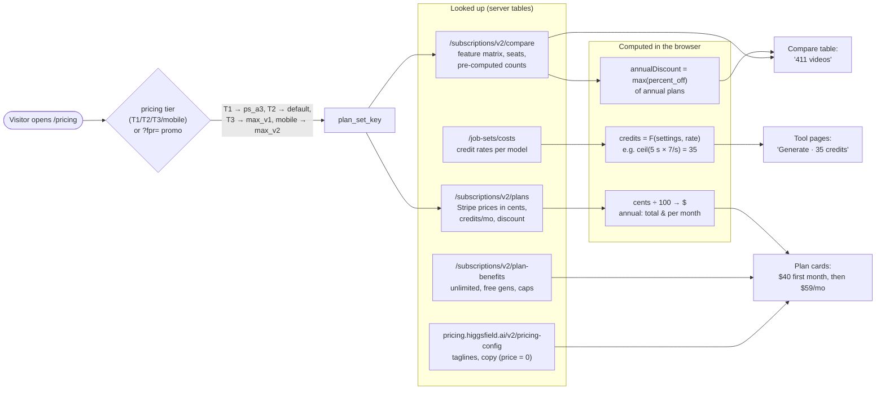

# How Higgsfield.ai pricing works

A complete, standalone guide to how https://higgsfield.ai/pricing is built: where every number comes from, how plan
prices, discounts and credits relate, how model credit costs are computed, and how this scraper turns the raw JSON
into `dataset.json` and CSV tables.

**Verified on:** 2026-11-26 from a fresh GET-only, anonymous run (`runs/20261126-092524_pricing-doc`, plan set
`ps_a3`, request IP in Egypt) and the live `https://higgsfield.ai/pricing.md`. Raw excerpts below come from
`samples/higgsfield/` and that run's `raw/` folder. Money in the raw API is **integer US cents**. Credits are
**fractional numbers**.

Contents

1. [TL;DR: how the page is built](#1-tldr-how-the-page-is-built)
2. [Endpoints, one by one](#2-endpoints-one-by-one)
3. [Plan pricing math, with worked examples](#3-plan-pricing-math-with-worked-examples)
4. [Plan sets (25 price lists) and geo pricing](#4-plan-sets-25-price-lists-and-geo-pricing)
5. [Offers, special offers, promo links and the sale schedule](#5-offers-special-offers-promo-links-and-the-sale-schedule)
6. [Benefits and entitlements](#6-benefits-and-entitlements)
7. [The comparison matrix (`/compare`)](#7-the-comparison-matrix-compare)
8. [Marketing config (`pricing-config`)](#8-marketing-config-pricing-config)
9. [Model credits (`/job-sets/costs`)](#9-model-credits-job-setscosts)
10. [Login-only pricing](#10-login-only-pricing)
11. [How the scraper maps raw data to output](#11-how-the-scraper-maps-raw-data-to-output)
12. [Generated snapshot](#12-generated-snapshot)
13. [Change monitoring, caveats and confidence](#13-change-monitoring-caveats-and-confidence)

---

## 1. TL;DR: how the page is built

- **The HTML has no prices.** `/pricing` is a TanStack Start (React SSR) app. After it loads, the browser fetches
  JSON from `https://fnf-api-gw.higgsfield.ai/fnf` and `https://pricing.higgsfield.ai`.
- **Plan prices come from a lookup table.** `GET /subscriptions/v2/plans?plan_set_key=…` returns Stripe prices in
  cents (before the offer, after the offer, at renewal), credits per month and the discount. The client only picks
  **which plan set** to ask for, based on its pricing tier, and divides by 100 to format. It does no price
  arithmetic.
- **Model credits come from a lookup table plus a client formula.** `GET /job-sets/costs` returns per-model rates
  (credits per image, per second, per 50 characters, …). The JS for each tool multiplies the matching rate by the
  user's settings (duration, batch, resolution, …) and rounds the result. The server charges the same amount when the
  job runs.
- **Credits become dollars only through the plan you pay for**: `$ per credit = price for the period / credits for
  the period`. For example, Plus annual is $360 / 14,400 credits = **$0.025 per credit**.
- **Everything else is copy or entitlement data:** `/plan-benefits` (unlimited models, free generations, caps),
  `/compare` (the "what you get" matrix, with counts the server has pre-computed) and `pricing-config` (taglines and
  marketing text, where every price is 0).
- **Country comes from the request IP** (`country_code`) and can't be overridden. Every price is in **USD**. US
  visitors get plan set **`ps_a3`**, which matches `https://higgsfield.ai/pricing.md` exactly.



What is looked up and what is computed:

| User sees | Looked up from | Computed by the client | Computed by this scraper |
|---|---|---|---|
| Plan price ($40, then $59) | `final_price`, `renew_price` (cents) | ÷ 100, currency format | `pricing.*.total/per_month`, `savings`, `price_per_credit` |
| "Save 50%" badge | `discount.percent_off` | max over annual plans (`annualDiscount`) | `discount.applies_to` |
| Credits per month | `credits` | — | `credits_per_period = credits × months` |
| "411 videos" | `/compare` value string | — (server pre-computes it) | `quantity`, `quantity_unit` |
| "35 credits" on a tool | `cost_per_second = 7` | `ceil(5 × 7) × batch` | `example.credits`, `usd_estimate` |
| Unlimited / free gens | `/plan-benefits` rows | — | joined into `plan.unlimited_model_ids`, `plan.free_gens`, `model.entitlements` |

---

## 2. Endpoints, one by one

Base URLs: `API = https://fnf-api-gw.higgsfield.ai/fnf`, `CFG = https://pricing.higgsfield.ai`. Minimal headers:
`Accept: application/json`. The scraper also sends a Chrome User-Agent, `Origin: https://higgsfield.ai` and
`Referer: https://higgsfield.ai/pricing`. No cookies, CSRF token or signature are needed for the public endpoints.

| # | Endpoint | Auth | Scraper section | Output |
|---|---|---|---|---|
| 1 | `GET {API}/subscriptions/v2/plans` | public | `plans` | `plan_sets[]`, `plan_sets[].plans[]`, `credit_values[]` |
| 2 | `GET {API}/subscriptions/v2/compare` | public | `compare` | `comparisons[]` (+ `seats` merged into plans) |
| 3 | `GET {API}/subscriptions/v2/plan-benefits` | public | `benefits` | `benefit_cards[]` (+ joined into plans and models) |
| 4 | `GET {API}/job-sets/costs` | public | `models` | `models[]` → `price_points[]` |
| 5 | `GET {CFG}/v2/pricing-config` | public | `marketing` | `marketing[]` |
| 6 | `GET {API}/subscriptions/v2/packages` | Bearer | `auth` | `auth.credit_packages[]` |
| 7 | `GET {API}/subscriptions/bundle/unlim-catalog` | Bearer | `auth` | `auth.payloads[]` (raw) |
| 8 | `GET {API}/workspaces/credit-price` | Bearer | `auth` | `auth.payloads[]` (raw) |
| 9 | `GET {API}/subscriptions/v2/adjustable-credits` | Bearer | `auth` | `auth.payloads[]` (raw) |
| — | `GET https://higgsfield.ai/pricing.md` | public | (used by `crosscheck`) | none; compared with the `ps_a3` dataset |

The scraper stores each response as an envelope `{"meta": {endpoint, url, params, fetched_at, status}, "body": …}`
in `<run>/raw/`. The tables below describe `body`.

### 2.1 Plans: `GET {API}/subscriptions/v2/plans`

| Query param | Required | Values | Effect |
|---|---|---|---|
| `plan_set_key` | no (defaults to `default`) | one of 25 keys (§4) | Which price list. `ps_a3` is the US list |
| `with_localization` | no | `true` / `false` | Localized plan names |
| `promo_link_code` | no | the code from a `/pricing?fpr=<code>` link | Promo prices (not used by the scraper) |

An unknown `plan_set_key` returns **HTTP 422**, and the error message lists all valid keys.

Raw excerpt (`samples/higgsfield/plan_sets/plans_ps_a3.json`, trimmed to 2 of 14 plans):

```json
{
    "plans": [
        {
            "id": "57386caa-1f9a-47f0-bb32-cb1b13d78635",
            "plan_type": "plus",
            "name": "Plus",
            "credits": 1200,
            "billing_period": "annual",
            "product_id": "prod_UBpIQ04Yh2Pj1h",
            "price_id": "price_1TDRddCmk0pn4HuHJIHeNNUZ",
            "original_price": 70800,
            "original_monthly_price": 5900,
            "final_price": 36000,
            "final_monthly_price": 3000,
            "renew_price": 36000,
            "renew_monthly_price": 3000,
            "currency": "usd",
            "discount": {"percent_off": 50, "duration_months": null, "duration": "forever"},
            "offer": null
        },
        {
            "plan_type": "team", "credits": 1000, "billing_period": "monthly",
            "original_price": 7900, "final_price": 5500, "renew_price": 5500,
            "discount": {"percent_off": 30, "duration_months": null, "duration": "forever"}
        }
    ],
    "country_code": "EG",
    "special_offer": null
}
```

| Key | Type | Unit | Meaning | Output field |
|---|---|---|---|---|
| `country_code` | str | ISO 3166 | Country detected from the caller's IP. Can't be overridden | `plan_set.country_code`, `plan.country_code`, `meta.country_code` |
| `special_offer` | null / str / object | — | Site-wide highlight. `"ultra"` in the `*_ultra` sets (the plan to feature); `null` otherwise | `plan_set.special_offer` |
| `plans[].id` | uuid | — | Plan UUID | `plan.plan_uuid` |
| `plans[].plan_type` | str | — | `starter basic plus ultra max team scale`. `free_trial`, `trial` and `secret` are hidden by the site JS (and by the scraper unless `--include-hidden-plans`) | `plan.plan_type`, `plan.audience` (team/scale/enterprise → `business`) |
| `plans[].name` | str | — | Display name | `plan.name` |
| `plans[].credits` | int | credits **per month** (also on annual and quarterly plans; per seat on team/scale) | Monthly allowance | `plan.credits_per_month`; `credits_per_period = credits × billing_months` |
| `plans[].billing_period` | str | — | `monthly`, `annual` or `quarterly` | `plan.billing_period`, `plan.billing_months` (1 / 12 / 3) |
| `plans[].product_id` | str | — | Stripe product ID | `plan.stripe_product_id` |
| `plans[].price_id` | str | — | Stripe price ID (the join key to `/compare`) | `plan.stripe_price_id` |
| `plans[].original_price` | int | **cents**, whole period | List price **before the offer** | `plan.pricing.before_offer.total` |
| `plans[].original_monthly_price` | int | cents / month | Before the offer, per month | `plan.pricing.before_offer.per_month` |
| `plans[].final_price` | int | cents, whole period | What you pay **now** (after the offer) | `plan.pricing.after_offer.total` |
| `plans[].final_monthly_price` | int | cents / month | After the offer, per month (rounded by the server) | `plan.pricing.after_offer.per_month` |
| `plans[].renew_price` | int | cents, whole period | What the **next renewal** costs | `plan.pricing.renewal.total` |
| `plans[].renew_monthly_price` | int | cents / month | Renewal per month | `plan.pricing.renewal.per_month` |
| `plans[].currency` | str | ISO 4217, lowercase | Always `usd` so far | `plan.currency` (upper-cased) |
| `plans[].discount` | null / object | — | `{percent_off, duration, duration_months}` (§3.2) | `plan.discount` + `applies_to` |
| `plans[].discount.percent_off` | number | % | **Rounded label** for the badge, not the exact ratio | `plan.discount.percent_off` |
| `plans[].discount.duration` | str | — | `once`, `forever` or `repeating` (Stripe coupon semantics) | `plan.discount.duration` |
| `plans[].discount.duration_months` | int / null | months | Used only with `repeating` | `plan.discount.duration_months` |
| `plans[].offer` | null / object | — | Personal or promo offer. `null` in every anonymous sample | `plan.offer` (kept raw) |

Derived by the scraper (not in the raw data): `plan_id` (a hash of `plan_set_key, plan_type, billing_period,
credits`, which is stable even when the UUID changes), `has_offer` (after < before), `savings{total, per_month,
percent}`, `price_per_credit{before_offer, after_offer, renewal}`, `seats` (from `/compare`), `benefit_card_ids`,
`unlimited_model_ids` and `free_gens` (from `/plan-benefits`).

### 2.2 Compare: `GET {API}/subscriptions/v2/compare`

| Query param | Values |
|---|---|
| `plan_set_key` | as for `/plans` |
| `billing_period` | `monthly` / `annual` (the counts in the matrix depend on it) |
| `with_localization` | `true` |

Raw excerpt (`runs/20261126-092524_pricing-doc/raw/compare__billing_period-annual__plan_set_key-ps_a3.json`, trimmed):

```json
{
    "plan_set_key": "ps_a3",
    "plans": [
        {"plan_type": "free", "billing_period": "annual", "credits": 0, "final_monthly_price": 0, "seats": 1, "purchased": false},
        {"plan_type": "team", "billing_period": "annual", "credits": 1000, "price_id": "price_…", "final_monthly_price": 4500, "seats": 2, "purchased": false}
    ],
    "categories": [
        {
            "slug": "video",
            "name": "Video",
            "description": "Top-tier models to generate short videos from prompts, images…",
            "features": [
                {
                    "name": "Seedance 2.5 720p",
                    "detail": "35 credits/5s",
                    "values": {
                        "free": {"type": "bool", "value": false},
                        "plus": {"type": "string", "value": "411 videos"},
                        "team": {"type": "string", "value": "685 videos"}
                    }
                }
            ]
        }
    ]
}
```

| Key | Type | Unit | Meaning | Output field |
|---|---|---|---|---|
| `plan_set_key` | str | — | Echo of the request | `comparison.plan_set_key` |
| `plans[]` | list | — | Same fields as `/plans`, **plus the Free plan**, for both billing periods | `comparison.plans[]` (only rows whose `billing_period` matches the request) |
| `plans[].seats` | int | seats | **Minimum** seat count: Team 2, Scale 5, others 1 | `comparison.plans[].seats`; copied into `plan.seats` by Stripe `price_id` |
| `plans[].purchased` | bool | — | Whether the caller owns the plan (always false when anonymous) | not exported |
| `plans[].final_monthly_price` | int | cents | as `/plans` | `comparison.plans[].price_after_offer_per_month` |
| `categories[].slug` | str | — | `video`, `image`, `lipsync-studio`, `character`, `credits-usage`, `access-features` | `comparison.categories[].slug` |
| `categories[].name` / `description` | str | — | Headings | `…name`, `…description` |
| `features[].name` | str | — | A model plus a setting ("Seedance 2.5 720p"), or a feature ("Commercial use") | `…features[].name` |
| `features[].detail` | str | credits per unit, as text | "35 credits/5s"; "~14 credits/5s" (`~` means approximate); "2 credit/image"; "" for features | `…detail`, parsed into `approx`, `credits`, `per` |
| `features[].values.<plan_type>.type` | str | — | `bool` or `string` | `…values[].value_type` |
| `features[].values.<plan_type>.value` | bool / str | count of outputs | e.g. "411 videos", "Up to 480 generations", "16 concurrent generations", `true` | `…values[].raw`, `available`, `quantity`, `quantity_unit` |

### 2.3 Plan benefits: `GET {API}/subscriptions/v2/plan-benefits`

| Query param / header | Values |
|---|---|
| `locale` and `Accept-Language` | `en de es fr ja ko pt-BR zh-CN` |

The response is the same for every plan set. Raw excerpt (`samples/higgsfield/plan_benefits.json` shape, values from
the 2026-11-26 run, trimmed):

```json
{
    "schema_version": 1,
    "locale": "en",
    "valid_until": null,
    "tab_badges": {"business": {"label": "30-day unlimited Seedance 2.5", "icon": "infinity", "theme": "business"}},
    "cards": {
        "annual": [
            {
                "plan_type": "plus",
                "tab": "individual",
                "campaign": null,
                "experiment": null,
                "availability": {"chip_label": "Availability", "note": "Unlimited & free gens work only on higgsfield.ai",
                                 "tooltip": "Unlimited access and free generations are not available in MCP/CLI, Canvas, or Supercomputer."},
                "sections": [
                    {
                        "id": "unlimited", "kind": "list", "title": "Unlimited & free gens",
                        "rows": [
                            {
                                "id": "nano_banana_pro",
                                "label": "Nano Banana Pro",
                                "job_set_types": ["nano_banana_2"],
                                "entitlement": {
                                    "type": "unlimited", "duration_days": 7, "starts": "on_purchase",
                                    "available_until": null, "requirements": [],
                                    "caps": {"max_resolution": "2K", "concurrency": {"count": 2, "per": "member", "pool": "image"}}
                                },
                                "placement": "primary", "tags": [], "emphasis": "none"
                            }
                        ]
                    }
                ]
            }
        ],
        "monthly": []
    }
}
```

| Key | Type | Unit | Meaning | Output field |
|---|---|---|---|---|
| `schema_version`, `locale`, `valid_until` | int / str / null | — | Envelope info | not exported |
| `tab_badges.<tab>` | object | — | Badge on the Individual/Business tab (`label`, `icon`, `theme`) | `benefit_card.tab_badge`, `dataset.tab_badges` |
| `cards.<period>[]` | list | — | One card per `billing_period × tab × plan_type` (24 cards). Includes legacy plan types (`basic lite standby pro max`) and `enterprise` | one `benefit_card` each (`card_id = hash(period, tab, plan_type)`) |
| `.plan_type`, `.tab` | str | — | `individual` / `business`. Team appears on both | `benefit_card.plan_type`, `.tab` |
| `.campaign` | null / object | — | `{id, theme, ends_at, show_availability, footnote}`, e.g. `business_unlim_seedance_2_5` | `benefit_card.campaign` |
| `.experiment` | null / object | — | A/B experiment marker | `benefit_card.experiment` |
| `.availability` | object | — | "Unlimited & free gens work only on higgsfield.ai" | `benefit_card.availability` |
| `.sections[].id` | str | — | `unlimited`, `free_gens`, `business_unlim_hero`, `business_unlim_promo`, `seat_bonus`, `enterprise_volume_hero` | `sections[].section_id` |
| `.sections[].kind` | str | — | `list` (rows), `hero` (campaign grant in `data.grant`), `banner` (`data.action`), `seat_bonus` (`data`) | `sections[].kind` |
| `.sections[].slot/title/subtitle/theme/info.text` | str | — | UI layout and text | `sections[].slot/title/subtitle/theme/info` |
| `.sections[].data` | object | — | hero: `{state, model_label, grant{type, duration_days, caps, starts, requirements}, cta}`; seat_bonus: `{credits_per_seat, starts_from_seat, expires_in_days, credits_rollover}` | `sections[].data` (raw); a hero grant adds `label:<model_label>` to `unlimited_model_ids` |
| `.rows[].id`, `.label`, `.description` | str | — | Row ID and display name ("Nano Banana Pro") | `rows[].row_id/label/description` |
| `.rows[].job_set_types[]` | list[str] | — | **Join key** to `/job-sets/costs` model IDs | `rows[].model_ids` |
| `.rows[].entitlement.type` | str | — | `unlimited`, `free_gens`, `included` or `none` (`none` + `of` = not on this plan) | `rows[].entitlement.type` |
| `.entitlement.count` | int | generations | Number of free generations | `…count`, `plan.free_gens[].count` |
| `.entitlement.duration_days` | int / null | days | Unlimited window: 7, 14, 30 or 365; `null` = while subscribed | `…duration_days` |
| `.entitlement.starts` / `available_until` / `requirements` | str / str / list | — | `on_purchase`; deadline; e.g. `["business_verification"]` | same names |
| `.entitlement.caps` | object | — | `max_resolution`, `resolutions`, `max_duration_s` (s), `qualities`, `output_formats`, `options`, `concurrency{count, per, pool}` | `…caps` |
| `.entitlement.of`, `.reason` | str | — | For `none`: what is missing (`unlimited`) | `…of`, `…reason` |
| `.rows[].placement`, `emphasis`, `tags`, `tooltip`, `icon`, `tooltip_links` | — | — | UI hints | kept except `icon`, `tooltip_links` |

### 2.4 Model costs: `GET {API}/job-sets/costs`

No parameters (the site also sends a workspace header when logged in; §9). Raw excerpt
(`samples/higgsfield/model_loading/job_sets_costs.json`, trimmed):

```json
{
    "data": [
        {"job_set_type": "kling3_0", "cost": [
            {"mode": "pro", "audio": {"on": 2.5, "off": 1.75}},
            {"mode": "std", "audio": {"on": 2, "off": 1.5}}
        ]},
        {"job_set_type": "gpt_image_2", "cost": [
            {"quality": "low", "resolution": "1k", "credits": 0.5},
            {"quality": "high", "resolution": "4k", "credits": 12}
        ]}
    ],
    "version": "0cee321863e207292a9facc5db75a99be4f292b03865ace9c025bd229f9b8f77"
}
```

| Key | Type | Unit | Meaning | Output field |
|---|---|---|---|---|
| `version` | str | sha256 | Hash of the whole table. Changes whenever any price changes | `model.costs_version`, `meta.costs_version` |
| `data[].job_set_type` | str | — | Model / job type ID | `model.model_id` (+ `display_name`, `family`, `category`) |
| `data[].cost[]` | list | — | Price rows in one of ~55 shapes (§9) | `model.price_points[]`, `options`, `units`, `components`, `min_credits`, `max_credits`, `has_discount` |
| `credits` | number | credits / generation | Per image or job | point `unit = credits_per_generation` |
| `cost_per_second`, `credits_per_second` | number | credits / s | Per second of output (or of input, for edit/upscale/dub) | `credits_per_second`, `example = {seconds: 5, credits: 5 × rate}` |
| `credits_per_minute` | number | credits / min | Per minute of input | `credits_per_minute`, example 1 min |
| `image_credits` (+ `image_count`) | number | credits / image | Add-on per generated image | `credits_per_image` |
| `frame_credits` | number | credits / frame | Add-on per input frame | `credits_per_frame` |
| `base_credits` | number | credits | Flat add-on per job (0 today) | `base_credits` |
| `original_<key>` | number | same as `<key>` | Price before a discount (strike-through) | `original_credits`, `discount_percent`, `is_discounted` |
| `resolution`, `source_resolution`, `quality`, `mode`, `model`, `model_type`, `model_id`, `operation`, `thinking`, `has_references`, `creativity`, `input_fps`, `output_fps`, `animation_mode` | str / num / bool | — | Selectable options | `price_points[].dimensions`, `model.options` |
| `audio: {on, off}` | object | credits / s | Price with or without generated audio | dimension `audio` |
| `video: {with_video, without_video}` | object | — | Rate with or without a reference video | dimension `video_input` |
| `video_edit: {…}` | object | credits / s | Edit-mode rate (charged on source length) | `component = "video_edit"` |
| `resolutions: [...]` | list | — | Nested rows under one `model` | children inherit the `model` dimension |
| `is_estimate`, `reference_fps`, `max_frames`, `image_count` | — | — | Metadata | `price_points[].attributes` |
| `formula` + `cost_units_*`, `characters_per_block`, `seconds_per_block`, `fps_multipliers`, `rounding`, `duration_rounding`, `batch_size`, `unlimited`, … | — | cost units (1/100 credit) | Server-side audio/TTS formulas | `price_points[].formula` + an effective unit (§9) |

### 2.5 Marketing config: `GET {CFG}/v2/pricing-config`

| Query param | Values |
|---|---|
| `locale` | `en` … |
| `planVersion` | `v51.0.0` (the short form `v51` also works). **Leave it out to get all 51 versions** (~4–6 MB) |

Raw excerpt (`samples/higgsfield/pc_v51.json`, trimmed):

```json
{
    "versions": {
        "v51.0.0": {
            "annual": {
                "plans": {
                    "plus": {
                        "tagline": "For consistent and easy AI content creation",
                        "credits": {
                            "amount": 1000,
                            "label": "credits/mo.",
                            "tooltip": "~4800 images or ~200 videos or ~60 character generations",
                            "promoItems": [{"prefix": "= 600", "text": "Nano Banana Pro Generations", "isBold": true}]
                        },
                        "mainFeatures": [{"id": "concurrent", "text": "Parallel generations: up to 6 Videos, 8 Images", "status": "included"}],
                        "unlimitedAccess": {"title": "365-DAY UNLIMITED & FREE GENS ", "features": [
                            {"id": "nano-banana", "text": "Nano Banana", "status": "included", "badges": [{"label": "365 UNLIMITED", "color": "primary"}]}
                        ]},
                        "billingPeriods": {"monthly": {"price": 0, "credits": {"amount": 1200, "label": "credits per month"}}}
                    }
                }
            }
        }
    }
}
```

| Key | Type | Unit | Meaning | Output field |
|---|---|---|---|---|
| `versions.<vN.0.0>` | object | — | One block per copy version (v1…v51) | `marketing_plan.config_version`, `is_latest` |
| `.<period>.plans.<plan>` | object | — | Plans in v51: `free basic pro ultimate creator team enterprise-plan starter ultra plus scale max two_day_offer` | one `marketing_plan` per version × period × plan |
| `tagline` | str | — | One-line pitch | `tagline` |
| `credits.amount` / `label` / `tooltip` | int / str / str | credits | Headline credits and "≈ N images" text | `credits_amount`, `credits_label`, `credits_tooltip` |
| `credits.promoItems[]` | list | — | `{prefix, text, isBold}` lines | `promo_items` |
| `mainFeatures[]` | list | — | `{id, text, status: included/excluded/limited, tooltip, icon, isHighlighted}` | `main_features[]` |
| `unlimitedAccess.{title, features[]}` | object | — | Unlimited/free-gens list with `badges` | `feature_groups[group_id=unlimitedAccess]` |
| `customSections.<id>.{title, features[]}` | object | — | Extra blocks | `feature_groups[]` |
| `everythingOnSection` | object | — | Team-workspace features | `feature_groups[group_id=everythingOnSection]` |
| `billingPeriods.<period>.{price, credits}` | object | — | **`price` is always 0**. Real prices come only from `/plans` | `billing_periods` (raw) |
| `specialDeal` | str | — | Badge text ("BEST VALUE", "SPECIAL", "Fixed amount of 40 credits for 2 days") | `special_deal` |
| `ui` | object | — | CTA texts (`two_day_offer`: "Get 2-day access", "pay once, non-recurring") | `ui` |

### 2.6–2.9 Login-only endpoints

Send `Authorization: Bearer <Clerk session JWT>`. Without it they return `401 {"detail":"Invalid or expired token"}`.
They were observed live on 2026-11-26 while logged in; see §10 (shapes, the 6 top-up packs, the 12 slider tiers).

### 2.10 `GET https://higgsfield.ai/pricing.md`

The site's official Markdown version of the US pricing page (`<link rel="alternate" type="text/markdown">`). It has
these parts: "Last updated", "Best prices right now" (the current sale), an Individual plans table, a Business plans
table (with seat ranges: **Team 2–9, Scale 5–15**), the availability note, and per-plan inclusions. It is in USD and
**matches `ps_a3` exactly**. The `crosscheck` command compares it with a run: on 2026-11-26 there were 0 mismatches
in 57 plan values and 76 benefit rows. It lists no per-model credit costs. Snapshots:
`samples/higgsfield/pricing.md` (2026-11-25) and `samples/higgsfield/pricing_doc/pricing_2026-11-26.md`.

---

## 3. Plan pricing math, with worked examples

All examples use `ps_a3` (US) on 2026-11-26. The scraper does the same arithmetic in `parsers/plans.py`:

```
total, per_month   = cents ÷ 100                    (if one is missing: per_month = total ÷ months, total = per_month × months)
months             = 1 (monthly) | 3 (quarterly) | 12 (annual)
credits_per_period = credits × months
price_per_credit   = total ÷ credits_per_period     (rounded to 0.0001; same as per_month ÷ credits)
savings            = before − after; percent = (1 − after/before) × 100
has_offer          = after.total < before.total
renewal            = renew_* (falls back to after_offer if missing)
```

### 3.1 Three prices: before, after, renewal

| Stage | Raw field | Meaning |
|---|---|---|
| **before_offer** | `original_price` / `original_monthly_price` | List price (the struck-through number) |
| **after_offer** | `final_price` / `final_monthly_price` | What the **first** payment costs today |
| **renewal** | `renew_price` / `renew_monthly_price` | What the **next** payment costs if nothing changes |

**Plus, monthly** (1,200 credits, `discount {percent_off: 33, duration: "once"}`):

```
original_price 5900 cents → $59.00 list
final_price    4000 cents → $40.00 for the first month
renew_price    5900 cents → $59.00 from month 2 ("once" = first payment only)
savings        59.00 − 40.00 = $19.00 = 32.20 %   (the badge says 33 %, see 3.3)
$/credit       before 59/1200 = 0.0492 · after 40/1200 = 0.0333 · renewal 59/1200 = 0.0492
```

pricing.md says the same: "$40 first month, then $59/mo".

**Plus, annual** (`discount {percent_off: 50, duration: "forever"}`):

```
original_price         70800 cents → $708.00 = 12 × $59.00 (original_monthly_price 5900)
final_price            36000 cents → $360.00 per year = 12 × $30.00 (final_monthly_price 3000)
renew_price            36000 cents → $360.00 ("forever" = renewals stay discounted)
credits_per_period     1200 × 12 = 14,400
$/credit               before 708/14400 = 0.0492 · after 360/14400 = 0.0250 · renewal 0.0250
savings                708 − 360 = $348.00 per year ($29.00/mo) = 49.15 %   (badge: 50 %)
```

### 3.2 Discount duration → `applies_to`

| `discount.duration` | `applies_to` (scraper) | Renewal price | Seen on (ps_a3) |
|---|---|---|---|
| `once` | `first_payment` | back to list (`renew = original`) | Plus/Ultra **monthly** |
| `forever` | `all_payments` | stays discounted (`renew = final`) | every **annual** plan; Team/Scale monthly |
| `repeating` + `duration_months: N` | `first_N_months` | list after N months (Stripe semantics, **inferred**) | not seen in any sample |
| no `discount` | `null` | = list | Starter, Basic, Max (quarterly), all quarterly plans |

`renew_price` is what actually counts. `duration` explains why it is what it is.

### 3.3 `percent_off` is a label, not the formula

The price is the Stripe price (`final_price`), and `percent_off` is a rounded badge:

| Plan | before | after | exact off | `percent_off` |
|---|---:|---:|---:|---:|
| Plus monthly | 5900 | 4000 | 32.20 % | 33 |
| Plus annual | 70800 | 36000 | 49.15 % | 50 |
| Ultra 3k annual | 154800 | 54000 | 65.12 % | 65 |
| Ultra 6k annual | 309600 | 99600 | 67.83 % | 68 |
| Ultra 9k annual | 464400 | 140400 | 69.77 % | 69 |
| Team annual | 94800 | 53998 | 43.04 % | 43 |

Never compute a price from `percent_off`. The scraper stores both (`discount.percent_off` and `savings.percent`).
The compare table's "Save up to N %" is `max(percent_off)` over the annual plans (from the site JS).

### 3.4 Annual = 12 × monthly, with two quirks

- `original_price = 12 × original_monthly_price` and `final_price ≈ 12 × final_monthly_price`.
- **The annual list price can be higher than the monthly list price:** Ultra 6k annual `original_monthly_price`
  is 25800 ($258) against 25000 ($250) on the monthly plan; Ultra 9k is $387 against $375. The "list price" on the
  annual tab is therefore not the monthly price.
- **The per-month figures are rounded by the server:** Team annual `final_price 53998` ÷ 12 = 4499.83, but
  `final_monthly_price` is 4500. Scale annual 96002 ÷ 12 = 8000.17, but the monthly figure is 8000. Stripe charges
  the **total** ($539.98, $960.02, as pricing.md says). The scraper keeps both numbers as given and computes
  $/credit from the **total**.

**Ultra 6k annual:**

```
original_price 309600 → $3,096.00 = 12 × $258.00
final_price     99600 → $996.00   = 12 × $83.00
credits         6000 × 12 = 72,000
$/credit        996 / 72000 = 0.01383 → 0.0138   (list: 3096 / 72000 = 0.0430)
```

### 3.5 Ultra credit tiers

Ultra is sold in 3 credit tiers that share `plan_type: "ultra"`, are told apart by `credits`, and each has its own
Stripe price. In `ps_a3`: 3,000 / 6,000 / 9,000 credits per month. The cheapest dollars per credit on the site is
Ultra 9k annual at **$0.0130**. Some plan sets use other tiers (`ps_a7`: 2,400 / 4,800 / 7,200 at $99 / $199 / $299
per month, with no discount). The plan ID hash includes `credits`, so the tiers never collide.

### 3.6 Seats (business plans)

- Team and Scale prices and credits are **per seat**. `/compare` gives the **minimum** seat count: Team **2**,
  Scale **5**. pricing.md gives the ranges: Team 2–9, Scale 5–15.
- The `/compare` "Credits" row already multiplies by the minimum seats: Team **2,000** (= 1,000 × 2) and Scale
  **12,500** (= 2,500 × 5).
- Minimum purchase: Team monthly is 2 × $55 = **$110/mo** for 2,000 credits; Scale monthly is 5 × $119.99 =
  **$599.95/mo** for 12,500 credits. $/credit doesn't depend on the seat count (Team monthly 55/1000 = 0.0550).
- **Seat bonus** (`/plan-benefits` `seat_bonus` section): Team gives 400 credits per seat starting from seat 3,
  expiring after 30 days, no rollover. Scale gives 1,250 credits per seat starting from seat 6, 30 days, with rollover.
  So extra seats beyond the minimum come with bonus credits. (How the bonus is applied per billing cycle is
  **inferred** from the field names.)
- The scraper fills `plan.seats` from `/compare` by matching Stripe `price_id`. Every money field stays per seat.

### 3.7 Credits per month vs per period

`credits` is always **per month**, also on annual and quarterly plans. An annual plan grants `credits × 12` over the
year (the site's own "411 videos" for Plus annual = 14,400 / 35). Quarterly plans (`*_q` sets) are billed every 3
months, so `credits_per_period = credits × 3`. Example from `max_v2_q`: Max quarterly 1,800 credits, `original_price`
23700 ($237 per quarter = $79/mo).

### 3.8 Full plan table (ps_a3)

See the generated table in [§12](#12-generated-snapshot). It has every plan with before / after / renewal (total and
per month), the discount and how it applies, and $/credit.

---

## 4. Plan sets (25 price lists) and geo pricing

### 4.1 All 25 keys

From the API's 422 error (`GET /subscriptions/v2/plans?plan_set_key=bogus`):

```
mcp  default  default_basic  default_q  default_ww  default_ww_q
max_v1  max_v1_q  max_v1_seedance_2_5  max_v1_ultra
max_v2  max_v2_seedance_2_5  max_v2_q  max_v2_ultra  max_v3
ps_a1  ps_a2  ps_a3  ps_a3_basic  ps_a3_q  ps_a4  ps_a5  ps_a6  ps_a7  mob_v1
```

Scraper presets (`--plan-sets`, `constants.PLAN_SET_PRESETS`): **`us`** = `[ps_a3]` (the default), **`tiers`** =
`[ps_a3, default, max_v1, max_v2]`, **`all`** = all 25. You can also pass a comma-separated list of keys. Print them with
`python -m higgsfield_scraper plan-sets`.

### 4.2 How the frontend picks one

De-minified from the pricing bundle:

```js
const PLAN_SET_BY_TIER = { T1: "ps_a3", T2: "default", T3: "max_v1" };
const MOBILE_PLAN_SET  = "max_v2";
planSetKey = pricingOffer?.planSetKey                    // from a ?fpr=<code> promo link or user metadata
          ?? (tier ? (isMobile ? MOBILE_PLAN_SET : PLAN_SET_BY_TIER[tier]) : "default");
```

| Tier | Plan set | Who gets it |
|---|---|---|
| T1 | `ps_a3` | US and other top-tier markets (`ps_a3` = pricing.md) |
| T2 | `default` | middle tier, and the fallback when no tier is known |
| T3 | `max_v1` | lower-price markets |
| mobile | `max_v2` | mobile visitors with a tier |
| promo / user metadata | any key | an `fpr` promo link or an account-level assignment overrides the tier |

The other keys (`_q` quarterly variants, `_ultra`, `_seedance_2_5`, `ps_a1…a7`, `mob_v1`, `mcp`) are experiments,
promos and special checkouts. `mcp` is the checkout for the MCP/CLI (Plus and Ultra 3k only).

### 4.3 Country detection: why it can't be overridden

- Every `/plans` response has `country_code`, taken from the request IP at the edge.
- These overrides were tried and **ignored**: the headers `CF-IPCountry: US` and `X-Country-Code: US`, and the query
  parameter `country_code=US`.
- The tier (and so the plan set) is chosen by the site from that country. The **API** still serves any plan set to
  anyone, so the scraper requests `ps_a3` directly to get US prices from any IP. It does not try to look like it is in
  the US, and it records `meta.country_code` (EG for these runs) next to the data.
- The currency was `usd` in every response for every plan set. Prices differ by plan set, not by currency.

### 4.4 How the sets differ

Ultra (3k/6k/9k), Team and Scale are **identical in every set** that sells them (checked across all 25 sets in
`runs/20261126-092607_all-prices`). The differences are in the entry plan, Plus, the billing periods on offer, and
special tiers:

| Plan set | Entry plan(s) | Plus credits | Plus monthly (list → first month) | Plus annual /mo (list → after) | Periods | Notes |
|---|---|---:|---|---|---|---|
| `ps_a3` (T1, US) | Starter 270 cr $19 | 1,200 | $59 → $40 | $59 → **$30** | m, a | = pricing.md |
| `ps_a3_basic` | Basic 120 $9 + Starter 270 $19 | 1,200 | $59 → $40 | $59 → $30 | m, a | 16 plans |
| `ps_a3_q` | Starter 270 $19 | 1,200 | $59 → $40 | $59 → $30 | m, q, a | Plus quarterly $59/mo, no discount |
| `ps_a4` | Starter 270 $19 | 1,200 | $59 → $40 | $59 → $30 | m, a | |
| `default` (T2) | Starter 200 $15 | 1,000 | $49 → $35 | $49 → $25 | m, a | |
| `default_basic` | Basic 120 $9 + Starter 200 $15 | 1,000 | $49 → $35 | $49 → $25 | m, a | |
| `default_q` | Starter 200 $15 | 1,000 | $49 → $35 | $49 → $25 | m, q, a | Ultra quarterly too |
| `default_ww` | Basic 70 $5 | 1,000 | $49 → $35 | $49 → $25 | m, a | |
| `default_ww_q`, `max_v2_q` | Basic 70 $5 | 1,000 | $49 → $35 | — | m, q | Max quarterly 1,800 / 3,600 / 5,400 cr ($79 / $158 / $237 per month) |
| `max_v1` (T3), `max_v1_seedance_2_5`, `ps_a2`, `ps_a5`, `ps_a6` | Basic 120 $9 | 1,000 | $49 → $35 | $49 → $25 | m, a | |
| `max_v1_q` | Basic 120 $9 | 1,000 | $49 → $35 | $49 → $25 | m, q, a | + Max quarterly |
| `max_v1_ultra`, `max_v2_ultra` | Basic 120 / 70 | 1,000 | $49 → $35 | $49 → $25 | m, a | `special_offer: "ultra"` |
| `max_v2` (mobile), `max_v2_seedance_2_5` | Basic 70 $5 | 1,000 | $49 → $35 | $49 → $25 | m, a | |
| `max_v3` | Basic 120 + Starter 200 (monthly) | 1,000 | — | $49 → $25 | m, a | Plus and Ultra annual only; 10 plans |
| `ps_a1`, `ps_a7` | Starter 200 $15 | 1,000 | $49 → $35 | $49 → $25 | m, a | `ps_a7`: Ultra 2,400 / 4,800 / 7,200 at $99 / $199 / $299, no discount |
| `mcp` | — | 1,000 | $49 → $35 | $49 → $25 | m, a | Plus + Ultra 3k only (4 plans) |
| `mob_v1` | — | 1,000 | $49 → $49 | $49 → $49 | m, a | Plus only, **no discount** (2 plans) |

**Plus annual across sets** (from the raw `final_price` and `credits`):

| Set group | credits/yr | `original_price` | `final_price` | $/credit after | $/credit list |
|---|---:|---:|---:|---:|---:|
| `ps_a3`, `ps_a3_basic`, `ps_a3_q`, `ps_a4` | 14,400 | 70800 ($708) | 36000 ($360) | 0.0250 | 0.0492 |
| `default`, `max_v1`, `max_v2`, `ps_a1/2/5/6/7`, `mcp`, … | 12,000 | 58800 ($588) | 30000 ($300) | 0.0250 | 0.0490 |
| `mob_v1` | 12,000 | 58800 ($588) | 58800 ($588) | 0.0490 | 0.0490 |

So the US set charges $60 more per year for Plus annual but gives 2,400 more credits, and the after-offer
$/credit is the same ($0.025). The entry plan differs more: US Starter costs $0.0704/credit, `default` Starter
$0.0750, `max_v1` Basic $0.0750, and `max_v2` Basic $0.0714.

---

## 5. Offers, special offers, promo links and the sale schedule

| Mechanism | Where | What it does |
|---|---|---|
| `discount` on a plan | `/plans` | The normal "−50 %" pricing (§3.2). On the anonymous US set every paid plan except Starter has one |
| `offer` on a plan | `/plans` | A personal or promo offer attached to one plan. `null` in every anonymous response. It is filled for logged-in users with an offer from `/user/offers` (login) or for a promo-link request. The scraper keeps it raw (`plan.offer`); its fields have not been observed |
| `special_offer` | `/plans` top level | Highlights a plan site-wide. `"ultra"` in `max_v1_ultra` / `max_v2_ultra`, otherwise `null` |
| Promo links | `https://higgsfield.ai/pricing?fpr=<code>` or `/offer/<code>` | The JS resolves the code to a `planSetKey` (e.g. `{d94luc: {code: "default"}}`) and sends `promo_link_code=<code>` to `/plans`. The scraper does **not** use promo codes |
| `two_day_offer` | `pricing-config` | A one-time, non-recurring "40 credits for 2 days" pack (copy only; its price comes from login-only flows) |
| Campaigns | `/plan-benefits` `campaign`, `hero`, `banner` sections, `tab_badges` | Time-limited entitlements, e.g. `business_unlim_seedance_2_5` ("30-day unlimited Seedance 2.5", business plans only) |
| `/business-unlim/state` | public API (scraped by `scrape site --what promos`) | Unlimited-model trial cards per team plan and billing period, plus the pricing banner |
| `/datetime-settings` | public API (`scrape site --what promos`) | The **sale and promo schedule** |

### 5.1 The sale schedule: `GET {API}/datetime-settings`

This public endpoint returns 17 named windows `{source, datetimes{starts_at, ends_at}, params{…}}`. The frontend
switches banners, countdowns and per-plan free-gen grants on and off with them. Live on 2026-11-26
(`samples/higgsfield/pricing_doc/datetime_settings_2026-11-26.json`, non-null params only):

```json
[
    {"source": "sale_11_11", "datetimes": {"starts_at": "2026-11-26T00:00:00Z", "ends_at": "2026-11-27T00:00:00Z"},
     "params": {"phase": "black_friday_69_phase_2", "max_discount_percent": 69}},
    {"source": "freegen_card_bonus", "datetimes": {"starts_at": null, "ends_at": null},
     "params": {"credits": 40, "credits_expire_days": 90}},
    {"source": "plan_free_gens", "datetimes": {"starts_at": "2026-10-22T00:00:00Z", "ends_at": "2026-11-01T00:00:00Z"},
     "params": {"plan_free_gens": [{"plan_type": "starter", "billing_period": null,
                "items": [{"job_set_type": "hf_mult_motion_control", "count": 0, "resolutions": null}]}]}}
]
```

Other sources: `free_trial_all_unlim`, `plan_all_unlims`, `unlim_trial_in_mcp`, `freegens_seedance_4k(_new_users)`,
`freegens_seedance_2_5_1080p`, `exclusive_seedance_2_5_1080p`, `unlim_marketplace_bundles`, `seedance_2_5_sale`
(`phase: plan_ladder`), `generation_seconds_sale`, `kling_4_release`, `genjutsu_lite_release`, `seedance_2_5_presale`
(`unlim_days: 7`), `unlim_seedance_4k` (`stage1_days: 3, stage2_days: 7`).

**The Black Friday sale shows how the pieces fit:**

| Date | `/datetime-settings` `sale_11_11` | pricing.md banner | `/plans` Ultra annual 6k / 9k |
|---|---|---|---|
| 2026-11-25 | `black_friday_phase_2`, `max_discount_percent: 70`, from 2026-11-25 00:00 | "up to 70% off, ends 2026-11-26 00:00 UTC" | $80 / $115 per month (−68 % / −70 %) |
| 2026-11-26 | `black_friday_69_phase_2`, `max_discount_percent: 69`, ends 2026-11-27 | "up to 69% off, ends 2026-11-27 00:00 UTC" | $83 / $117 per month (−68 % / −69 %) |

The schedule only drives the **banner**. The prices themselves changed in `/plans` (new `final_price`), and
`pricing.md` followed. To watch a sale, diff `/plans` (`python -m higgsfield_scraper diff --only plans,offers`).

---

## 6. Benefits and entitlements

`/plan-benefits` describes what a plan includes **besides credits**. It is the same for every plan set.

### 6.1 Card anatomy

- One card per `billing_period × tab × plan_type` (24 on 2026-11-26). This includes legacy plans (`basic`, `lite`,
  `standby`, `pro`, `max`) for existing subscribers, and `enterprise`. Team has a card on both tabs.
  **Correction (2026-11-26 login audit):** `lite` is not only legacy: it is still **sold to logged-in users** as an
  annual plan (100 credits/month, $12/year = $1/month, list $84, 85 % off forever, ps_a3). The anonymous
  `/plans` response omits it; `--logged-in-prices` adds it (see §10).
- Section kinds:
  - **`list`** with rows: `unlimited` ("Unlimited & free gens" / "Unlimited models") and `free_gens` ("Free
    generations").
  - **`hero`**: a campaign grant. Team: "7-day (monthly) / 14-day (annual) unlimited Seedance 2.0", 720p, max 15 s,
    1 concurrent per member, requires `business_verification`. Scale: "7-day / 30-day unlimited Seedance 2.5",
    720p, max 25 s. Enterprise: "Volume based discounts on Seedance", contact sales.
  - **`banner`**: a cross-sell ("30-day unlimited Seedance 2.5, available on business plans only" on the individual
    Team card, with `action: switch_tab`).
  - **`seat_bonus`**: see §3.6.
- `availability`: unlimited and free gens work **only on higgsfield.ai**. They don't work in MCP/CLI, Canvas or
  Supercomputer.

### 6.2 Entitlement types

| `entitlement.type` | Meaning | Key fields |
|---|---|---|
| `unlimited` | Generations cost 0 credits within the caps | `duration_days` (7 / 14 / 30 / 365; `null` = while subscribed), `caps.max_resolution`, `caps.qualities`, `caps.output_formats`, `caps.concurrency{count, per: member, pool: image}`, `starts: on_purchase`, `requirements` |
| `free_gens` | N free generations | `count`, `caps.max_resolution` |
| `included` | Feature included, no allowance | — |
| `none` | Not on this plan | `of` (e.g. `unlimited`), `reason` |

Example caps from the Plus annual card: GPT Image 2.6 is unlimited for 7 days up to 2K, **only in low/medium
quality and PNG/JPEG/WebP** (other settings spend credits), with up to 2 concurrent per member shared across the
image pool.

### 6.3 How the joins work

```
benefit row.job_set_types[]  ──►  /job-sets/costs job_set_type  (model_id)
card (plan_type, billing_period) ──►  every plan with the same plan_type and billing_period (all credit tiers, all plan sets)
```

- `plan.benefit_card_ids` / `unlimited_model_ids` / `free_gens` are collected from every card matching
  `(plan_type, billing_period)`. For Team that means both the individual and the business card.
- `model.entitlements[]` gets one entry per (card × row) where the model is unlimited or has free gens:
  `{plan_type, billing_period, tab, type, count, duration_days, max_resolution, max_duration_s, concurrency, starts,
  requirements, benefit_label}`.
- Hero grants have no `job_set_types`. They are recorded as `label:<model label>` (e.g. `label:Seedance 2.0`).
- **9 models appear only in benefits** and have no `/job-sets/costs` row: `nano_banana_2` (shown as "Nano Banana
  Pro"), `nano_banana`, `flux_2`, `kling_omni_image`, `seedream_v4_5`, `seedream_v5_lite`, `openai_hazel_mini`,
  `soul_cinematic`, `text2image_soul_v2`. The scraper adds them as models with `has_cost_data: false` and logs a
  warning. Their credit price exists only in `/compare` detail text (e.g. "Nano Banana Pro · 2 credit/image") or in
  static JS.
- The site JS also maps some models to dedicated zero-cost "unlimited" job types: `nano_banana_2 →
  nano_banana_pro_unlimited`, `gpt_image_2 → gpt_image_2_unlimited`, `kling3_0 → kling_3_unlimited`.

The per-plan unlimited and free-gen lists are in the snapshot (§12). In short, for ps_a3: Starter gets Seedream 5.0
Lite + Flux.2 Pro (1K) unlimited and Soul 300 free gens; Plus monthly adds 7-day Seedream 5.0 Pro and GPT Image 2.6
plus "while subscribed" Nano Banana, Kling O1 Image and Seedream 4.5, with 3,000 Soul gens; Plus annual and Ultra
add 7-day Nano Banana Pro, with 5,000 Soul gens (Ultra annual: 10,000); Team/Scale get Nano Banana Pro + Seedream 5.0
Pro (7 days) plus the Seedance hero grant (Scale annual also Kling 3.0).

---

## 7. The comparison matrix (`/compare`)

One response per `plan_set_key × billing_period`. The client adds `annualDiscount = max(percent_off)` over the annual
plans.

**Structure:** 6 categories. On 2026-11-26 (ps_a3) they had: `video` 70 features, `image` 28, `lipsync-studio` 13,
`character` 2, `credits-usage` 2, `access-features` 9. Each category starts with a "Concurrent Generations" row.

**How the rows map to credits and models.** A model row's `detail` is a representative credit cost, and each plan
cell is the **number of outputs the plan's credits buy**, pre-computed by the server:

```
value = floor(plan credits for the period × min seats ÷ detail credits)

Seedance 2.5 720p, detail "35 credits/5s" (= cost_per_second 7 × 5 s in /job-sets/costs)
  monthly:  Plus  1200 / 35 = 34.3  → "34 videos"     Ultra 3000 / 35 = 85.7 → "85 videos"
            Team  1000 × 2 / 35 = 57.1 → "57 videos"  Scale 2500 × 5 / 35 = 357.1 → "357 videos"
  annual:   Plus  1200 × 12 / 35 = 411.4 → "411 videos"   Team 2000 × 12 / 35 = 685.7 → "685 videos"
Nano Banana Pro, detail "2 credit/image", annual Starter: 270 × 12 / 2 = 1620 → "1620 images"
Character "Max Generations Amount", annual Starter: 3240 / 30 → "Up to 108 generations"
```

- **Annual counts are per year**, monthly counts per month. Ultra uses its lowest tier (3,000).
- `bool` cells mean included or not included. `string` cells are counts, "Unlimited concurrent generations", or
  `"0"`.
- `detail` is a **typical setting, not the minimum**. "GPT Image 2.6 · 1.75 credit/image" matches medium 2k (or low 4k);
  the minimum in `/job-sets/costs` is 0.75 (low, 1k). A `~` prefix marks a rounded-down estimate: Kling 3.0 720p
  (std, audio off) is 1.5 × 5 = 7.5 → "~7 credits/5s", and 1080p (pro, audio off) is 1.75 × 5 = 8.75 → "~8 credits/5s".
- The `credits-usage` category's "Credits" row gives credits per month **× minimum seats** (Team 2000, Scale 12500).
  "Credit discount" is `false` for every plan.
- The parser turns `detail` into `{approx, credits, per}` and each cell into `{available, quantity,
  quantity_unit}`. CSV: `comparison_matrix.csv` (one row per feature × plan).
- The cost estimator uses the `detail` credits as a fallback price for models without a `/job-sets/costs` row,
  joined through the benefit labels.

---

## 8. Marketing config (`pricing-config`)

- **Versions:** `v1.0.0` → `v51.0.0` (51 in total). The scraper fetches the latest by default
  (`--marketing-versions latest`, or `all`, or a list). Versions v1–v17 also have `billingOverrides` /
  `variantOverrides`, which are not exported.
- **Plans in v51:** `free basic pro ultimate creator team enterprise-plan starter ultra plus scale max
  two_day_offer`. The legacy names (`pro`, `ultimate`, `creator`) are still there for old subscribers.
- **Taglines (v51):** Free "Get started with AI content creation"; Starter/Basic "For first-time AI content
  creators"; Plus/Pro "For consistent and easy AI content creation"; Ultra/Max "For creators building AI
  projects" (badge "BEST VALUE"); Creator "For experts scaling production to the max" ("SPECIAL"); Team/Scale "For
  agencies and small teams"; Enterprise "For large organizations and global teams"; two_day_offer "For trial
  generations at the most affordable cost".
- **Credit copy:** `credits.amount` + `label` ("credits/mo.", "credits per seat/mo.", "Limited daily credits",
  "Custom Credits Amount", "credits for 2 days") and a tooltip such as "~4800 images or ~200 videos or ~60 character
  generations". `promoItems` lines such as "= 600 Nano Banana Pro Generations", "~ 200 Kling 3.0 videos".
- **Prices: none.** `billingPeriods.*.price` is always 0. Treat this endpoint as **copy only**.
- **The copy is not plan-set aware and can be out of date:** v51 Plus says `credits.amount: 1000` in its headline but
  `billingPeriods.monthly.credits.amount: 1200`; `ps_a3` sells 1,200 and `default` sells 1,000. Team/Scale copy says
  "1500 credits per seat/mo." while `/plans` has Team 1,000 and Scale 2,500 per seat. Always take credits from
  `/plans`.

---

## 9. Model credits (`/job-sets/costs`)

The full reference is in [`COST_FORMULAS.md`](COST_FORMULAS.md): every family's JS formula with chunk citations,
scenarios, discount rules, unlimited/free-gen rules, and generated rate tables for every model. This section is a
summary.

### 9.1 Master equations

```
quote (UI)  = F_type(settings, media, rows)        rows = /job-sets/costs[job_set_type].cost  (static JS table as fallback)
charged     = 0                       if use_unlim and an active unlimited grant covers the settings (batch ≤ 1)
            = 0, −1 free gen          if use_free_gens and the model has free gens left (unlimited wins)
            = 0, −N seconds           if use_generation_seconds covers model + resolution (Seedance 2.5)
            = server price            otherwise (cost units ÷ 100)
USD         = charged × $/credit of the plan you pay for
```

The backend works in **cost units = credits × 100** (`cost_units_per_credit: 100`), so the finest rounding is 0.01
credit. The table is fetched once per user and workspace (with a workspace header when logged in) and cached for
5 minutes, so **prices can differ per workspace**. The scraper sees the anonymous table.

### 9.2 Main formula shapes

| Shape | Formula (JS) | Used by |
|---|---|---|
| per second, integer ceil, × batch | `ceil(d × cps) × max(1, batch)` | Seedance 2.5 / Flash, Cinema Studio 4.0, Seedance 2.0, Happy Horse, Gemini Omni |
| per second, no rounding | `d × cps` | Kling 3.0 / 4.0 family, Grok, MiniMax H3, Flux 3 video |
| per second, ceil to 0.01 | `ceil₀.₀₁(d × cps)` | Wan 3.0, upscale/video tools, voice change |
| per image | `batch × credits[resolution, quality…]` | all image models |
| per text block | `ceil(chars / 50) × rate` | ElevenLabs, MiniMax/Seed speech TTS |
| fixed | `template.cost`, `ceil(units / 100)` | apps, viral-hub presets |
| server quote | `POST /job-sets/costs` or `POST /jobs/…?dry_run=true` | motion-control chains, Topaz (not called by the scraper) |

The strike-through "was" price uses the same formula with `original_*`.

### 9.3 Cost row shapes (one raw excerpt each)

There are 87 job types on 2026-11-26 (`scene_switch` is new since the 86-type sample `job_costs.json`). About 55
distinct JSON shapes fall into these families. The parser (`parsers/costs.py`) flattens every one into typed price
points:

| Shape | Raw excerpt | Becomes |
|---|---|---|
| Flat per generation | `gpt_image_2`: `{"quality":"low","resolution":"1k","credits":0.5}` | `credits_per_generation`, dims `quality`, `resolution` |
| Per second + discount | `seedance_2_0` child: `{"resolution":"480p","cost_per_second":3,"original_cost_per_second":6}` | `credits_per_second` 3, original 6, `discount_percent` 50, example 5 s = 15 |
| Nested list under a model | `seedance_2_0`: `{"model":"seedance_2_0_fast","resolutions":[{…}]}` | children inherit `model` |
| With / without reference video + edit component | `seedance_2_5`: `{"resolution":"720p","video":{"with_video":{"cost_per_second":7},"without_video":{"cost_per_second":7}},"video_edit":{"model":"video_edit","cost_per_second":7.5}}` | dim `video_input`; `component = video_edit` |
| Audio on/off map | `kling3_0`: `{"mode":"std","audio":{"on":2,"off":1.5}}` | dim `audio`, `credits_per_second` |
| Add-on per image | `reframe`: `{"resolution":"480p","cost_per_second":3,"image_credits":1.25,"image_count":3}` | `credits_per_second` + `credits_per_image`; `image_count` → attributes |
| Add-on per frame | `swap_object`: `{"resolution":"480p","cost_per_second":3,"frame_credits":3.5}` | + `credits_per_frame` |
| Base fee | `gemini_omni`: `{"resolution":"720p","base_credits":0,"cost_per_second":3}` | + `base_credits` |
| Options + estimate flag | `fps_boost`: `{"model":"topaz","input_fps":24,"output_fps":30,"source_resolution":"480p","cost_per_second":3.3,"is_estimate":false}` | dims incl. fps; `is_estimate` → attributes |
| Upscale grid | `flux_video_upscale`: `{"creativity":0,"source_resolution":"480p","resolution":"720p","cost_per_second":0.5,"original_cost_per_second":1.0}` | 3 dims, discount |
| `formula: character_blocks` | `elevenlabs_v4`: `{"formula":"character_blocks","characters_per_block":50,"cost_units_per_block":23,"cost_units_per_credit":100,"rounding":"ceil"}` | `credits_per_50_characters` = 23/100 = 0.23; 1,000 chars = 4.6 |
| `formula: estimated_duration` | `seed_audio`: `{"formula":"estimated_duration","characters_per_second":15,"cost_units_per_second":10,…}` | `credits_per_second` = 0.1 of estimated speech |
| `formula: input_duration` | `audio_dubbing`: `{"formula":"input_duration","credits_per_second":3.0,"duration_rounding":"floor"}`; `elevenlabs_video_to_music`: `credits_per_minute: 4.0` | `credits_per_second` / `credits_per_minute` |
| `formula: input_duration_by_fps` | `dubbing_lipsync`: `{"fps_multipliers":[{"fps":25,"credits_per_second":3.0},{"fps":30,…3.6},{"fps":60,…6.0}]}` | one point per `fps` |
| `formula: duration_blocks` | `youtube_faceless_video`: `{"animation_mode":"scene_based","seconds_per_block":10,"cost_units_per_block":1600}` | `credits_per_10_seconds` = 16 |
| `formula: linear_units` | `qwen_audio_tts`: `{"cost_units_numerator":3,"cost_units_denominator":70,"minimum_cost_units":1}` | `credits_per_character` = 3/70/100 (unit **assumed**, flagged `unit_assumed`) |

Formula rows also carry `batch_size {minimum, maximum, pricing: linear}` and `unlimited {eligible,
maximum_batch_size}`. These are kept in `price_points[].formula`.

### 9.4 `usd_estimate`

```
rate         = after-offer $/credit of the --usd-reference plan (default plus:annual, lowest credit tier, first plan set)
usd_estimate = (example.credits if present else credits) × rate        (rounded to 4 decimals)

seedance_2_5, 720p, without_video:  7 credits/s × 5 s = 35 credits × $0.0250 = $0.875
gpt_image_2, low, 1k:               0.5 credits × $0.0250 = $0.0125
```

`meta.usd_reference` records which plan and rate were used. It is an **estimate**: what you actually pay per credit
depends on your plan (from $0.0130 on Ultra 9k annual to $0.0860 on Scale at list price) and is $0 on an unlimited
model.

---

## 10. Login-only pricing

These four endpoints need a Clerk session (`Authorization: Bearer …`, minted automatically after `login`). They were
**observed live on 2026-11-26** with a personal (non-team) account:

| Endpoint | Observed live 2026-11-26 (logged in, personal account) | Scraper handling |
|---|---|---|
| `/subscriptions/v2/packages` | 200 `{data: [{id, price_id, amount, original_amount, display_amount, credits, currency, credits_per_dollar, discount, features[{display_number, text, type, is_available}], is_highlighted, tax_amount, tax_rate, offer}], expire_days: 90}`. **amount (cents) and credits are ×100.** 6 packs: 100 / 200 / 500 / 1,000 / 2,000 / 4,000 credits; e.g. 100 credits = $6.25 (list $8.50, `discount` 26, `credits_per_dollar` 16) | `credit_package` (÷100, every field declared) → `auth.credit_packages[]`, `csv/auth_credit_packages.csv` |
| `/subscriptions/bundle/unlim-catalog` | 200 `{"bundles": []}` (no bundles offered to this account) | `auth_payload` (raw) |
| `/subscriptions/v2/adjustable-credits` | 200 `{data: [12 tiers with the same fields as packages, + is_default], expire_days, iteration: 2000}`, e.g. 5,000 credits = $250.75 (list $425, 41 % off) | `auth_payload` (raw) |
| `/workspaces/credit-price` | **500** for an account without a team workspace. The site calls it only from the team "buy credits" screen | warning + stat `higgs/auth/http_error/credit_price/500`; run stays `success` |

**Credit top-up packs (2026-11-26, US):**

| Credits | You pay | List price | Discount label | Credits per $ |
|---:|---:|---:|---:|---:|
| 100 | $6.25 | $8.50 | 26 % | 16 |
| 200 | $11.76 | $17.00 | 29 % | 17 |
| 500 | $29.41 | $42.50 | 31 % | 17 |
| 1,000 | $55.56 | $85.00 | 35 % | 18 |
| 2,000 | $105.26 | $170.00 | 38 % | 19 |
| 4,000 (highlighted) | $210.53 | $340.00 | 38 % | 19 |

**Adjustable credits (credit slider, 2026-11-26):** 12 tiers. 5,000 credits = $250.75 · 7,000 = $351.05 · 9,000 = $451.35 · 11,000 = $551.65 ·
13,000 = $651.95 · 15,000 = $752.25 (41 % off) · 17,000 = $809.52 · 19,000 = $904.76 · 21,000 = $1,000.00 ·
23,000 = $1,095.24 · 25,000 = $1,190.48 · 100,000 = $4,761.90 (44 % off).

Purchased credits expire after 90 days (`expire_days`). The original JS-based description follows.

| Endpoint | What is known | Scraper output |
|---|---|---|
| `GET {API}/subscriptions/v2/packages` (credit top-ups) | `{data: [{id, amount, original_amount, display_amount, credits, tax_amount, offer}], expire_days}`. The JS divides **amount, original_amount, display_amount, tax_amount and credits** by 100. `offer` is `{type: "bonus", bonus_credits}` (÷100) or `{type: "discount", amount_without_offer, savings}` (cents). Paid plans advertise "Credit top-ups with discount" | `auth.credit_packages[]` (normalized; `credits` ÷ 100, money ÷ 100) |
| `GET {API}/subscriptions/bundle/unlim-catalog` | Catalog of purchasable unlimited-model bundles (bought through `POST …/bundle/purchase/instant/unlim`, never called) | `auth.payloads[]` raw `data` |
| `GET {API}/workspaces/credit-price` | Price per credit for the workspace (top-up / auto-top-up rate) | `auth.payloads[]` raw |
| `GET {API}/subscriptions/v2/adjustable-credits` | Credit-slider tiers ("boost credits"), used by the adjustable plans | `auth.payloads[]` raw |

**Logged-in differences on the public price lists (audit 2026-11-26, `LOGIN_COVERAGE.md`).** A session changes two
endpoints that the anonymous scrape already reads; `hf-workspace-id` changes nothing:

| Endpoint | Anonymous | Logged in |
|---|---|---|
| `/subscriptions/v2/plans?plan_set_key=ps_a3` | 14 plans | **15**: + `lite` / annual, 100 credits/month, **$12/year ($1/month)**, list $84/year, `discount {percent_off: 85, duration: "forever"}`, `offer: null`. The 14 shared rows are byte-identical |
| `/job-sets/costs` | 87 rows, `version 0cee3218…` | **88** rows, `version 9048fa70…`: + `magi_2` (1080p, `base_credits` 0, `cost_per_second` 2.5 → 12.5 credits for 5 s). Other 87 rows identical; stable over 3 re-checks |

Whether `lite` is offered to every logged-in user or only some cohorts is unknown (one free account tested).
`--logged-in-prices` (opt-in) fetches both lists again with the session as `plans_logged_in` / `job_costs_logged_in`
and appends only the rows the anonymous response lacks, tagged `visibility: "logged_in"` (plans, their
`credit_values` row, models); anonymous rows are untouched, and `meta.logged_in_prices` records both costs `version`
hashes and the added ids. Without the flag the output is exactly the anonymous one.

More login-only endpoints (opt-in `--sections account`, never part of `all`; whitelisted, see `CLI.md`):
`/workspaces/wallet` (balances in cost units ×100, converted to credits), `/workspaces/subscription`,
`/v2/auto-top-ups/settings` (`credits_per_dollar` 18, refill `options[]`, `expire_days` 90),
`/user/free-gens/v2`, `/user/generation-seconds`, `/generation-seconds/packs` (purchasable generation-second packs;
empty for this account, 401 anonymous), `/subscriptions/bundle/all-unlim/status`,
`/subscriptions/bundle/seedance-unlimited` (`{tiers: []}` today). `/workspaces/credit-price` 500 on personal accounts:
confirmed. `credits_per_dollar` is kept only in `account` (adding it to the `auth` section would change the default
logged-in `--sections all` output).

Related public facts: `two_day_offer` (40 credits for 2 days, one-time) in the marketing config; the
`freegen_card_bonus` window (40 credits, 90-day expiry); the wallet distinguishes subscription, on-demand (top-up),
bonus and scoped credits (see `COST_FORMULAS.md` §5.3).

**How to get them:** put `HF_EMAIL` / `HF_PASSWORD` in `.env` (gitignored), then:

```bash
python -m higgsfield_scraper login                  # Clerk emails a 6-digit code
python -m higgsfield_scraper login --code 123456    # session cached in runs/.auth/clerk_client.json
python -m higgsfield_scraper auth-check
python -m higgsfield_scraper scrape --sections all,auth --label with-login
python -m higgsfield_scraper scrape --sections all,account --logged-in-prices --label with-login-extras   # opt-in extras
```

Google/Apple accounts have no password: set `HF_CLERK_CLIENT` (the browser's `__client` cookie) instead. Without a
session, `--auth auto` (the default) skips these endpoints. **Never** call the mutating endpoints found in the bundle
(`/subscriptions/update|change`, `/packages/instant`, `/bundle/purchase/*`, `/workspaces/wallet/purchase-credits`,
`/workspaces/create-checkout-session`, …).

---

## 11. How the scraper maps raw data to output

A run writes `runs/<UTC ts>_<label>/`:

```
raw/<endpoint>__<params>.json   envelopes {meta, body} — re-parse offline with `normalize`
http/                           request/response/body/curl per call + session.har
output/dataset.json             the nested, validated dataset (indent 4)
output/items/<kind>.jsonl       one validated entity per line
output/json/*.json              plans, plan_sets, models, benefit_cards, comparisons, marketing, credit_values, meta, auth
output/csv/*.csv                flat tables (below)
output/schema/dataset.schema.json
output/summary.md               human-readable summary
manifest.json, logs/
```

### 11.1 `dataset.json`

```
schema_version
meta            run_id, label, scraped_at, source_page, country_code, currency, locale, sections, plan_set_keys,
                costs_version, marketing_versions, marketing_latest_version, usd_reference{plan_id, …, usd_per_credit},
                filters, counts, endpoints, warnings
plan_sets[]     plan_set_key, country_code, currency, special_offer, plan_count, plan_types, plans[] ← /plans (+/compare seats, +benefits)
credit_values[] plan_id, plan_set_key, plan_type, billing_period, credits_per_month,
                usd_per_credit_before_offer, usd_per_credit_after_offer, credits_per_usd_after_offer
models[]        model_id, display_name, family, category, units, options, components, price_point_count,
                has_cost_data, has_discount, min_credits, max_credits, costs_version, entitlements[],
                price_points[]{point_id, dimensions, component, unit, credits, original_credits, discount_percent,
                               is_discounted, example, attributes, formula, usd_estimate}
benefit_cards[] card_id, plan_type, billing_period, tab, campaign, experiment, availability, tab_badge,
                unlimited_model_ids, free_gens, sections[]{section_id, kind, slot, title, …, rows[]{row_id, label,
                model_ids, entitlement{type, of, reason, count, duration_days, starts, available_until, requirements, caps}}}
tab_badges      {individual|business: {label, icon, theme}}
comparisons[]   comparison_id, plan_set_key, billing_period, plans[], categories[]{slug, name, features[]{name,
                detail, approx, credits, per, values[]{plan_type, value_type, raw, available, quantity, quantity_unit}}}
marketing[]     marketing_id, config_version, is_latest, billing_period, plan_type, tagline, credits_amount, …
auth            credit_packages[], payloads[]
```

Every entity also has `schema_version` and `source {endpoint, url, params, fetched_at}`. Money is serialized as
decimal **strings** (`"30.00"`, `"0.0250"`).

### 11.2 CSV tables

| File | One row per | Key columns |
|---|---|---|
| `plans.csv` | plan | `plan_set_key, plan_type, billing_period, credits_per_month, seats, pricing.{before_offer,after_offer,renewal}.{per_month,total}, discount.*, savings.*, price_per_credit.*, unlimited_model_ids, free_gens` |
| `plan_sets.csv` | plan set | `special_offer, plan_count, plan_types` |
| `credit_values.csv` | plan | $/credit before and after the offer, credits per $ |
| `models.csv` | model | `family, category, units, min_credits, max_credits, has_cost_data, has_discount` |
| `model_price_points.csv` | price point | `dimensions.<name>, component, unit, credits, original_credits, example.*, usd_estimate` |
| `model_entitlements.csv` | model × plan entitlement | `type, count, duration_days, max_resolution` |
| `benefit_cards.csv`, `benefit_sections.csv`, `benefit_rows.csv` | card / section / row | entitlement fields flattened |
| `comparisons.csv`, `comparison_plans.csv`, `comparison_categories.csv`, `comparison_matrix.csv` | compare / plan / category / feature × plan | `detail, credits, per, raw, quantity, quantity_unit` |
| `marketing_plans.csv`, `marketing_features.csv`, `marketing_promo_items.csv` | copy | |
| `auth_credit_packages.csv`, `auth_payloads.csv` | login-only data | |
| `run_meta.csv` | run | meta fields |

### 11.3 Commands

```bash
.venv\Scripts\activate
python -m higgsfield_scraper scrape --dry-run                        # planned requests, no network
python -m higgsfield_scraper scrape --sections all --label pricing   # US (ps_a3), 6 GETs
python -m higgsfield_scraper scrape --sections plans --plan-sets all # all 25 price lists
python -m higgsfield_scraper show plans                              # latest run: price table
python -m higgsfield_scraper show model seedance_2_5                 # every price point + entitlements
python -m higgsfield_scraper show benefits plus
python -m higgsfield_scraper show compare concurrent
python -m higgsfield_scraper diff                                    # latest vs previous compatible run
python -m higgsfield_scraper diff --only plans,offers --min-change 5 --out reports/prices.md
python -m higgsfield_scraper crosscheck --save                       # latest ps_a3 run vs live pricing.md
python -m higgsfield_scraper normalize --run runs/<id>               # re-parse raw/ after a parser change
python scripts/gen_pricing_snapshot.py --write docs/PRICING.md       # refresh §12 below
```

---

## 12. Generated snapshot

Regenerate with `python scripts/gen_pricing_snapshot.py --write docs/PRICING.md` (latest successful pricing run) or
add `--run <id>`. Everything between the markers is overwritten.

<!-- BEGIN pricing-snapshot -->
_Generated by `python scripts/gen_pricing_snapshot.py --write docs/PRICING.md` from run `20261126-092524_pricing-doc`, scraped 2026-11-26T09:25:24.046479Z (country by IP: EG, plan sets: ps_a3). `/job-sets/costs` version `0cee321863e2…`, marketing config v51.0.0. Counts: 14 plans, 96 models, 528 price points, 24 benefit cards._

#### Plans — plan set `ps_a3` (country by IP: EG, special_offer: `null`)

Totals are for the whole billing period; `/mo` is per month. Business plans are **per seat** (minimum seats shown).

| Plan | Billing | Credits/mo | Credits/period | Seats | Before offer | After offer | Renewal | Discount → applies to | $/credit before / after / renewal |
|---|---|---:|---:|---:|---|---|---|---|---|
| Starter | monthly | 270 | 270 | 1 | $19.00 ($19.00/mo) | **$19.00 ($19.00/mo)** | $19.00 ($19.00/mo) | — | 0.0704 / 0.0704 / 0.0704 |
| Starter | annual | 270 | 3,240 | 1 | $228.00 ($19.00/mo) | **$228.00 ($19.00/mo)** | $228.00 ($19.00/mo) | — | 0.0704 / 0.0704 / 0.0704 |
| Plus | monthly | 1,200 | 1,200 | 1 | $59.00 ($59.00/mo) | **$40.00 ($40.00/mo)** | $59.00 ($59.00/mo) | −33% `once` → first_payment | 0.0492 / 0.0333 / 0.0492 |
| Plus | annual | 1,200 | 14,400 | 1 | $708.00 ($59.00/mo) | **$360.00 ($30.00/mo)** | $360.00 ($30.00/mo) | −50% `forever` → all_payments | 0.0492 / 0.0250 / 0.0250 |
| Ultra | monthly | 3,000 | 3,000 | 1 | $129.00 ($129.00/mo) | **$75.00 ($75.00/mo)** | $129.00 ($129.00/mo) | −42% `once` → first_payment | 0.0430 / 0.0250 / 0.0430 |
| Ultra | monthly | 6,000 | 6,000 | 1 | $250.00 ($250.00/mo) | **$140.00 ($140.00/mo)** | $250.00 ($250.00/mo) | −45% `once` → first_payment | 0.0417 / 0.0233 / 0.0417 |
| Ultra | monthly | 9,000 | 9,000 | 1 | $375.00 ($375.00/mo) | **$199.00 ($199.00/mo)** | $375.00 ($375.00/mo) | −47% `once` → first_payment | 0.0417 / 0.0221 / 0.0417 |
| Ultra | annual | 3,000 | 36,000 | 1 | $1,548.00 ($129.00/mo) | **$540.00 ($45.00/mo)** | $540.00 ($45.00/mo) | −65% `forever` → all_payments | 0.0430 / 0.0150 / 0.0150 |
| Ultra | annual | 6,000 | 72,000 | 1 | $3,096.00 ($258.00/mo) | **$996.00 ($83.00/mo)** | $996.00 ($83.00/mo) | −68% `forever` → all_payments | 0.0430 / 0.0138 / 0.0138 |
| Ultra | annual | 9,000 | 108,000 | 1 | $4,644.00 ($387.00/mo) | **$1,404.00 ($117.00/mo)** | $1,404.00 ($117.00/mo) | −69% `forever` → all_payments | 0.0430 / 0.0130 / 0.0130 |
| Team | monthly | 1,000 | 1,000 | 2 | $79.00 ($79.00/mo) | **$55.00 ($55.00/mo)** | $55.00 ($55.00/mo) | −30% `forever` → all_payments | 0.0790 / 0.0550 / 0.0550 |
| Team | annual | 1,000 | 12,000 | 2 | $948.00 ($79.00/mo) | **$539.98 ($45.00/mo)** | $539.98 ($45.00/mo) | −43% `forever` → all_payments | 0.0790 / 0.0450 / 0.0450 |
| Scale | monthly | 2,500 | 2,500 | 5 | $215.00 ($215.00/mo) | **$119.99 ($119.99/mo)** | $119.99 ($119.99/mo) | −45% `forever` → all_payments | 0.0860 / 0.0480 / 0.0480 |
| Scale | annual | 2,500 | 30,000 | 5 | $2,580.00 ($215.00/mo) | **$960.02 ($80.00/mo)** | $960.02 ($80.00/mo) | −63% `forever` → all_payments | 0.0860 / 0.0320 / 0.0320 |

#### Unlimited models and free gens per plan

| Plan | Billing | Unlimited models | Free gens (count, max res) |
|---|---|---|---|
| Starter | monthly | Seedream 5.0 Lite (`seedream_v5_lite`), Flux.2 Pro (`flux_2`) | Higgsfield Genjutsu (`hf_mult_motion_control`) ×1 ≤720p, Soul V2 & Cinema (`soul_cinematic`) ×300, Soul V2 & Cinema (`text2image_soul_v2`) ×300 |
| Starter | annual | Seedream 5.0 Lite (`seedream_v5_lite`), Flux.2 Pro (`flux_2`) | Higgsfield Genjutsu (`hf_mult_motion_control`) ×3 ≤720p, Soul V2 & Cinema (`soul_cinematic`) ×300, Soul V2 & Cinema (`text2image_soul_v2`) ×300 |
| Plus | monthly | Seedream 5.0 Pro (`seedream_v5_pro`), GPT Image 2.6 (`gpt_image_2_6`), GPT Image 2.6 Flare (`gpt_image_2_6_flare`), Nano Banana (`nano_banana`), Kling O1 Image (`kling_omni_image`), Seedream 4.5 (`seedream_v4_5`), Seedream 5.0 Lite (`seedream_v5_lite`), Flux.2 Pro (`flux_2`) | Higgsfield Genjutsu (`hf_mult_motion_control`) ×2 ≤720p, Soul V2 & Cinema (`soul_cinematic`) ×3,000, Soul V2 & Cinema (`text2image_soul_v2`) ×3,000 |
| Plus | annual | Nano Banana Pro (`nano_banana_2`), Seedream 5.0 Pro (`seedream_v5_pro`), GPT Image 2.6 (`gpt_image_2_6`), GPT Image 2.6 Flare (`gpt_image_2_6_flare`), Nano Banana (`nano_banana`), Kling O1 Image (`kling_omni_image`), Seedream 4.5 (`seedream_v4_5`), Seedream 5.0 Lite (`seedream_v5_lite`), Flux.2 Pro (`flux_2`) | Higgsfield Genjutsu (`hf_mult_motion_control`) ×3 ≤720p, Soul V2 & Cinema (`soul_cinematic`) ×5,000, Soul V2 & Cinema (`text2image_soul_v2`) ×5,000 |
| Ultra | monthly | Nano Banana Pro (`nano_banana_2`), Seedream 5.0 Pro (`seedream_v5_pro`), GPT Image 2.6 (`gpt_image_2_6`), GPT Image 2.6 Flare (`gpt_image_2_6_flare`), Nano Banana (`nano_banana`), Kling O1 Image (`kling_omni_image`), Seedream 4.5 (`seedream_v4_5`), Seedream 5.0 Lite (`seedream_v5_lite`), Flux.2 Pro (`flux_2`) | Higgsfield Genjutsu (`hf_mult_motion_control`) ×2 ≤720p, Soul V2 & Cinema (`soul_cinematic`) ×5,000, Soul V2 & Cinema (`text2image_soul_v2`) ×5,000 |
| Ultra | annual | Nano Banana Pro (`nano_banana_2`), Seedream 5.0 Pro (`seedream_v5_pro`), GPT Image 2.6 (`gpt_image_2_6`), GPT Image 2.6 Flare (`gpt_image_2_6_flare`), Nano Banana (`nano_banana`), Kling O1 Image (`kling_omni_image`), Seedream 4.5 (`seedream_v4_5`), Seedream 5.0 Lite (`seedream_v5_lite`), Flux.2 Pro (`flux_2`) | Higgsfield Genjutsu (`hf_mult_motion_control`) ×3 ≤720p, Soul V2 & Cinema (`soul_cinematic`) ×10,000, Soul V2 & Cinema (`text2image_soul_v2`) ×10,000 |
| Team | monthly | Nano Banana Pro (`nano_banana_2`), Seedream 5.0 Pro (`seedream_v5_pro`), Seedance 2.0 (campaign) | — |
| Team | annual | Nano Banana Pro (`nano_banana_2`), Seedream 5.0 Pro (`seedream_v5_pro`), Seedance 2.0 (campaign) | — |
| Scale | monthly | Nano Banana Pro (`nano_banana_2`), Seedream 5.0 Pro (`seedream_v5_pro`), Seedance 2.5 (campaign) | — |
| Scale | annual | Nano Banana Pro (`nano_banana_2`), Seedream 5.0 Pro (`seedream_v5_pro`), Kling 3.0 (`kling3_0`), Seedance 2.5 (campaign) | — |

#### Model credit summary

≈USD = credits of the cheapest option (for per-second / per-minute / per-character units: the example quantity shown) × the `plus:annual` after-offer rate (**$0.0250/credit**, plan set `ps_a3`). Models with no `/job-sets/costs` entry come only from plan benefits.

| Model | id | Family | Category | Unit (cheapest) | Min cr | Max cr | Cheapest option | Example | ≈USD |
|---|---|---|---|---|---:|---:|---|---|---:|
| Audio Dubbing | `audio_dubbing` | audio_dubbing | audio | credits_per_second | 3 | 3 | — | seconds=5, credits=15 | $0.3750 |
| Dubbing Lipsync | `dubbing_lipsync` | dubbing_lipsync | audio | credits_per_second | 3 | 6 | fps=25 | seconds=5, credits=15 | $0.3750 |
| Elevenlabs V4 | `elevenlabs_v4` | elevenlabs | audio | credits_per_50_characters | 0.23 | 0.23 | — | characters=1,000, credits=4.6 | $0.1150 |
| Elevenlabs V4 Turbo | `elevenlabs_v4_turbo` | elevenlabs | audio | credits_per_50_characters | 0.15 | 0.15 | — | characters=1,000, credits=3 | $0.0750 |
| Elevenlabs Video To Music | `elevenlabs_video_to_music` | elevenlabs_video_to_music | audio | credits_per_minute | 4 | 9 | model_id=music_v1 | minutes=1, credits=4 | $0.1000 |
| Qwen Audio TTS | `qwen_audio_tts` | qwen_audio_tts | audio | credits_per_character | 0.00042857 | 0.00042857 | — | characters=1,000, credits=0.4286 | $0.0107 |
| Seed Audio | `seed_audio` | seed_audio | audio | credits_per_second | 0.1 | 0.1 | — | seconds=5, credits=0.5 | $0.0125 |
| Text2speech V2 | `text2speech_v2` | text2speech | audio | credits_per_50_characters | 0.05 | 0.15 | model=cozy_voice | characters=1,000, credits=1 | $0.0250 |
| Voice Change Merge | `voice_change_merge` | voice_change_merge | audio | credits_per_second | 0.1 | 0.1 | — | seconds=5, credits=0.5 | $0.0125 |
| 3D Jutsu Angles | `3d_jutsu_angles` | 3d_jutsu_angles | image | credits_per_generation | 1.25 (was 1.5) | 2.5 | resolution=1.5k | — | $0.0312 |
| Flux.2 Pro | `flux_2` | flux | image | no cost data | — | — | — | — | — |
| GIF | `gif` | gif | image | credits_per_generation | 1 | 3 | mode=create | — | $0.0250 |
| GPT Image 2 | `gpt_image_2` | gpt_image | image | credits_per_generation | 0.5 | 12 | quality=low resolution=1k | — | $0.0125 |
| GPT Image 2.5 | `gpt_image_2_5` | gpt_image | image | credits_per_generation | 0.25 (was 1) | 12 | model=flare quality=low resolution=1k | — | $0.0062 |
| GPT Image 2.6 | `gpt_image_2_6` | gpt_image | image | credits_per_generation | 0.75 | 12 | quality=low resolution=1k | — | $0.0188 |
| GPT Image 2.6 Flare | `gpt_image_2_6_flare` | gpt_image | image | credits_per_generation | 0.75 | 12 | quality=low resolution=1k | — | $0.0188 |
| Ideogram 4.5 | `ideogram_4_5` | ideogram | image | credits_per_generation | 0.25 | 6.25 | quality=very_low | — | $0.0062 |
| Ideogram 4.5 Precise Edit | `ideogram_4_5_precise_edit` | ideogram | image | credits_per_generation | 0.5 | 7 | quality=very_low | — | $0.0125 |
| Ideogram 4.6 | `ideogram_4_6` | ideogram | image | credits_per_generation | 1 | 19 | quality=low resolution=2k has_references=False | — | $0.0250 |
| Ideogram 4.6 Precise Edit | `ideogram_4_6_precise_edit` | ideogram | image | credits_per_generation | 1 | 19 | quality=low resolution=2k | — | $0.0250 |
| Ideogram | `p_image_ideogram` | ideogram | image | credits_per_generation | 0.1 | 1 | thinking=very-low resolution=1k | — | $0.0025 |
| Ideogram Vector | `ideogram_vector` | ideogram_vector | image | credits_per_generation | 3 | 10 | operation=vectorize | — | $0.0750 |
| Kling Image 4.0 | `kling_image_4_0` | kling_image | image | credits_per_generation | 2 | 5 | resolution=2k | — | $0.0500 |
| Kling O1 Image | `kling_omni_image` | kling_omni_image | image | no cost data | — | — | — | — | — |
| Minimax H3 Image | `minimax_h3_image` | minimax_h3_image | image | credits_per_generation | 3 | 4 | resolution=1k | — | $0.0750 |
| Nano Banana | `nano_banana` | nano_banana | image | no cost data | — | — | — | — | — |
| Nano Banana Pro | `nano_banana_2` | nano_banana | image | no cost data | — | — | — | — | — |
| Nano Banana 2.1 | `nano_banana_2_1` | nano_banana | image | credits_per_generation | 1.5 | 3 | resolution=1k | — | $0.0375 |
| OpenAI Hazel Mini | `openai_hazel_mini` | openai_hazel_mini | image | no cost data | — | — | — | — | — |
| Recraft V4.1 | `recraft_v4_1` | recraft | image | credits_per_generation | 1.25 | 10 | model_type=standard resolution=1k | — | $0.0312 |
| Seedream 5.0 Flash | `seedream_5_0_flash` | seedream | image | credits_per_generation | 0.5 | 0.5 | resolution=1.5k | — | $0.0125 |
| Seedream 5.5 | `seedream_5_5` | seedream | image | credits_per_generation | 2.5 | 3.5 | resolution=1.5k | — | $0.0625 |
| Seedream 4.5 | `seedream_v4_5` | seedream | image | no cost data | — | — | — | — | — |
| Seedream 5.0 Lite | `seedream_v5_lite` | seedream | image | no cost data | — | — | — | — | — |
| Seedream 5.0 Pro | `seedream_v5_pro` | seedream | image | credits_per_generation | 1.25 (was 1.5) | 2.5 | resolution=1.5k | — | $0.0312 |
| Soul V2 & Cinema | `soul_cinematic` | soul_cinematic | image | no cost data | — | — | — | — | — |
| Soul V2 & Cinema | `text2image_soul_v2` | text2image_soul | image | no cost data | — | — | — | — | — |
| Ad Multiplier | `ad_multiplier` | ad_multiplier | video | credits_per_second | 3 | 34 | resolution=480p video_input=with_video | seconds=5, credits=15 | $0.3750 |
| Ad Multiplier V2 | `ad_multiplier_v2` | ad_multiplier | video | credits_per_second | 3 | 34 | resolution=480p video_input=with_video | seconds=5, credits=15 | $0.3750 |
| Ad Multiplier Replace | `ad_multiplier_replace` | ad_multiplier_replace | video | credits_per_second | 3 | 16 | resolution=480p | seconds=5, credits=15 | $0.3750 |
| AI Host Video | `ai_host_video` | ai_host_video | video | credits_per_second | 3.3 | 17.6 | resolution=480p | seconds=5, credits=16.5 | $0.4125 |
| AI Influencer Motion Control | `ai_influencer_motion_control` | ai_influencer_motion_control | video | credits_per_second | 3 | 20 | resolution=480p | seconds=5, credits=15 | $0.3750 |
| AI Influencer Motion Control Flash | `ai_influencer_motion_control_flash` | ai_influencer_motion_control_flash | video | credits_per_second | 1 (was 3) | 4 | resolution=480p | seconds=5, credits=5 | $0.1250 |
| AI Influencer Replace Object | `ai_influencer_replace_object` | ai_influencer_replace_object | video | credits_per_second | 3 | 20 | resolution=480p | seconds=5, credits=15 | $0.3750 |
| AI Influencer Replace Object Flash | `ai_influencer_replace_object_flash` | ai_influencer_replace_object_flash | video | credits_per_second | 1 (was 3) | 4 | resolution=480p | seconds=5, credits=5 | $0.1250 |
| Cinematic Studio 3.0 | `cinematic_studio_3_0` | cinematic_studio | video | credits_per_second | 3.5 (was 6) | 24 | resolution=480p | seconds=5, credits=17.5 | $0.4375 |
| Cinematic Studio Video 3.5 | `cinematic_studio_video_3_5` | cinematic_studio_video | video | credits_per_second | 3.5 (was 6) | 24 | resolution=480p | seconds=5, credits=17.5 | $0.4375 |
| Cinematic Studio Video 4.0 | `cinematic_studio_video_4_0` | cinematic_studio_video | video | credits_per_second | 3 | 34 | resolution=480p video_input=with_video | seconds=5, credits=15 | $0.3750 |
| Cinematic Video Editor | `cinematic_video_editor` | cinematic_video_editor | video | credits_per_second | 3 | 20 | resolution=480p | seconds=5, credits=15 | $0.3750 |
| Cinematic Video Inpaint | `cinematic_video_inpaint` | cinematic_video_inpaint | video | credits_per_second | 3 | 34 | resolution=480p video_input=with_video | seconds=5, credits=15 | $0.3750 |
| Cinematic Video Relight | `cinematic_video_relight` | cinematic_video_relight | video | credits_per_second | 3 | 34 | resolution=480p video_input=with_video | seconds=5, credits=15 | $0.3750 |
| Depth Anything Video | `depth_anything_video` | depth_anything_video | video | credits_per_second | 1.5 | 1.5 | — | seconds=5, credits=7.5 | $0.1875 |
| Draw To Video | `draw_to_video` | draw_to_video | video | credits_per_second | 3 | 12 | resolution=480p | seconds=5, credits=15 | $0.3750 |
| Flux 3 Video | `flux_3_video` | flux | video | credits_per_second | 6 | 13 | resolution=720p video_input=with_video | seconds=5, credits=30 | $0.7500 |
| Flux Video Upscale | `flux_video_upscale` | flux_video_upscale | video | credits_per_second | 0.5 (was 1) | 11 | creativity=0 source_resolution=480p resolution=720p | seconds=5, credits=2.5 | $0.0625 |
| FPS Boost | `fps_boost` | fps_boost | video | credits_per_second | 2 | 120 | model=bytedance source_resolution=1080p min_fps=24 max_fps=30 | seconds=5, credits=10 | $0.2500 |
| Gemini Omni | `gemini_omni` | gemini_omni | video | base_credits | 0 | 3 | resolution=1080p | — | $0.0000 |
| Gemini Omni Flash 1.2 | `gemini_omni_flash_1_2` | gemini_omni_flash | video | base_credits | 0 | 6.75 | resolution=1080p | — | $0.0000 |
| Grok Video v1.5 | `grok_video_v15` | grok_video | video | credits_per_second | 2.5 | 8 | resolution=480p | seconds=5, credits=12.5 | $0.3125 |
| Grok Video v1.5 Lite | `grok_video_v15_lite` | grok_video | video | credits_per_second | 1 | 4 | resolution=480p | seconds=5, credits=5 | $0.1250 |
| Happy Horse Video | `happy_horse_video` | happy_horse_video | video | credits_per_second | 2.5 (was 4) | 4.5 | resolution=720p | seconds=5, credits=12.5 | $0.3125 |
| HF Evolution | `hf_evolution` | hf_evolution | video | credits_per_second | 7 | 7 | resolution=720p model=hf_evolution | seconds=5, credits=35 | $0.8750 |
| Higgsfield Genjutsu | `hf_mult_motion_control` | hf_mult_motion_control | video | credits_per_second | 3 | 20 | resolution=480p | seconds=5, credits=15 | $0.3750 |
| HF Mult Motion Control Flash | `hf_mult_motion_control_flash` | hf_mult_motion_control_flash | video | credits_per_second | 1 (was 3) | 4 | resolution=480p | seconds=5, credits=5 | $0.1250 |
| HF Mult Replace Object | `hf_mult_replace_object` | hf_mult_replace_object | video | credits_per_second | 3 | 20 | resolution=480p | seconds=5, credits=15 | $0.3750 |
| HF Mult Replace Object Flash | `hf_mult_replace_object_flash` | hf_mult_replace_object_flash | video | credits_per_second | 2 (was 6) | 4 | resolution=720p | seconds=5, credits=10 | $0.2500 |
| Intone | `intone` | intone | video | credits_per_second | 3 | 34 | resolution=480p video_input=with_video | seconds=5, credits=15 | $0.3750 |
| Kling 3.0 | `kling3_0` | kling | video | credits_per_second | 1.5 | 6 | mode=std audio=off | seconds=5, credits=7.5 | $0.1875 |
| Kling 3.0 Motion Control | `kling3_0_motion_control` | kling | video | credits_per_second | 1.5 | 2.5 | mode=std | seconds=5, credits=7.5 | $0.1875 |
| Kling 3.0 Turbo | `kling3_0_turbo` | kling | video | credits_per_second | 1.5 | 2 | resolution=720p | seconds=5, credits=7.5 | $0.1875 |
| Kling 4.0 | `kling4_0` | kling | video | credits_per_second | 2.5 | 12 | resolution=720p video_input=without_video | seconds=5, credits=12.5 | $0.3125 |
| Kling 4.0 Flash | `kling_4_0_flash` | kling | video | credits_per_second | 1.5 (was 3) | 2 | resolution=720p video_input=without_video | seconds=5, credits=7.5 | $0.1875 |
| Kling O3 FLF | `kling_o3_flf` | kling_o3_flf | video | credits_per_second | 1 | 6 | mode=std audio=off | seconds=5, credits=5 | $0.1250 |
| Kling O3 Image Reference | `kling_o3_image_reference` | kling_o3_image_reference | video | credits_per_second | 1 | 6 | mode=std audio=off | seconds=5, credits=5 | $0.1250 |
| Marketing Studio Video | `marketing_studio_video` | marketing_studio_video | video | credits_per_second | 3.5 (was 4) | 13 | resolution=480p | seconds=5, credits=17.5 | $0.4375 |
| Minimax H3 Highspeed | `minimax_h3_highspeed` | minimax_h3_highspeed | video | credits_per_second | 1.25 | 2 | resolution=480p | seconds=5, credits=6.25 | $0.1562 |
| Minimax H3 Lite | `minimax_h3_lite` | minimax_h3_lite | video | credits_per_second | 1 | 1.25 | resolution=480p | seconds=5, credits=5 | $0.1250 |
| Reframe | `reframe` | reframe | video | credits_per_image | 1.25 | 12 | resolution=1080p | — | $0.0312 |
| Remove Object | `remove_object` | remove_object | video | credits_per_second | 3 | 12 | resolution=480p | seconds=5, credits=15 | $0.3750 |
| SAM 3 Video | `sam_3_video` | sam | video | credits_per_second | 0.225 | 0.225 | — | seconds=5, credits=1.125 | $0.0281 |
| Scene Switch | `scene_switch` | scene_switch | video | credits_per_second | 4.03 | 37.58 | tier=basic resolution=1080p cost_per_run=8.87 cost_per_piece=8.87 piece=run masks_cost_per_frame=0 picture_cost=0 look_cost=0 | seconds=5, credits=20.15 | $0.5038 |
| Seedance 2.0 | `seedance_2_0` | seedance | video | credits_per_second | 1 (was 1.5) | 22 | model=seedance_2_0_fast resolution=480p | seconds=5, credits=5 | $0.1250 |
| Seedance 2.0 Mini | `seedance_2_0_mini` | seedance | video | credits_per_second | 0.5 (was 1) | 1 | resolution=480p | seconds=5, credits=2.5 | $0.0625 |
| Seedance 2.5 | `seedance_2_5` | seedance | video | credits_per_second | 3 | 34 | resolution=480p video_input=with_video | seconds=5, credits=15 | $0.3750 |
| Seedance 2.5 Flash | `seedance_2_5_flash` | seedance | video | credits_per_second | 2 | 6 | resolution=480p video_input=without_video | seconds=5, credits=10 | $0.2500 |
| Seedance 2.5 Kling Upscale | `seedance_2_5_kling_upscale` | seedance | video | credits_per_second | 4 | 4 | resolution=1080p | seconds=5, credits=20 | $0.5000 |
| Swap Object | `swap_object` | swap_object | video | credits_per_second | 3 | 12 | resolution=480p | seconds=5, credits=15 | $0.3750 |
| Topaz Hyperion 2.5 | `topaz_hyperion_2_5` | topaz_hyperion | video | credits_per_second | 2.6 | 5.2 | resolution=1080p | seconds=5, credits=13 | $0.3250 |
| Video Character Asset | `video_character_asset` | video_character_asset | video | credits_per_second | 3 | 34 | resolution=480p video_input=with_video | seconds=5, credits=15 | $0.3750 |
| Videoshop Camera Move | `videoshop_camera_move` | videoshop_camera_move | video | credits_per_second | 3 | 34 | resolution=480p video_input=with_video | seconds=5, credits=15 | $0.3750 |
| Videoshop Edit | `videoshop_edit` | videoshop_edit | video | credits_per_second | 3.5 | 34 | resolution=480p video_input=with_video | seconds=5, credits=17.5 | $0.4375 |
| Videoshop Genjutsu | `videoshop_genjutsu` | videoshop_genjutsu | video | credits_per_second | 3 | 20 | resolution=480p | seconds=5, credits=15 | $0.3750 |
| Videoshop Relight | `videoshop_relight` | videoshop_relight | video | credits_per_second | 3 | 34 | resolution=480p video_input=with_video | seconds=5, credits=15 | $0.3750 |
| Wan 3.0 | `wan3_0` | wan | video | credits_per_second | 0.75 (was 1.25) | 6 | resolution=480p video_input=without_video | seconds=5, credits=3.75 | $0.0938 |
| Wan 3.0 Prime | `wan3_0_prime` | wan | video | credits_per_second | 1.25 (was 1.75) | 11 | resolution=480p video_input=without_video | seconds=5, credits=6.25 | $0.1562 |
| Youtube Faceless Video | `youtube_faceless_video` | youtube_faceless_video | video | credits_per_10_seconds | 16 | 41 | animation_mode=scene_based | seconds=60, credits=96 | $2.4000 |
<!-- END pricing-snapshot -->

---

## 13. Change monitoring, caveats and confidence

### 13.1 What to watch

| Signal | Meaning | How |
|---|---|---|
| `meta.costs_version` changed | Some model price changed | `diff --only models` |
| `plans[].pricing.after_offer` / `renewal` / `discount` changed | Sale or price change (e.g. Black Friday phase 2: Ultra 6k annual $80 → $83) | `diff --only plans,offers` |
| `special_offer` / `offer` not null | Site-wide highlight or personal offer | `diff --only offers` |
| `/datetime-settings` window starts or ends | Banner and sale schedule | `scrape site --what promos` |
| New `campaign` / `hero` in plan-benefits | New promotion or grant | `diff --only benefits` |
| New key in the 422 enum (`plan_set_key=bogus`) | New pricing experiment | `--plan-sets bogus` |
| New `vNN.0.0` in `pricing-config` | New packaging or copy | `--marketing-versions all` |
| `pricing.md` "Last updated" or banner changed | Official US page changed | `crosscheck` |
| `__HF_BUILD__.git` changed in `/pricing` HTML | New frontend build; re-check the JS mappers | recon |
| Non-200 in `manifest.json → responses` | Endpoint moved or broke | run status |

### 13.2 Caveats

- **The country is fixed by IP.** The scraper reads `ps_a3` for US prices from any IP. Plan sets for other countries
  can be fetched by key, but which one a country gets is decided by the site and can't be verified without a real
  request from there.
- **`percent_off` is a rounded label** (§3.3). Use `final_price` / `renew_price`.
- **Per-month figures are rounded** on Team/Scale annual (§3.4). Totals are what Stripe charges.
- **Business plans are per seat**, with minimum seats 2 / 5. The compare "Credits" row is × minimum seats.
- **Compare counts** use a representative setting and the lowest Ultra tier, and annual counts are per year.
- **Marketing copy** can disagree with `/plans` (credits 1000 vs 1200, Team 1500 vs 1000). It is copy only.
- **9 benefit-only models** have no cost rows. Their credit prices come only from compare text or static JS.
- **Workspace-specific prices:** the client sends a workspace ID with `/job-sets/costs`. Anonymous data may differ
  from what a team workspace sees.
- **Unlimited and free gens** apply only on higgsfield.ai (not MCP/CLI, Canvas or Supercomputer), only within the
  caps, and only with batch ≤ 1.
- **`usd_estimate`** assumes the Plus annual rate. Real cost per credit ranges from $0.0130 to $0.0860.
- **Login-only shapes** (§10) were observed with one personal account; team accounts may differ (credit-price needs a
  team workspace). `repeating` discounts are unobserved.
- **Sales move fast:** on 2026-11-25 → 26 the Ultra annual prices changed within a day. Always quote prices with the
  run ID and date.

### 13.3 Confidence

| Claim | Source | Confidence |
|---|---|---|
| Plan prices are server lookups in cents; the client only formats | `/plans` raw + JS fetch/mapper | **verified live** |
| `ps_a3` = US prices | `crosscheck` vs live pricing.md: 57/57 plan values, 76/76 benefit rows | **verified live** |
| Annual = 12 × monthly; `$/credit = total / (credits × months)` (Plus annual $0.025) | raw `/plans` | **verified live** |
| `once` → renewal at list, `forever` → renewal discounted | raw `renew_price` on every plan | **verified live** |
| `repeating` → first N months | parser + Stripe semantics | inferred (not seen) |
| `percent_off` is rounded, not exact | raw arithmetic (§3.3) | **verified live** |
| Minimum seats Team 2 / Scale 5; prices per seat | `/compare` `seats`, pricing.md "per seat" | **verified live** |
| Seat-bonus application per cycle | `/plan-benefits` field names | inferred |
| Country can't be overridden | 3 override attempts | **verified live** |
| Tier mapping T1→ps_a3, T2→default, T3→max_v1, mobile→max_v2 | de-minified JS | from JS |
| Promo link `?fpr=` → `promo_link_code` → plan set | JS | from JS (not exercised) |
| Ultra/Team/Scale identical across all 25 sets | `--plan-sets all` run 2026-11-26 | **verified live** |
| Compare counts = floor(credits × seats × months / detail) | arithmetic on raw values | **verified live** |
| Model credit rates | `/job-sets/costs` raw | **verified live** |
| Per-model client formulas (ceil, batch, rounding) | JS chunks, see COST_FORMULAS.md | from JS |
| Server charges what the UI quotes | JS comment + cost units | inferred |
| `/datetime-settings` drives banners; prices change in `/plans` | live 2026-11-25 vs 26 | **verified live** |
| Login-only endpoint shapes | logged-in GET, 2026-11-26 (personal account) | **verified live** (credit-price: 500 without a team workspace) |
| Prices can differ per workspace | JS sends workspace header | from JS |
