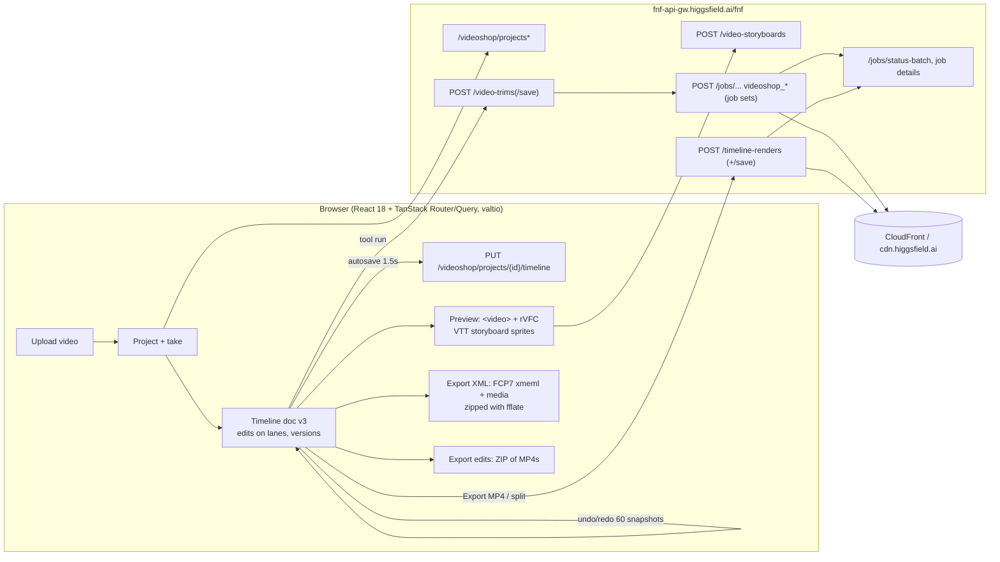
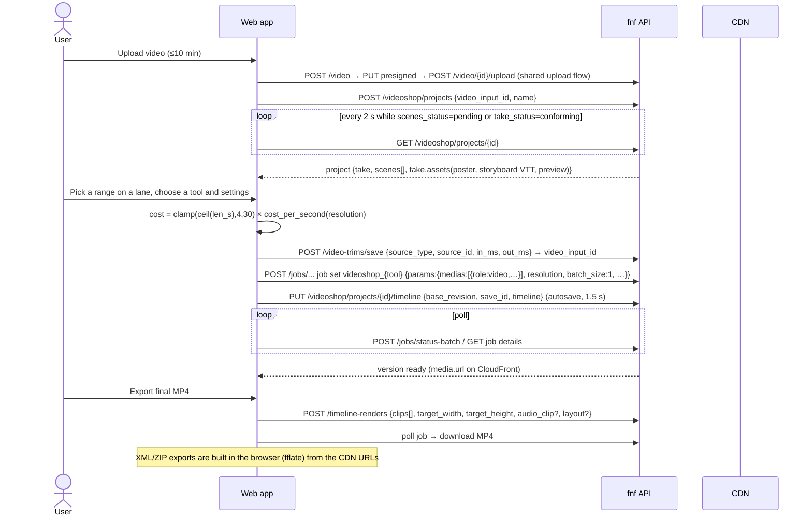

# Editing Room (`/editing-room`, internal name "videoshop")

How the Higgsfield **Editing Room** works, reverse-engineered from the public JS bundle and public GETs.

**Date:** 2026-11-26. **Build:** `548e0f3a` (same as [`../MODEL_LOADING.md`](../MODEL_LOADING.md)). Chunks are in
`samples/higgsfield/js2/` (gitignored). The page HTML is in `samples/higgsfield/js2/_pages/editing_room.html`.
**Method:** static analysis plus GET-only probes with no login. No POST/PUT/PATCH/DELETE, upload, render or
generation was sent. Endpoints marked **JS** are known only from the bundle and were **not called**.
UI strings were resolved by mapping Lingui message ids to the public English catalog
`https://l10n.higgsfield.ai/l10n/production/r/231ec7251afbc2e1/en.6f327b41fe.json` (saved as
`js2/_l10n_en.6f327b41fe.json`).

---

## 1. TL;DR

The Editing Room is **not a classic NLE** (no multi-track mixing, transitions, captions, music or filters). It is an
**AI re-shoot editor for one uploaded video**. You upload a video (a "take"). The server cuts it into shots
("auto-cut"). You then place **edits** (time ranges) on stacked **lanes**. Each edit runs one AI tool on that
range: **Genjutsu** (swap person or location), **Angles**, **Camera move**, **Relight** or **Brush** (prompt
inpainting). "Lens swap" is in the code but marked "coming soon". Every generation becomes a **version** of the
edit, and you pick which version is placed. Export happens on the **server** (`POST /timeline-renders`). The other
exports are a client-side ZIP of the clips, or a **FCP7 XML** project for Premiere or DaVinci Resolve, zipped in
the browser with fflate.

- The timeline engine is **custom**: a React + valtio document, versioned `schemaVersion: 3`. No Remotion,
  Konva, Pixi, Fabric, Twick or wavesurfer.
- There is **no client-side encoding**: no WebCodecs encoder, ffmpeg.wasm, MediaRecorder or muxer. The preview is
  plain `<video>` elements with `requestVideoFrameCallback` for frame-accurate seeks. The filmstrip comes from
  server-made WebVTT storyboard sprites.
- **Models and credits:** 4 `job_set_type`s (`videoshop_genjutsu`, `videoshop_relight`, `videoshop_camera_move`,
  `videoshop_edit`), priced per second by `/job-sets/costs`. The billed length is clamped to 4–30 s.
- **Persistence:** server autosave (`PUT /videoshop/projects/{id}/timeline`), 1.5 s debounce, optimistic
  concurrency via `base_revision`/`save_id` (409 on conflict), `keepalive` flush on `pagehide`, and a
  localStorage journal.



---

## 2. Features

Checked against the requested list. "No" means there is no code or string for it in the editor chunks.

| Feature | Present? | How (evidence: UI strings from the l10n catalog, code in `548e0f3a-9x5h1F6my-Vy3fcG.js`) |
|---|---|---|
| Upload a source video | Yes | "Upload video to edit · Up to 10 minutes"; MP4/WebM; must be at least `{minSeconds}` long; ProRes is rejected ("Convert it to H.264") |
| Scene detection / auto-cut | Yes, server | `scenes_status: pending/ready/failed`, `scenes:[{start_ms,end_ms}]`; "Auto-cutting your video", "Cut into {0} clips"; the client estimates an ETA from past runs (localStorage `videoshop:auto-cut-timing:v1`) |
| Timeline, tracks | Yes | Stacked **lanes** (`layer`), zoom (`videoshop:timeline-zoom:v1:{id}`), resizable height, playhead, ruler, show/hide a lane |
| Clips, trimming, splitting | Partly | Manual **cuts** (`PUT /cuts {cuts_ms}`; "a cut needs at least 1 second of video on each side"); **trim start/end per shot** (`trim`, `shotTrims`). There is no clip reordering and no multi-source timeline |
| Transitions | No | — |
| Text, captions, subtitles | No | Only an empty `<track kind="captions">` on the player |
| Audio, music, voiceover | No editing | The original audio is kept. A single-shot export passes the take's audio as `audio_clip`. The XML export detects whether the take has audio by scanning the MP4 `hdlr soun`/`mp4a` atoms in the browser |
| Effects, filters | Through AI tools only | See below |
| **Genjutsu** (`genjutsu`) | Yes | "Swap motion, objects or style". Modes `genjutsuWay`: `swap-person`, `change-location`. Needs at least 1 reference image plus an optional prompt. Range 2–30 s and **may cross cuts** |
| **Angles** (`angle`) | Yes | "Re-shoot from a new angle". `rotateDegree` 0–359, `tiltDegree` −30…90, `shot` ∈ `auto/ws/ms/cu`, named presets (`profl`, …). Range 2–15 s, inside one cut |
| **Camera move** (`camera-move`) | Yes | "Add a dolly, a pan or an orbit". `moveId` (e.g. `dollyin`, `orbitleft/right`, `fpv`, `barrelroll`, `roboarm`, `orbit360p`, `overhead`, `vertigo`) and `intensity` 0–100. Some moves need at least 4 s. Range 2–15 s |
| **Relight** (`relight`) | Yes | Light presets (Golden hour, Studio key, Moonlight, Neon split, Rim light, Campfire…). Custom lights `{az, el, color, brightness, diffuse}`, or a text prompt plus an optional light reference image. Range 2–15 s |
| **Brush** (`brush`) | Yes | "Paint over what to change" plus a prompt. The strokes are reduced to a normalized bounding box `selection:{x,y,w,h}`. Range 2–30 s |
| Lens swap (`camera`) | Stub | "Lens swap is coming soon." (tool id `camera` is in the enum) |
| Generate a clip into the timeline | Yes | Each run creates a **version** of the edit. Versions stack: "Add an edit on the lane above to change this result again" |
| Extend, lipsync, B-roll | No | — |
| Versions and history | Yes | "A clip keeps every version"; version history panel; statuses generating/queued/failed/ready/unavailable; failures `nsfw`, `ip_detected`, `canceled` ("Credits returned") |
| Compare | Yes | Before/after sweep, **Split** view (`side_by_side` for portrait takes, `stacked` for landscape) |
| Templates / examples | Yes | CMS examples (`cms.higgsfield.ai/videoshop-examples`) and forkable example projects (`/videoshop/project-examples`, "Open the example") |
| Export | Yes | 4 options: "Export final video (MP4)", "Export split view video (MP4)", "Export all edits (ZIP)", "Export project (XML) — FCP7 XML + media for DaVinci Resolve, Premiere". No bitrate/fps presets: the render keeps the take's width × height. The XML uses the project `frameRate` (default 30) |
| Undo/redo | Yes | Snapshot stacks of up to 60 entries with a coalescing key. Keyboard shortcuts via a `mod+`/`alt+`/`shift+` key map |
| Batch size, quality | Yes | Resolution `480p/720p/1080p` ("This output resolution is not available for the source video"). Batch size control, but every tool builder sends `batch_size: 1` |
| Free usage | Yes | "First edit for free", "FREE edit until {date}". Free gens or free **generation seconds** from a grant whose `config.job_set_types` covers all 4 videoshop types. The nav item varies with `holdsEditingRoomFreeRun` (`editing-room-free-run` vs `editing-room`) |
| Feedback | Yes | "How was your experience with Editing Room?" (`/feedback/forms/*`) |

Routes (from the route tree in `548e0f3a-aXyXjC_KHBp09DNW.js`): `/editing-room` (layout, shows a "desktop only"
fallback on small screens), `/editing-room/` (tabs `videos | guide | community`), `/editing-room/$projectId`
(editor) and `/editing-room/examples/$slug`. Old `/videoshop/*` routes redirect here with a 301.

---

## 3. User workflow



---

## 4. Stack and libraries

| Layer | What | Evidence (chunk → excerpt) |
|---|---|---|
| Framework | React 18, TanStack Start/Router (file routes), TanStack Query | `aXyXjC…`: ``P(`/_private/editing-room/$projectId`)({component:…})``; `9x5h1…`: `De({queryKey:vb.detail(e),…refetchInterval…})` |
| State | **valtio** (`proxy`/`ref`/`snapshot`) | `1IspxCnk…`: ``function j_(e={}){if(!I_(e))throw Error(`object required`)`` plus `proxyStateMap`, `snapCache`; editor store `zw()` = `mt({document:nt(…),versions:nt(…),undo:nt([]),redo:nt([]),coalesceKey:null,locked:…})` |
| Undo/redo | Custom snapshot stack (60) | `9x5h1…`: ``e.undo=nt([...e.undo,r].slice(-60))`` |
| Validation | zod (minified) | Project schema `take_status:Ze([`ready`,`conforming`])`, timeline `schemaVersion:lt(3)` |
| i18n | Lingui with ids resolved from the `l10n.higgsfield.ai` route catalogs | `t({id:`OwIqiD`})` |
| UI | In-house "q" design system on Tailwind v4 classes (`text-q-…`, `rounded-q-300`), sonner toasts, Radix primitives (shared chunks) | `--videoshop-*` CSS variables |
| Drag and drop | Custom pointer handlers (no dnd-kit or react-dnd in the closure) | `data-videoshop-edit`, `data-videoshop-lane` |
| Player | `<video>` + `requestVideoFrameCallback` seek confirmation, media-chrome-style controls | `8A0DIgMf…`: ``e.requestVideoFrameCallback((n,r)=>{…r.mediaTime…})`` |
| Thumbnails | Server WebVTT sprite storyboard | `POST /video-storyboards` → `vtt_url` `…/storyboard/board.vtt` |
| ZIP | **fflate** (`Zip`, `ZipPassThrough`, `strToU8`), lazy chunk `548e0f3a-egHLn7R5mjwF54TG.js` | `9x5h1…`: ``let{Zip:t,ZipPassThrough:n,strToU8:r}=await …import(`./548e0f3a-egHLn7R5mjwF54TG.js`)`` |
| NLE export | Hand-written FCP7 `xmeml` v4 | ``[`<?xml version="1.0" encoding="UTF-8"?>`,`<!DOCTYPE xmeml>`,`<xmeml version="4">`…`` |
| Persistence | Server autosave plus a localStorage journal | ``n=`videoshop:timeline:v3:${e.id}` ``; `dT=1500`; ``window.addEventListener(`pagehide`,T)`` |
| Collaboration | None. Single user with conflict detection only | 409 → "This project was changed somewhere else. The latest edits are loaded" |
| Auth | Clerk JWT (`Authorization: Bearer`), `hf-workspace-id` | shared `ci()` fetch wrapper |
| Analytics | PostHog chunk ids, Amplitude-style `track*` events (`trackEditorViewed`, `trackProjectCreate`) | — |
| Media CDN | `d2ol7oe51mr4n9.cloudfront.net` (inputs), `d8j0ntlcm91z4.cloudfront.net` (results), `cdn.higgsfield.ai` (thumbs, previews, storyboards), `static.higgsfield.ai/videoshop/…` (UI media), `static-public-media.higgsfield.ai/videoshop-examples/…` (CMS examples) | from the public examples |

**Searched and not found** in the 178-file editor closure: `VideoEncoder`, `VideoDecoder`, `AudioEncoder`,
`EncodedVideoChunk`, `ffmpeg`, `.wasm`, `mp4box`, `mp4-muxer`, `webm-muxer`, `MediaRecorder`, `OffscreenCanvas`,
`new Worker`, `remotion`, `konva`, `pixi`, `fabric`, `twick`, `wavesurfer`, `avc1`, `vp09`, `yjs`, `zustand`,
`jotai`, `dnd-kit`.

---

## 5. Data model

**Project** (`GET /videoshop/projects/{id}`; zod schema `Yy`). Real shape from the public examples; ids shortened:

```json
{
  "id": "82118cec-…", "name": "My corners of the city", "created_at": 1795086926.3,
  "take": {
    "id": "2552d9f4-…", "type": "video_input",
    "url": "https://d2ol7oe51mr4n9.cloudfront.net/user_<redacted>/2552d9f4-….mp4",
    "thumbnail_url": "https://cdn.higgsfield.ai/…_thumb.webp",
    "width": 3840, "height": 2160, "duration_ms": 15041, "filename": "Input (1).mp4",
    "assets": {
      "poster":     {"status": "ready", "url": "…"},
      "storyboard": {"status": "ready", "vtt_url": "https://cdn.higgsfield.ai/storyboard/…/board.vtt"},
      "preview":    {"status": "ready", "url": "https://cdn.higgsfield.ai/videoshop/take/…/compressed.mp4"}
    }
  },
  "take_status": "ready",            // or "conforming" (server transcode; the editor shows a spinner)
  "scenes_status": "ready",          // pending | ready | failed
  "scenes": [{"start_ms": 0, "end_ms": 15041}]
}
```

**Timeline document v3** (`PUT|GET /videoshop/projects/{id}/timeline`; zod `Rb`). The GET wraps it as
`{revision, save_id, timeline}`.

```json
{
  "schemaVersion": 3,
  "nextEditNumber": 9,
  "trim": {"startMs": 0, "endMs": 15041},                 // optional
  "shotTrims": [{"startMs": 0, "endMs": 7000}],           // optional, per shot
  "edits": [{
    "id": "uuid", "number": 7, "layer": 2, "hidden": false,
    "startMs": 4474, "endMs": 6866, "cutsMs": [],
    "tool": "angle",                                       // genjutsu|angle|camera-move|relight|brush|camera|null
    "genjutsuWay": null,                                   // swap-person|change-location (genjutsu only)
    "resolution": "1080p",                                 // 480p|720p|1080p
    "promptEnabled": false, "prompt": "",
    "references": [{"id": "uuid", "type": "media_input", "url": "…"}],
    "relight": null,   // {preset, lights:[{az,el,color,brightness,diffuse}], custom?:{active,lights}, description?:{active,prompt,reference}}
    "brush": null,     // {strokes:[{points:[x,y,…], size}]}
    "cameraMove": null,// {moveId, intensity, direction: left|right|null}
    "angle": {"rotateDegree": 270, "tiltDegree": 0, "shot": "cu", "preset": "profl"},
    "placedVersionId": "uuid"                              // the version shown on the timeline
  }],
  "versions": [{
    "id": "uuid", "editId": "uuid", "number": 1, "batchId": "uuid",
    "jobSetId": "uuid", "rangeMs": {"startMs": 1241, "endMs": 3450}, "mediaStartMs": 0,
    "specKey": "[\"relight\",1241,3450,\"1080p\",\"\",[],\"take\",{…}]",   // detects "Changed since the last result"
    "resolution": "1080p",
    "madeWith": {"tool": "relight", "resolution": "1080p", "relight": {…}},
    "status": "ready",                                     // generating(+queued)|failed(+failureReason)|ready|unavailable
    "media": {"id": "uuid", "type": "video_job", "url": "https://d8j0ntlcm91z4.cloudfront.net/…mp4"},
    "thumbnailUrl": "…"
  }]
}
```

Hard limits (`$_` table): genjutsu and brush ranges are 2–30 s, relight, camera-move and angle ranges are 2–15 s,
and only genjutsu may cross cuts. Results are placed by `placedVersionId`. The playable result is the intersection
of the edit range and the version's `rangeMs`.

**Render request** (`POST /timeline-renders`, **JS, not called**):

```json
{"clips":[{"source_type":"video_input|job","source_id":"uuid","in_ms":0,"out_ms":4474}, …],
 "target_width":3840,"target_height":2160,
 "audio_clip":{…},                    // only when the project is a single shot
 "layout":"stacked|side_by_side","input_clips":[…],   // split view only
 "folder_id":"…"}
→ {"job_set_id":"…","job_id":"…","total_duration_ms":15041}
```

---

## 6. API endpoints

Base `https://fnf-api-gw.higgsfield.ai/fnf` unless noted. "public" = verified 200 without auth on 2026-11-26.
"login" = verified 401. "JS" = seen only in the bundle, **not called**.

| Method | Path | Auth | Purpose |
|---|---|---|---|
| GET | `https://cms.higgsfield.ai/videoshop-examples?lang=en` | **public** | 11 CMS examples: `{id,title,thumbnail_url,preview_url,input{url,w,h,duration_ms},final,edits[{tool,label,prompt,start_ms,end_ms,layer}]}` (fetched with `credentials:"omit"`) |
| GET | `/videoshop/project-examples` | **public** | 6 full example projects with their timeline documents (`{items:[{project,timeline}]}`) |
| POST | `/videoshop/project-examples/{id}/fork` `{name,cuts_ms,job_ids}` | JS | Copy an example into My videos ("Save this variant") |
| GET | `/videoshop/projects?size=50` | login | Project list |
| GET | `/videoshop/projects/{id}` | JS (login) | Project with take and scenes. Polled every 2 s while pending or conforming, 5 s while assets are pending |
| POST | `/videoshop/projects` `{video_input_id,name}` | JS | Create a project from an uploaded video |
| POST | `/videoshop/projects/fork` `{example_id,name,cuts_ms}` | JS | Start from a CMS example → `{project, final_video}` |
| PATCH | `/videoshop/projects/{id}` `{name}` | JS | Rename |
| PUT | `/videoshop/projects/{id}/cuts` `{cuts_ms}` | JS | Save manual cuts |
| DELETE | `/videoshop/projects/{id}` | JS | Delete |
| GET / PUT | `/videoshop/projects/{id}/timeline` `{base_revision,save_id,timeline}` | JS | Load or autosave the timeline doc (409 = conflict) |
| GET | `/videoshop/camera-moves`, `/videoshop/relight-presets`, `/videoshop/angle-presets` | login | Tool presets (`{items:[{id,name,group?,lights?,method?,guide_seconds?,thumbnail_url,preview_url}]}`) |
| POST | `/video-trims`, `/video-trims/save` `{source_type,source_id,in_ms,out_ms,folder_id?}` | JS | Server trim. `/save` returns a reusable `video_input_id` that becomes the job input |
| POST | `/video-storyboards` `{source_type,source_id}` | JS | VTT sprite storyboard for the filmstrip |
| POST | `/jobs/…` via the shared FNF submit (`fnfJob: videoshop_*`, mutation keys `job-set-videoshop-{edit,genjutsu,relight,camera-move}`) | JS | Run a tool (see 7) |
| POST | `/timeline-renders`; `/timeline-renders/{job_id}/save` | JS | Server render of the final or split MP4. `/save` turns a render into a `video_input` (used to stitch the source for an edit that spans earlier results) |
| POST | `/jobs/status-batch`, GET `/jobs/by-ids`, job details | JS (login) | Polling (shared) |
| GET | `/job-sets/costs` | **public** | Per-second prices for the 4 videoshop types |
| GET | `/user/generation-seconds`, free-gens and unlimited grants | JS (login) | Free-seconds or free-gens counters for videoshop |
| POST | `/video`, `/video/{id}/upload`, `/media/batch` | JS | Shared upload flow ([`../MODEL_LOADING.md`](../MODEL_LOADING.md) §6) |
| GET/POST | `/feedback/forms/{pending,trigger,manual}` | JS | Feedback prompt |
| GET | `https://static.higgsfield.ai/videoshop/videoshop-media/…`, `/reality-manipulation/features/{id}` | public CDN | UI media |

---

## 7. Models, providers and credits

Tool → `job_set_type` → params builder (`KD()` in `9x5h1…`):

| Tool | `job_set_type` | `params` (besides `resolution`, `batch_size:1`, `medias:[{role:"video",data:{id,type:"video_input"}}]`) |
|---|---|---|
| genjutsu | `videoshop_genjutsu` | reference images as `{role:"image"}` medias (at least 1), optional `prompt` |
| relight | `videoshop_relight` | `relight:{preset,lights[],text:""}`, or `prompt` plus an optional image reference |
| brush | `videoshop_edit` | `prompt`, `brush:true`, `selection:{x,y,w,h}` |
| camera-move | `videoshop_camera_move` | `move_id`, `intensity` |
| angle | `videoshop_camera_move` | `mode:"angles"`, `angle:{azimuth,elevation,shot,preset?}` |

Submit context: `contextExtension:{sourceVideoDuration, generationAspectRatio, useGenerationSeconds|useFreeGens}`,
`withAuthGuard`, `withGuards`. The underlying model vendors are **not named** anywhere in the JS. The
"Higgsfield Genjutsu / Reality manipulation" branding suggests in-house wrappers (inferred).

**Credit formula (JS) × live prices (`/job-sets/costs`, version `0cee3218…`, saved in
`samples/higgsfield/editing_room/job_sets_costs.json`).** `L = min(30, max(4, ceil(seconds)))`:

| Type | Formula | 480p | 720p | 1080p | 4k |
|---|---|---|---|---|---|
| `videoshop_genjutsu` | `L × cps` | 3 | 7 | 20 | — |
| `videoshop_relight` | `L × cps(with_video) + image_credits` (3.5) | 3 | 7 | 16 | 34 |
| `videoshop_camera_move` (move + angle) | `L × cps(with_video)` | 3 | 7 | 16 | 34 |
| `videoshop_edit` (brush) | `ceil(min(30,max(4,s)) × cps)` | 3.5 | 7.5 | 20 | 34 |

Example: a 3.2 s relight at 1080p costs `4 × 16 + 3.5 = 67.5` credits. A 12 s genjutsu at 720p costs 84. The UI
only offers 480p/720p/1080p. 4k is priced but not selectable in this build.

**Gating.** Generation requires a login (`withAuthGuard`) and the standard plan, paywall and unlimited guards.
Free use comes from a free-gens or **generation-seconds** grant whose `config.job_set_types` includes all four
videoshop types, limited by `max_duration`/`min_duration`/`resolutions`. Support or impersonation sessions disable
generation and export. Feature flags (`window.__HF_FF`, hashed names) are present on the page, but no
editor-specific flag name could be tied to them.

---

## 8. Rendering and encoding

- **Decode and preview:** browser `<video>` only. Clips are played as windows (`inMs`/`outMs`) into the take or
  into result videos. A `requestVideoFrameCallback` loop confirms that seeks landed within tolerance. The server
  makes a compressed **preview** MP4 of the take (`…/videoshop/take/{id}/preview/…/compressed.mp4`) and a WebVTT
  storyboard sprite for the filmstrip.
- **Encode and render: server-side.** `POST /timeline-renders` receives an EDL (`clips[]` of
  source/in/out) plus `target_width/height` equal to the take's size. It returns a `job_id` that is polled like
  any job, and the MP4 is then downloaded. The split view adds `layout` (`stacked`/`side_by_side`) and
  `input_clips`. The client sends no codec, bitrate or fps settings, so the server decides them.
- **Source preparation:** before a tool runs, the edit window is cut on the server (`/video-trims/save`, polled
  every 1.5 s up to 40 times). If the window spans earlier results, they are first joined with a
  `/timeline-renders` + `/save` round trip ("The joined clip did not finish").
- **Client-side exports (no transcoding):**
  - "Export all edits (ZIP)": downloads every ready result MP4 and zips it with fflate.
  - "Export project (XML)": FCP7 `xmeml` v4 (sequence, `<rate><timebase>` from `frameRate`, NTSC flag,
    `clipitem`s, 48 kHz stereo/mono audio track) plus a `media/` folder plus a README with import steps for
    Premiere and Resolve.
- There are no `avc1`/`vp09`/`opus` strings, no wasm, no workers and no export presets in the editor.

---

## 9. Public vs login

| Public (no login) | Login only |
|---|---|
| Page HTML and JS, l10n catalogs | Everything under `/videoshop/projects*` |
| `cms.higgsfield.ai/videoshop-examples` (11 examples) | Tool presets (camera moves, relight, angles) |
| `/videoshop/project-examples` (6 projects with full timeline docs, prompts, result URLs) | Trims, storyboards, jobs, renders, uploads |
| `/job-sets/costs` (prices) | Free-gens and generation-seconds counters |
| Example media on `static-public-media.higgsfield.ai` and CloudFront | — |

---

## 10. What could be scraped

1. **Prices:** `videoshop_*` rows of `/job-sets/costs`. The existing pipeline already covers them. Add the
   videoshop formulas (clamp 4–30 s, `+image_credits` for relight) to the cost layer.
2. **Examples catalog:** `cms.higgsfield.ai/videoshop-examples?lang=…` (titles, edit labels, prompts, before and
   after media).
3. **Example projects:** `/videoshop/project-examples`. These give real tool parameters per edit (relight presets
   with light rigs, camera move ids, angle presets, genjutsu prompts) and real `jobSetId`s. That is the only public
   source of preset ids, because the preset endpoints need a login.
4. Not scrapeable without login: user projects, preset lists, renders.

Samples: `samples/higgsfield/editing_room/` (`cms_videoshop_examples.json`, `videoshop_project_examples.json` with
user ids redacted, `job_sets_costs.json`).

---

## 11. Confidence

| Claim | Level |
|---|---|
| Public endpoints (CMS examples, project-examples, costs) and their shapes | **Verified live** (GET, 2026-11-26) |
| Preset endpoints and `/videoshop/projects` need a login | **Verified live** (401) |
| Timeline schema v3, tools, ranges, param builders, job type mapping, credit formulas | **From JS** and consistent with the public example timelines |
| Server-side rendering; no client encoder | **From JS** (absence across the whole 178-chunk closure, plus the `/timeline-renders` call) |
| Export formats (FCP7 XML, ZIP via fflate, MP4) | **From JS** plus UI strings |
| valtio as the state library | **From JS** (minified `proxy` signature and `proxyStateMap`/`snapCache`), library name inferred |
| Underlying AI vendors behind `videoshop_*` | **Unknown** |
| Exact jobs route path for `videoshop_*` (`/jobs/v2/{type}` vs kebab) | **Inferred** from the shared `package-fnf` submit factory |
