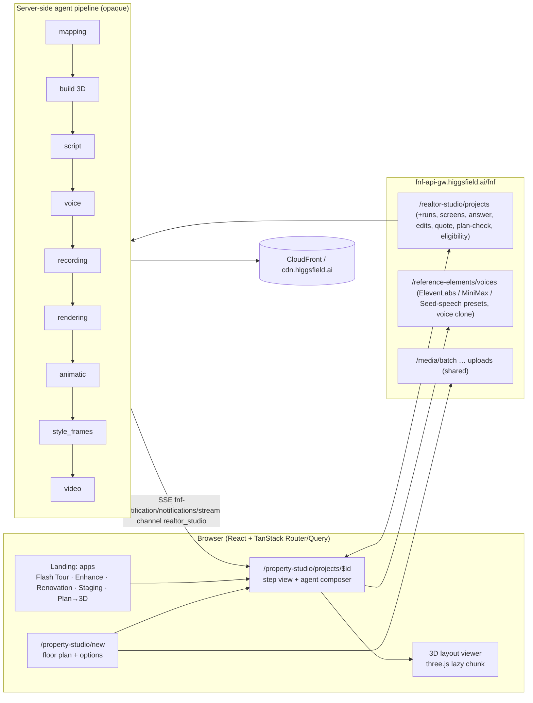
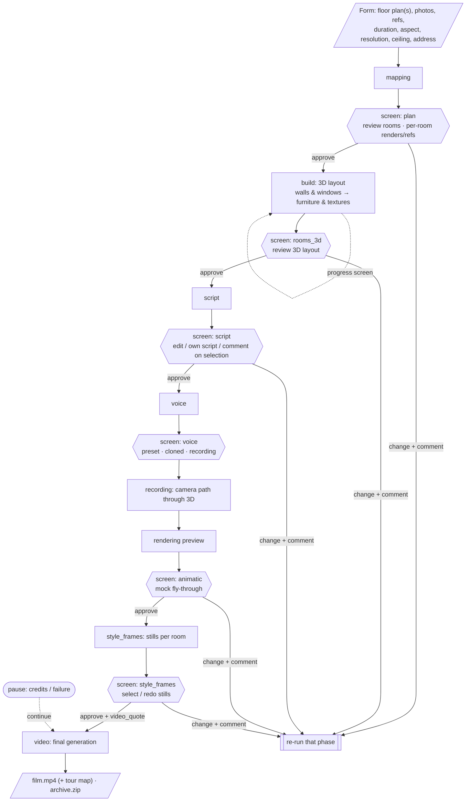

# Property Studio (`/property-studio`, internal names "realtor studio" / "realty studio")

How the Higgsfield **Property Studio** works, reverse-engineered from the public JS bundle and public GETs.

**Date:** 2026-11-26. **Build:** `548e0f3a`. Chunks are in `samples/higgsfield/js2/` (gitignored). The page HTML
is in `samples/higgsfield/js2/_pages/property_studio.html`. **Method:** static analysis plus GET-only probes with
no login. No POST/PUT/PATCH/DELETE, upload or generation was sent. **JS** = known from the bundle only, **not
called**. UI strings come from the public English Lingui catalog (`js2/_l10n_en.6f327b41fe.json`).

---

## 1. TL;DR

Property Studio is a **real-estate listing-media product** with two halves:

1. **Walkthrough** (the main product, `make: "walkthrough"`). It turns a **floor plan** (PNG/JPEG/WebP/PDF, 1–2
   floors) plus optional room photos and style references into a **narrated, furnished 3D fly-through video**.
   It runs as a **server-side multi-step agent pipeline**: room mapping → 3D layout build → script → voice →
   camera path recording → animatic → style stills → final video. The pipeline stops at **review gates
   ("screens")** where the user approves or asks for changes in a chat-like **agent composer**.
2. **One-shot "apps" (formats)** on the same backend: **Flash Tour** (`speedramp_walkthrough`: ordered photos →
   fast-cut tour video), **Enhance** (fix lighting, clean up), **Renovation**, **Virtual Staging** (furnish empty
   rooms), **Floor plan to 3D** (photoreal 3D image), plus a hidden `exploded_view`.

Everything goes through one REST family, `/realtor-studio/*`, as **projects → runs → screens → answers**. The
**prompts, tools and models are server-side**. The public JS has no prompt templates, no tool schemas and no
`job_set_type`s for these steps, and `/job-sets/costs` has no realty rows. Pricing is quoted by
`POST /realtor-studio/quote` (JS) and shown in the UI as an estimate of **1500–2000 credits** per walkthrough.
Progress is pushed over an **SSE notification stream** (`realtor_studio` channel) and by polling. The 3D layout is
shown in the browser with **three.js** (OrbitControls, RoomEnvironment).



---

## 2. Features

| Feature | Details (from JS and UI strings) |
|---|---|
| **Walkthrough video** | "Upload your floor plan, add room references, and build your walkthrough". Steps shown: **Interior → 3D Layout → Script & voice → Video**. "Generations can take up to 1 hour" |
| Inputs | Floor plan (PNG, JPEG, WebP or **PDF**, 15 MB max; up to 2 floors with "Swap floors"). **Duration** 45/60/90/120/180/240 s. **Aspect ratio** `16:9`, `9:16` (default), `4:3`, `3:4`. **Resolution** `720p`, `1080p` (default), `4k`. **Ceiling height** in metric or imperial (default unit chosen from the user's country). Optional **location/address** ("e.g. Walnut Street, Bronx, NY") |
| Floor-plan validation | `POST /realtor-studio/plan-check {file_ids}` → `[{file_id, verdict, message}]`. Error `realtor_studio_not_a_floor_plan` |
| Rooms review | Detected rooms with `outline` polygons and `label_point` on the plan. Rename rooms or change their `function`, drop rooms. Per-room images are either **Render** ("how this room should look") or **Reference** ("inspiration… without copying"), plus **global style references** |
| 3D layout | "Building 3D layout" (walls & windows → furniture & textures). A 3D model per floor (`files[].kind="model"`) is shown in a three.js viewer, with rooms as `ROOM_<n>` meshes |
| Script | AI-written room-by-room script (`script.blocks[{room, heading, text}]`). The user can edit it, select a passage and comment on it, or **upload their own** script (≤ 2 MB) |
| Voice | Preset voices (filters: gender, age), **custom voice clone** from a 15 s–2 min sample (≤ 25 MB, with a "voice limit reached" cap), or an uploaded **voice-over recording** |
| Fly-through | "Recording walkthrough" (camera path through the 3D layout) → "Rendering" → **mock fly-through (animatic)** review of camera movement and room order |
| Style stills | Per-room generated stills. Select or redo them ("Keep at least one still selected") |
| Final video | "Your video tour". Download the MP4, or a **ZIP** "for further editing" (`run.result.film` + `run.result.archive`). Optional **tour map** overlay ("Adds a small floor plan to the corner of your final video") |
| Edit after done | `POST /projects/{id}/edits {start_step:"animatic"}`: "Editing creates a new project. Each change costs credits" |
| Agent composer | "Describe the changes…", attach images, max 2,000 chars, "LLMs can make mistakes and calls cost credits", agent history sidebar. **Voice input** is beta ("Higgsfield corporate accounts only") |
| Run control | `allowed_actions`: `edit`, `open_step`, `answer`, `resend`, `cancel`, `continue`, `restart`, `rename`, `delete`, `set_tour_map`. A run can be **paused** (`pause.kind`: `credits` or `failure`, with `needed_credits` and `balance`) |
| **Flash Tour** (`speedramp_walkthrough`) | "Turn photos into a fast-cut video tour". Room photos in order (best with 5–10) plus an aspect ratio |
| **Enhance** (`enhance`) | "Fix lighting and clean up any photo". Photos plus optional notes ("remove the cables and clutter", "match the lighting from @image2") |
| **Renovation** (`renovation`) | "See your space fully renovated". Photos plus optional references |
| **Virtual Staging** (`virtual_staging`) | "Furnish empty rooms". Photos of empty rooms plus optional references |
| **Floor plan to 3D** (`floor_plan_3d`) | "Flat plan into a photoreal 3D image". Floor plan(s) |
| `exploded_view` | In the `make` enum and the request builder (plans, photos, references), but has **no card** in the UI (hidden or upcoming) |
| Explore gallery | ~75 curated before/after presets ("Walnut Loft House", "Oak Kitchen", …) served from `static.higgsfield.ai/realty-studio/app-presets/{v1,full-v1}/…`, with "Recreate" |
| History | Project list grouped by version, "{count} in progress", credits spent per project |
| Notifications | In-app toast and browser push (`/auxiliary/notifications-sw.js`) when a run is `ready/paused/completed/failed` |

Routes: `/property-studio` (layout plus notification listener), `/property-studio/` (landing: Explore and History
tabs), `/property-studio/new` (walkthrough form) and `/property-studio/projects/$projectId/`.

---

## 3. User workflow (walkthrough)

```mermaid
sequenceDiagram
  actor U as User
  participant W as Web app
  participant API as /realtor-studio
  participant AG as Server pipeline
  participant N as SSE notifications
  U->>W: Upload floor plan(s), set duration/aspect/resolution/ceiling/address
  W->>API: (upload via shared media flow) → POST /plan-check {file_ids}
  W->>API: POST /projects {name, make:"walkthrough", plan_image_ids|plan_file_ids, plan_meta, units, ceiling_height_m, length_seconds, aspect_ratio, resolution, address}
  API-->>W: {project_id}
  API->>AG: run starts (phase mapping)
  AG-->>N: realtor_studio {project_id, run_id, state:"ready", screen}
  W->>API: GET /projects/{id} (+ /runs/{run}/screens/{screen})
  Note over U,W: Screen "plan": review rooms, add per-room renders/references
  U->>W: approve / request changes
  W->>API: POST /runs/{run}/screens/{screen}/answer {items:[{decision:"approve"|"change", room?, comment?}], images, room_edits}
  AG->>AG: build 3D (progress screen) → rooms_3d screen
  U->>W: approve layout → script screen (edit, upload own, or comment on a selection)
  U->>W: voice screen: {voice:{voice_id}} or {voice:{recording_file_ids}}
  AG->>AG: recording → rendering → animatic screen (mock fly-through)
  AG->>AG: style_frames screen (stills per room) → video
  AG-->>N: state "completed"
  W->>API: GET /projects/{id} → run.result.film (+archive)
  Note over W,API: pause (credits/failure) → POST /runs/{run}/continue; cancel → /cancel; redo from animatic → POST /projects/{id}/edits
```

Polling (from JS): project query every **5 s** while working, **15 s** while waiting or paused. The SSE event
invalidates the query and shows a toast unless the user is already on that project.

---

## 4. Stack and libraries

| Layer | What | Evidence |
|---|---|---|
| Framework | React, TanStack Start/Router, TanStack Query | `aXyXjC…`: ``P(`/_private/property-studio/projects/$projectId/`)``; `qIj-kOO6…`: `refetchInterval… Lc={working:5e3,unknown:5e3,waiting:15e3}` |
| API client | Shared fetch wrapper with Clerk JWT plus workspace header, validated with zod | `H2odSMT…`: ``P(`/realtor-studio/projects/${L(t)}`),B({headers:U9(e),signal:n})`` → `A9.parse(…)` |
| Realtime | SSE through an EventSource polyfill that supports headers, a pooled `subscribe(channel)` | `uhUwvmv4…`: ``i=`https://fnf-api-gw.higgsfield.ai/fnf-notification`,a=r(`/notifications/stream`)``; ``R.t.pool.allocate(L.r).subscribe(`realtor_studio`,…)``; `FnLZVP0e…`: ``u.Accept=`text/event-stream` `` |
| Web push | Service worker | `` `/auxiliary/notifications-sw.js` `` |
| 3D | **three.js** (WebGLRenderer, PerspectiveCamera, OrbitControls, PMREM + RoomEnvironment), lazy chunk `548e0f3a-ilySZK-sfzqnkmDa.js` | ``i=new t.OrbitControls(c,r.domElement),i.enableDamping=!0``; ``Ie=`ROOM_` `` |
| Agent UI | Shared "studio agent" composer (also used by Cinema/Marketing studios): Lexical editor, skill chips, attachments, voice input with waveform | named modules `studio-agent-panel-header`, `studio-skill-chip`, `voice-input-lexical-plugin`, `use-agent-composer-approval-resize` |
| Voices | `/reference-elements/voices?model=elevenlabs` (voice API module shared with Cinematic Audio) | `wLhb1Df…`: ``hf=`elevenlabs` `` |
| i18n | Lingui with the `l10n.higgsfield.ai` catalogs | — |
| Static media | `static.higgsfield.ai/realty-studio/…` (hero videos, app presets, explore gallery) | verified 206 on `…/hero/featured/walkthrough-1-v2-poster.webp` |

---

## 5. Data model

**Project** (`GET /realtor-studio/projects/{id}`; zod `A9`, abridged):

```json
{
  "id": "uuid", "name": "New walkthrough", "make": "walkthrough",
  "stage": "build", "active_phase": "build", "state_version": 12,
  "waiting_on": "rooms_3d", "activity": "Building 3D layout…",
  "pending_gate": {"run_id": "…", "screen_id": "…", "mode": "answer",
                   "answer_targets": {"rooms": [1,2], "shots": ["s1"]}},
  "allowed_actions": ["answer","cancel","rename","delete","set_tour_map"],
  "view": {"phase": "build", "state": "asking", "screen_id": "…", "redoing": false},
  "pause": {"kind": "credits", "needed_credits": 400, "balance": 120, "since": "…", "expires_at": "…"},
  "form": {"make": "walkthrough", "plan_image_ids": ["…"], "plan_file_ids": [], "plan_meta": [{"file_id":"…","floor":1}],
           "photo_ids": [], "reference_ids": [], "notes": null, "units": "metric", "ceiling_height_m": 2.7,
           "length_seconds": 60, "aspect_ratio": "9:16", "resolution": "1080p", "address": null},
  "form_files": [/* file */], "models": [/* file kind=model per floor */],
  "run": {"id": "…", "status": "waiting", "error_message": null, "active_phase": "build",
          "credits_spent": {"total": 640}, "working_since": "…",
          "result": {"film": {/* file */}, "archive": {/* file */}},
          "outputs": [{"name": "…", "file": {/* file */}, "original": null}]},
  "latest_screen": {/* screen */},
  "content_screens": {"plan": "screen-id", "script": "screen-id"},
  "tour_map": true,
  "versions": {"count": 2, "latest": {"project_id": "…", "name": "…", "run": {…}}},
  "edit": {"source_project_id": "…", "preparation": "…"}
}
```

**File:** `{id, kind: image|video|audio|model|archive|document, role, floor, room?, shot?, replaces?,
status: ready|regenerating, name?, access:{url}}`.

**Screen** (`GET /realtor-studio/projects/{p}/runs/{r}/screens/{s}`; `g9`):

```json
{
  "id": "…", "screen": "plan",            // plan|progress|rooms_3d|script|voice|animatic|style_frames|video|credits
  "waits": true, "text": "…", "activity": "…", "created_at": "…",
  "files": [/* file */],
  "rooms":  [{"number": 1, "name": "Living room", "floor": 1, "outline": [[x,y],…], "label_point": [x,y]}],
  "shots":  [{"id": "s1", "kind": "…", "rooms": [1], "start_s": 0, "duration_s": 6, "label": "…"}],
  "script": {"title": "…", "blocks": [{"room": 1, "heading": "Living room", "text": "Welcome home! …"}]},
  "video_quote": {"credits": 1200},
  "answer": null, "saved_answer": null
}
```

**Answer** (`POST …/screens/{s}/answer`, **JS, not called**):

```json
{
  "items": [{"decision": "change", "room": 2, "shot": null, "block": 3,
             "selection": {"text": "…", "start": 10, "end": 42}, "file_id": null, "comment": "make it brighter"}],
  "reference_file_ids": ["…"],
  "images": {"per_room": [{"room": 1, "files": [{"file_id": "…", "kind": "photo"}, {"file_id": "…", "kind": "reference"}]}],
             "global": ["…"]},
  "room_edits": {"rename": [{"room": 3, "name": "Office", "function": "office"}], "drop": [5]},
  "own_script": {"text": "…"},                      // or {"file_id": "…"}
  "voice": {"voice_id": "…"}                        // or {"recording_file_ids": ["…"]}
}
```

Pipeline enums (`F9()` in `H2odSMT…`): phases `mapping, plan, build, script, voice, recording, rendering,
pictures, animatic, style_frames, video`. States `idle, working, asking, resend, paused, failed, canceled, done`.
Run status `working, waiting, done, failed, canceled`.

---

## 6. API endpoints

Base `https://fnf-api-gw.higgsfield.ai/fnf`. "public" = verified 200, "login" = verified 401, "JS" = **not called**.

| Method | Path | Auth | Purpose |
|---|---|---|---|
| GET | `/realtor-studio/projects?size=15&group=&cursor=` | login | Project list (`{items, cursor}`) |
| GET | `/realtor-studio/projects/{id}` | JS (login) | Project with state, run, latest screen |
| POST | `/realtor-studio/projects` `{make, name, …form}` | JS | Create a walkthrough or app job → `{project_id, make}` |
| PATCH | `/realtor-studio/projects/{id}` `{name}` / `{tour_map}` | JS | Rename, toggle the tour map |
| DELETE | `/realtor-studio/projects/{id}?expected_run_id=` | JS | Delete |
| POST | `/realtor-studio/projects/{id}/runs` `{previous_run_id}` | JS | Restart or new run |
| POST | `/realtor-studio/projects/{id}/edits` `{start_step:"animatic"}` | JS | Edit a finished video (creates a new project) |
| GET | `/realtor-studio/projects/{p}/runs/{r}/screens?size=50&cursor=` | JS | Screen history (agent history) |
| GET | `/realtor-studio/projects/{p}/runs/{r}/screens/{s}` | JS | One screen |
| POST | `/realtor-studio/projects/{p}/runs/{r}/screens/{s}/answer` | JS | Approve or request changes at a gate |
| POST | `/realtor-studio/projects/{p}/runs/{r}/cancel`, `/continue` | JS | Cancel, or resume after a pause |
| GET | `/realtor-studio/eligibility?make=` | login | `{can_create, reasons[]}` ("This tool is unavailable in your workspace") |
| POST | `/realtor-studio/quote` | JS | `{credits, generations, text, exact}` ("Calculating price…") |
| POST | `/realtor-studio/plan-check` `{file_ids}` | JS | Floor-plan verdicts |
| GET | `/reference-elements/voices?size=33&model=elevenlabs&gender=&age=` | **public** | Voice presets (`{items:[{id,name,gender,age,source(mp3),waveform_url,type:"preset",supported_models:["elevenlabs","minimax","seed_speech"]}], preset_cursor, has_more}`) |
| POST / DELETE | `/reference-elements/voice`, `/reference-elements/{id}`, `/reference-elements/{id}/enable-audio` | JS | Voice clone create/delete |
| GET (SSE) | `https://fnf-api-gw.higgsfield.ai/fnf-notification/notifications/stream` | JS (login) | Push events, channel `realtor_studio`: `{notification_id, project_id, run_id, state: ready|paused|completed|failed, screen_id?, screen?, reason?, notification_title, notification_body}` |
| POST | `/media/batch` → presigned PUT → `/media/{id}/upload` | JS | Shared upload flow for plans, photos and voice files (see [`../MODEL_LOADING.md`](../MODEL_LOADING.md)) |
| GET | `https://static.higgsfield.ai/realty-studio/{hero,app-presets,explore-v1,walkthroughs,design-v1}/…` | **public** | Marketing and example media |

Error codes used by the UI: `realtor_studio_project_not_found`, `realtor_studio_not_a_floor_plan`,
`not_enough_credits`, `enterprise_group_credit_limit_reached`.

---

## 7. Models, providers and credits

- **No `job_set_type` is visible** for any Property Studio step. The client never calls `/jobs/*` for realty; it
  only talks to `/realtor-studio/*`. `/job-sets/costs` (87 types on 2026-11-26) has no realty, realtor, staging or
  walkthrough row. The model choice is entirely server-side.
- **Evidenced providers:** voices from **ElevenLabs** (the UI queries `model=elevenlabs`). Presets also list
  `minimax` and `seed_speech` as supported models. **An LLM** is evidenced by "LLMs can make mistakes and calls cost
  credits" and the AI script writer; its vendor is not named. Image and video models for stills and the final
  video are **not named**.
- **Credits:**
  - quote endpoint → `{credits, generations, text, exact}` (credits are split into generation and text/LLM parts);
  - per screen `video_quote.credits` before the final video;
  - `run.credits_spent.total`;
  - UI warning: "High credit usage: est. **1500-2000** credits in average… longer or more complex walkthroughs cost
    more, and additional versions use more";
  - edits cost credits, "spent credits won't be refunded";
  - when the balance runs out, the run **pauses** with `needed_credits`/`balance` and resumes via `/continue`.
- **Plan gating:** `GET /eligibility?make=` (`can_create`, `reasons`). Workspace and enterprise credit limits
  apply. The paywall/upsell components are shared with the rest of the app. Voice input is limited to Higgsfield
  corporate accounts (beta). No Property-Studio-specific feature-flag name could be tied to `window.__HF_FF`.

---

## 8. Workflow, agent and "skills"

**It is a gated chain, not a single job.** Node graph (phases → review screens, from `H9()`/`R9`/`B9`/`V9`):



UI step to phase mapping: **Interior** = `plan`, **3D Layout** = `rooms_3d`, **Script & voice** = `script`/`voice`,
**Video** = `style_frames`/`animatic`/`video`.

**Agent and skills.** The project page reuses the generic Higgsfield "studio agent" composer: Lexical input,
attachments, `studio-skill-chip`, voice input and agent history. In Property Studio the composer only produces
**structured answers** (`decision: "change"` + `comment` + `reference_file_ids` taken from attached images). The
client sends **no free-form chat, tool definitions or prompts**. The same shared chunk set also loads the general
"claudesfield" agent client (`/claudesfield/chats/*`, `tool_approval`, `tool_calls`) used by Higgsfield's chat
agent, but no Property Studio code path calls it. **No prompt templates or tool schemas for Property Studio are in
the public JS.** The only embedded text templates are UI placeholders, for example the sample script "Welcome
home! Let's start in the living room—a place to unwind…" and the Enhance hint "Describe what to fix, e.g. 'remove
the cables and clutter' or 'match the lighting from @image2'". The MCP server (`mcp.higgsfield.ai`) is not
referenced by these chunks.

**App formats** use the same `POST /realtor-studio/projects` with a per-make body (`yn()` in
`548e0f3a-D3C4aqqUKZ01IQF2.js`):

```js
speedramp_walkthrough: {make, name, photo_ids, aspect_ratio}
enhance:               {make, name, photo_ids, notes?}
renovation | virtual_staging: {make, name, photo_ids, reference_ids?}
exploded_view:         {make, name, photo_ids?, plan_image_ids?|plan_file_ids?, plan_meta?, reference_ids?}
floor_plan_3d:         {make, name, plan_image_ids?|plan_file_ids?, plan_meta?}
```

---

## 9. Public vs login

| Public | Login only |
|---|---|
| Page HTML and JS, l10n catalogs | All `/realtor-studio/*` (projects, runs, screens, eligibility, quote, plan-check) |
| `/reference-elements/voices?model=elevenlabs` (voice presets with MP3 previews) | Voice cloning, uploads |
| `static.higgsfield.ai/realty-studio/*` example media (hero videos, ~75 explore presets, app before/after) | SSE notification stream |
| — | Credit quotes and actual charges |

---

## 10. What could be scraped

1. **Voice catalog:** `/reference-elements/voices` paginated (`preset_cursor`), filterable by `model`
   (`elevenlabs`, also try `minimax`, `seed_speech`, `qwen_audio`), `gender` and `age`. Sample:
   `samples/higgsfield/property_studio/reference_elements_voices_elevenlabs.json`.
2. **Explore and preset media:** the preset list (format, path, title id, input count, width, height) is
   hard-coded in `548e0f3a-1Zr93DgzOqSBRyme.js` (`en=[[format, path, titleId, inputs, w, h], …]`) and maps to
   `static.higgsfield.ai/realty-studio/app-presets/v1/{path}/{before|after|input-N|tour|tour-preview}.{webp|mp4}`.
   A spider could enumerate before/after pairs per format without login.
3. **Prices:** not scrapeable publicly. There are no cost rows, and the quote is a login POST. Only the UI estimate
   of 1500–2000 credits is public.

---

## 11. Confidence

| Claim | Level |
|---|---|
| Voices endpoint is public; `/realtor-studio/projects` and `/eligibility` need a login; static media host | **Verified live** (GET 200 / 401 / 206) |
| Endpoints, request/response schemas, phases, screens, answer format, app bodies | **From JS** (zod schemas and request builders) |
| Form options (durations, aspect ratios, resolutions, 15 MB limits, 2 floors), credit estimate 1500–2000 | **From JS** plus UI strings |
| SSE transport for notifications | **From JS** (EventSource polyfill and `text/event-stream` header in the realtime chunk); not connected |
| three.js viewer | **From JS** (lazy chunk `ilySZK…`) |
| ElevenLabs/MiniMax/Seed-speech voices | **From JS** plus the public voices payload |
| LLM for the script and agent; image/video models; prompts | **Unknown**: server-side; only "LLMs" is mentioned in the UI |
| `exploded_view` being unreleased | **Inferred** (in the enum and builder, no UI card) |
