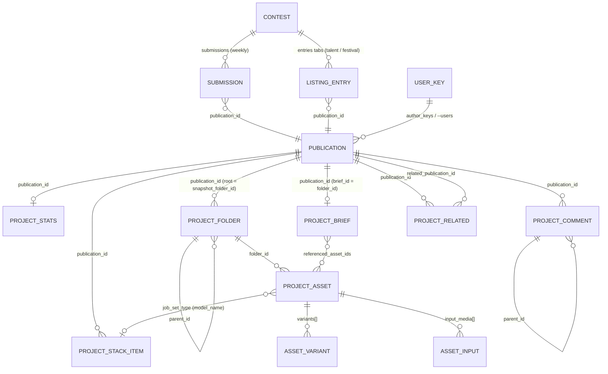

# `projects` scraper: community projects and contests

```
python -m higgsfield_scraper scrape projects [options]
```

This scraper collects Higgsfield's community **project publications** (films, series, carousels), the
**recommended** feeds, **contest entries** (festival and talent contest submissions published as projects),
**contests** (with rules, rewards, prizes, judges, FAQ, timeline and winners) and **contest submissions**. With
`--public-series` (no login) it also collects the **original series** from the public `fnf-series` service.
Opt-in flags add the **nested data of each project page** (folders, every asset with its prompt and model, the brief
as Markdown, stats and model stack, comments, related projects), contests **by slug** and the projects of given
**users**: see [Nested data model](#nested-data-model-opt-in-2026-11-26).

All requests are GET. Every endpoint is public. The legacy `/fnf/series` path used by the default run is not
(401 without a session, 404 with one); see *Original series* below. The code lives in
`higgsfield_scraper/scrapers/projects/` and the tests are in `tests/test_projects.py`
(fixtures: `tests/fixtures/projects/`).

## Endpoints (base `https://fnf-api-gw.higgsfield.ai/fnf`)

| key (`endpoint`) | path | params | pagination / limits |
|---|---|---|---|
| `projects_publications` | `/project-publications` | `limit` (max **50**), `cursor`, `category` (slug), `featured=true` | `next_cursor` (`"<score>:<uuid>"`), `null` at end. No total. Unknown category -> 404 `Category not found` |
| `projects_recommended` | `/project-publications/recommended` | `scope`, `limit` (max 50), `cursor`, `current_publication_id` | `next_cursor` is an **offset** string (`"50"`). Response also has `feed{source,version,snapshot_id}` |
| `projects_categories` | `/project-publications/categories` | none | `{items:[{slug,label}]}` (currently 2: `open-sourced-by-higgsfield`, `spotlight`) |
| `projects_publication_detail` | `/project-publications/{publication_id}` | none | detail. The same record is also served at `/project-publications/{username}/{slug}` (the web page `/@user/projects/slug`) |
| `projects_contest_entries` | `/contest-participations/publications` | `tab`, `contest_key`, `size` (max **100**), `cursor` (offset), also `trending`, `standing`, `sort`, `query`, `homepage` | `{items, next_cursor, total}`. `total` is recorded in `meta.totals_available` |
| `projects_contests` | `/contests` | `contest_type` (`global` default \| `weekly`), `status` (repeatable), `size` (max **100**), `cursor` | `{items, has_more, cursor}`. **Without `contest_type` only global contests are returned** |
| `projects_contest_detail` | `/contests/by-id/{id}` (also `/contests/{slug}`) | none | full contest |
| `projects_contest_submissions` | `/contests/{id}/submissions` | `limit` (max **100**), `offset`, `ordering`, `user_id`, `search` | `{items, has_more}`, offset pagination |
| `projects_series` 🔒 | `/series` | `limit` (the web app uses 100) | 401 `Invalid or expired token` without a session |
| `projects_series_detail` 🔒 | `/series/{slug}` | none | 401 without a session |
| `projects_series_public` | **base `https://fnf-api-gw.higgsfield.ai/fnf-series`** `/series` (`--public-series`) | `limit` (≤100; the web app sends 100) | `{items, total}` (35 on 2026-11-26), one page, no cursor. Public, no login |
| `projects_series_public_detail` | fnf-series `/series/{slug}` (`--public-series --with-details`) | none | full series + episodes. Public |

Enums, read from the API's own 422 messages:

* recommended `scope`: `community`, or a ContestKey: `ad_contest`, `ai_film_festival`, `talent_contest`,
  `discord`. Without a scope the API serves a ranking of `ai_film_festival` films.
* contest `status`: `created`, `open`, `shortlist`, `judge`, `finished`. `contest_type`: `weekly`, `global`.
* submissions `ordering`: `newest`, `most-liked`, `most-viewed`, `trending`.
* contest-participations `contest_key`: only `ai_film_festival` or `talent_contest`. `tab`: `trending`,
  `submissions`, `latest`, `most_watched`, `all_entries`, `liked`, `voted`. The tabs `top_50`,
  `higgsfield_choice` and `audience_choice` are served by `/contest-participations/lists/{tab}` (not scraped).

These endpoints were looked at but are not used:

* `/contests/trending` returns 204 (empty).
* `/contests/weekly-challenge/latest` returns 404.
* `/contests/{id}/projects` returns 405.
* `/contests/{id}/submissions/me` and `/contests/{id}/projects/me` are per-user.
* `/project-publications/{id}/report` and the `/reaction`, `/vote` and `/subscribe` endpoints are mutating. They are
  never called.

Live sizes on 2026-11-25:

* More than 2,000 discoverable publications. 40 pages were walked without reaching the end; the order is a decaying
  score.
* 4 global contests and 5 weekly contests.
* 4,518 `ai_film_festival` entries and about 2,220 `talent_contest` entries.
* 8,752 submissions to *Make Your Action Scene*. The weekly contests have 19–137 submissions each.

## Options

| flag | default | meaning |
|---|---|---|
| `--what` | `all` | `publications,recommended,contests,entries,series` (comma list) |
| `--categories` | none | publication category slugs, filtered server-side (one listing per slug) |
| `--featured` | off | publications listing with `featured=true` |
| `--scope` | `all` | recommended scopes (see enum) |
| `--with-details` | off | fetches `/project-publications/{id}` for every publication and `/contests/by-id/{id}` for every contest. The detail is merged into the same record (`detail_fetched=true`, `detail_source`) |
| `--with-submissions` | off | pages through every contest's submissions |
| `--contest-status` | `all` | `open` (created/open/shortlist/judge), `closed` (finished) or `all`. Filtered server-side and in `keep()` |
| `--contest-types` | `all` | `global,weekly` |
| `--entry-keys` | `all` | contest keys for the contest-entries listing |
| `--entry-tab` | `latest` | tab of the contest-entries listing |
| `--submission-ordering` | `newest` | |
| `--max-submissions N` | all | cap on submissions per contest |
| `--public-series` | off | series from the public `fnf-series` service (no login): `projects_series_public` (+ `_detail` with `--with-details`). `--max-items N` caps the series via `limit=N` (series do not use the publications/contests budget). Without the flag series keep the legacy behaviour (skipped without a session) |
| `--with-profiles` | off | **opt-in personal data**: user ids, usernames, names, avatars, headlines, locations, profile URLs, page URLs that contain a handle, the names of `some_contestants`, social `post_urls`, and judge avatars and links |
| `--with-project-assets`, `--with-project-brief`, `--with-project-stats`, `--with-project-comments`, `--with-project-related` | off | nested project data; see [Nested data model](#nested-data-model-opt-in-2026-11-26) |
| `--contest a,b` | none | contests by slug (e.g. `talent-contest`, `wcc-the-place-you-know`) instead of the contest listing |
| `--contest-tabs` | `--entry-tab` | entries tabs of a `--contest` (`latest,trending,most_watched,all_entries,submissions` or `all`) |
| `--users a,b` | none | public projects of these handles (`--what user-projects`); handles are inputs, outputs stay pseudonymous |

The common flags also apply: `--max-items` (counts publications and contests), `--max-pages` (per listing: each
publication listing, each recommended scope, each entries key, the contests of each type, the submissions of each
contest), `--page-size` (clamped to the API maxima above), `--download-media`, `--delay`, `--auth` and the rest.
When `--max-items` is reached, pagination stops.

## Entity kinds and fields

Every entity has `source` (Provenance: endpoint, url, params, fetched_at). Timestamps are ISO-8601 UTC strings.
Keys that the API returns but the scraper does not map are kept in `extra`, including viewer-specific flags such as
`is_liked_by_user`, `watch_required` and `watched_percent`.

| kind | id | collection |
|---|---|---|
| `projects_publication` (primary) and `projects_publication_detail` (merged) | `publication_id` | `publications` |
| `projects_episode` | `episode_id` | `episodes` |
| `projects_category` | `slug` | `categories` |
| `projects_contest` (primary) and `projects_contest_detail` (merged) | `contest_id` | `contests` |
| `projects_contest_submission` | `submission_id` | `submissions` |
| `projects_series` 🔒 | `series_id` | `series` |
| `projects_listing_entry` | `entry_id` | `listing_entries` |
| `projects_folder` (opt-in) | `folder_id` | `folders` |
| `projects_asset` (opt-in) | `placement_id` | `assets` |
| `projects_brief` (opt-in) | `brief_id` | `briefs` |
| `projects_stats` (opt-in) | `publication_id` | `project_stats` |
| `projects_stack_item` (opt-in) | `stack_item_id` | `stack_items` |
| `projects_comment` (opt-in) | `comment_id` | `comments` |
| `projects_related` (opt-in) | `related_id` | `related` |

**Publication** fields:

* Ids: `publication_id`, `project_id`, `snapshot_folder_id`, `original_folder_id` (detail), `root_folder_id`
  (entries).
* Description: `name`, `slug`, `type` (`film`/`series`/`carousel`), `state`, `description`, `duration_seconds`.
* Flags: `is_ongoing`, `is_open_source`, `has_changes_since_publish`, `show_prompts`, `show_canvas`,
  `is_discoverable`, `is_featured`, `is_higgsfield_featured`, `is_talents_hub`, `can_receive_audience_choice_votes`.
* Featured episode: `featured_episode_id`, `featured_episode_slug` and `featured_episode_url` (these point to
  `/original-series/<series>/<episode>`).
* Contest: `contest_key`. `contest_badges[]` holds `{contest_key, list_key}`, for example `top_50`.
* Classification: `tags[]`, `categories[]` (slugs).
* Media:
  * `media[]` is normalized. Each item has `role` (cover/gallery/trailer), `position`, `media_id`, `type`
    (`media`=image, `video`, `job`=a generation), `name`, `url`, `original_url`, `preview_url`, `thumbnail_url`,
    `min_url`, `download_url`, `width`, `height`, `duration_seconds`, `object_fit` and `extra`.
  * `cover_url` and `trailer_url` are shortcuts.
  * `media_count`, and `episode_count` for series.
* People: `authors[]` and `team` are **Person** records (below). `author_count`, `author_keys[]`.
* Counters: `views`, `likes`, `comments`, `votes` (entries only), `awards[]`.
* Detail only: `generations_count`, `credits_spent`, `free_generations`, `size_bytes`, and `model_usage[]` with
  `{job_set_type, display_name, count, credits_spent}`.
* Dates: `created_at`, `published_at`, `project_updated_at`, `final_submitted_at`, `grant_awarded_at`.
* Bookkeeping: `url` (with `--with-profiles` only, because it is `/@<username>/projects/<slug>`), `listing` (the
  listing where it was first seen), `detail_fetched`, `detail_source`, `extra`.

**Person** (authors, team, winner, contestants, submitters):

* Always included: `role`, `author_key` (sha256 of the user id, 16 hex; stable across runs), `is_owner`,
  `total_projects_views`, `total_projects_likes`, `followers_count`, and `badges[]` with
  `{badge_id, name, icon_url, description}`.
* With `--with-profiles` only: `user_id`, `username`, `full_name`, `avatar_url`, `headline`, `location`,
  `profile_url`.

**Episode**: a series-type publication's gallery videos are its episodes, ordered by `number`. Each has
`publication_id`, `media_id`, `title`, `duration_seconds`, `video_url` (often HLS), `original_url` (mp4),
`preview_url`, `thumbnail_url`, `width` and `height`. Episodes of an original series (login only) also have
`series_id`, `series_slug`, `slug`, `description`, `is_locked`, `is_adults_only` and `url`. The film detail's
`featured_episode_slug` links a publication to its original-series page.

**Contest**:

* Basics: `contest_id`, `slug`, `title`, `description`, `contest_type`, `status`, `status_group` (open/closed).
* Dates: `start_at`, `end_at`, `submissions_close_at`, `rules_effective_at` (a date).
* Results: `results_published`.
* Media and links: `preview_image`, `preview_video`, `logo_url`, `redirect_url`.
* Prizes: `prize_pool` with `prize_pool_unit`. The unit is `usd` or `credits`, taken from the detail's prizes:
  global contests are USD and weekly contests are credits.
* Counts: `submissions_count`, `entries_count`, `is_trending`.
* People: `winner` (Person), `some_contestants_count` and `some_contestants[]` (with profiles only), `judge_count`.
* `judges[]`: `display_name` and `description` are always included. `user_id`, `avatar_url`, `background_url` and
  `external_link` need `--with-profiles`.
* From the detail:
  * `settings{max_submissions, new_project_per_submission, allow_generation_move, allow_generation_copy,
    source_clip_required}`
  * `rewards{first/second/third_place_credits, honorable_mention_credits, honorable_mentions_count,
    style_champion_credits}`
  * `prizes[]{label, type, value, count}`
  * `theme_markdown`, `details_markdown` (the full rules), `faq[]`
  * `timeline` (the festival programme, as returned)
  * `winner_submission_ids[]`, `submission_ids[]`
* Bookkeeping: `url`, `detail_fetched`, `detail_source`.

The detail's `winners[]` are also emitted as submissions with `listing="winners"`.

**Submission**:

* Ids and basics: `submission_id`, `contest_id`, `contest_slug`, `type`, `project_id`, `title`, `description`.
* Media: `thumbnail_id`, `thumbnail_url`, `video_id`, `video_url` (mp4), `video_preview_url`.
* Results: `winner_place` (1st/2nd/3rd/hm/cc), `honorable_mention`, `style_champion`, `shortlisted`.
* Flags: `has_source_video`, `has_assets`, `clone_available`.
* Counters: `likes_count`, `dislikes_count`, `views_count`, `total_views`, and `social_media_metrics{instagram,
  tiktok, youtube, x}_views`.
* Social posts: `post_url_count`. `post_urls[]` needs profiles.
* Moderation and review: `moderation_status`, `suspend_reason`, `winner_feedback`, `winner_reviewer_name`,
  `winner_reviewer_company`.
* Other: `badges[]`, `user` (Person), `publication_id`, `publication_slug`, `publication_url` (profiles), `listing`,
  `url`.

**Series** (parser written from the web app's JS; checked against the live `fnf-series` response 2026-11-26 —
same fields and ids whichever endpoint fed them; fixture `tests/fixtures/projects_series/`):

* Basics: `series_id`, `slug`, `title`, `short_description`, `full_description`, `author_type`, `author`,
  `is_series`, `state`.
* Images and video: `portrait_url`, `landscape_url`, `background_url`, `logo_url`, `trailer_url`,
  `trailer_hls_url`.
* Links: `project_url`, `project_publication_id`.
* Counts: `duration_seconds`, `likes`, `views`, `comments`, `vote_count`, `subscriber_count`.
* Classification: `categories[]`, `tags[]`, `banner_images[]`, `episode_count`.

**ListingEntry**: `listing` (for example `publications`, `publications:category=spotlight`,
`recommended:community` or `entries:ai_film_festival:latest`), `publication_id`, `position` (the 0-based rank when
the cursor is an offset), `page_cursor` and `index_in_page`. Publications are de-duplicated, so this table keeps
every listing a publication appears in and its rank there.

## Outputs (`runs/<ts>_projects-<label>/output/`)

* `dataset.json`: the `ProjectsDataset` with `meta` (CoreMeta: options, limits, limits_hit, totals_available,
  counts, endpoints, warnings), `publications`, `episodes`, `categories`, `contests`, `submissions`, `series`,
  `listing_entries` and `summary`.
* `json/<collection>.json` (one file per collection), `json/meta.json`, `schema/dataset.schema.json`, `summary.md`.
* `csv/`: `publications`, `publication_media`, `publication_authors` (authors and team), `publication_model_usage`,
  `episodes`, `categories`, `contests`, `contest_judges`, `contest_rewards` (the prizes list; the `rewards` object is
  flattened into `contests.csv`), `contest_faq`, `contest_contestants` (profiles only), `submissions`, `series`,
  `listing_entries` and `run_meta`.
* The CSVs are complete: every JSON leaf is a column, nested lists become JSON text, and the child tables carry their
  parent keys. This is tested in `test_csvs_contain_every_json_field`.
* With a `--with-project-*` flag only: `dataset.json` uses `ProjectsNestedDataset` (the default schema is unchanged)
  and adds `folders`, `assets`, `briefs`, `project_stats`, `stack_items`, `comments`, `related`, `nested_summary`;
  `csv/` adds `project_folders`, `project_assets`, `project_asset_variants`, `project_asset_inputs`,
  `project_briefs`, `project_stats`, `project_stack`, `project_comments`, `project_related`
  (`test_nested_csvs_complete_and_brief_files`); `output/briefs/<slug>.md` holds each brief.

`--download-media` picks files by mode:

* `thumbs`: cover images, thumbnails, contest preview images and logos.
* `full`: trailers and videos. The mp4 `original_url` or `preview_url` is used; HLS playlists are skipped.
* `all`: both, plus the gallery images of carousels.

## Examples

```
python -m higgsfield_scraper scrape projects --max-items 200
python -m higgsfield_scraper scrape projects --with-details --with-submissions --max-items 500
python -m higgsfield_scraper scrape projects --what contests --with-details --with-submissions --contest-status closed
python -m higgsfield_scraper scrape projects --what publications --categories spotlight --with-details
python -m higgsfield_scraper scrape projects --what recommended --scope ai_film_festival --max-pages 2
python -m higgsfield_scraper scrape projects --what entries --entry-keys talent_contest --entry-tab most_watched
python -m higgsfield_scraper scrape projects --what contests --contest talent-contest --with-submissions --max-submissions 5 --with-project-assets --with-project-brief --with-project-stats --with-project-comments --with-project-related
python -m higgsfield_scraper scrape projects --what user-projects --users <handle> --with-project-assets --with-project-brief
python -m higgsfield_scraper normalize --run runs/<run>
```

## Nested data model (opt-in, 2026-11-26)

The project page `https://higgsfield.ai/@<handle>/projects/<slug>` shows more than the publication record: the
**stats** block (Generations, Credits spent, Size, Stack), the **Folders** and the **Assets** grid (every generation
with its prompt), the **Project brief**, the **Comments** and a **related projects** list. The `--with-project-*` flags
collect these. They are off by default: without them the requests, the dataset and every output file are the same as
before (proved byte for byte, see *Proofs* below).

Every nested request is a public GET. None needs a login or the `hf-access-realm` header: the folder, items, brief and
comments endpoints answered 200 to anonymous calls with and without the realm header. Each project costs about
5 + (sub-folders with children) + (item pages) + (comment pages) requests at ~1 req/s.

### Traversal

```
contest (--contest <slug>)                       GET /contests/{slug}
 ├─ submissions (--with-submissions)             GET /contests/{id}/submissions          (weekly contests)
 └─ entries tabs (--with-submissions)            GET /contest-participations/publications?tab=…&contest_key=…
      │                                              (talent-contest, festival; --contest-tabs)
user (--users <handle>)                          GET /user/{handle}/v2/publications?publication_type=project
publications / recommended / entries listings    (unchanged)
      └─► publication detail                     GET /project-publications/{id}   (show_prompts, snapshot_folder_id, stats)
            ├─ stats + stack (--with-project-stats)        parsed from the detail, no extra request
            ├─ root folder (--with-project-assets)         GET /folders/{folder}
            │    ├─ sub-folders, recursively               GET /folders/{id}/children
            │    ├─ assets ("All assets")                  GET /folders/{folder}/items/v2?include_subfolders=true&size=100
            │    └─ Watermarks folder (listed apart)       GET /folders/{watermarks}/items/v2
            ├─ brief (--with-project-brief)                GET https://dam-editor-worker.higgsfield.ai/brief/{folder}/snapshot
            ├─ comments + replies (--with-project-comments) GET fnf-community /entities/project_publication/{id}/comments
            └─ related list (--with-project-related)       GET /project-publications/recommended?scope=…&current_publication_id={id}
```

The folder of the assets and of the brief is chosen like the web app (`Fi()`, below): the publication's
`snapshot_folder_id`; for a contest entry without a snapshot, `original_folder_id`, then the listing's
`root_folder_id`. A weekly-contest submission's `project_id` is the author's private working folder (403); its
publication's `snapshot_folder_id` is public.

### Endpoints (all GET, all public)

| key (`endpoint`) | URL | params | notes |
|---|---|---|---|
| `projects_contest_by_slug` | `/fnf/contests/{slug}` | none | same body as `/contests/by-id/{id}` → `projects_contest_detail` |
| `projects_user_publications` | `/fnf/user/{handle}/v2/publications` | `publication_type=project`, `limit` (50), `cursor` | `{publications, has_more, cursor, total}`; items are publication-shaped |
| `projects_folder` | `/fnf/folders/{id}` | none | root folder: `name`, `count` (= "All assets"), `subfolders_count`, `is_snapshot`, `surface` |
| `projects_folder_children` | `/fnf/folders/{id}/children` | none | `{items, cursor}`; folders with `count`; recurse while `subfolders_count > 0` |
| `projects_folder_items` | `/fnf/folders/{id}/items/v2` | `size` (**≤100**, 422 above), `include_subfolders=true`, `cursor` | `{items, cursor}`; `cursor` is an epoch float, `null` at the end. Items: `{type: job, job{…}}` or `{type: audio_input \| file_input \| …, input{…}}` |
| `projects_brief` | `https://dam-editor-worker.higgsfield.ai/brief/{folder}/snapshot` | none | **binary** Yjs v1 update; header `X-Brief-Updated-At` (epoch ms). Stored in `raw/` as `{snapshot_b64, bytes, updated_at_ms, content_type}` |
| `projects_comments` | `https://fnf-api-gw.higgsfield.ai/fnf-community/entities/project_publication/{id}/comments` | `limit` (app 20; 100 accepted), `cursor`, `parent_id` + `order=asc` for replies | `{items, total, next_cursor}` |
| `projects_related` | `/fnf/project-publications/recommended` | `scope`, `current_publication_id` | same shape as the recommended feed; `next_cursor: null` (20 items) |

Not used: `/jobs/{id}` and `/assets/{id}/public?folder_id=` (per-asset detail) answer a **Cloudflare challenge**
(403 "Just a moment…") to plain GETs, with or without the realm header; nothing is attempted against it, and the items
listing already carries the prompt, params and media. `/folder/{id}/preview` answers 401. The talent contest's own
`/contests/{id}/submissions` is empty (`submissions_count: 0`): its entries are the contest-participations listing.

### Where the app calls them (JS evidence, build `548e0f3a`, `samples/higgsfield/js2/`)

| what | chunk | excerpt |
|---|---|---|
| page model (stats, stack, brief, comments id) | `548e0f3a-H2odSMT_fOKI1GMn.js` `z8()` | `information:[…{key:"generations",…value:L8(e.stats.generations_count)},{key:"credits",…value:L8(e.stats.credits_spent)},{key:"size",…value:ya(e.stats.size_bytes)}]…stack:be}…document:mhe(e),commentsSubmissionId:e.publication_id` |
| stack percentages | same chunk, `mv()` + `jie()` | `t=e.filter(e=>e.count>0\|\|e.credits_spent>0),n=t.reduce((e,t)=>e+t.count,0),r=t.map(e=>n>0?e.count/n*100:0),i=jie(r)` (largest-remainder rounding to 0.1); labels `gv={"Cinematic Studio 3.5 Video":"Cinematic Studio"}` |
| folder of assets/brief | `548e0f3a-7IF3WF78weifYSD-.js` `Fi()` | `i=e.snapshotFolderId==null?r?e.sourceFolderId:null:…,a=i==null?r?e.rootFolderId:null:i;return{clone:i,assets:a,brief:a,…}` |
| folder detail / children query keys | `548e0f3a-H2odSMT_fOKI1GMn.js` `DG()`, `PG()`, `jS()` | `queryKeyFolderDetails(e,t){return[hT,"asset-folder",e,…]}`, `queryKeyFolderChildren(e,t,n,r){return[hT,"asset-folder-children",e,…]}`, ``P(`/folders/${L(t)}`)`` |
| folder items | `548e0f3a-H2odSMT_fOKI1GMn.js` `qce()` | ``v=P(`/folders/${L(t)}/items/v2`);i!=null&&v.searchParams.set(`cursor`,…)…include_subfolders…`` |
| assets panel | `548e0f3a-1zY4W3jQgh3J1vLb.js` `Je({projectId})` | `_=h(A(e,{queryClient:f}))` (= folder detail query) + `Ve(…{paginate:!1})` (children) |
| brief | `548e0f3a-1_wQCLxCnZ1w_6P0.js` `PublishedProjectBriefSnapshot` | ``l=`https://dam-editor-worker.higgsfield.ai` … o(e){return`${l}/brief/${e}/snapshot`} … r.headers.get(`X-Brief-Updated-At`)``; queryKey `["published-project-brief-snapshot", folderId]` |
| comments | `548e0f3a-epLlmlxrz-fO4lOR.js` `M()`, `B()`, `V()`, `z()` | ``w(`/entities/${e.entityType??"project_publication"}/${e.publicationId}/comments`)`` with `limit` (`J=20`), `cursor`, `parent_id`, `order`; keys `["publication-comments", id]`, `["publication-comment-replies", id, parentId]`; mapper `text:e.content,replies:e.reply_count,…likesCount:e.like_count,replyTo:e.parent_id` |
| related list | `548e0f3a-7IF3WF78weifYSD-.js` `ua()`, `fa()`, `da()` | queryKey `["published-project","recommendations",{community,scope,returnPath,currentPublicationId}]`; `da`: `talent_contest`→`talent_contest`, no key→`community`, else `ai_film_festival`; `current_publication_id` only for those two |
| user projects | `548e0f3a-3On2TPGk30aH8MrG.js` `profile-feed-api` | ``H(`/user/${encodeURIComponent(e)}/v2/publications`)…set(`limit`,`50`)…cursor`` → `{publications, has_more, cursor, total}` |
| contest page | SSR loader `#(public)#contests#$contestSlug` | the page HTML embeds the contest; the API equivalent is `/contests/{slug}` |

### Field map: API → page → stored (checked on "The Sea Walks Out", 2026-11-26, and "The Library", wcc)

| page shows | API field | stored | conversion / check |
|---|---|---|---|
| Generations **59** | detail `stats.generations_count` = 59 | `projects_stats.generations_count` | none (`L8` = number format) |
| Credits spent **5 064** | `stats.credits_spent` = 5064.0 | `credits_spent` | credits, **not** ×100; the space is the locale's digit grouping |
| Size **739.4 MB** | `stats.size_bytes` = 739 380 053 | `size_bytes`, `size_mb` = 739.4 | **decimal** MB (÷1 000 000, 1 decimal); ÷1024² would give 705.1 |
| Stack **Seedream 5.0 Pro 32.2%** +6 | `stats.stack[]` `{job_set_type, display_name, count, credits_spent}` | `projects_stack_item` | **computed by the page**: share = count / Σcount ×100 over the shown rows (count>0 or credits>0); percent = largest-remainder to 0.1. 19/59 = 32.2, 18/59 = 30.5, 16/59 = 27.1, 2/59 = 3.4 ×2, 1/59 = 1.7 ×2 (sum 100.0): all 7 match |
| Folders: All assets **60**, Cast 6, Locations 16, Music 1, Props 2, Scenes 22, Titles and Posters 13, Watermarks 4 | root `count` = 60; children `count` | `projects_folder.asset_count` | all 8 match. The root count (60) **excludes** the 4 Watermarks files: the root items listing does not return them, so that folder is listed on its own (`in_all_assets=false`) |
| Assets grid ("Preview · 480p") | items `job.results.{raw,min}`, `job.params.resolution` | `url`, `min_url`, `variants[]`, `resolution` | 60 assets = 59 jobs + 1 audio upload; per-model counts equal the stack counts. The grid shows `min` (preview); `raw` is the original |
| prompt in the asset viewer | `job.params.prompt` | `prompt` (only when the publication's `show_prompts` is true) | the API returns prompts whatever `show_prompts` says; the scraper drops them (and prompt-like params) when it is false |
| Project brief (Markdown, tables, prompts, job ids) | brief snapshot (Yjs) | `projects_brief.markdown` + `output/briefs/<slug>.md` | decoded and rendered client-side by the app (Lexical); the scraper does the same: 105 blocks, 10 tables, 7 code blocks, 7,523 words; 12 job ids in the text, all 12 are assets of the project |
| Comments (5) with likes / replies | `items[].like_count`, `reply_count`, `parent_id` | `projects_comment.likes`, `reply_count`, `parent_id` | `total` is the root-comment count (5 on the page earlier, 6 at the run) |
| related projects with views | `items[].views` | `projects_related.views` | the page filters the current project out; so does the parser |

The second project checked was "The Library" (wcc-the-place-you-know): 77 assets = API count, 71 generations, 2,826.25 credits, 940.3 MB (940 263 693 bytes), 7 stack rows (Seedance 2.5 59.2% …).

### ER diagram



**Keys.** All ids are the API's own UUIDs except where noted: `folder_id`; `placement_id` = the API `folder_job_id`
(one placement of an asset in a folder; the same job can sit in two folders), else `sha256(root, type, asset_id,
folder_id)[:16]`; `asset_id` = the job id (= the asset id, see `JOBS_AND_STORAGE.md`); `brief_id` = the folder id;
`projects_stats` is keyed by `publication_id`; `stack_item_id` = `sha256(publication_id, job_set_type,
display_name)[:16]`; `comment_id`; `related_id` = `sha256(publication_id, related_publication_id, scope)[:16]`.
People are `author_key`/`owner_key`/`creator_key` = `sha256(user id)[:16]` (the existing Person convention).

**Nesting vs tables.** Each kind is its own collection (`dataset.json` → `folders`, `assets`, `briefs`,
`project_stats`, `stack_items`, `comments`, `related`, `nested_summary`), joined by `publication_id`. Only two small
lists stay nested inside an asset (`variants[]`, `input_media[]`); they also get child CSV tables. A comment's author
is a nested `Person`.

**Common fields** of every nested row: `source` (Provenance: endpoint, url, params, fetched_at), `source_url`,
`scraped_at` (UTC ISO-8601), `schema_version` (1).

**Personal fields** (null unless `--with-profiles`): `owner_user_id`, `owner_username` (folders), `creator_user_id`,
`creator_username` (assets), the comment author's `user_id`, `username`, `full_name`, `avatar_url`, `headline`,
`location`, `profile_url`. Always kept: the pseudonymous keys, badges and public counters.

#### `projects_folder` → `folders`, `csv/project_folders.csv`

| field | type | unit | source field | null | example |
|---|---|---|---|---|---|
| `folder_id` | str (UUID) | | `id` | no | `96cfeed5-…` |
| `publication_id` | str | | request label | yes | `d62acd40-…` |
| `root_folder_id` | str | | `root_folder_id` | yes | `96cfeed5-…` |
| `parent_id` | str | | `parent_id` | yes (root) | `null` |
| `is_root` | bool | | `is_root` | yes | `true` |
| `depth` | int | levels | `path` segments − 1 | yes | `1` |
| `position` | int | | order in `/children` | yes (root) | `0` |
| `name` | str | | `name` | yes | `Cast` |
| `slug`, `description`, `emoji`, `color` | str | | same | yes | `cyan` |
| `surface` | str | | `surface` | yes | `contests`, `cast`, `watermarks` |
| `folder_kind` | str | | `kind` | yes | `null` |
| `asset_count` | int | assets | `count` | yes | `60` |
| `subfolders_count`, `views_count`, `copies_count` | int | | same | yes | `8` |
| `access_mode`, `link_access_level` | str | | same | yes | `via_link` |
| `is_snapshot`, `is_discoverable`, `locked` | bool | | same | yes | `true` |
| `preview_url`, `cover_image_url` | str (URL) | | same | yes | |
| `contest_key`, `contest_id`, `project_id` | str | | same | yes | |
| `publication_state` | str | | `publication.state` | yes | `published` |
| `created_at`, `updated_at`, `archived_at`, `hidden_at` | str | UTC ISO-8601 | epoch seconds | yes | `2026-11-26T11:20:52+00:00` |
| `assets_scraped` | int | assets | computed | yes | `60` |
| `owner_key` | str | | sha256(`user_id`)[:16] | yes | |
| `owner_user_id`, `owner_username` | str | | `user_id`, `owner_username` | **profiles only** | |
| `extra` | object | | unmapped keys (minus personal) | no | |

#### `projects_asset` → `assets`, `csv/project_assets.csv` (+ `project_asset_variants.csv`, `project_asset_inputs.csv`)

| field | type | unit | source field | null | example |
|---|---|---|---|---|---|
| `placement_id` | str | | `folder_job_id` | no | `e70219dd-…` |
| `asset_id` | str (UUID) | | `job.id` / `input.id` | no | `4effebad-…` |
| `item_type` | str | | `type` | yes | `job`, `audio_input`, `file_input` |
| `position` | int | | order in the listing | yes | `0` |
| `in_all_assets` | bool | | from the root listing? | no | `true` |
| `publication_id`, `root_folder_id` | str | | request labels | yes | |
| `folder_id` | str | | `folder_id` | yes | `25531d40-…` |
| `folder_name`, `folder_path` | str | | joined from folders | yes | `Posters`, `Titles and Posters / Posters` |
| `status` | str | | `status` | yes | `completed` |
| `media_type` | str | | `results.raw.type` / `input.type` | yes | `image`, `video`, `audio` |
| `job_set_id`, `job_set_type`, `job_set_parent_id` | str | | same | yes | `seedream_v5_pro` |
| `model_name` | str | | stack `display_name` by `job_set_type` | yes | `Seedream 5.0 Pro` |
| `prompts_visible` | bool | | detail `show_prompts` | no | `true` |
| `prompt` | str | | `params.prompt` | yes (hidden → null) | `Create a cinematic 16:9 film poster…` |
| `has_prompt` | bool | | computed | no | `true` |
| `params` | object | | `params` (minus prompt keys when hidden) | no | `{aspect_ratio, resolution, seed, medias…}` |
| `aspect_ratio`, `resolution` | str | | `params.*` | yes | `16:9`, `2k`, `480p` |
| `width`, `height` | int | px | `params.width/height` | yes | `2720` |
| `duration_seconds` | float | s | `params.duration` / `input.duration` | yes | `224.8` |
| `seed`, `batch_size` | int | | `params.*` | yes | `252267` |
| `input_media[]` | list | | `params.medias[]` → `{position, role, media_id, type, url}` | no | reference images |
| `url` | str (URL) | | `results.raw.url` / `input.url` | yes | original png/mp4/wav |
| `min_url`, `thumbnail_url`, `hls_url`, `h264_url` | str (URL) | | `results.min/raw/hls/h264` | yes | |
| `download_url`, `waveform_url`, `filename`, `extension` | str | | upload fields | yes | `The Last Pluck.m4a` |
| `variants[]` | list | | every `results.*` with a url → `{variant, type, url, thumbnail_url, extra}` | no | `raw`, `min` |
| `size_bytes` | int | bytes | `input.size_bytes` | yes | `39657276` |
| `cost_raw` | str | **unknown** | `meta.cost` | yes | `2.1116` (not credits; kept as returned) |
| `comments_count`, `review_status` | int / str | | same | yes | `0` |
| `created_at`, `uploaded_at` | str | UTC ISO-8601 | epoch seconds | yes | |
| `creator_key` | str | | sha256(`user_id`)[:16] | yes | |
| `creator_user_id`, `creator_username` | str | | `user_id`, `user.username` | **profiles only** | |
| `extra` | object | | unmapped (`trace_id`, `cluster_hash`, …) | no | |

#### `projects_brief` → `briefs`, `csv/project_briefs.csv`, `output/briefs/<slug>.md`

| field | type | unit | source | null | example |
|---|---|---|---|---|---|
| `brief_id`, `folder_id` | str | | the brief's folder | no | `96cfeed5-…` |
| `publication_id`, `publication_slug` | str | | request labels | yes | `the-sea-walks-out` |
| `title` | str | | Y.Doc map `meta.title` | yes | `null` |
| `has_content` | bool | | rendered text not empty | no | `true` |
| `markdown` | str | | Yjs → Lexical → Markdown | yes | `> 🎬 **The Sea Walks Out** · 3:26 …` |
| `updated_at` | str | UTC ISO-8601 | header `X-Brief-Updated-At` (ms) | yes | |
| `snapshot_bytes` | int | bytes | response length | no | `300418` |
| `block_count`, `word_count` | int | | computed | no | `105`, `7523` |
| `node_types` | object | count | computed | no | `{paragraph: 412, table: 10, …}` |
| `links[]`, `referenced_ids[]`, `referenced_asset_ids[]` | list | | computed | no | 12 job ids |
| `file` | str | | `briefs/<slug>.md` | yes | `briefs/the-sea-walks-out.md` |
| `decode_error` | str | | decoder failure | yes | `null` |

Markdown mapping: heading → `#…`, paragraph, quote / callout → `>` (callout emoji kept), list (bullet, number, check,
nested), code → fenced block, table → pipe table (`<br>` inside cells), link → `[text](url)`, horizontal rule →
`---`; text format bits bold/italic/strikethrough/code → `**`/`*`/`~~`/`` ` ``. Unknown decorator nodes become
`<!-- type {attrs} -->`.

#### `projects_stats` → `project_stats`, `csv/project_stats.csv`

| field | type | unit | source | null | example |
|---|---|---|---|---|---|
| `publication_id` | str | | detail | no | |
| `generations_count`, `free_generations` | int | generations | `stats.*` | yes | `59`, `20` |
| `credits_spent` | float | credits | `stats.credits_spent` | yes | `5064.0` |
| `size_bytes` | int | bytes | `stats.size_bytes` | yes | `739380053` |
| `size_mb` | float | MB (10⁶) | computed | yes | `739.4` |
| `model_count`, `stack_generations` | int | | computed over shown stack rows | no | `7`, `59` |
| `extra` | object | | other `stats` keys | no | |

#### `projects_stack_item` → `stack_items`, `csv/project_stack.csv`

| field | type | unit | source | null | example |
|---|---|---|---|---|---|
| `stack_item_id` | str | | sha256(publication_id, job_set_type, display_name)[:16] | no | |
| `publication_id`, `position` | str, int | | detail order | no | `0` |
| `job_set_type`, `display_name` | str | | `stats.stack[]` | yes | `seedream_v5_pro`, `Seedream 5.0 Pro` |
| `label` | str | | display_name + UI renames | yes | `Seedream 5.0 Pro` |
| `count` | int | generations | `count` | yes | `19` |
| `credits_spent` | float | credits | `credits_spent` | yes | `0.0` |
| `shown_in_ui` | bool | | count>0 or credits>0 | no | `true` |
| `share` | float | % | computed (exact) | yes | `32.2034` |
| `percent` | float | % (0.1) | computed (page rounding) | yes | `32.2` |

#### `projects_comment` → `comments`, `csv/project_comments.csv`

| field | type | unit | source | null | example |
|---|---|---|---|---|---|
| `comment_id` | str (UUID) | | `id` | no | |
| `publication_id`, `thread_type` | str | | `publication_id`, `entity_type` | yes | `project_publication` |
| `parent_id`, `is_reply` | str, bool | | `parent_id` | yes | `null`, `false` |
| `text` | str | | `content` | yes | |
| `created_at`, `updated_at` | str | UTC ISO-8601 | same | yes | |
| `likes`, `dislikes`, `reply_count` | int | | `like_count`, `dislike_count`, `reply_count` | yes | `1` |
| `reactions[]`, `mention_count` | list, int | | `reactions`, `len(mentions)` | no | |
| `author` | Person | | `author` (pseudonymous; badge → `badges[]`, `rating_points` in `extra`) | yes | `{author_key, …}` |
| `is_by_author` | bool | | author_key ∈ publication author_keys | yes | `false` |

#### `projects_related` → `related`, `csv/project_related.csv`

| field | type | unit | source | null | example |
|---|---|---|---|---|---|
| `related_id` | str | | sha256(publication_id, related id, scope)[:16] | no | |
| `publication_id`, `related_publication_id`, `position`, `scope` | str/int | | request + order | no | `talent_contest` |
| `name`, `slug`, `type`, `contest_key` | str | | item | yes | `CAT LAST`, `film` |
| `views`, `likes`, `comments` | int | | item | yes | `2201` |
| `cover_url`, `author_keys[]`, `feed_source` | | | `cover.url`, authors, `feed.source` | yes | `ranking` |

### Options

| flag | meaning |
|---|---|
| `--with-project-assets` | root folder, every sub-folder (recursively) and every asset of each project, with prompt (only if `show_prompts`), model, params, media variants, folder path and dates |
| `--with-project-brief` | the brief rendered to Markdown: field `markdown` and file `output/briefs/<slug>.md` |
| `--with-project-stats` | `projects_stats` + `projects_stack_item` from the detail (the page's percentages) |
| `--with-project-comments` | comments + replies (`parent_id`, `order=asc`) |
| `--with-project-related` | the page's related-projects list |
| `--users a,b` | public projects of these handles (adds `user-projects` to `--what`; `--what user-projects --users a` for only that). Handles are inputs: `meta.options.users` keeps `key:<sha256>` and the listing is `user:<key>` unless `--with-profiles` |
| `--contest a,b` | fetch these contests by slug (instead of listing every contest). With `--with-submissions`: their submissions and, for `talent-contest` / `higgsfield-global-film-festival`, their entries tabs |
| `--contest-tabs` | entries tabs of a `--contest`: `latest, trending, most_watched, all_entries, submissions` or `all` (default: `--entry-tab`). `liked` / `voted` are per-viewer and refused |

Each `--with-project-*` flag fetches the publication detail of every publication seen (listings, entries, user
projects, contest submissions), whether or not `--with-details` is given, and merges it into the publication.

Limits: `--max-items` counts publications and contests as before (nested rows are not counted). `--max-submissions`
caps each contest's submissions **and** each `--contest` entries tab. `--max-pages` also caps the item pages of each
folder (`assets:<folder>`) and the comment pages of each thread. `--download-media` saves assets under
`<run>/media/projects_asset/`: `thumbs` = thumbnail / preview image, `full` = the original file (png, mp4, wav, mov),
`all` = both + the `min` preview. The Watermarks folder holds 1.5 GB `.mov` packshots: `--max-media-mb` applies.

### Privacy

* Prompts, briefs, folder names and assets are content the author published on the project page; they are kept.
  Prompts are dropped when the author turned `show_prompts` off.
* People stay pseudonymous unless `--with-profiles` (owners, creators, commenters: `*_key` only).
* Folder bodies carry `owner_username`: the spider blanks it before the response reaches `raw/` and the parser
  (`parse_folder_response`), and since commit `de0f5b8` it is also in `core/privacy.PERSONAL_KEYS`, so the `http/`
  archive redacts it too (unless `--with-profiles`).
* `--users` handles appear in the request URL, so in `raw/` meta, `http/`, logs and the manifest's `argv`, as any
  CLI input does; not in `output/`.

### Anonymous vs logged in (2026-11-26)

Every endpoint was called anonymously and with the user's session (fresh Clerk token per call, GET only, ~1 req/s;
script kept outside the repo; tokens never printed or stored). Same project ("The Sea Walks Out"), a project with
`show_prompts: false`, and a weekly submission's private working folder.

| endpoint | anonymous | logged in | difference |
|---|---|---|---|
| publication detail (by id, by handle/slug) | 200 | 200 | **identical bytes** |
| `/contests/{slug}`, weekly `/contests/{id}/submissions` | 200 | 200 | identical bytes |
| entries `tab=latest` | 200 (5 of 2,764) | 200 (5 of 2,764) | same keys and total; the 5 items and their order differ (per-viewer ranking) |
| entries `tab=liked`, `tab=voted` | **401** | 200, `items: []` | the viewer's own likes / votes: per-user, never scraped (`--contest-tabs` refuses them) |
| `/folders/{id}`, `/info`, `/children` | 200 | 200 | identical bytes (no extra `role` / `capabilities` for a non-member) |
| `/folders/{id}/items/v2` | 200 (60 items, 59 prompts) | 200 | **identical bytes**: no extra or private assets |
| items of a `show_prompts: false` project | 200 (7 items, 0 prompts) | 200 (0 prompts) | identical: a session does **not** reveal hidden prompts |
| a submission's private working folder (`project_id`) | 403 | 403 | private stays private |
| `/folder/{id}/preview` | 401 | 404 | not a public route either way |
| brief snapshot (dam-editor-worker) | 200 | 200 | identical bytes |
| comments (fnf-community) | 200 | 200 | identical bytes (`is_mine` false either way) |
| related list | 200 (20) | 200 (20) | same keys; `is_liked_by_user` null → false; the 20 projects and their order differ (per-viewer ranking) |
| `/user/{handle}/v2/publications` | 200 | 200 | identical bytes |
| `/project-publications/{id}/stats` | 404 | 404 | not an endpoint |
| `/jobs/{id}`, `/assets/{id}/public` (+ `hf-access-realm` folder) | 403 Cloudflare | 403 Cloudflare | challenge either way; not attempted further |
| items with `hf-access-realm: {"kind":"folder",…}` | 200 | 200 | the realm header changes nothing |

**Result: a session adds no public data** to any nested endpoint: same fields, same assets, same totals, no hidden
prompts, no private folders. It only adds the viewer's own state (`is_liked_by_user`, the liked/voted tabs) and a
personalised order of the feeds. So there is **no logged-in option**: every nested request is sent without
`meta["auth"]`, so `--auth auto` with a cached session, `--auth off` and `--auth required` all give the same
nested output (tested: `test_nested_requests_are_anonymous_even_with_a_session`, `test_auth_off_has_no_token_provider`,
`test_viewer_only_tabs_are_refused`). A first comparison showed 401s on brief, comments and related with a session:
that was a stale cached token (`TokenProvider.get()` without refresh); with a fresh token they are 200 and identical.

### Live runs (2026-11-26)

| run | command (all `--with-project-assets --with-project-brief --with-project-stats --with-project-comments --with-project-related`) | projects | folders | assets | briefs (with text) | stack rows | comments | related | requests |
|---|---|---:|---:|---:|---:|---:|---:|---:|---:|
| `nested-sea2` | `--what user-projects --users <handle> --max-items 1` | 1 | 13 | 64 (60 + 4 Watermarks) | 1 (1) | 7 | 6 | 20 | 11 |
| `nested-check` | `--what contests --contest talent-contest --with-submissions --max-submissions 5` | 5 | 102 | 4,745 | 5 (5) | 57 | 10 | 100 | 100 |
| `nested-check-wcc2` | `--what contests --contest wcc-the-place-you-know --with-submissions --max-submissions 5` | 5 | 18 | 675 | 5 (2) | 33 | 4 | 100 | 42 |

* "The Sea Walks Out" was not among the talent contest's 5 latest entries, so it was checked with `--users`: all
  8 folder counts, the 60 "All assets", the 4 Watermarks files, 59 generations, 5 064 credits, 739.4 MB and the 7
  stack percentages match the page; the brief has 7,523 words and its 12 job ids are all assets of the project.
* Talent contest: `/contests/{id}/submissions` is empty (`submissions_count: 0`); the 5 projects come from the
  entries tab `latest` (`size=5`, then `max_submissions=5 reached`). 5 root folders report a slightly larger API
  `count` than the listing returns (see *Gaps*).
* wcc-the-place-you-know: 5 submissions → 5 projects (a first run followed only 2: the contest detail's winners
  had been emitted first, so the page's repeats were dropped before the follow-up; fixed by following the
  response body). "The Library": 77 assets = API count 77; 71 generations, 2,826.25 credits, 940.3 MB, 7 models.

### Proofs (2026-11-26)

* Default unchanged: `scrape projects --dry-run` output is byte-identical before and after, and so are the dry-runs
  of `--what contests --with-details --with-submissions`, `--what publications --with-details` and
  `--what series --public-series`. `Selection.to_dict()` omits every new option at its default, so `meta.options`
  is unchanged; the nested collections, CSVs, counts, endpoints and the `ProjectsNestedDataset` schema appear only
  with a `--with-project-*` flag (`test_default_dataset_has_no_nested_keys`).
* `normalize` of two existing projects runs (`20261125-131446_projects-smoke`, `20261126-112314_fix-after-projects`)
  before vs after: 23 of 27 output files byte-identical, the other 4 differ only in `run_id` / `scraped_at`.
* `pytest`: all pass; `tests/test_projects_nested.py` (37 tests, fixtures `tests/fixtures/projects_nested/`, user
  ids faked with same-length ids, also inside the binary brief).
* `scripts/check_pricing_identity.py`: 31/31 identical.

### Gaps

* Per-asset detail (`/jobs/{id}`, `/assets/{id}/public`) sits behind a Cloudflare challenge; not attempted. The
  listing carries the same prompt, params and results.
* `meta.cost` of a job is kept as `cost_raw`: its unit is not documented (it is not credits: 2 Kling jobs cost 45
  credits in the stack and `2.1116` here).
* ~~The `http/` archive keeps `owner_username` of folder bodies~~: fixed in `de0f5b8` (`owner_username` added to
  `core/privacy.PERSONAL_KEYS`).
* The core archive redaction (`core/privacy.PERSONAL_KEYS`) blanks every `display_name`, including the model names
  of `stats.stack[]`. Live runs are unaffected (parsed before archiving), but `normalize` sees `[redacted]`: the
  stack then falls back to `job_set_type` as `label` and assets get no `model_name` (the existing
  `publication_model_usage.display_name` has the same issue). Fix belongs in core (redact `display_name` only inside
  person containers).
* A folder's API `count` can exceed what its public listing returns (e.g. 172 vs 165 in a `cinematic_studio`
  folder, 2,018 vs 1,984 for a whole project; the folder listed on its own returns the same 165): the count includes
  items the public listing never returns. Reported in `assets_scraped`, `nested_summary.asset_count_mismatches` and a
  warning. "The Sea Walks Out" matches exactly.
* A `--contest` detail's `winners[]` are emitted as submissions (`listing="winners"`) but are not followed into
  nested data; the submissions pages are (capped by `--max-submissions`).
* `trending` entries: the app also sends `trending=v3`; like `--entry-tab trending`, the scraper does not.
* The lists tabs (`top_50`, `higgsfield_choice`, `audience_choice` → `/contest-participations/lists/{tab}`) are
  not scraped.
* The brief decoder handles the node types seen (paragraph, heading, quote, callout, list, listitem, code, table,
  link, horizontal rule); other decorator nodes are kept as HTML comments.

## Gaps and notes

* **Original series.** The series are **public** on `https://fnf-api-gw.higgsfield.ai/fnf-series/series?limit=100`
  (+ `/series/{slug}`), which is what the web app calls (JS `ho(`/series`)`). The default run keeps its old
  behaviour so its output does not change: it uses `/fnf/series`, which answers 401 without a session (not
  requested: a warning is logged and the dataset gets `original series (/series) need a login session: none
  scraped`) and **404 even with a session**. Add `--public-series` to get them without a login:
  `scrape projects --what series --public-series` → 35 series (one per `projects_series`, plus one
  `projects_episode` per episode with `series_id`/`series_slug`). `meta.endpoints` then also lists
  `projects_series_public[_detail]`. `is_vote_triggered` / `is_notify_triggered` are per-viewer (always false
  anonymously) and stay in `extra`; `cast[]` (character names and pictures) is in `extra` too.
* The `/project-publications` listing has no total. Its cursor is a score, so `position` is unknown after page 1.
* A publication's public URL contains the author's handle, so `url` is null unless `--with-profiles` is given. Media
  URLs on the CDN contain the raw Clerk user id (`user_…`) in their path; this is how the API serves them.
* `/project-publications/{a}/{b}` is `{username}/{slug}`, not an episode endpoint. Publication episodes are the
  series' gallery videos.
* Per-viewer fields (`is_liked_by_user`, `is_followed`, `watch_*`) are always null or false for anonymous requests.
  They are kept in `extra`.
* The same publication appears in several listings. Repeats are dropped before they count against `--max-items`,
  and the listing membership is still recorded.
* `awards[]` was empty in every sample, so it is passed through untyped.
* `normalize` re-parses every page in `raw/` and applies the run's `--max-items` budget (via `RunManager.normalize`,
  primary kinds in order: publications first). Earlier versions of this note said the budget was not applied; a
  2026-11-25 verification run had produced 787 publications instead of 491 before the framework started budgeting.
* Fix 2026-11-26: `normalize` now applies the run's `--max-items` budget in primary-kind order (publications
  first), so a capped run can keep a contest *detail* whose list row was cut. Such a contest is kept as is, without
  the publication-only `listing="detail"` fallback (Contest has no `listing` field; that fallback made
  `normalize --run runs/20261125-131446_projects-smoke` fail with `contests.0.listing … extra_forbidden`).
  Output for list + detail pairs is unchanged. Test: `tests/test_fixes_20261126.py`.
* Path ids (publication, contest or series id, and the contest id of a submissions page) are stored in the
  envelope's `params`, so that each detail gets its own `raw/` file. `Envelope.filename` uses only the endpoint and
  the params. These ids are not query parameters of the URL.
