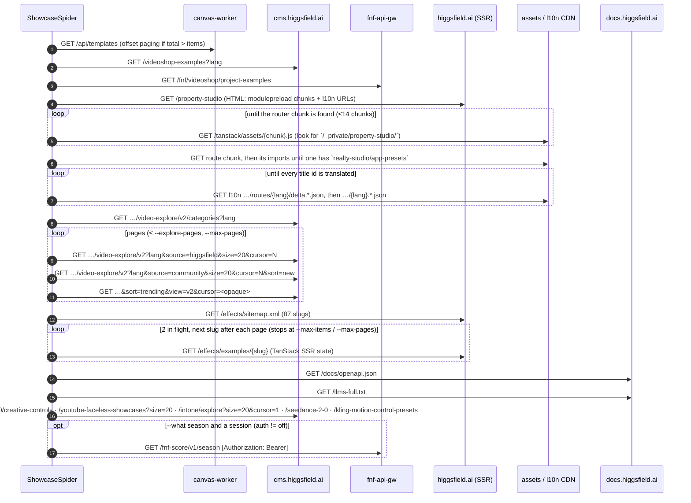
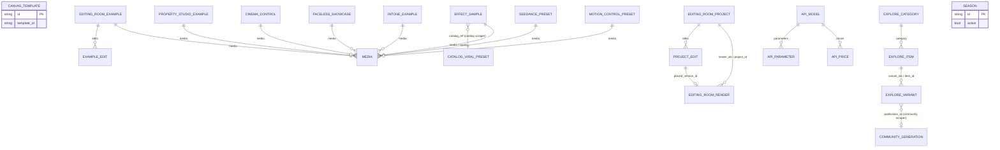

# `showcase` scraper — example and showcase content

Opt-in scraper (`scrape showcase`) for the public Higgsfield example/showcase content that no other scraper
covered on 2026-11-26 (build `548e0f3a`). GET only, about 1 request per second (framework `DOWNLOAD_DELAY`).
Public requests never carry a token. One login-only source (`season`) is opt-in and returns per-user data.

```bash
python -m higgsfield_scraper scrape showcase                                   # every public source
python -m higgsfield_scraper scrape showcase --what api_models,canvas_templates
python -m higgsfield_scraper scrape showcase --what explore --explore-sort both --explore-pages 10
python -m higgsfield_scraper scrape showcase --what effect_examples --effects acid,vanish
python -m higgsfield_scraper scrape showcase --what property_studio_examples --lang de --download-media thumbs
python -m higgsfield_scraper scrape showcase --what reels_presets,reels_comments --max-items 20   # opt-in reels
python -m higgsfield_scraper scrape showcase --what all --max-items 30          # + opt-in reels, login-only season
python -m higgsfield_scraper normalize --run runs/<id>                         # re-parse raw/ offline
python scripts/merge_generations.py --latest community,catalog,projects,site,showcase
```

Contents: 1 sources · 2 evidence (JS + live) · 3 HTTP flow · 4 endpoint table · 5 schema (ER, fields, CSV) ·
6 options · 7 privacy · 8 dedupe · 9 skipped sources and gaps · 10 Reels (Shorts Studio).

---

## 1. Sources (`--what`)

| `--what` | Kinds | What it is | Public? | Size (2026-11-26) |
|---|---|---|---|---|
| `canvas_templates` | `showcase_canvas_template` | Canvas (Flow) workflow templates | yes | 5 |
| `editing_room_examples` | `showcase_editing_room_example`, `…_project`, `…_render` | Editing Room (videoshop) CMS examples + 6 complete example projects with every edit's tool parameters and every rendered version | yes | 11 examples, 6 projects, 41 renders |
| `property_studio_examples` | `showcase_property_studio_example` | Property Studio explore presets (before/after/tour) from the JS preset table + lingui titles | yes | 69 |
| `explore_categories` | `showcase_explore_category`, `…_item`, `…_variant` | Higgsfield Multiplier "video explore": categories, curated trends (`higgsfield`) and community trends (`community`, with likes) + their variants (original / edit / generation, prompt, params, publication id) | yes | 6 categories; 35 curated; 49 322 community |
| `effect_examples` | `showcase_effect_sample` | Approved sample generations on `/effects/examples/{slug}` (job, prompt, params, output, inputs) | yes | 87 pages × first SSR page of samples |
| `api_models` | `showcase_api_model` | Public API docs: every `vendor/model/variant` endpoint with parameters (JSON schema) and listed prices | yes | 83 endpoints, 580 parameters |
| `cinema_controls` | `showcase_cinema_control` | Cinema Studio 4.0 creative controls (camera model/lens/aperture/movement, color, pacing, light, genre, era) with sample media | yes | 78 |
| `faceless_showcases` | `showcase_faceless_showcase` | YouTube-faceless showcase videos | yes | 9 |
| `intone_examples` | `showcase_intone_example` | Intone explore examples (video + recreate inputs) | yes | 18 |
| `seedance_presets` | `showcase_seedance_preset` | Seedance 2.0 preset previews (CMS `/seedance-2-0`) | yes | 14 |
| `motion_control_presets` | `showcase_motion_control_preset` | Kling motion-control presets (preview + source video) | yes | 36 |
| `season` | `showcase_season` | `fnf-score` season | **login only**, per user | `null` (no active season) |
| `reels_presets` (**opt-in**) | `showcase_reels_preset` | Shorts Studio (ex "Genjutsu for Reels" / AI Reels) presets: finished example reel (output video + variants), prompt, script, instructions, reference reel (+ its platform stats), character/own-video inputs, recreates, publication likes. See §10 | yes | 40 curated + 75 community |
| `reels_comments` (**opt-in**) | `showcase_reels_comment` | comments on community Shorts Studio presets (fnf-community `generation_publication` threads). See §10 | yes | 73 threads, 0 comments |

`--what` default = `public` = every public source **except the opt-in reels sources** (unchanged since before
they were added); `all` = public + `reels_presets` + `reels_comments` + `season`.

## 2. Evidence (JS call site + live check)

Chunks are in `samples/higgsfield/js2/` (build `548e0f3a`); live samples (redacted) in `samples/higgsfield/showcase/`.

| Source | Chunk | Excerpt / queryKey | Live check (field mapping) |
|---|---|---|---|
| Canvas templates | `fmaPQSnk2K7UZee5` | ``function lh(e){…return R(t?`/api/templates?${t}`:`/api/templates`)}`` · ``uh(e){return R(`/api/templates/${E(e)}`)}`` · WS ``case`template`:r=`${n}//${t.host}/api/templates/${E(e.id)}/connect` `` (+`?ticket=…&format=json`) | `{items[{id,name,description,thumbnail_url,created_at}],total:5,limit:50,offset:0}`; detail = same fields; `/preview` and `/node-types` 404; `/auth` 401 anon → 200 `{ticket}` logged in; WS without ticket → 401 `TICKET_MISSING` |
| Editing Room CMS examples | `9x5h1F6my-Vy3fcG` | ``async function BM({signal:e}){let t=await fetch(Xr(`/videoshop-examples`),{signal:e,credentials:`omit`})`` · `WM={all:[`videoshop-example`],list:()=>[...WM.all,`list`]}` · zod `{url,preview_url,input,final,edits:rt(it())}` | 11 items; `input/final.duration_ms` (ms → `*_duration_ms`), `edits[{tool,label,prompt,start_ms,end_ms,layer}]` |
| Editing Room project examples | `9x5h1F6my-Vy3fcG` | ``async function lb({signal:e}){let t=await ci($r(`/videoshop/project-examples`),{signal:e})…Wy(await t.json())`` (POST `/…/{id}/fork` exists — never called) | `{items[{project,timeline}]}`; timeline `schemaVersion:3`, `edits[]` (`startMs/endMs` ms, `relight{preset,lights[{az,el,color,brightness,diffuse}]}`, `cameraMove`, `angle`, `brush`, `genjutsuWay`), `versions[]` (`jobSetId`, `madeWith`, `media{id,url}`) |
| Property Studio presets | `1Zr93DgzOqSBRyme` (route chunk `Qhm6yOmmqVylfDqQ`, router tree `aXyXjC_KHBp09DNW`) | ``en=[[`flash-tour`,`02-walnut-loft-house`,{id:`R-iA_7`},3,1920,1080],…]`` · mapper ``function Qt(e,t){let[n,r,i,a,o,s]=e,c=`${n}/${r}`,l=`/realty-studio/app-presets/v1/${c}`,d=`/realty-studio/app-presets/full-v1/${c}`…poster:u(`${l}/after`,`webp`),video:f?u(`${l}/tour-preview`,`mp4`)…output:f?u(`${d}/tour`,`mp4`):u(`${d}/after`,`webp`)`` · `$t={"flash-tour":`speedramp_walkthrough`,…}` | 69 rows; `static.higgsfield.ai/realty-studio/app-presets/{v1,full-v1}/…` → 200 (checked `after.webp`, `tour-preview.mp4`, `before.webp`); titles from `l10n.higgsfield.ai/…/routes/en/delta.*.json` (`"R-iA_7":["Walnut Loft House"]`) |
| Video explore | `XZSXCAwfnxLKLxkA`, `gRvJ6lVOIMtATabs` | ``f=se(`https://cms.higgsfield.ai`,`/higgsfield-multiplier/video-explore/v2`);f.searchParams.set(`lang`,…),set(`source`,t),set(`size`,`20`),set(`cursor`,String(i)),t===`community`&&set(`sort`,n),d&&(set(`view`,`v2`)…user_id…)`` · sorts: ``n!==`trending`&&n!==`new`||t===`higgsfield`&&n===`new` → invalid_sort`` · `Id=[`higgsfield`,`community`]` · categories zod `{categories:x(C({category:w(),trends:E()}))}` · queryKeys `[higgsfield-multiplier,video-explore,v2,pages,production,…]`, `[…,v2,categories]`, `[higgsfield-multiplier,publication-likes,…]` | curated `total` 35; community `total` 49 322 (`sort=new`, page-number cursor), trending = opaque cursor (`view=v2`); item `likes_count/views_count/comments_count/times_made/trend_id/category`; variants `type ∈ {original, edit, generation}`, generation has `publication{id,likes_count,views_count}` + `author{user_id,username,avatar_url,badge}`; `duration` in s |
| Effect examples | routes in `mebxmR0vvTYTIFO1` (``path:`/effects/examples/$presetSlug` ``); page chunk `6lhZWtuK8J2Kvkj-`; hook in `noLHLkDLcotwEZi3` | ``queryKey:[`viral-hub-approved-generations`,`preset`,`all-job-types`,e]`` → TanStack server fn ``_({method:`GET`}).handler(O(`55703b74…`))`` with `{cursor, presetId}` | SSR loader `{preset, initialSamples{total,hasMore,cursor,items[{id,job,output,attachments,presetId,presetName,publishedAt}]}}`; `publishedAt`/`job.createdAt` epoch s → ISO UTC; `job.user{id,fullname,username,avatarUrl}` (personal) |
| API models | — (docs site) | `docs.higgsfield.ai/docs/llms.txt`: "Use the selected model's documentation…; `/docs/openapi.json` is supplementary" | `llms-full.txt` (598 KB): 83 `**Endpoint ID:**` sections with "Complete JSON schema" blocks; `openapi.json` 9 paths (6 model POSTs) |
| Cinema controls | `bKEXuDpgggSxxXuu` | ``let t=N(`/cinema-studio-4-0/creative-controls`);for(let n of e…)t.searchParams.append(`type`,n);I||t.searchParams.set(`show_hidden`,…)`` | `{camera_model[5],camera_lens[6],camera_aperture[4],camera_movement[33],color[5],pacing[5],light[7],genre[7],era[6]}`; `segments[{index,start_seconds,end_seconds}]` |
| Faceless showcases | `H2odSMT_fOKI1GMn` | ``async function kW(e){let t=qi(`/youtube-faceless-showcases`,SW(n()));t.searchParams.set(`size`,`20`)`` (`qi` = `Jj` = CMS URL builder `xO("https://cms.higgsfield.ai",e)` + `lang`) | `{total:9,cursor:null,items[{id,title,category,video_url,thumbnail_url,icon_url}]}` |
| Intone examples | `gRvJ6lVOIMtATabs` | ``async function MV(e,t){let n=hs(`/intone/explore`);n.searchParams.set(`size`,`20`),n.searchParams.set(`cursor`,String(e))`` (`credentials:"omit"`) | `{total:18,cursor:null,items[{id,title,video,image,priority,recreate{character,…}}]}` |
| Seedance presets | `0Oc7kBnNHrwTIkVv` | ``async function i(e){let t=Wr(`/seedance-2-0`),n=await fetch(t);…return{items:i.map(r),cursor:null,total:i.length,hasMore:!1}}`` | list of 14 `{id,name,preview_image,preview_media,description,duration,priority}` (`duration` s) |
| Motion-control presets | `CizYhr_F3jpYWNFF` | ``async function w(){let e=fn(`/kling-motion-control-presets`);qn||e.searchParams.set(`show_hidden`,`true`)`` → `inputVideo:{id:e.source_media.id,…}` | list of 36 `{id,name,description,preview_media,source_media{id,url},priority}` |
| Season | `RjL0wZNqpe3iHpMW` (`/v1/season`) | see `docs/LOGIN_COVERAGE.md` | anon 401 `Invalid or expired token`; logged in 200 `null`; `/v1/season/weekly-canvas` 404 |

## 3. HTTP flow



Headers: framework defaults (Chrome UA, `Origin`/`Referer: https://higgsfield.ai`) plus `Accept: text/html` for
SSR pages, `*/*` for JS chunks and `text/plain` for `llms-full.txt`. No cookies. Non-JSON bodies are converted to
small JSON before they are archived in `raw/` (see `parsers.py` docstring), so `normalize` works offline.

## 4. Endpoint table

| Endpoint (name) | URL | Public / login | Page size, paging | Total seen | Logged-in difference (A/B, same URL) |
|---|---|---|---|---|---|
| `showcase_canvas_templates` | `GET canvas-worker…/api/templates` | public | `limit` 50, `offset` | 5 | none (same 5, same fields) |
| — (not used) | `GET …/api/templates/{id}` · `/auth` · `/connect` (WS) | detail public; `/auth` **login** | — | — | `/auth`: 401 → 200 `{ticket}`; the ticket opens a WebSocket graph sync (client must send Yjs sync messages) → **not fetched** (not a GET API; would need a write-capable protocol) |
| `showcase_videoshop_examples` | `GET cms…/videoshop-examples?lang` | public | one list | 11 | none |
| `showcase_videoshop_project_examples` | `GET gw/fnf/videoshop/project-examples` | public | one list | 6 (41 versions) | none |
| `showcase_property_studio_page` | `GET higgsfield.ai/property-studio` | public HTML | — | 24 chunks, 10 l10n files | SSR ignores Bearer (not sent) |
| `showcase_property_studio_chunk` | `GET assets…/tanstack/assets/{chunk}` | public | — | ~10 probes | n/a (static) |
| `showcase_l10n` | `GET l10n.higgsfield.ai/l10n/production/r/{build}/routes/{lang}/delta.*.json` | public | — | 69 titles | n/a |
| `showcase_explore_categories` | `GET cms…/higgsfield-multiplier/video-explore/v2/categories?lang` | public | — | 6 | none |
| `showcase_explore_feed` | `GET cms…/video-explore/v2?lang&source&size=20&cursor[&sort][&view=v2][&category]` | public | 20 fixed; `new`: page number + `total`; `trending`: opaque cursor | curated 35; community 49 322 (last page 2466 reachable) | none for the same URL. The app adds `user_id=` (personalised trending) when logged in — never sent. Viewer's own likes come from a separate token call (`publication-likes` → `checkPublicationLikes`) = personal, not fetched |
| `showcase_effects_sitemap` | `GET higgsfield.ai/effects/sitemap.xml` | public | — | 87 slugs | n/a |
| `showcase_effect_page` | `GET higgsfield.ai/effects/examples/{slug}` | public SSR | first sample page only (more via server fn, see §9) | `initialSamples.total` per page (e.g. 5) | SSR HTML is identical (Bearer is not used by SSR) |
| `showcase_api_openapi` / `showcase_api_docs` | `GET docs.higgsfield.ai/docs/openapi.json`, `/llms-full.txt` | public | — | 83 endpoints (6 in openapi) | n/a (different site; API keys are for the paid API) |
| `showcase_cinema_controls` | `GET cms…/cinema-studio-4-0/creative-controls?lang` | public | — | 78 | none |
| `showcase_faceless_showcases` | `GET cms…/youtube-faceless-showcases?lang&size=20` | public | cursor | 9 | none (on `fnf-api-gw` the path 401/404s: it is a CMS path) |
| `showcase_intone_explore` | `GET cms…/intone/explore?lang&size=20&cursor=1` | public | cursor | 18 | none |
| `showcase_seedance_presets` | `GET cms…/seedance-2-0?lang` | public | one list | 14 | none |
| `showcase_motion_control_presets` | `GET cms…/kling-motion-control-presets?lang` | public | one list | 36 | none (`show_hidden` not sent) |
| `showcase_season` | `GET fnf-api-gw…/fnf-score/v1/season` | **login** | — | `null` | 401 → 200 `null` (per-user progress; only metadata would be exported) |

Conclusion of the A/B check (every source called anonymously and with a Bearer token, GET only): **logging in adds
nothing public-relevant** to any showcase source. So every public request is sent with `auth=False` (no token even
with `--auth auto`), and only `season` uses `meta["auth"]="required"` (skipped cleanly without a session, not
scheduled with `--auth off`). Tests: `tests/test_showcase.py::test_public_requests_never_carry_auth`,
`::test_season_is_login_required_and_opt_in`.

## 5. Schema

Source of truth: `higgsfield_scraper/scrapers/showcase/schemas.py` (pydantic v2, `extra="forbid"`).
`python -m higgsfield_scraper schema` exports `showcase_*.schema.json` and `showcase.dataset.schema.json`.

### 5.1 ER diagram



### 5.2 Common fields (every entity)

| Field | Type | Source | Nullable | Example |
|---|---|---|---|---|
| `id` | str (16 hex) | `make_id(kind, natural key)` | no | `4f66dd028b31c2db` |
| `source_url` | str | page a person can open (or API URL) | no | `https://higgsfield.ai/effects/examples/acid/3b10…` |
| `scraped_at` | ISO-8601 UTC | response time | no | `2026-11-26T14:05:43Z` |
| `schema_version` | int | constant | no | `1` |
| `source` | Provenance `{endpoint,url,params,fetched_at}` | request | no | |
| `generation_key` | str | `job:<job id>`, else `media:<CDN file id>` of the main output, `static:<path>` (Property Studio) | yes | `job:d3a99a04-…` |
| `media_keys` | list[str] | every output `media:<id>` | `[]` | |

`Media` = `{role, type, url, width px, height px, duration_s, media_key}`; `duration_s` = API `duration` (s) or
`duration_ms / 1000`; `media_key` = API media id, else the last UUID in the URL. `Engagement` = `{likes, views,
comments, uses}` (`uses` = `times_made`).

### 5.3 Per-entity fields (natural key in bold)

| Entity | Field | Type / unit | Source field | Null? | Example |
|---|---|---|---|---|---|
| canvas_template | **template_id** | uuid | `id` | no | `96397cc5-…` |
| | name, description | str | `name`, `description` | yes | Simple Seedance 2.0 |
| | thumbnail_url, created_at | url, ISO | `thumbnail_url`, `created_at` | yes | |
| | app_url | url | `https://higgsfield.ai/canvas/templates/{id}` | no | |
| | graph_available | bool | constant `false` (WS only) | no | false |
| editing_room_example | **example_id**, **lang** | slug | `id` | no | `tea-house` |
| | title | str | `title` | yes | Tea house |
| | media[] | Media | `thumbnail_url`, `preview_url`, `input`, `final` (+ thumbnails) | `[]` | role `final` |
| | input_duration_ms, final_duration_ms | int ms | `input/final.duration_ms` | yes | 30042 |
| | edits[] `{edit_id,tool,label,prompt,start_ms,end_ms,layer}` | ms | `edits[]` | `[]` | camera-move / Pull Back Arc Right |
| | tools | list | distinct `edits[].tool` | `[]` | |
| editing_room_project | **project_id** | uuid | `project.id` | no | |
| | name, created_at, updated_at | str, ISO (from epoch s) | `project.*` | yes | |
| | take (Media), take_duration_ms | | `project.take` | yes | 3840×2160, 15041 ms |
| | scenes[] | `{start_ms,end_ms}` | `project.scenes` | `[]` | |
| | timeline_schema_version | int | `timeline.schemaVersion` | yes | 3 |
| | edits[] | `{edit_id, number, tool, tool_mode (genjutsuWay), layer, start_ms, end_ms, hidden, resolution, prompt_enabled, prompt, params{relight,brush,cameraMove,angle}, references[Media], placed_version_id}` | `timeline.edits[]` (`startMs`…) | `[]` | relight `{preset:"bold-02", lights:[{az:45, el:35, color:"#FFBC70", brightness:100, diffuse:10}]}` |
| | render_ids, tools | list | `timeline.versions[].id` | `[]` | |
| editing_room_render | **project_id + version_id** | uuid | `versions[].id` | no | |
| | edit_id, number, job_set_id, batch_id, status, resolution | | `editId, number, jobSetId, batchId, status, resolution` | yes | ready, 1080p |
| | tool, prompt, made_with | | `madeWith` | yes | relight |
| | start_ms, end_ms | ms | `rangeMs` | yes | |
| | media[] | Media | `media{id,url}` | `[]` | `media_key` = media.id |
| property_studio_example | **format + path + lang** | | JS row | no | `flash-tour`, `02-walnut-loft-house` |
| | preset_index | int | row position (app id = index + 100) | no | 0 |
| | app | str | `$t[format]` | yes | speedramp_walkthrough |
| | title_id, title | str | row `{id}` → lingui catalog | yes | R-iA_7 → Walnut Loft House |
| | input_count, width, height | int, px | row | no | 3, 1920, 1080 |
| | media[] | Media | `input`, `input_full`, `poster`, `video`, `output` (mapper Qt) | `[]` | |
| | chunk | str | JS chunk name | yes | |
| explore_category | **category** | str | `category` | no | lifestyle |
| | trends | int | `trends` | yes | 1132 |
| explore_item | **item_id** | uuid | `id` | no | |
| | feed_source, sort, category_filter | str | `source` / request | — | community, new |
| | title, description, job_set_type, priority, category, trend_id | | same names | yes | hf_mult_replace_object |
| | engagement | likes, views, comments, uses | `likes_count, views_count, comments_count, times_made` | values yes | likes 1569, views null |
| | original_video (Media) | s | `original_video` | yes | |
| | variant_ids, publication_ids | list | variants | `[]` | |
| explore_variant | **item_id + variant_id** | uuid | `variants[].id` | no | |
| | variant_type | original\|edit\|generation | `type` | yes | |
| | prompt, params, priority | | same | yes / `{}` | `{width, height, resolution}` |
| | media[], inputs[] | Media | `media` (+ main_url, hls_url, thumbnail_url), `input_assets` | `[]` | |
| | publication_id, publication_engagement | | `publication{id,likes_count,views_count}` | yes | |
| | creator_key, creator_badge | hash, str | `author.user_id` (hashed), `author.badge` | yes | |
| | creator `{user_id, username, avatar_url}` | | `author` | **only `--with-profiles`** | |
| effect_sample | **preset_slug + sample_id** | | page + `items[].id` | no | acid |
| | preset_id, preset_kind, preset_name, catalog_ref | | `loader.preset` | yes | `catalog_viral_preset:92e39a66…` |
| | sample_preset_id | | `presetId` (mixed-media id) | yes | |
| | job_id, job_set_id, job_set_type, status | | `job.id, jobSetId, jobSetType, status` | yes | viral_hub_video |
| | prompt, params | | `prompt` / `job.params.prompt`, `job.rawParams` (input URLs removed) | yes / `{}` | |
| | created_at, published_at | ISO (from epoch s) | `job.createdAt`, `publishedAt` | yes | |
| | media[], inputs[] | Media | `output{source,rawUrl,posterUrl,hlsUrl}`, `attachments[].inputMedia` | `[]` | |
| | creator_key / creator | | `job.user` | creator only `--with-profiles` | |
| | samples_total | int | `initialSamples.total` | yes | 5 |
| api_model | **endpoint_id** | str | `**Endpoint ID:**` | no | minimax/hailuo-2.3/standard/image-to-video |
| | vendor, model, variant | | split of endpoint_id | model/variant yes | minimax, hailuo-2.3, standard/image-to-video |
| | http_method, endpoint_url | | `POST https://api.higgsfield.ai/{id}` | no | |
| | title, family, doc_url, playground_url, summary | | H1, `[← Family]`, `Source:`, console link | yes | |
| | usage_notes | list | `## Usage notes` bullets | `[]` | |
| | parameters[] `{name,type,required,default,enum,minimum,maximum,format,title,description}` | | "Complete JSON schema" | `[]` | duration enum [6, 10] default 6 |
| | required_parameters, json_schema | | schema | `[]`/`{}` | |
| | prices[] `{label, amount (Decimal str), currency, unit, price_raw}` | USD only if "USD" is in the section | price tables | `[]` | `Text input 5.00 USD per 1 million tokens` |
| | price_notes | list | sentences with `$` | `[]` | |
| | in_openapi | bool | path in `openapi.json` | no | |
| season | **season** (singleton) | | `/v1/season` | — | |
| | active, season_id, name, starts_at, ends_at | | body | yes | active false |
| | top_level_keys, personal_fields_dropped | list | key names only (values never exported) | `[]` | |
| cms items (cinema_control, faceless_showcase, intone_example, seedance_preset, motion_control_preset) | **item_id** (cinema: **group + item_id**) | uuid | `id` | no | |
| | title, description, category, priority, lang | | `name`/`title`, … | yes | Modern |
| | media[] | Media | `media`/`url` (cinema), `video_url/thumbnail_url/icon_url` (faceless), `video/image/recreate.*` (intone), `preview_media/preview_image` (seedance), `preview_media/source_media` (motion control) | `[]` | |
| | extra | dict | every other API field (blur placeholders dropped) | `{}` | |
| | cinema: group, tag, is_auto, segments[] | s | `tag, is_auto, segments` | | genre / robot-arm |
| | seedance: duration_s | s | `duration` | yes | 12 |

### 5.4 Output layout

`runs/<ts>_showcase-<label>/output/`: `dataset.json`, `json/<collection>.json`, `schema/dataset.schema.json`,
`summary.md`, `items/showcase_<kind>.jsonl`, and complete CSVs:

| CSV | Rows | Keys |
|---|---|---|
| `<collection>.csv` (18 collections) | one per entity, child lists removed, nested dicts → dotted columns, scalar lists → JSON text | `id` |
| `editing_room_examples__media/__edits`, `editing_room_projects__edits/__scenes`, `editing_room_renders__media`, `property_studio_examples__media`, `explore_variants__media/__inputs`, `effect_samples__media/__inputs`, `api_models__parameters/__prices`, `cinema_controls__media/__segments`, `<cms>__media`, `reels_presets__media/__inputs`, `reels_comments__reactions` | one per child | `parent_id` (= parent `id`), `position` |
| `run_meta.csv` | key/value of `meta` | `key` |

Completeness is tested (`test_dataset_and_csvs_complete`): every JSON leaf has a column, rows 1:1.

## 6. Options

| Flag | Default | Effect |
|---|---|---|
| `--what LIST` | public sources | comma list of §1 names, `public`, `all` (+ `season`); `explore` = `explore_categories` |
| `--lang` | `en` | CMS `lang` (en es de ja ko) and Property Studio titles (+ zh) |
| `--explore-sources` | `higgsfield,community` | which explore feeds |
| `--explore-sort` | `new` | community sort: `new`, `trending`, `both` (curated feed is always `trending`) |
| `--explore-pages N` | 3 | pages of 20 per feed; `0` = to the end (≈2467 pages for community/new) |
| `--explore-categories LIST\|all` | off | also crawl `community/new` per category |
| `--effects LIST` | all sitemap slugs | only these `/effects/examples` slugs |
| `--reels-sources` | `higgsfield,community` | Shorts Studio lists for `reels_presets` / `reels_comments` (comments: community only) |
| `--with-profiles` | off | keep explore authors / effect-sample users / reels preset authors and commenters (`creator`) and the reference reel's `reference_author_handle` |
| common | | `--max-items` (**per kind**), `--max-pages` (per feed / chunk discovery / effect pages), `--download-media none\|thumbs\|full\|all`, `--auth`, `--delay` … (see `CLI.md`) |

## 7. Privacy

- Default: no usernames, avatars, names or Clerk ids in the dataset. Creators become `creator_key` =
  `make_id("creator", user_id)` (stable pseudonym, joinable across runs). `--with-profiles` adds `creator`.
- Archives: `personal_data=True` → `raw/` and `http/` bodies are redacted by the framework (usernames, avatars);
  the effect-page conversion additionally replaces `job.user` with `{id_hash}` (the SSR uses `fullname`/`avatarUrl`,
  which the core redactor does not know).
- Residual: Higgsfield CDN URLs of user uploads/results embed the uploader's Clerk id as a path segment
  (`…/user_XXXX/<file>.mp4`). They are kept because they are the media addresses; strip them downstream if needed.
- Login-only `season` is per-user; only season metadata and the *names* of other fields are exported.
- Fixtures (`tests/fixtures/showcase/`) and samples (`samples/higgsfield/showcase/`) are redacted
  (`user_REDACTED…`, `REDACTED`).

## 8. Dedupe (`scripts/merge_generations.py`)

Every generation-like record has `generation_key` (+ `media_keys`). The merge script reads several runs (community,
catalog, projects, site, showcase), unions records sharing a key (`job:`, `media:` of OUTPUT files only,
`pub:` only for single-generation publications) and writes `generations_index.csv/.json` (`sources[]`, best
prompt/model/media/likes/views/comments) + `duplicates.json` (counts per source pair). Inputs
(`d2ol7oe51mr4n9.cloudfront.net`) are never keys, so two generations made from the same upload stay separate.
Overlaps by design: effect samples ↔ community generations (same job ids when published), explore community
variants ↔ community generations (`publication_id`), effect presets ↔ catalog viral presets (`catalog_ref`, presets
themselves are not re-exported).

## 9. Skipped sources and gaps

| Source | Status | Reason |
|---|---|---|
| Canvas template node graph (nodes, models, prompts) | **not available** | Only via `wss://canvas-worker…/api/templates/{id}/connect?ticket=` — ticket needs a login (`/auth` 200 only with a session) and the socket is a sync protocol where the client must send messages; a receive-only connection got no data in 12 s. Not a GET API → not scraped. |
| Effect samples beyond the first SSR page | not fetched | further pages come from a TanStack server function (`/_serverFn/<hash>` GET with a serialized payload); the hash changes every build. `samples_total` records what the page reports. |
| `/viral-hub/main-page-previews` (94) | skipped | same presets as catalog `viral_presets` (+ chain presets); catalog's domain |
| `cms /applications`, `/applications/explore` | skipped | apps are covered by `scrape site --what apps` |
| `cms /cards` (192) | skipped | promo banners (marketing), not examples |
| `cms /ai-influencer-config` | skipped | builder option catalog (labels + icons), not generations |
| `cms /tips/random` | skipped | 422 without `plan`; UI tips |
| `/reference-elements/voices` (Property Studio voices) | covered | `scrape catalog --kinds reference_voice` |
| `GW/fnf-apps-marketplace/api/v1/apps/community` | not in this scraper | community apps marketplace with views/likes/remixes (see `docs/ENGAGEMENT.md`); app-centric, belongs to `site`/`community` |
| `fnf-score /v1/season/weekly-canvas` | 404 | |
| Personal "my likes" (`checkPublicationLikes`, `is_liked_by_user`) | never fetched | per-viewer personal data |

## 10. Reels (Shorts Studio, ex "Genjutsu for Reels" / "AI Reels")

Recon 2026-11-26. The local JS copy is build `548e0f3a` (`samples/higgsfield/js2/`). The live site serves the same
asset prefix with different chunk names and l10n build `451ce68bf291c7cb`. Live chunks fetched for this section:
the route chunk `G3VOJnj8pukYIeFi` and the module chunk `mkcBPJ35mFABKor6`. Everything below is GET only.

### 10.1 What each "reels" feature is

| Route / name | What it is (JS evidence) | Public content? |
|---|---|---|
| `/shorts-studio` (`/_private/shorts-studio`) | **Shorts Studio**, the current name of Genjutsu for Reels / AI Reels. It is a creation tool: you pick a preset (an example reel), "Recreate" it with your character, script, voice or own recording, and it starts an `ai_reels_v1` job set. The page has an **Explore** tab with two sources, `higgsfield` (curated) and `community` (`Tt` tabs `[{value:"higgsfield"},{value:"community"}]`), and a History tab (your own `ai_reels_v1`/`ai_reels_result` job sets; login only). | **yes**: both preset lists |
| `/shorts-studio/$id` | The detail page of a curated preset. The `$id` is the preset **UUID**; a slug gives 404. The SSR loader is the server function `$De({id,locale})`. It adds `description`, `ranking`, `performance{viewsOverTime,recreations,engagementRate}` and `reactions{likes,dislikes}`. Apart from `preset`, `author.handle` and `reactions.likes`, these values are **identical placeholders on every preset** (same 31-point curve, `recreations` 2400, `dislikes` 140, same description). Community preset ids give 404. | the real data equals the API (not scraped) |
| `/genjutsu-for-reels`, `/genjutsu-for-reels/$id`, `/start/genjutsu-for-reels`, `/_private/genjutsu-for-reels`, `/flow/shorts-studio`, `/shorts`, `/shorts/$id` | Legacy routes. Their `beforeLoad` throws `M({href:Fm(fl…),statusCode:301})` with `fl="/shorts-studio"`, `pl="/start/shorts-studio"`, `dl(id)="/shorts-studio/"+id` (router chunk `aXyXjC_KHBp09DNW`, module `ml()`). | redirects only |
| `/start/shorts-studio` | Landing page; `307 → /shorts-studio` | redirect |
| `/ai-reels/shared/$code` | Share link. `Vi(code)` checks `^ps[0-9a-f]{32}$`, then `Pi(code,"ai-reels")` = `GET fnf /preset-shares/{code}` → `{share_code,product,preset_id,…}` → redirect to `/shorts-studio/{preset_id}`. Codes are created by `POST /ai-reels/presets/{presetId}/share` (never called). | **not enumerable**, see 10.5 |
| `/reels` | No such route: `404` (only a l10n/nav string) | — |
| `/sora-2-reels` | Marketing redirect `301 → /seedance/2.5` | — |
| Blog `reels-studio-intro`, `genjutsu-for-reels-intro`, `shorts-intro` | Redirect table `KE=[{from:"/reels-studio-intro",to:"/shorts-studio-intro",status:301},…]` | covered by `blog` / `site` |
| ClipCut (`/apps/clipcut`, "Instant Outfit Reel Maker", 15 credits) and Urban Cuts (`/apps/urban-cuts`, beat-synced outfit reels, 25 credits) | Apps (stepper pages) | already collected by `scrape site --what apps` (`apps.json`); not duplicated |
| "optimized for Instagram Reels, TikTok, YouTube Shorts" presets | l10n strings of other preset catalogs (marketing, viral) | covered by `catalog` |

**Job types and models.** The job set type enum includes `AI_REELS="ai_reels_v1"`, `AI_REELS_RESULT="ai_reels_result"`
and `REELS_STUDIO="reels_studio"` (chunk `H2odSMT_fOKI1GMn`). The create call is `POST /ai-reels/compose`
(`authMode:"required"`; never called). Its body is `{avatar_images, avatar_videos, reference_video_id, script,
own_recording, instructions | duration_seconds, video_model, voice, preset_slug}`. The defaults come from module
`ai-reels-settings`: `quality "1080p"`, **`video_model "magi_2"`**, durations `[15,30,60,120]`. The validator
(`xIsn2xMLJ4o75d85`) allows duration 5–120 s, instructions ≤ 2000 chars, ≤ 40 medias with roles
`character|other|reference|voice`, and 1–10 own recordings. The Supercomputer agent also has tools
`reels_studio_list_presets|create_preset|create|status|list_sessions` (login only). Sora 2 is unrelated:
`/sora-2-reels` is only a marketing redirect.

**Already in other feeds?** I counted `ai_reels_v1` / `ai_reels_result` / `reels_studio` in `job_set_type` across
the **395** `runs/*/raw/community_*.json` files: **0**. None of the 73 community preset publication ids and none of
the 115 preset ids occur in any existing raw file. The explore `hf_mult_*` items are Multiplier `motion_control` /
`replace_object` trends, not reels. So no existing command collects these reels. `reels_presets` is new data.

### 10.2 Endpoints

| Endpoint (GET) | JS | Response | Notes |
|---|---|---|---|
| `fnf-api-gw…/fnf-cms-api/ai-reels-presets?lang=en` | module `ai-reels-preset-queries`: ``a(e){let n=Ne(l,`/ai-reels-presets`);for(…)n.searchParams.set(t,r);fetch(n)}``, `o(lang)=a({lang})`, `l=Je().replace(/\/fnf\/?$/,"/fnf-cms-api")`; queryKey `["ai-reels-presets","list",lang]` | `{items[40], next_cursor:null, categories[{id:"style-transfer",label,icon_key}]}` | curated; the whole list comes in one response (`size`/`cursor` are ignored) |
| `…/ai-reels-presets?lang=en&source=community` | `s(lang)=a({lang,source:"community"})`; queryKey `[…,"community-list",lang]` | `{items[75], next_cursor:null, categories}` | community; adds `author{username,avatar_url,badge}`, `likes_count`, `publication{id,likes_count}` |
| `…/ai-reels-presets/{slug}` | ``c(e){Ne(l,`/ai-reels-presets/${encodeURIComponent(e)}`)}``; queryKey `[…,slug,"prompt"]`, zod `T=B({prompt:g})` | one preset **+ `prompt`** (no `author/publication/recreates`) | 404 `AI Reels preset not found.` for a UUID; the scraper merges the list item with the detail |
| `fnf-api-gw…/fnf-community/entities/generation_publication/{publication.id}/comments?limit=20[&cursor][&parent_id]` | community `na=({kind,id})=>N(`/entities/${ta[kind]}/${id}/comments`)`, `ta.generation="generation_publication"` | `{items[comment], total, next_cursor?}` | random id → 404 `publication not found` (so the ids are real publications); `/stats` → 400 (only `project_publication|blog_post`) |
| `fnf /preset-shares/{code}` | `_8(e,t)`: ``h8(t===`what-if`?…:`/preset-shares/${encodeURIComponent(e)}`)`` | `{share_code, product, preset_id, …}` | needs a code; not scraped |

`GET fnf /ai-reels/presets` and `/ai-reels/categories` do not exist: 401 without a login, 404 with one.

### 10.3 Field map (`showcase_reels_preset`)

| API field | Record field | Notes |
|---|---|---|
| `id` | `preset_id` (natural key) | `id = make_id("showcase_reels_preset", id)` |
| `slug`, `source`, `title`, `description`, `category` (+ `categories[].label`) | `slug`, `preset_source`, `title`, `description`, `category`, `category_label` | |
| detail `prompt`; `script`; `instructions`; `hashtags`; `quality`; `duration_seconds`; `own_recording` | `prompt`, `script`, `instructions`, `hashtags`, `quality`, `duration_s`, `own_recording` | `prompt` is present on curated presets and on most community presets |
| `generated_video_media{url,compressed_url,compressed_width/height,thumbnail_url,media_id,width,height,duration_seconds}` | `media[]` roles `output`, `output_compressed`, `output_thumbnail` | **the output video** |
| `thumbnail_media.url` | `media[]` role `thumbnail` | |
| `video_media{…}` | `inputs[]` `reference`, `reference_compressed`, `reference_thumbnail` | the reel being recreated (community: an upload on `d2ol7oe51mr4n9`) |
| `character_media`, `background_media` | `inputs[]` `character`, `background` | |
| `own_videos[i]{…}` | `inputs[]` `own_video_{i}` (+ `_thumbnail`) | own recordings (community) |
| `source_url`, `source_platform`, `views`, `likes`, `comments`, `author_handle` | `reference_url`, `reference_platform`, `reference_engagement{views,likes,comments}`, `reference_author_handle` | stats of the **reference reel on Instagram** (curated only; the JS nulls them for community). Handle only with `--with-profiles` |
| `recreates`; `publication.likes_count` (else `likes_count`) | `engagement.uses`; `engagement.likes` | Higgsfield engagement |
| `publication.id` | `publication_id`, `media_keys += pub:<id>` | community comment thread |
| `author{username,avatar_url,badge}` | `creator_key` + `creator_key_basis`, `creator_badge`, `creator` (`--with-profiles`) | The API has no user id. The Clerk id is taken from the avatar path `/user_<id>/` (basis `user_id`; same key as the other scrapers, 42 of 75). Otherwise the key is the hash of `username:<name>` (basis `username`, 31 of 75) |
| — | `job_set_type="ai_reels_v1"`, `generation_key` = `media:<output media id>` | for `scripts/merge_generations.py` |

`showcase_reels_comment` has these fields: `comment_id`, `publication_id`, `preset_id`, `parent_id`, `text` (`content`),
`created_at`, `updated_at`, `likes` (`like_count`), `dislikes`, `reply_count`, `reactions[]`, `creator_key`
(hash of `user_id`) and `creator` (only with `--with-profiles`). The scraper follows `next_cursor` and fetches one
level of replies (`parent_id`), like the community scraper.

CSV files: `reels_presets.csv`, `reels_presets__media.csv`, `reels_presets__inputs.csv`, `reels_comments.csv` and
`reels_comments__reactions.csv`.

### 10.4 Anonymous vs logged in

| Request | Anonymous | Logged in |
|---|---|---|
| `fnf-cms-api /ai-reels-presets?lang=en` | 200, 40 items (98 807 B) | 200, byte-identical |
| `…&source=community` | 200, 75 items (234 447 B) | 200, byte-identical |
| `…/ai-reels-presets/{slug}` | 200 (+`prompt`) | 200, identical |
| `fnf-community …/generation_publication/{id}/comments` | 200 `{items:[],total:0}` | 200, identical |
| `fnf /preset-shares/{code}` | 422 bad format / 404 `preset_share_not_found` | same |
| `fnf /ai-reels/presets`, `/ai-reels/categories` | 401 | 404 (no such API) |
| `/shorts-studio`, `/shorts-studio/{uuid}` SSR | 200 (same 40 presets; detail placeholders) | not compared (SSR ignores a bare session cookie, see `docs/LOGIN_COVERAGE.md`) |
| own reels history (`ai_reels_v1` job sets), `POST /ai-reels/compose`, share creation | — | per-user or write: never fetched |

The scraper therefore never sends a token for reels (`auth=False`).

### 10.5 Totals and what is not available

The live counts on 2026-11-26 were 40 curated presets (3 562 recreates; reference reels 21.0 M views and 1.52 M
likes on Instagram) and 75 community presets (229 recreates; 24 publication likes; 73 have a publication, 5 use own
recordings). Of the 73 community comment threads, all 73 were fetched without a cap, and they hold **0 comments**.
The JSON schema is ready for comments when they appear; the parser is tested on a synthetic fixture that has the
real fnf-community shape.

| Not available | Why |
|---|---|
| `/ai-reels/shared/$code` share pages | Codes are `ps` + 32 hex (128 bit). Only `POST …/presets/{id}/share` creates them (out of bounds). No list returns a code (`share` does not appear in either preset list). Not enumerable. |
| Users' own Shorts Studio generations (`ai_reels_v1`, `ai_reels_result`) | They exist only in each user's history (login, per user). They are not in the community gallery (0 of 395 raw files). The community presets are the public subset that users chose to publish. |
| Job ids of the example reels | The API exposes no job or job-set id. Curated outputs carry `media_id`. Community outputs live under `community-presets/{preset_id}/…`, so their `media:` key is the preset id, and they also carry `pub:<publication id>`. |
| Detail-page `performance` / `ranking` / `dislikes` | They are placeholders: identical values on every curated preset. |
| Higgsfield views of a preset | The API returns none (`views` is the reference reel's Instagram count). |
| Community preset detail pages | `/shorts-studio/{community id}` gives 404; the API has all the data. |
