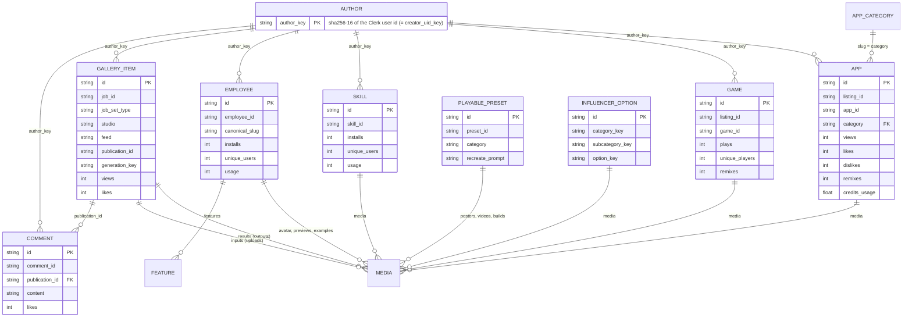
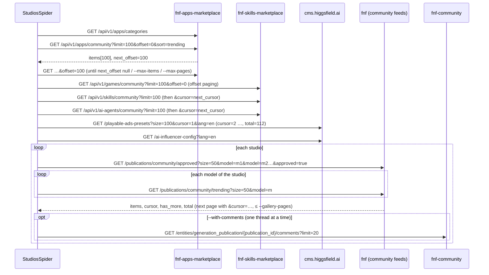

# `scrape studios` — studio & marketplace content

Opt-in scraper for the **public** content of Higgsfield's studio products and marketplaces that no other scraper
covers. Verified live on 2026-11-26 (frontend build `548e0f3a`). GET only, ~1 request/s, never with a token: every
source below answers anonymously and identically with a session.

```bash
python -m higgsfield_scraper scrape studios                                   # every source (all are public)
python -m higgsfield_scraper scrape studios --what apps --apps-sort most_viewed --max-items 500
python -m higgsfield_scraper scrape studios --what games,skills,employees
python -m higgsfield_scraper scrape studios --what galleries --studios marketing_studio,cinema_studio \
    --gallery-pages 0 --with-comments
python -m higgsfield_scraper scrape studios --what playable_presets,influencer_options --lang de
python -m higgsfield_scraper scrape studios --dry-run                         # planned first requests (64)
```

Contents: [1. Areas](#1-areas-what-is-public) · [2. Sources and options](#2-sources-kinds-and-options) ·
[3. Endpoints and JS evidence](#3-endpoints-and-js-evidence) · [4. Schema](#4-schema-er-diagram-and-fields) ·
[5. HTTP flow](#5-http-sequence) · [6. Anonymous vs logged in](#6-anonymous-vs-logged-in) ·
[7. Not available](#7-not-available-and-why) · [8. Privacy](#8-privacy) · [9. Limits](#9-limits-and-caveats)

## 1. Areas: what is public

| Area / product | Routes | What it is | Public content | Totals (2026-11-26) | Comments | Collected by |
|---|---|---|---|---|---|---|
| **Community apps marketplace** | `/marketplace/apps/`, `/marketplace/apps/$appId`, `/apps/$slug` | user-built mini apps on `<slug>.higgsfield.app` | listing with views / likes / dislikes / remixes / credits spent, author, cover video | **~59,560** listings (offset binary search, `sort=newest`); 8 categories | no comment API | `--what apps` |
| **Community games** | `/marketplace/games/`, `/marketplace/games/$gameId` | user-built browser games | listing with plays / unique players / remixes, source zip | **1,299** | no | `--what games` |
| **Skills marketplace** | `/marketplace/skills/`, `/marketplace/skills/$skillId` | community agent skills | installs / unique users / usage counts | **632** (7 cursor pages) | no | `--what skills` |
| **AI employees** (marketplace) | `/marketplace/employees/`, `/marketplace/employees/shorts-maker`, `/marketplace/employees/$employeeId` | agent "employees" (built-in + community) | description, public instructions (`public_md`), features, example videos, connectors, installs/users/usage | **296** (3 pages); 3 built-ins | no | `--what employees` |
| AI employee share links | `/marketplace/employees/shared/$shareSlug` | an employee shared by link | `GET …/ai-agents/community/by-slug/{slug}` works only with a known slug | not enumerable | no | — (slugs are private links) |
| **Playable Ads** | `/playable-ads`, `/start/playable-ads` (307 → `/playable-ads`), `/playable` | playable-ad game generator | "explore" presets: finished playable ad (HTML build), videos, posters + the prompt/settings to recreate it | **112** | no | `--what playable_presets` |
| **AI Influencer** | `/ai-influencer`, `/ai-influencer-studio` | character builder | the builder's options (4 categories, 143 options with images); published outputs → galleries | 143 options; trending outputs `ai_influencer` 1,017, `ai_influencer_sheet` 11 | via galleries `--with-comments` | `--what influencer_options`, `galleries` |
| `/ai-influencer/shared/$code` | | one shared influencer | share codes only appear inside personal data | not enumerable | — | — |
| **Marketing Studio** | `/marketing-studio`, `/marketing-studio-community`, `/mobile/marketing-studio`, `/marketing-studio/preset/$slug` | product-ad generator | community gallery = approved feed `model=marketing_studio_video` (SSR shows the same 33); presets → `scrape catalog` | approved **33**; trending `marketing_studio_image` 18, `marketing_studio_2_image` 78 | yes (generation_publication) | `--what galleries` |
| **Cinema Studio** | `/cinema-studio` (307 → `/generate`), `/cinematic-studio` | cinematic image/video studio | published outputs; creative controls → `scrape showcase --what cinema_controls` | approved `cinematic_studio_3_0` **41**; trending `cinematic_studio_image` 489, `soul_cinema_studio` 295, `cinematic_studio_2_5` 29 | yes | `--what galleries` |
| **Canvas** | `/canvas/*` | node canvas | published outputs (templates → `scrape showcase --what canvas_templates`) | trending `canvas` 54, `canvas_soul` 47 | yes | `--what galleries` |
| **Ads Studio** | `/ads-studio`, `/ads-studio/google-ads`, `/brands`, `/b/$brandId`, `/brand-research/`, `/brand-research/$brandId`, `/products`, `/ad-multiplier`, `/apps/link-to-video-ad` (301 → `/marketing-studio?tool=url-to-ad`) | agent workspace for a user's brands, products, research, ad accounts, scheduled tasks | **none** — every page is `/_private/ads-studio/*`; no published gallery (0 in approved/trending for all 8 ads models) | 0 | — | not collected (login, personal) |
| **Shorts / Shorts Studio** | `/shorts`, `/shorts/$id` (301 → `/shorts-studio/$id`), `/shorts-studio`, `/shorts-studio/$id` | AI reels from a reference reel | style presets with source-reel engagement → **owned by the reels agent** | 40 curated presets | — | `scrape showcase --what reels_presets` |
| **Short Drama / Production / Popcorn** | `/short-drama/`, `/short-drama/$projectId`, `/production`, `/production/$episodeId`, `/popcorn` | drama projects, episode production, keyframe/photo-dump tool | **none public**: per-user projects (`/_private/…`); `/production` 404 anonymously; published dramas → `scrape site/projects` (original series) | galleries for `short_drama_result`, `dramas_v1`, `drama_episode_edit`, `reels_studio*`, `ai_reels_*`, `youtube_faceless_video`: 0 | — | not collected |
| **AI Host** | `/ai-host`, `/ai-host/channels`, `/ai-host/channel/$channelId` | YouTube host channels (via a connected YouTube account) | **none**: 404 anonymously; channels come from the user's connector (`/claudesfield/connector/connections/youtube_data_api/channels`) | `ai_host_*` galleries: 0 | — | not collected |
| **Property Studio / Editing Room** | `/property-studio`, `/editing-room/*` | | examples → `scrape showcase`; published outputs (`realtor_studio_*`, `videoshop_*`) | galleries: 0 | — | `--what galleries` (currently empty) |

"Totals" are API totals or exhaustive counts on 2026-11-26; gallery trending totals are per model (see §9).

## 2. Sources, kinds and options

| `--what` | Kinds (collection) | Endpoint(s) | Paging |
|---|---|---|---|
| `apps` | `studios_app_category` (`app_categories`), `studios_app` (`apps`) | `studios_app_categories`, `studios_apps` | `limit` ≤ 100 (200 silently clamps to 100), `offset` + `next_offset`; no total |
| `games` | `studios_game` (`games`) | `studios_games` | `limit` 100, `offset` + `next_offset` |
| `skills` | `studios_skill` (`skills`) | `studios_skills` | `limit` 100, opaque `next_cursor` |
| `employees` | `studios_employee` (`employees`) | `studios_employees` | `limit` 100, opaque `next_cursor` |
| `playable_presets` | `studios_playable_preset` (`playable_presets`) | `studios_playable_presets` | `size` 100 (JS `u=100`), `cursor` = page number, `total` |
| `influencer_options` | `studios_influencer_option` (`influencer_options`) | `studios_influencer_config` | one document |
| `galleries` | `studios_gallery_item` (`gallery_items`), `studios_comment` (`comments`, `--with-comments`) | `studios_gallery`, `studios_comments` | feeds: `size` ≤ 50, float `cursor`, `has_more`, `total`; comments: `limit` 20, `next_cursor`, `total` |

Default: every source (`all` = `public`: there is no login-only source). Kinds are counted per kind by `--max-items`
(child kinds `studios_app_category` and `studios_comment` are not counted).

| Option | Default | Meaning |
|---|---|---|
| `--what` | all | comma list of the sources above, `all` or `public` |
| `--lang` | `en` | CMS lists (`playable_presets`, `influencer_options`): `en es de ja ko` (labels/titles translated) |
| `--apps-sort` | `trending` | `trending` (JS default), `most_viewed`, `popular`, `newest`; unknown values fall back to trending |
| `--studios` | all | gallery studios: `marketing_studio, ads_studio, cinema_studio, ai_influencer, canvas, shorts_drama, ai_host, property_studio, editing_room` (model lists in `endpoints.STUDIO_MODELS`) |
| `--gallery-feeds` | `approved,trending` | which community feeds |
| `--gallery-pages` | 3 | pages (50 items) per studio × feed (× model for trending); `0` = until `has_more` is false |
| `--with-comments` | off | fetch public comments of every kept gallery item (sequential, 1+ request per item) |
| `--with-profiles` | off | keep author `user_id`/name/avatar (otherwise only `author_key`) |
| common | | `--max-items`, `--max-pages`, `--page-size`, `--download-media none|thumbs|full|all`, `--delay`, `--auth`, … |

`--download-media`: `thumbs` = images, `full` = videos, `all` = every media URL incl. gallery inputs and HTML/zip
builds.

## 3. Endpoints and JS evidence

Bases are resolved by service helpers in the router chunk `548e0f3a-aXyXjC_KHBp09DNW.js`:
`function Nxe(e=``){…`https://fnf-api-gw.higgsfield.ai/fnf-apps-marketplace`…}` (exported `zj`),
`function Mxe(e=``){…`/fnf-skills-marketplace`…}` (exported `pM`), `Axe` → `/fnf-community`, `Pxe` → `cms.higgsfield.ai`.

| Endpoint name | Request | Evidence (chunk → excerpt) | queryKey / types |
|---|---|---|---|
| `studios_app_categories` | `GET {GW}/fnf-apps-marketplace/api/v1/apps/categories[?type=]` → `{items[{slug,label,description,position,app_types[]}]}` | `A13AJJNCJ8TQGmoc`: `X={community:`/api/v1/apps/community`,categories:`/api/v1/apps/categories`,…}`; `async function ee(e){let t=m(X.categories);e&&t.searchParams.set(`type`,e)…(await n.json()).items}` | — (the earlier 404 in LOGIN_COVERAGE was `/api/v1/categories`, a wrong path) |
| `studios_apps` | `GET …/api/v1/apps/community?limit&offset&sort[&q&category&type]` → `{items[], next_offset}` (detail `…/community/{id}` has the same fields) | same chunk: `function ae(e,t){…e.searchParams.set(`limit`,String(t.limit??J)),i&&e.searchParams.set(`q`,i),…`offset`…`category`…`sort`…`type`}`, `J=100`; mapper `_(e)` reads `views_count, remixes_count, credits_usage, my_reaction, likes_count/dislikes_count (I(e))`; sorts in `H2odSMT_fOKI1GMn`: `Ol=[{value:`trending`},{value:`most_viewed`},{value:`popular`},{value:`newest`}],kl=`trending`` | `[apps-marketplace, personal, …]` (personal only) |
| `studios_games` | `GET {GW}/fnf-skills-marketplace/api/v1/games/community?limit&offset` → `{items[], next_offset, next_cursor:null}` | `dy9Vut-sBl0NGlHY`: `ki=100,$={community:`/api/v1/games/community`,communityDetail:…,communityPlay:…/play,communityRemix:…/remix}` with base `H` = `pM` (skills marketplace). On the apps base the same path answers 401. | — |
| `studios_skills` | `GET {GW}/fnf-skills-marketplace/api/v1/skills/community?limit[&cursor]` → `{items[], next_cursor}` | `73K2QNng…`: `/api/v1/skills/community`, `/community/${id}/content`, `/install` (POST, never called) | — |
| `studios_employees` | `GET {GW}/fnf-skills-marketplace/api/v1/ai-agents/community?limit[&cursor&q&category&sort&scope]` → `{items[], next_cursor}` | `RJwf4cFCa-pOOpZR`: `G=`/api/v1/ai-agents`,K=`/api/v1/ai-employees/orchestratable-skills`,q=`${G}/personal`,J=`${G}/community`,Y=100`; `async function D(e,i){…s(`${J}/by-slug/${encodeURIComponent(e)}`)…}` (shared employees) | `[marketplace-agent-employees(-infinite)]`, `[community-agent-employee]` (`dy9Vut`) |
| `studios_playable_presets` | `GET cms.higgsfield.ai/playable-ads-presets?size=100&cursor=<page>&lang` → `{total, cursor, items[]}` | `uBUqSEKZIqX571QB`: `async function s(e,t){let n=Sn(`/playable-ads-presets`);n.searchParams.set(`size`,String(u)),n.searchParams.set(`cursor`,String(e))…credentials:`omit`}`, `u=100`; mapper `preset:{prompt:e.recreate.prompt,gameType:e.recreate.game_type,dimension:e.recreate.dimension,mode:e.recreate.mode}` | zod `m.parse(...)` |
| `studios_influencer_config` | `GET cms.higgsfield.ai/ai-influencer-config?lang` → `{categories[{key,label,is_advanced,subcategories[{key,label,max_selections,required_selections,default_option,options[{key,label,type,media}]}]}]}` | `YNwTwBIMiHh-jeot`: `async function v(){let e=s(`/ai-influencer-config`),t=await fetch(e)…}`; mapper `isAdvanced:e.is_advanced,subcategories:e.subcategories.map(m)` | `T.categories()` |
| `studios_gallery` | `GET {GW}/fnf/publications/community/{approved\|trending}?size&model=…[&approved=true][&cursor]` → `{items[], cursor, has_more, total}` | `tCLaulKUdGQfxqgZ`: `async function KL(e){…d=`/publications/community/trending`;r&&(d=`/publications/community/approved`)…i&&(Array.isArray(i)?i:[i]).forEach(e=>{f.searchParams.append(`model`,e.toString())})…r!==void 0&&f.searchParams.set(`approved`,r?`true`:`false`)}`; router `KW=P(`/(public)/marketing-studio-community`)({loader:async()=>{let e=await ua({...lc,size:80,_isTestV2:!0,authMode:`none`})…` with `lc={filter:null,model:`marketing_studio_video`,approved:!0}`; `XL(e,t=`cinema-studio-3`)` (that literal is rejected by the API: 422) | community feed types (see `docs/scrapers/community.md`) |
| `studios_comments` | `GET {GW}/fnf-community/entities/generation_publication/{publication_id}/comments?limit=20[&cursor]` → `{items[], total, next_cursor}` | `Pl2H2mKz4X6BJdOa`: `ea=20,ta={generation:`generation_publication`,project:`project_publication`,blog:`blog_post`},na=({kind:e,id:t})=>N(`/entities/${ta[e]}/${encodeURIComponent(t)}/comments`)` | — |

Route chunks (router `aXyXjC_KHBp09DNW.js`, fetched to `samples/higgsfield/studios/js/`): `/(public)/marketing-studio-community`
→ `W00rhTmj2eatCYPU` (masonry of the loader's `publications`), `/_private/ads-studio` → `c_G3AWmujciUYxkL`,
`/_private/ads-studio/{all,brands,products,b/$brandId,brand-research/…}` → pending-only chunks (`OqN2Zl2p…`,
`jhiogb-B…`, `twvZ7wVy…`, `CZvMKf3y…`, `a_1VMFlO…`, `auRPYh4-…`), `/_private/ai-host` → `ptsYTs3wBK-ajPU9` (calls
`/claudesfield/connector/connections/youtube_data_api/channels`, `/ai-host/new`), `/_private/short-drama/` →
`Q41WQ0nw…`, `/_private/short-drama/$projectId` → `SrNcHPGj…`, `/_private/popcorn` → `1NoufekGX4IEtPWT` (calls
`/keyframes/v3/*`, `/photo-dump/packs`, `/media/${e}/upload` — all personal), `/_private/playable-ads` →
`nyxw41zbTEUxXAZR` (workspace/wallet calls), `/_private/shorts-studio` → `pEpDX84FWCl0NRvQ` (loader = server fn
`ZJ=ar({method:`GET`}).handler(br(`47b825b0…`))`), `/_private/supercomputer/marketplace/{apps,employees,…}` →
`qt8KIdKU…`, `pV7v7qm-…`, `LyAbDUqP…` (shorts-maker examples on `static.higgsfield.ai/claudesfield/agent-employees/`),
`UQ1PJOYj…` (shared employee).

## 4. Schema (ER diagram and fields)



Every entity: `id` = `make_id(kind, natural key)` (16 hex), `source_url`, `scraped_at` (UTC), `schema_version` = 1,
`source` (`endpoint, url, params, fetched_at`). Media rows: `role, type, url, width, height, duration_s, media_key`
(API media id or last UUID of the URL).

| Collection | Natural key | Fields (API field → ours) |
|---|---|---|
| `app_categories` | slug | `slug, label, description, position, app_types[]` |
| `apps` | listing `id` | `id→listing_id, app_id, name, description, category, type→app_type, app_url, preview_url`; media `logo_url, cover_url, cover_video_url, marketplace_cover_url`; `engagement{views_count→views, likes_count→likes, dislikes_count→dislikes, remixes_count→remixes, credits_usage}` (float credits; the UI rounds); `is_featured, is_higgsfield, is_pinned, remix_allowed, main_page_position, published_at`; `sort`, `rank` (0-based position); `user_id→author_key`; `my_reaction` dropped (always null, personal) |
| `games` | listing `id` | `game_id, name, slug, description, category_id→category, game_url, source_url→source_zip_url, remixed_from_community_game_id→remixed_from, plays_count→plays, unique_players_count→unique_players, remixes_count→remixes, created_at, updated_at`; media logo/cover |
| `skills` | `id` | `name, display_name, canonical_slug, description, short_description, sub_title, example_prompt, category_id, color, preview_urls→media, installs_count→installs, unique_users_count→unique_users, usage_count→usage, content_url` (absolute), `reference_paths, is_builtin`; `usage_total/usage_personal` dropped (empty; personal) |
| `employees` | `id` | `name, display_name, canonical_slug, sub_title, description, public_md, example_prompt, category_id, visibility, color, skill_pool_mode, connector_pool_mode, orchestrated_skills[], connectors[], features[{icon,title,description}]`, media `avatar_url, preview_urls, examples_section.examples[{src\|id, aspect_ratio}]`, `installs, unique_users, usage, is_builtin`; `installed_ai_agent*`, `owned_by_current_user` dropped (per viewer) |
| `playable_presets` | `id` + lang | `title, category, priority, recreate.{prompt,game_type,dimension,mode}→recreate_*`; media `poster, vertical_poster, covers[]→cover{n}, video, widescreen_video, input_video` (+ `_full`, `_compressed`, `_thumbnail`), `game, widescreen_game` (HTML builds, type `file`) |
| `influencer_options` | category + subcategory + option + lang | `category_key/label/is_advanced, subcategory_key/label, max_selections, required_selections, default_option, option_key/label/type, position, media` |
| `gallery_items` | job `id` | `id→job_id, job_set_id, job_set_type, studio` (from `STUDIO_MODELS`), `feed`, `publication.{id→publication_id, approved, pinned_at, views_count→engagement.views, likes_count→engagement.likes}`, `status`, `params.prompt/enhanced_prompt/width/height/aspect_ratio/resolution/duration→duration_s`, `preset` (`params.preset.id`, `preset_id`, `style.name`, else `mode/specific_mode`, else `genre`), `settings` (every other `params` field), `inputs` (any `params` media: `medias[].data`, `input_image`, `mask_input_image`, `item_medias`, …), `media` = `results.{raw,min,hls,h264}` (+ thumbnails), `published_at/created_at` (epoch → ISO), `user_id→author_key`, `generation_key = job:<id>`, `media_keys` (output UUIDs), `rank` |
| `comments` | comment `id` | `publication_id, entity_type, parent_id, content, like_count→likes, dislike_count→dislikes, reply_count→replies, created_at, updated_at, user_id→author_key` (top-level comments; replies need `parent_id` paging and are not fetched) |

CSV (`output/csv/`): one table per collection plus `<collection>__media`, `employees__features`,
`gallery_items__inputs`, keyed by `parent_id` + `position`; dicts are dotted columns, scalar lists JSON text. Every
JSON leaf has a column (tested).

Generation dedup: `gallery_items` carry `generation_key: job:<job id>` + `media_keys`, so
`scripts/merge_generations.py` (unchanged; it discovers any collection whose rows have `generation_key`) merges them
with `community` generations / feed items of the same job. No other studios collection is generation-like.

## 5. HTTP sequence



## 6. Anonymous vs logged in

Compared with the cached session (`TokenProvider.from_env().get()`, token never printed) on 2026-11-26:

| Source | Anonymous | Logged in | Difference |
|---|---|---|---|
| apps / games / skills / employees lists | 200 | 200, byte-identical | `my_reaction` stays null; `owned_by_current_user`, `installed_*` per viewer (dropped) |
| playable presets, influencer config | 200 | — (CMS, no auth) | none |
| galleries | 200 | same items | `is_liked_by_user` per viewer (dropped) |
| comments | 200 | same | `is_mine` per viewer (dropped) |
| `fnf/ai-influencer-config` | 401 | 404 | wrong base (the app uses the CMS one) |
| personal: `…/apps/personal`, `…/ai-agents/personal`, `…/games/personal`, `fnf/ai-influencers`, Ads Studio / AI Host / Short Drama / Popcorn workspaces | 401 / app shell | 200 (own items, e.g. 2 built-in employees installed) | **own data only — never collected** |

Login adds nothing public. Pages `/brands`, `/products`, `/ai-host`, `/ai-host/channels`, `/production`,
`/marketplace/employees/shorts-maker` answer **404** to an anonymous SSR request; `/ads-studio`,
`/ads-studio/google-ads`, `/ad-multiplier`, `/shorts`, `/popcorn`, `/playable-ads`, `/ai-influencer-studio`,
`/mobile/marketing-studio` render only the app shell (no loader data).

## 7. Not available, and why

- **Ads Studio brands, products, brand research, scheduled tasks, connectors, Google Ads** — the user's own
  workspace (route ids `/_private/ads-studio/*`, robots `noindex`); no public gallery (all ads job types 0 in both
  community feeds).
- **AI Host channels / Short Drama projects & episodes / Production / Popcorn projects** — per-user projects and a
  connected YouTube account; no public listing. Published drama episodes are the *original series*
  (`scrape site --what originals`, `scrape projects --what series --public-series`).
- **Shorts Studio presets** (`/shorts-studio`, `/fnf-cms/ai-reels-presets`) — collected by
  `scrape showcase --what reels_presets` (reels agent); not duplicated here.
- **Marketing Studio presets** — `scrape catalog` (`marketing_category`, `marketing_preset`).
- **Cinema Studio content library / creative controls** — `scrape showcase --what cinema_controls`; templates →
  `showcase canvas_templates`.
- **Shared links** (`/marketplace/employees/shared/$shareSlug`, `/ai-influencer/shared/$code`, `/ai-reels/shared/$code`)
  — readable one by one with a known slug (`…/ai-agents/community/by-slug/{slug}`) but not enumerable.
- **App / game / skill / employee comments** — no comment API exists for them in the bundle (comments exist only for
  `generation_publication`, `project_publication`, `blog_post`).
- **Gallery comment replies** — top-level only (`total` counts top-level); replies need `parent_id` paging.
- **Skill / employee body** (`…/community/{id}/content`, SKILL.md) — not fetched (text of the skill; one request
  per item); the URL is recorded in `content_url`.
- **Exact apps total** — the API returns no total; ~59,560 by offset binary search (`sort=newest`).

## 8. Privacy

- Authors are `author_key` = `make_id("creator", user_id)` (same hash as showcase `creator_key`). With
  `--with-profiles`: `author{user_id, name, avatar_url}`.
- `creator_uid_key` (apps, games, skills, employees, gallery_items, comments) = `core.privacy.creator_uid_key(<Clerk
  user id>)`: the same hash as `author_key`, under the column name all scrapers share (COMPLETENESS fix #10). It is
  null when the id is missing or redacted, and on gallery items whose `author_key` falls back to the profile
  username (not a Clerk id, so not joinable).
- Archives (`raw/`, `http/`) are redacted by the framework (`personal_data=True`). `author.name` of apps, games,
  skills and employees is **not** a core `PERSONAL_KEYS` entry, so the spider blanks it before the body is archived in
  `raw/` (`parsers.redact_author_names`). The `http/` archive is written by the core middleware from the raw response
  and still contains these `author.name` values — fixing that needs `"name"` handled inside person containers in
  `core/privacy.py` (shared file, not changed here).
- CDN media URLs keep `user_…` path segments (owner decision). Comment text is public and kept.

## 9. Limits and caveats

- **Trending honours only the last `model`** value (approved sums them: `cinematic_studio_3_0` + `marketing_studio_video`
  → total 74 = 41 + 33), so trending is requested once per model (64 first requests by default).
- A job in both feeds is kept once (first seen, usually `approved`).
- Trending cursors are floats (score); they are sent with full precision (`repr`).
- `--max-items` caps each kind separately; for galleries it caps all studios together (studios are requested in
  `STUDIO_MODELS` order).
- Live run 2026-11-26 `scrape studios --max-items 20 --with-comments` (run `20261126-155656_final20`, 4.5 min,
  0 errors, 0 dropped): app_categories 8, apps 20, games 20, skills 20, employees 20, playable_presets 20,
  influencer_options 20, gallery_items 20 (all Marketing Studio: the shared cap fills with the first studio),
  comments 1 (from 20 gallery items). Published studio outputs available in total: **2,112** (approved 74 +
  trending 2,038).
